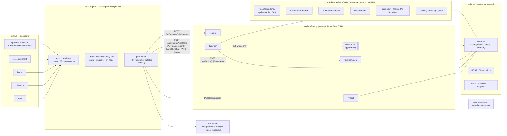
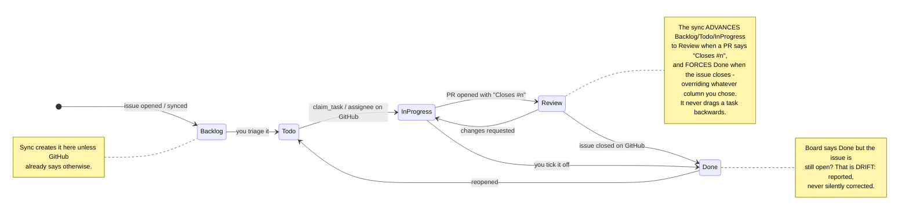

# KanbanFlow

> ## KanbanFlow is GitHub, visualized.
>
> **GitHub issues are the substrate for the work the world can see** — the items, their state,
> and their conversation. KanbanFlow **projects** them into a richer graph and adds what an
> issue tracker has no place for: dependencies, acceptance criteria, subtasks, agent claims,
> and memory.
>
> It is a **projection, not a mirror.** GitHub owns some fields; the board owns others; a few
> are derived. Which is which is spelled out in
> [Who owns what](#who-owns-what) — read that table before you trust either side.

| | |
|---|---|
| **Stack** | .NET 10 · Blazor Server · SQLite (EF Core 10) · Minimal APIs · Node 18+ for the MCP wrapper |
| **Surfaces** | 6 UI routes · 65 REST endpoints · 33 native MCP tools · 54 Node-wrapper MCP tools |
| **Sync** | **One-way**, GitHub → board. It **never writes to GitHub**. GitHub owns title, priority, milestone; the board owns dependencies, criteria, subtasks, claims, ordering, memory — see [Who owns what](#who-owns-what) |
| **Tests** | 1,160 xUnit · 56 in-app integration · 50 existing Playwright scenarios · 223 script tests · workflow transport/browser verification — [all local, no CI](#deliberate-non-features) |
| **Runs at** | `http://127.0.0.1:5123` — localhost only, no auth, no Docker, no cloud |
| **Log book** | [`docs/BACKLOG.md`](docs/BACKLOG.md) — the authoritative record of what happened |
| **Deep detail** | [`docs/ARCHITECTURE.md`](docs/ARCHITECTURE.md) |

Workflow surface counts and the full .NET/script suites were checked on September 6, 2026; other inventories retain their existing baseline. The commands that produced
them are in [Surfaces, verified](#surfaces-verified) — run them yourself; do not trust the
table alone.

---

## Contents

- [The thesis](#the-thesis)
- [How the sync works](#how-the-sync-works)
- [GitHub → KanbanFlow: the mapping](#github--kanbanflow-the-mapping)
- [Who owns what](#who-owns-what)
- [Known omissions](#known-omissions)
- [The task lifecycle](#the-task-lifecycle)
- [Runbook](#runbook) — [start](#0-start-the-app) · [onboard a repo](#1-onboard-a-new-repo) · [create an issue](#2-create-a-new-issue) · [sync](#3-run-a-sync) · [status & drift](#4-check-status-and-drift) · [log book](#5-read-the-log-book)
- [Surfaces, verified](#surfaces-verified)
- [What is audited — and what is not](#what-is-audited--and-what-is-not)
- [Deliberate non-features](#deliberate-non-features)
- [Install & run](#install--run)
- [Tests](#tests)
- [Docs](#docs)

---

## The thesis

For work that starts as a local idea, the [request workflow](docs/request-workflow.md) now connects the exact original ask to a refined brief, published cards and results inside these same boards. The GitHub import remains available for work that starts as an issue.

GitHub already holds the work: the issues, the milestones, the review conversations, the
closes. What it does not hold is a **picture**. `gh issue list` across six repos is 400 lines
of text with no shape — you cannot see what is in flight, what is blocked, or what to do next.
GitHub Projects gets closer, but it is a board *for humans clicking buttons*; an agent cannot
ask it "what should I work on, and why".

KanbanFlow does not ask you to move your work. It **projects** GitHub into a project knowledge
graph and gives that graph three surfaces:

1. **A board** — drag-and-drop kanban, project outline, and an ideas inbox. A filter bar over
   the board narrows it as you type — free-text over name and description, plus priority,
   assignee, claimed-by and hide-done, AND-combined and carried in the query string
   (`?q=&priority=&assignee=&claimedBy=&hideDone=`), so a filtered view survives a reload and
   pastes into chat as a link. Filtering never reorders anything: a drag under an active filter
   anchors on the next *visible* card's identity and the server resolves that against the full
   persisted column. For you.
2. **A REST API** — 60 endpoints over the same graph. For scripts.
3. **An MCP server** — the same capabilities as first-class agent tools, plus a direction
   engine that answers *"what next, and why"* with a human-readable reason. For agents.

The projection is deliberately **lossy in one direction and additive in the other**. GitHub
supplies the work items and their conversation; the board supplies the structure an issue
tracker cannot express — a cycle-guarded dependency DAG, acceptance-criteria checklists,
recursive subtasks, agent claims (`ClaimedBy` / `ClaimedAt`), ordering (`SortOrder`),
requirements, and a memory knowledge graph. **None of that has a GitHub representation.**
Editing an issue will never change a dependency edge or tick an acceptance criterion.

Three properties make it safe to point at a real portfolio:

- **GitHub is upstream.** The sync reads GitHub and writes the board. **It never writes to
  GitHub** — not a label, not a comment, not a status. Today the board→GitHub direction does
  not exist at all.
- **It advances your board, and overrides it in exactly one case.** Drag a task to
  `InProgress` and the sync leaves it there — *unless the issue is closed*, in which case the
  task is forced to `Done` regardless of where you put it
  (`syncTasks()` in `portfolio-sync.mjs`). The opposite disagreement — board `Done`, issue still
  open — is reported as **drift** and never touched (`driftDoneButOpen`). That asymmetry is the whole rule; the
  older "never overrides your status" phrasing was half true and has been corrected here.
- **It is idempotent.** Re-running converges instead of duplicating, with **no schema change** —
  the identity of every projected row is encoded in data GitHub already gave it.

---

## How the sync works



Every sync write goes over **REST**, never straight to SQLite — so the mutations the service
layer owns land in the audit trail like any other. (What that does and does not cover is
[spelled out below](#what-is-audited--and-what-is-not).)

The right-hand box is the part that makes this a projection rather than a mirror: those
entities are created by you and by agents doing real work, live only on the board, and are
invisible to GitHub.

The sync also **cannot** run over the native MCP server: the 28 native tools include
`list_projects` and `get_project_context` but **no `create_project`**, so an agent on `/mcp`
cannot onboard a repo. That parity gap is [#231](https://github.com/joelfuller2016/KanbanFlow-v2/issues/231).

---

## GitHub → KanbanFlow: the mapping

| GitHub concept | KanbanFlow entity | Idempotency key | Direction |
|---|---|---|---|
| Repo | `Project` | `<!-- github: owner/repo -->` marker in `Project.Description`; falls back to `Project.Name` == repo short name (case-insensitive) | GitHub → board |
| Milestone | `Feature` | `Feature.Name` == milestone title, within the project; issues with no milestone go to a feature literally named `Unsorted` | GitHub → board |
| Issue | `TaskItem` | the **`#<n>` title prefix followed by one space** — the space is part of the key (`/^#(\d+)\s/`) | GitHub → board |
| Issue labels (`P0`…`P3`, `priority:high`, `critical`, …) | `TaskItem.Priority` | — reconciled every run | GitHub → board (GitHub always wins) |
| Issue state + linked open PR | `TaskItem.Status` | — | GitHub → board, **advance-only** (see below) |
| Issue body | `TaskItem.Description` | `<!-- kanbanflow-sync -->` block + first 1500 chars | GitHub → board |
| Issue comment | `TaskComment` (`Comment`) | GitHub node id stamped as `<!-- gh:ID -->` | GitHub → board |
| PR conversation comment | `TaskComment` (`Comment`) | same `<!-- gh:ID -->` marker | GitHub → board |
| PR review, `APPROVED` | `TaskComment` (**`Verification`**) | same `<!-- gh:ID -->` marker | GitHub → board |
| PR review, `CHANGES_REQUESTED` | `TaskComment` (**`Blocked`**) | same `<!-- gh:ID -->` marker | GitHub → board |
| PR inline `file:line` review comment | `TaskComment` (`Comment`) | same `<!-- gh:ID -->` marker | GitHub → board |
| *(every task mutation the sync makes)* | `ActivityEvent` | — append-only | board-internal |
| *(nothing)* | — | — | **board → GitHub: never** |

**Status is deliberately asymmetric — and one row does override you.** On create it is derived
from GitHub (`closed` → `Done`; open + linked open PR → `Review`; open + assignee →
`InProgress`; else `Backlog`). On update:

| Condition | Action | Overrides a hand-set status? |
|---|---|---|
| issue closed, task ≠ `Done` | → `Done` | **Yes.** Whatever column you put it in, a closed issue forces `Done` (`syncTasks()` in `portfolio-sync.mjs`) |
| issue open, linked open PR, task ∈ {`Backlog`, `Todo`, `InProgress`} | → `Review` | Partly — it advances those three, and will not touch `Review` or `Done` |
| issue open, task = `Done` | **drift** — reported, not touched | No |
| task's issue is in neither the open nor the closed set | **drift** — deleted or transferred; never auto-deleted | No |
| anything else | leave the board alone | No |

> The frequently-repeated line *"the sync advances status but never overrides yours"* is **half
> true**. Row 1 is a genuine override. If you deliberately park a task in `Todo` while its issue
> is closed, the next sync will move it to `Done` and keep doing so.

**The two fragile keys.** Both are data, not decoration:

- Strip or edit the `#<n>` prefix (the number, then one space) on a task title and the task is orphaned — the next sync
  creates a duplicate. Rename the *issue*, not the task.
- Edit a mirrored comment's text and you strip its `<!-- gh:ID -->` marker — the next sync
  re-adds it as a duplicate. The marker is hidden where the body renders as Markdown
  (`MarkdownRenderer` sanitises HTML comments away) but **plainly visible in raw reads**:
  `GET /api/tasks/{id}/comments`, a `curl`, and any agent pulling the comment over MCP all
  see it.

A durable `Project.RepoUrl` and `TaskItem.IssueNumber` would replace both keys with real
columns — [#237](https://github.com/joelfuller2016/KanbanFlow-v2/issues/237).

Full semantics, including truncation warnings, comment sizing, and every drift case:
[`docs/GITHUB-SYNC.md`](docs/GITHUB-SYNC.md) and
[`.claude/skills/kanban-portfolio/reference/mapping.md`](.claude/skills/kanban-portfolio/reference/mapping.md).

---

## Who owns what

The single most useful table here. Before you edit a field, know which side wins.

| Field | Owner | What that means in practice |
|---|---|---|
| Task **title** | **GitHub** | Reconciled every run (`syncTasks()`). Rename the issue; renaming the task is undone — and stripping the `#<n>` prefix, the number followed by one space, orphans it |
| Task **priority** | **GitHub** | Reconciled every run (`syncTasks()`) from `P0`…`P3` / `priority:high` / bare severity labels. Setting it on the board is undone on the next sync |
| Task **status** | **Shared, GitHub-dominant** | You may move it freely, **except** that a closed issue forces `Done` (`syncTasks()`). Board `Done` + open issue is reported as drift, not corrected |
| Task **feature** (milestone) | **GitHub** | An issue's milestone change moves the task via `PATCH /api/tasks/{id}/feature` (`syncTasks()`) |
| Task **description** | **GitHub, once** | Written from the issue body **only at creation**, truncated to 1,500 chars. It is **never refreshed** — the update patch carries only name, priority, status |
| **Comments** | **GitHub, append-only** | Issue comments, PR conversation, PR reviews, and inline `file:line` comments are appended, deduped by node id. Board-authored comments are never pushed |
| **`ActivityEvent`** | **Derived** | Written by the service layer as a side effect of task writes. Never read from or sent to GitHub |
| `TaskDependency` (DAG) | **Board** | No GitHub representation. Authored by you and by agents |
| `AcceptanceCriterion` | **Board** | No GitHub representation |
| `Subtask` (recursive) | **Board** | No GitHub representation |
| `Requirement` | **Board** | No GitHub representation |
| `ClaimedBy` / `ClaimedAt` | **Board** | Agent coordination primitive. GitHub assignees do **not** populate it |
| `SortOrder` | **Board** | Your manual ordering within a column. Survives sync |
| Memory graph (`MemoryNode` / relations / observations) | **Board** | Entirely local |
| `Idea` inbox | **Board** | Pre-project capture; promotion creates a Project, never a repo |

The read-only **Decision & Memory Map** at `/memory` visualizes that board-owned graph without
copying it into another store. It defaults to the same Agent / `knowledge-graph` namespace used by
the native MCP memory tools, classifies the tools' free-form `entityType` tags into readable lanes,
and provides both a relationship map and an accessible list/detail view. The UI only reads records
deliberately stored in the graph; it does not request, infer, or reconstruct model-hidden reasoning.
Capture clients must never write private scratchpads or secrets into this open local store. The read
service returns at most 900 source nodes; the UI then bounds one view to 80 nodes, 320 unique directed
edges, and 50 observations per selected record, with explicit warnings whenever a view is incomplete.

**Derived, not owned by either side:** task status *on create* (computed from issue state +
linked PR + assignee presence), the `Feature` named `Unsorted` (synthesised for issues with no
milestone), the `<!-- kanbanflow-sync -->` description block, and `isBlocked` /
`openBlockerCount` (computed from the board-owned dependency DAG at read time).

---

## Known omissions

What the sync **does not** do. Each of these is verified behaviour, not speculation — an agent
that assumes otherwise will be wrong.

| Omission | Detail |
|---|---|
| **Issue body is never refreshed** | Written once at task creation, truncated at `BODY_EXCERPT_LIMIT = 1500` (`portfolio-sync.mjs`). Edit an issue body and the board keeps the original excerpt forever |
| **Closed issues are fetched as numbers only** | Without `--include-closed` the sync pulls only issue *numbers* for closed issues (`fetchClosedIssues(repo, full)`), enough to converge a task to `Done` — their bodies and comments are not mirrored |
| **Assignees are not synchronised** | GitHub assignees are read once, only to infer `InProgress` on create (`deriveStatus()`). `TaskItem.Assignee` is never populated from GitHub |
| **Labels collapse to one priority** | The first matching severity label becomes `TaskItem.Priority`. Every other label survives only as text inside the description block — there is no label entity, and no filtering by label on the board |
| **Comment edits, deletions, and reactions are never reconciled** | Dedupe is by GitHub node id; an id already seen is skipped forever. An edited GitHub comment keeps its original mirrored text, and a deleted one stays on the board |
| **PR comments on a PR that closes no issue are dropped** | With no `Closes #n` there is no task to attach them to. They are counted and reported, never silently discarded |
| **Inline review comments cost one API call per PR** | Fetched via `gh api repos/{repo}/pulls/{n}/comments`. A failure is reported and sets a non-zero exit code — the board is explicitly flagged incomplete rather than looking whole |
| **Fetches are capped per list** | `GH_PAGE_LIMIT` defaults to `2000` (`KANBANFLOW_GH_PAGE_LIMIT` overrides it). Hitting the cap is a hard failure, not a warning — a count derived from a partial read is worse than no count |
| **No board → GitHub write path exists** | The sync creates nothing on GitHub — not an issue, not a comment, not a label. A task created on the board has no issue and will be reported as drift |
| **Board-owned structure never round-trips** | Dependencies, acceptance criteria, subtasks, requirements, claims, ordering, and memory have no GitHub equivalent. See [Who owns what](#who-owns-what) |
| **Milestones are flattened** | Features are created flat; GitHub milestones are not hierarchical, so the recursive-feature capability is unused by the sync |
| **Project ↔ repo link has no dedicated column** | There is still no `RepoUrl` column ([#237](https://github.com/joelfuller2016/KanbanFlow-v2/issues/237)), but the link is durable anyway: a `<!-- github: owner/repo -->` marker in `Project.Description` is the primary key, so a **marker-linked project survives a rename**. Short-name matching remains as a legacy fallback, and a hand-made project matching a repo short name is still adopted (and then stamped with a marker) on the next `onboard` |

---

## The task lifecycle

A card's column *is* its status. Five things can change it — dragging, the done checkbox, REST,
MCP, and the next sync after the issue closes. The first four are yours; the fifth can
overrule them, in the one case noted below.



A task with an unfinished dependency is **blocked**: excluded from `next-tasks`
recommendations and flagged `isBlocked` / `openBlockerCount` in step context. Those
dependencies are **board-owned** — GitHub has no equivalent, so blocking is something the
board knows and the issue tracker cannot. The direction engine ranks what is left by priority,
then status, then oldest-updated, and hands back a human-readable `reason` per pick.

---

## Runbook

Everything below was executed as written on Windows 11 / PowerShell 7 with Git Bash available.
Commands are portable except where noted; `smoke-api.ps1` and `verify.ps1` are PowerShell.

### 0. Start the app

```powershell
dotnet run --project src/KanbanFlow/KanbanFlow.csproj --urls http://127.0.0.1:5123
```

SQLite creates itself on first run with seed data. No setup, no Docker, no accounts.

> **Use `--urls http://127.0.0.1:5123`.** The launch profile defaults to `:5148`, but the MCP
> wrapper, `smoke-mcp.mjs`, `portfolio-sync.mjs`, and `portfolio-standup.mjs` all default to
> `:5123`. Standardising the profile on `:5123` is on the roadmap; until then pass the flag or
> set `KANBANFLOW_API_URL` to match.

Confirm it is up:

```bash
curl -s http://127.0.0.1:5123/api/admin/health
# {"status":"ok","app":"KanbanFlow","startedAtUtc":"2026-08-02T22:26:22.1897449Z",
#  "checkedAtUtc":"2026-08-02T22:26:30.7731684Z","runtime":".NET 10.0.10",
#  "openApiUrl":"/openapi.json"}
```

**Which database it opened.** The app names the file it is using, on every boot:

```text
info: KanbanFlow[0]
      [db] kanbanflow.db -> C:\...\src\KanbanFlow\kanbanflow.db (source=probe, existing=true)
```

`source` says how the file was chosen — `env` (`KANBANFLOW_DB_PATH` was set), `probe` (an existing
`kanbanflow.db` was found) or `default` (none existed anywhere, so this is a new database). The same line
appears on the Settings page. Resolution order, with `KANBANFLOW_DB_PATH` unset: the directory the
app was launched from, then the content root, then the application's own directory — the first one
that already holds a `kanbanflow.db` wins, and if nothing does, one is created beside the
application. That last step is what makes the location independent of where you started the app
from; if a second `kanbanflow.db` exists at another candidate, a warning names it rather than
silently opening an empty board (#354).

Custom database location — this override wins over every candidate above:

```powershell
$env:KANBANFLOW_DB_PATH = "C:\path\to\my-projects.db"
dotnet run --project src/KanbanFlow/KanbanFlow.csproj --urls http://127.0.0.1:5123
```

### 1. Onboard a new repo

Onboarding *is* the first sync. There is no separate "create project" step — point the sync at
a repo and it creates the `Project`, the milestone `Feature`s, and every issue as a `TaskItem`.

Requires an authenticated [`gh` CLI](https://cli.github.com/) (`gh auth status` to check).

```bash
# 1. See exactly what would be written. Mutates nothing.
node scripts/portfolio-sync.mjs --dry-run --repos joelfuller2016/KanbanFlow-v2

# 2. Happy with the plan? Run it for real.
node scripts/portfolio-sync.mjs --repos joelfuller2016/KanbanFlow-v2
```

**`onboard` is the explicit version of step 2's first half.** It resolves (or creates) the
`Project` for a repo and stamps the durable `<!-- github: owner/repo -->` marker into
`Project.Description` — including onto a legacy project that was previously linked by name
alone. It is safe to re-run:

```bash
node scripts/portfolio-sync.mjs onboard joelfuller2016/KanbanFlow-v2
```

To onboard several at once, or to make a repo set the default for every later run:

```bash
node scripts/portfolio-sync.mjs --repos owner/alpha,owner/beta,owner/gamma
```

```powershell
$env:KANBANFLOW_PORTFOLIO_REPOS = "owner/alpha,owner/beta"
node scripts/portfolio-sync.mjs
```

> **Run `--dry-run` first on a board that already has hand-made projects.** A project whose
> name happens to equal a repo's short name **will be adopted** by the sync — short-name
> matching is the fallback the durable marker does not replace, because a project that predates
> the marker has nothing else to match on. Once adopted (or onboarded) it carries a marker and
> the name stops mattering: rename it freely. [#237](https://github.com/joelfuller2016/KanbanFlow-v2/issues/237)
> would replace the marker with a real column, but the link is no longer waiting on it.

### 2. Create a new issue

Create it **on GitHub** — that is the substrate. The board is downstream.

```bash
gh issue create --repo joelfuller2016/KanbanFlow-v2 \
  --title "Board should show the linked PR on a task card" \
  --body  "Objective / Requirements / Goals (AC) / Plan — see docs/issue-quality-checklist.md" \
  --label "P2,enhancement" \
  --milestone "M5: Docs & Process"
```

Then bring it onto the board:

```bash
node scripts/portfolio-sync.mjs --repos joelfuller2016/KanbanFlow-v2
```

The new issue arrives as a `TaskItem` titled `#<n> <issue title>`, filed under the milestone's
`Feature` (or `Unsorted`), with priority from the `P2` label and status `Backlog`.

Repo issue templates live in [`.github/ISSUE_TEMPLATE/`](.github/ISSUE_TEMPLATE); what a
well-formed issue contains is in [`docs/issue-quality-checklist.md`](docs/issue-quality-checklist.md).

> **Tasks created *on the board* stay on the board.** The sync is one-way, so a board-only task
> has no issue and will be reported as drift on the next run. Use the board for triage and
> annotation; use GitHub to create work.

### 3. Run a sync

```bash
# Default repo set (or $KANBANFLOW_PORTFOLIO_REPOS), full comment mirroring.
node scripts/portfolio-sync.mjs

# Also mirror closed issues as Done tasks.
node scripts/portfolio-sync.mjs --include-closed

# Skip comment mirroring — much faster on repos with heavy bot review threads.
node scripts/portfolio-sync.mjs --no-comments

# Cap each mirrored comment (a single CodeRabbit review has measured 110,574 chars).
node scripts/portfolio-sync.mjs --max-comment-chars 4000

# Label the audit trail so you can tell this run apart later.
node scripts/portfolio-sync.mjs --actor nightly-sync

node scripts/portfolio-sync.mjs --help
```

The run prints a plan line per write, then a summary. Onboarding this repo from an empty
board produced:

```text
── summary ──
projects created: 1
features created: 8
tasks created:    100
tasks updated:    0
tasks moved:      0
tasks unchanged:  0
comments mirrored: 404
comments existing:   0

  ! biggest comment: 110,574 chars from coderabbitai on #149.
    Mirrored whole. Use --max-comment-chars N to cap it (agents reading this task over MCP pay for it).
```

**A second consecutive run creates nothing** — that is the idempotency contract. Immediately
re-running the same command gave:

```text
── summary ──
projects created: 0
features created: 0
tasks created:    0
tasks updated:    0
tasks moved:      0
tasks unchanged:  100
comments mirrored:   0
comments existing: 404
```

If a re-run keeps creating tasks, a `#<n> ` title prefix has been edited off.

### 4. Check status and drift

Three questions, three commands.

**"Is it safe to act on this board right now?"** — `status`. This is the dedicated health check:
read-only, and it answers with an **exit code** so a script or an agent can gate on it rather
than parsing prose.

```bash
node scripts/portfolio-sync.mjs status && echo "safe to act"
node scripts/portfolio-sync.mjs status --repos joelfuller2016/KanbanFlow-v2
```

| Exit | Meaning |
|---|---|
| `0` | Clean **and complete** — everything was read, and nothing disagrees |
| `1` | Confirmed drift. With `--strict`, also pending work, unsynced tasks, or a non-durable link |
| `2` | **Incomplete or error** — a repo could not be read, or a fetch hit its item bound |

Exit `2` dominates `1`: "I could not see everything" is a different answer from "I looked and it
is clean", and a drift count computed over a partial read is worse than no count at all. See
[`docs/GITHUB-SYNC.md`](docs/GITHUB-SYNC.md) for the full contract — including the fact that
`status --actor <name>` reports "last sync" only for syncs run under that **same** `--actor`.

**"Is the board still in agreement with GitHub?"** — the drift block at the end of any sync,
including a dry run:

```bash
node scripts/portfolio-sync.mjs --dry-run
```

```text
── drift (2) — board and GitHub disagree ──
  ! owner/repo#144: board says Done, issue is still open — https://github.com/owner/repo/issues/144
  ! owner/repo: task "#98 Old thing" has no matching issue #98 on GitHub (deleted or transferred?)
```

Drift is never auto-resolved. Close the issue, or move the card — the sync will not choose for
you, and it never deletes a task (the audit trail is sacred).

**"What is actually going on across everything?"** — the standup. Read-only; writes nothing,
anywhere. It rolls each project to one row, asks the direction engine what matters, and
overlays live GitHub state (open PRs, PRs stale without review >3 days, tasks parked
`InProgress` >14 days):

```bash
node scripts/portfolio-standup.mjs
node scripts/portfolio-standup.mjs --repos joelfuller2016/ZeroRouter
node scripts/portfolio-standup.mjs --help
```

Or ask an agent, over MCP, per project:

```text
get_next_tasks(projectId: 1, limit: 5)   → ranked picks, each with a reason
get_step_context(taskId: 42)             → everything needed to act on one task
```

### 5. Read the log book

**[`docs/BACKLOG.md`](docs/BACKLOG.md) is the authoritative log book** — the durable, ordered
record of what was decided and what happened. Read it before starting work; it answers "why is
this the way it is" faster than any query.

The live equivalents, when you need the current state rather than the history:

```bash
# Every recorded mutation on a project, newest first (limit clamped to 500).
curl -s "http://127.0.0.1:5123/api/projects/1/activity?limit=50"

# One task's history.
curl -s "http://127.0.0.1:5123/api/tasks/42/activity"

# One task's full context: description, criteria, subtasks, dependencies,
# comments (including every mirrored GitHub comment), and recent activity.
curl -s "http://127.0.0.1:5123/api/tasks/42/context"
```

In the browser, open a project at `/project/{id}` and click any card — the detail panel carries
the same comment stream and history.

---

## Surfaces, verified

[Issue #277](https://github.com/joelfuller2016/KanbanFlow-v2/issues/277) exists because this
README under-reported its own surface. Each number below was re-derived for this revision by
the command beside it — not copied from the previous README, and not copied from the issue.

| Surface | Count | Command that produced it |
|---|---:|---|
| REST endpoints (app) | 55 | `grep -cE '\.Map(Get\|Post\|Put\|Patch\|Delete)\(' src/KanbanFlow/ApiEndpoints.cs` |
| REST endpoints (admin) | 5 | `grep -cE '\.Map(Get\|Post\|Put\|Patch\|Delete)\(' src/KanbanFlow/AdminEndpoints.cs` |
| Workflow REST endpoints | 5 | `rg -c '\.Map(Get\|Post)\(' src/KanbanFlow/WorkflowEndpoints.cs` |
| **REST endpoints total** | **65** | *sum of the three above* |
| Native MCP tools (`POST /mcp`) | 33 | Actual native `tools/list`; see `scripts/smoke-workflow.mjs` |
| Node-wrapper MCP tools | 54 | Actual stdio `tools/list`; see `scripts/smoke-workflow.mjs` |
| Blazor routes | 6 | `grep -rn '@page' src/KanbanFlow/Components/ \| sort -u` → `/`, `/Error`, `/ideas`, `/memory`, `/project/{Id:int}`, `/settings` |
| Razor components | 37 | `find src/KanbanFlow/Components -name '*.razor' \| wc -l` |
| xUnit tests | 1,160 | `dotnet test tests/KanbanFlow.Tests` |
| In-app integration tests | 56 | `grep -c 'results.Add(await RunTest' src/KanbanFlow/Services/TestRunnerService.cs` (28 API + 22 service + 6 UI) |
| Playwright e2e scenarios | 50 | `npm run test:ui` |
| Script unit tests (`scripts/*.mjs`) | 223 | `npm run test:scripts` |

Historical inventory corrections from the original README revision: **53 → 60** endpoints (both memory
endpoints and `GET /api/tasks/{id}/context` were missing from the route list entirely);
**41 → 50** wrapper tools; native tool count stated for the first time (**24**); in-app suite
**40 → 56**; and `GET /api/subtasks/{id}`, `GET /api/acceptance-criteria/{id}`,
`GET /api/requirements/{id}` were listed as existing — **they do not exist**. The route map in
[`docs/ARCHITECTURE.md`](docs/ARCHITECTURE.md#rest-surface-65-endpoints) now marks them.

Also corrected: `#82`, `#83`, `#85`, `#88`, and `#89` were all cited as open/broken. All five
are **closed**, and the code enforces what they asked for.

---

## What is audited — and what is not

Every mutation *should* write an immutable `ActivityEvent`. **It does not yet.** The previous
README called this "non-negotiable ✅ for REST"; that was not true, and an agent that trusts a
partial history draws wrong conclusions. Here is the real coverage:

| Entity | Create | Update | Delete | Writes `ActivityEvent`? |
|---|:--:|:--:|:--:|---|
| `TaskItem` (incl. status, claim, release, reassign) | ✅ | ✅ | ✅ | **Yes** — via `ITaskService`, in one `SaveChanges` |
| `TaskComment` (add) | ✅ | — | ❌ | **Yes** on add via `ITaskService`; **no** on `DELETE /api/comments/{id}` |
| `Idea` (incl. promote) | ✅ | ✅ | ✅ | **Yes** — via `IIdeaService` |
| `Project` | ✅ | ✅ | ✅ | **Delete only.** Create and update write raw EF |
| `Requirement` | ✅ | ✅ | ✅ | **Assign only** (`PATCH /assign`). Create, update, delete write raw EF |
| `Feature` | ✅ | ✅ | ✅ | **No** |
| `Subtask` | ✅ | ✅ | ✅ | **No** |
| `AcceptanceCriterion` | ✅ | ✅ | ✅ | **No** |
| `TaskDependency` | ✅ | — | ✅ | **No** |

The mechanical evidence — the entire REST layer has exactly one inline audit call site:

```bash
grep -n 'AddActivityEvent(' src/KanbanFlow/ApiEndpoints.cs
# 2247:  AddActivityEvent(..., "RequirementAssigned", ...)   <- the only call
# 2364:  private static void AddActivityEvent(...)           <- the helper itself
```

Closing this is [#149](https://github.com/joelfuller2016/KanbanFlow-v2/issues/149) (extend
`ActivityEvent` to all entities). Two related issues are **already closed** and should not be
cited as gaps: [#88](https://github.com/joelfuller2016/KanbanFlow-v2/issues/88) routed UI
mutations through the shared service layer, and
[#85](https://github.com/joelfuller2016/KanbanFlow-v2/issues/85) made the audit log survive
entity deletion. [#302](https://github.com/joelfuller2016/KanbanFlow-v2/issues/302) tracks the
REST edge layer re-declaring policy the service layer already owns.

**What you can rely on today:** task and idea history is complete and identical across UI,
REST, and MCP, and it survives deletion. **What you cannot:** the shape of the graph around a
task — its features, subtasks, criteria, and dependencies — has no history at all.

---

## Deliberate non-features

These are settled charter decisions, not backlog items. Proposals to add them have been
filed and rejected; please read the linked issue before filing another.

| Not here | Why |
|---|---|
| **No CI / no GitHub Actions** | Single-trust-boundary, local-first tool. The gate is [`scripts/verify.ps1`](scripts/verify.ps1), run before every push, plus externally-scheduled [`scripts/pr-ci.ps1`](scripts/pr-ci.ps1) and [`scripts/master-health.ps1`](scripts/master-health.ps1) — same build + tests, no workflow file. See [`docs/ci-without-actions.md`](docs/ci-without-actions.md). |
| **No authentication or authorisation** | One machine, one owner, one agent. There is no second principal to authorise against. |
| **No Docker** | One SQLite file and `dotnet run`. A container adds a layer and removes nothing. |
| **No HTTPS, CORS lock, loopback pin, or rate limiting** | **Open access by design** — trust the network. [#169](https://github.com/joelfuller2016/KanbanFlow-v2/issues/169) removed the last host lock; [#84](https://github.com/joelfuller2016/KanbanFlow-v2/issues/84) and [#161](https://github.com/joelfuller2016/KanbanFlow-v2/issues/161) are the rejected hardening proposals. |
| **No multi-tenancy** | One database, one user. Per-project ownership scoping is not a goal. |
| **No real-time multi-human collaboration** | Single-user UX. Refresh on demand. |
| **No notifications** | The agent is the integration. |
| **No board → GitHub writes** | The whole safety argument rests on this. A sync that can write to GitHub is a sync that can corrupt the source of truth. |
| **No mobile-first UI** | Desktop primary; existing responsive work is a courtesy, not a target. |

If you need something in the right-hand column, this is not the tool.

---

## Install & run

```powershell
git clone https://github.com/joelfuller2016/KanbanFlow-v2.git
cd KanbanFlow-v2
dotnet run --project src/KanbanFlow/KanbanFlow.csproj --urls http://127.0.0.1:5123
# open http://127.0.0.1:5123
```

Prerequisites: **.NET 10 SDK**. For the sync and MCP wrapper: **Node 18+** and an authenticated
**`gh` CLI**. For the browser e2e suite: `npm install` then `npx playwright install chromium`.

Client-side libraries (Bootstrap, SortableJS) are vendored under `wwwroot/lib` and pinned in
`libman.json`:

```powershell
dotnet tool install -g Microsoft.Web.LibraryManager.Cli   # once
libman restore                                            # fetch the pinned versions
libman update bootstrap                                   # bump one
```

Optional: KanbanFlow can talk to an OpenAI-compatible LLM endpoint and an embedding endpoint
(both **fail-soft** — unreachable means a typed error result, never a 500). Configuration and
self-test endpoints: [`docs/ARCHITECTURE.md`](docs/ARCHITECTURE.md#optional-llm--embedding-configuration).

### Claude Code skills

Two skills ship in `.claude/skills/`. Pick by scope.

| Skill | Answers | Use when |
|---|---|---|
| [`kanban-project-ops`](.claude/skills/kanban-project-ops/SKILL.md) | *"What do I do next **in this project**, and how do I record it?"* | Working a task: `get_next_tasks` → `get_step_context` → `claim_task` → do it → `add_task_comment` → `update_task_status`. |
| [`kanban-portfolio`](.claude/skills/kanban-portfolio/SKILL.md) | *"What am I working on **across everything**?"* | Status, standups, "what's in flight", "what am I forgetting" — across more than one repo. Or when the board looks empty. |

---

## Tests

All local. There is no CI — [on purpose](#deliberate-non-features).

```powershell
./scripts/verify.ps1                    # the gate: restore + build (warnings=errors) + test + format
```

```bash
dotnet test tests/KanbanFlow.Tests      # 980 xUnit tests
```

```powershell
./scripts/smoke-api.ps1                 # boots its own app on a free loopback port,
                                        # ~75 HTTP calls including negative paths
```

```bash
node ./scripts/smoke-mcp.mjs 1          # MCP tool surface — needs the app running on :5123
npm run test:mcp                        # stdio framing A/B + the MCP smoke suite
npm run test:scripts                    # node:test units for scripts/*.mjs — the shared
                                        # priority model behind portfolio-sync and the
                                        # log book (#360). No app, no network, no DB.
npm run test:ui                         # Playwright e2e — builds, boots an isolated instance
                                        # (fixed port 5198 + throwaway DB), drives chromium, tears down
```

> **`test:ui` binds a fixed port (`5198`).** Two concurrent runs — two agents, or you and an
> agent — share that port but get *separate* throwaway databases, so one run's API calls land on
> the other's app and fail as `Feature <n> not found` rather than as a port clash. Override with
> `UI_E2E_PORT=<free port> npm run test:ui` when anything else might be running the suite.

```bash
# The in-app integration suite, from inside the live app.
# Also available as "Run all" at /settings.
curl -X POST "http://127.0.0.1:5123/api/admin/run-tests?suite=all"   # suite=api|ui|service|all
```

Build and tests are the hard gates in `verify.ps1`. The **format check is advisory** — it
prints a warning and lets the run continue, pending a one-time `dotnet format` cleanup of the
existing tree.

On a clean build + test run, `verify.ps1` exits **0** even when the formatter prints its advisory
warning. It exits **1** on a hard restore/build/test failure. Keep the advisory in the run record;
do not misreport it as a product-test failure or ignore it as nonexistent drift.

Feature-level test contracts and immutable execution records live in
[`docs/test-cases/`](docs/test-cases/). They complement the executable tests; they do not replace
them.

---

## Docs

| Doc | What it holds |
|---|---|
| [Requests, plans and results](docs/request-workflow.md) | Use the existing app and boards for original requests, briefs, real task cards, MCP updates, reviewed reports and conclusions |
| [Central project board implementation specification](docs/plans/central-project-board-implementation.md) | Detailed issue checklist, four diagrams, existing-versus-new behavior, acceptance checks and explicit later Codex work |
| [Central project board proposal](docs/plans/central-project-board.md) | Product direction, the same-board constraint and the proposed Codex execution path |
| [`docs/BACKLOG.md`](docs/BACKLOG.md) | **The log book.** Authoritative record of what happened and why. Start here. |
| [`docs/ARCHITECTURE.md`](docs/ARCHITECTURE.md) | Entity model, write path, full REST route map, MCP inventory, capability matrix, known gaps |
| [`docs/GITHUB-SYNC.md`](docs/GITHUB-SYNC.md) | Full sync semantics, drift cases, comment mirroring |
| [`.claude/skills/kanban-portfolio/reference/mapping.md`](.claude/skills/kanban-portfolio/reference/mapping.md) | GitHub → board mapping in full, with the reasoning |
| [`docs/ci-without-actions.md`](docs/ci-without-actions.md) | How the quality gate runs with no workflow file |
| [`docs/issue-quality-checklist.md`](docs/issue-quality-checklist.md) | What a well-formed issue contains |
| [`docs/test-cases/`](docs/test-cases/) | Feature-level test contracts, traceability, and commit-pinned execution records |
| [`docs/native-mcp-notes.md`](docs/native-mcp-notes.md) | Native in-process MCP implementation notes |
| [`docs/ai-briefing-schema.md`](docs/ai-briefing-schema.md) | The agent briefing payload shape |
| [`docs/requirements.md`](docs/requirements.md) | Original v1 requirements — partly superseded by `ARCHITECTURE.md` |
| [`docs/reviews/`](docs/reviews) | Historical review notes |

> `docs/BACKLOG.md` and `docs/GITHUB-SYNC.md` are authored on sibling branches and land with
> them; on a branch that has only this README the two links will 404 until those merge.

---

## License & contributing

Licensed under the [MIT License](LICENSE).

Single-developer project. Issues use the templates under
[`.github/ISSUE_TEMPLATE/`](.github/ISSUE_TEMPLATE), PRs follow
[`.github/PULL_REQUEST_TEMPLATE.md`](.github/PULL_REQUEST_TEMPLATE.md), and
`./scripts/verify.ps1` must pass before pushing. If you fork it, the data model is small enough
to skim in an afternoon — start with `src/KanbanFlow/Models/`, then `Data/AppDbContext.cs`,
then `ApiEndpoints.cs`.
