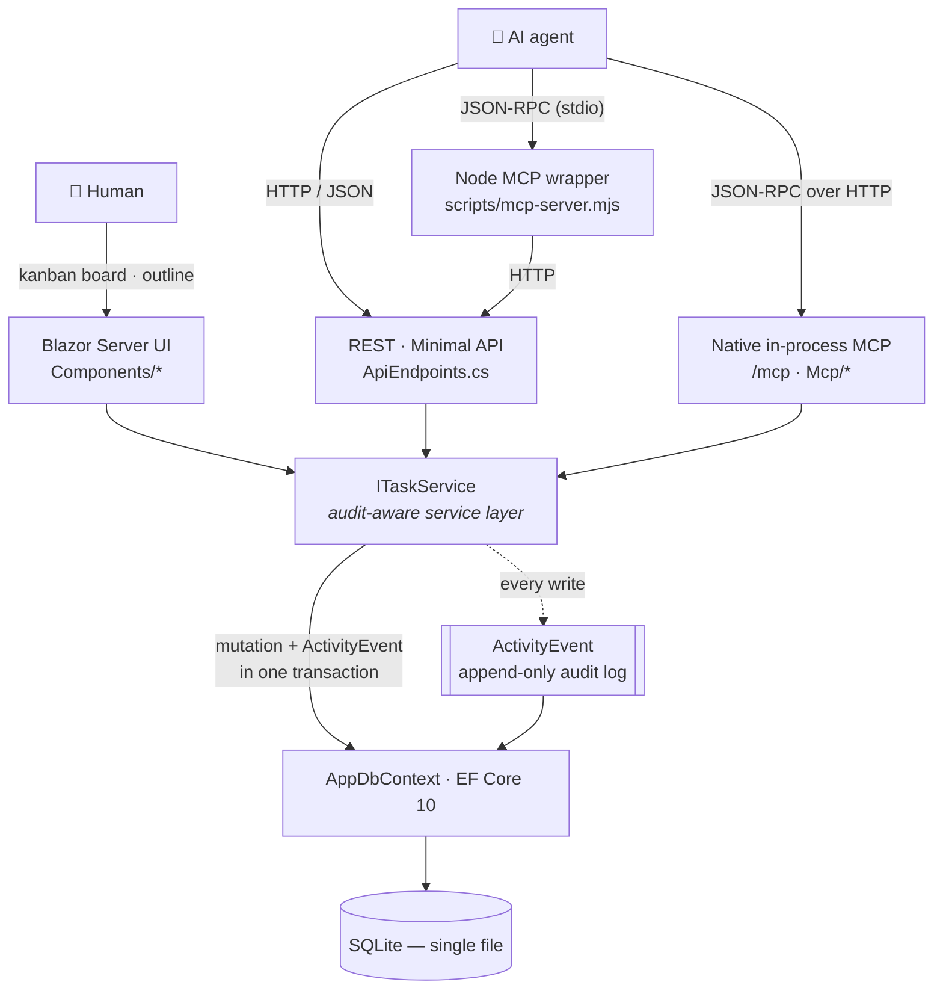
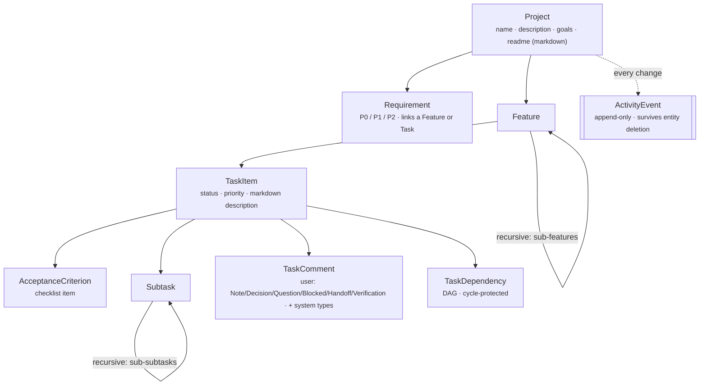
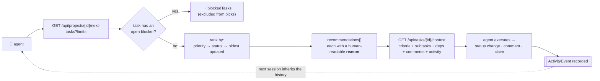
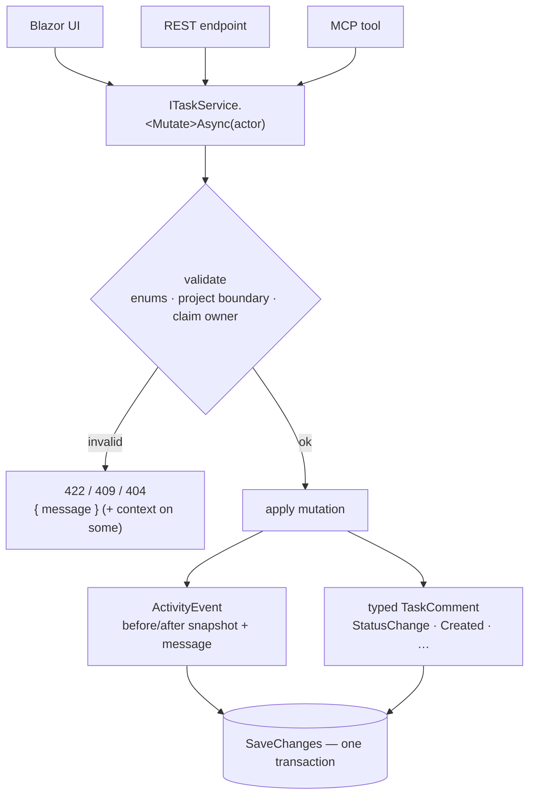
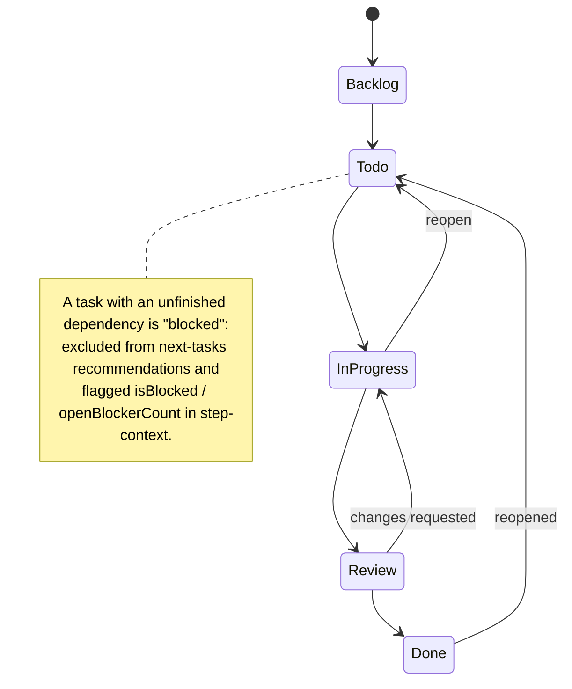

# KanbanFlow v2

> **An AI-first project knowledge graph that's equally a human kanban board and an agent API.**
> .NET 10 · Blazor Server · SQLite · REST + MCP · local-first · no auth · no Docker

**Designed for AI agents to read, write, and navigate structured project knowledge — and to be told *what to work on next, with the context they need to do it*.** Humans use the kanban UI; agents use the REST API and MCP server. It's not a kanban app with an API bolted on — the board is one view of a project knowledge graph that is equally exposed as REST + MCP.

## In one minute

- **What:** a single-file (.NET 10 + SQLite) app where a project — its features, tasks, subtasks, requirements, acceptance criteria, decisions, and dependencies — is structured data.
- **For humans:** a drag-and-drop kanban board + project outline.
- **For agents:** the *same* data over a REST API and an MCP server, plus a `next-tasks` engine that answers "what should I work on next?" with reasoning.
- **Guarantee:** every **task** mutation (human *or* agent) writes an immutable `ActivityEvent` — full-entity audit coverage is landing via the service-layer work (#88) — so agents inherit the causal history.
- **Scope:** local-first, single-user, single-trust-boundary (agent + owner on one machine). No auth, no multi-tenancy, no cloud.

---

## The problem it solves

AI coding agents are good at *executing* a well-scoped task but bad at knowing **what to do next, and why**. The state that answers those questions — goals, decisions, what's blocked, what changed and when — is scattered across chat logs, code comments, and a human's head. None of it is queryable by an agent, so:

- Agents **re-derive context** from scratch every session, expensively and unreliably.
- The **causal history of decisions is lost** — a new agent can't see *why* a previous one did something.
- Humans and agents **drift**: there's no shared, authoritative picture of project state.
- Traditional PM tools (Jira, Linear, Trello) are built for **humans clicking buttons** — their APIs are afterthoughts, and none of them can hand an agent "the exact context needed to act on this task."

**KanbanFlow v2 makes project state a first-class, agent-native knowledge graph.** Every entity is structured documentation reachable over REST + MCP; a direction engine ranks the next tasks with human-readable reasoning and bundles everything needed to execute; and an append-only audit trail records every mutation so agents and humans share one source of truth. The kanban board is just the human's view of that graph.

---

## Vision

KanbanFlow v2 does three things:

1. **Documents.** Every project, feature, task, subtask, criterion, requirement, comment, and activity event is structured documentation. The repo *is* the documentation.
2. **Directs.** Given a project, the API answers "what should I work on next?" with reasoning, dependencies expanded, and full context bundled in one call.
3. **Records.** Every change — by human or agent — produces an immutable activity event. Future agents have the full causal history.

A kanban board is a side effect of the data model, not the point.

## What it is, what it isn't

✅ A documentation-rich project structure that AI agents can read, write, and navigate
✅ A workflow engine that answers "what's next?" with reasoning + the context needed to execute
✅ A local, single-trust-boundary tool — designed for agent + owner on one machine
✅ A complete audit trail of every project change

❌ Not multi-tenant, not authenticated, not production-deployable beyond `localhost`
❌ Not a replacement for code repos, design tools, or chat — it complements them
❌ Not a real-time collaboration tool (no SignalR-driven multi-user editing)

If you need any of the things in the right column, this isn't the tool.

---

## Quick Start

```powershell
# Start the app (recommended — fixed URL agents can rely on)
$env:ASPNETCORE_ENVIRONMENT = "Development"
dotnet run --project src/KanbanFlow/KanbanFlow.csproj --urls http://127.0.0.1:5123
# Open http://127.0.0.1:5123
```

The app uses SQLite. The database file is created on first run with seed data — no setup, no Docker, no accounts.

To use a custom database location:

```powershell
$env:KANBANFLOW_DB_PATH = "C:\path\to\my-projects.db"
dotnet run --project src/KanbanFlow/KanbanFlow.csproj --urls http://127.0.0.1:5123
```

> **Note on URL.** The launch profile defaults to `http://localhost:5148`, but the MCP wrapper and smoke tests assume `http://127.0.0.1:5123`. Use the `--urls` flag above (or set `KANBANFLOW_API_URL` to match) to keep everything aligned. Standardising on `:5123` is on the roadmap.

### Tests (all local — no CI)

```powershell
# In-app integration suite (40 tests) — click "Run all" at /settings, or hit the running app
# (match the port you launched with — the launch profile defaults to :5148, Quick Start uses :5123):
curl -X POST "http://127.0.0.1:5123/api/admin/run-tests?suite=all"   # suite=api|ui|service|all

./scripts/smoke-api.ps1                 # ~50 HTTP calls against an ephemeral DB
node ./scripts/smoke-mcp.mjs 1          # exercises the MCP tool surface (needs the app running)
npm run test:ui                         # Playwright browser e2e: New Project + add-task modals,
                                        # board render, status auto-placement, Settings "Run all"
```

The in-app suite runs real integration tests from inside the live app (API hits the REST
surface, UI renders Razor routes via SSR, Service exercises `ITaskService` + the audit-log
contract). `npm run test:ui` builds, boots an isolated instance (scratch port + throwaway DB),
drives chromium, and tears down. First run needs `npm install` + `npx playwright install chromium`.

### Before you push

```powershell
./scripts/verify.ps1                    # restore + build (warnings=errors) + test  (+ format, advisory)
```

**There is no CI** (single-trust-boundary, local-first by design), so `verify.ps1` is the quality gate — run it before every push. Build + tests are hard gates; the **format check is advisory** (it reports drift but doesn't fail the run), pending a one-time `dotnet format` cleanup of the existing tree.

Client-side libraries (Bootstrap, SortableJS) are vendored under `wwwroot/lib` and pinned in `libman.json`. To restore or update them:

```powershell
dotnet tool install -g Microsoft.Web.LibraryManager.Cli   # once
libman restore                                            # fetch the pinned versions
libman update bootstrap                                    # bump a library
```

---

## Architecture



**Single project, single assembly, single SQLite file.** The simplicity is the feature. The **service layer (`ITaskService`) is the one audit boundary** — UI, REST, and the native MCP all route mutations through it so an `ActivityEvent` is produced once and applied everywhere (this is the #88 guarantee; the Node MCP wrapper reaches it via REST).

### Entities



Every text field on every entity is documentation that agents can retrieve, summarise, or update. Feature trees, subtask trees, and the dependency graph are all cycle-protected.

---

## Workflows

### 1. "What should I work on next?" — the direction engine

The whole point of the system: an agent asks for direction and gets a ranked, dependency-aware list with reasoning, then pulls one task's full context and acts — leaving an audit trail the *next* agent inherits.



### 2. Every change is audited — the #88 guarantee

There is one write path by design. Whether a mutation originates in the Blazor UI, a REST call, or an MCP tool, it flows through `ITaskService`, which validates, applies the change, and records an `ActivityEvent` (+ a typed comment) **in a single transaction** — so every surface produces identical audit history. (The UI reroute lands with the service-layer extraction, #88.)



### 3. Task lifecycle & dependency blocking

Cards are placed on the board by their status; changing status (drag-drop, the done checkbox, or an API/MCP call) re-groups the card. A task with an unfinished dependency is **blocked** and held out of `next-tasks` until its blocker is `Done`.



---

## Requirements

Requirements are organised by **capability**, not by entity. Every capability must be reachable from both REST and MCP.

### C-1. Read everything

| # | Requirement |
|---|-------------|
| R-1.1 | Agents can list and get every entity: project, feature, task, subtask, acceptance criterion, requirement, dependency, comment, activity event. |
| R-1.2 | `GET /api/projects/{id}/context` returns the entire project graph in one denormalised payload optimised for AI consumption — features, tasks, subtasks, criteria, comments, requirements, dependencies, recent activity. *(✅ implemented; needs paging caps for large projects.)* |
| R-1.3 | Activity is queryable per project and per task, time-ordered, with structured `before`/`after` snapshots. *(✅ implemented; surfaces only API-driven mutations — see issue #88.)* |
| R-1.4 | List endpoints support `?limit=&offset=` paging. *(❌ only the activity endpoint clamps `limit` to 500; everything else is unbounded — gap for large projects.)* |
| R-1.5 | A search endpoint returns matches across project descriptions, task descriptions, comments, and requirements: `GET /api/projects/{id}/search?q=...`. *(❌ not implemented.)* |

### C-2. Write everything

| # | Requirement |
|---|-------------|
| R-2.1 | Every entity has full REST CRUD: list, get, create, update, delete. *(✅ REST implemented for all entities, 53 endpoints.)* |
| R-2.2 | Every REST capability has at least one MCP tool. *(❌ MCP currently exposes 11 of ~40 needed tools — see "MCP roadmap" below.)* |
| R-2.3 | Mutations through the UI go through the **same shared service layer** as REST mutations, so audit events, claim semantics, and validation are produced once and applied everywhere. *(❌ currently broken — UI components write directly to EF, bypassing audit. This is issue #88 and the highest-priority refactor.)* |
| R-2.4 | All entity mutations produce an `ActivityEvent` row. *(✅ for REST; ❌ for UI — see R-2.3.)* |
| R-2.5 | Project boundary integrity: a feature cannot have a parent feature in another project; a task cannot be reassigned across projects; a requirement cannot link to a feature/task in another project. *(❌ broken — issues #82, #83.)* |
| R-2.6 | Cycle protection on feature trees, subtask trees, and dependency graphs. *(✅ implemented and correct.)* |
| R-2.7 | Enum validation rejects undefined values: `Status: "99"` returns 422; UI int-to-enum casts also validate. *(❌ broken — issue #89, plus 14 API call sites and 3 UI sites.)* |

### C-3. Direct agents to the next step, with full context

| # | Requirement |
|---|-------------|
| R-3.1 | `GET /api/projects/{id}/next-tasks?actor={name}&limit={n}` returns priority-sorted, dependency-aware next tasks. *(✅ implemented.)* |
| R-3.2 | Each recommendation includes a human-readable `reason` ("Top because: P0 requirement linked, no open blockers, oldest unclaimed"). *(✅ implemented via `BuildNextTaskReason`.)* |
| R-3.3 | Tasks blocked by incomplete dependencies are excluded from `next-tasks` results. *(✅ implemented.)* |
| R-3.4 | A "step context" endpoint returns everything an agent needs to act on a single task without re-querying the graph: full description, all acceptance criteria, all subtasks recursively, all dependencies (resolved to task names + status), recent comments (latest first), related requirements, recent activity events touching this task. *(⚠️ partial — `GET /api/tasks/{id}` returns subtasks + criteria; comments and dependencies require separate calls. Consolidate into a `GET /api/tasks/{id}/context` for AI consumption.)* |
| R-3.5 | `next-tasks` accepts an optional `actor` parameter and de-prioritises tasks already claimed by other actors. *(✅ implemented.)* |
| R-3.6 | The recommendation logic is documented in `docs/` so agents (and humans) can predict why a task ranked where it did. *(❌ not documented; the algorithm only lives in `BuildNextTaskReason` source.)* |

### C-4. Add and update documentation

| # | Requirement |
|---|-------------|
| R-4.1 | Project documentation fields are first-class: `name`, `description`, `goals`, `readme`. The `readme` field is a markdown body, intended to be the project's living documentation. *(✅ schema; ⚠️ no MCP tool to update README/goals yet.)* |
| R-4.2 | Markdown is rendered server-side via Markdig with HTML sanitisation. Renderable on any text field tagged `markdown`. *(❌ Markdig is referenced but never imported. README/description currently render as plaintext.)* |
| R-4.3 | Comments support typed authoring: `Note`, `Decision`, `Handoff`, `Verification` (user-creatable), and system types (`Created`, `StatusChange`, etc.). Agents pick the right type based on intent. *(✅ implemented; `AllowedUserCommentTypes` enforces the user/system split.)* |
| R-4.4 | Acceptance criteria are first-class checklist items, not embedded in description. *(✅ implemented.)* |
| R-4.5 | Activity log records both a structured `BeforeJson`/`AfterJson` snapshot and a human-readable `Message`. Both are exposed for AI summarisation. *(✅ implemented.)* |
| R-4.6 | Adding a `Decision` or `Handoff` comment is a single MCP tool call. *(✅ `add_task_comment` exists; agents pick `type`.)* |

### C-5. Be self-describing

| # | Requirement |
|---|-------------|
| R-5.1 | The API publishes an OpenAPI document (`/openapi.json`) covering every endpoint, request body, and response shape. *(✅ implemented — `Microsoft.AspNetCore.OpenApi` serves `/openapi/v1.json`; `/openapi.json` 302s to it. Response shapes still loosen pending the records refactor, R-5.2.)* |
| R-5.2 | Response types are strongly typed (records), not anonymous. *(❌ ~25 distinct anonymous shapes are constructed inline in `ApiEndpoints.cs`.)* |
| R-5.3 | Each MCP tool has a rich description that explains its purpose, parameters, and the kind of follow-up the agent typically does after calling it. *(⚠️ tool descriptions exist but are terse; could be expanded.)* |
| R-5.4 | `docs/requirements.md` lists every endpoint, kept in sync with the code. *(❌ currently lists 23 endpoints; code has 53. Plan: regenerate from OpenAPI once R-5.1 lands.)* |
| R-5.5 | Errors use a uniform shape: `{ "message": string, "errors"?: Record<string, string[]>, "details"?: Record<string, unknown> }`. *(⚠️ partially consistent — some endpoints add bonus fields ad-hoc.)* |

### C-6. Be operationally simple

| # | Requirement |
|---|-------------|
| R-6.1 | Zero setup: `dotnet run` produces a working app with seed data on .NET 10. *(✅.)* |
| R-6.2 | Single SQLite file; portable; no Docker, no migrations service. *(✅; but see R-6.4 — schema lifecycle needs work.)* |
| R-6.3 | A working smoke suite runs in under 60 seconds. *(✅ — `smoke-api.ps1` ~40s, asserts ~50 HTTP calls including negative paths.)* |
| R-6.4 | Schema evolves via EF Core migrations, not hand-rolled `ALTER TABLE` patchers. *(❌ currently `EnsureCreated()` + four `Ensure*` patchers in `Program.cs`, including a transactional FK-rebuild dance — see #86.)* |
| R-6.5 | A second smoke script (cross-platform, Node-based) lets non-Windows contributors verify the API. *(❌ only PowerShell smoke today.)* |
| R-6.6 | CI runs build + smoke on every PR. *(❌ no `.github/workflows/` exists.)* |

### C-7. Be honest about the audit trail (non-negotiable for AI accuracy)

| # | Requirement |
|---|-------------|
| R-7.1 | The audit log is the single source of truth for "what changed when." No mutation path is allowed to skip it. |
| R-7.2 | UI mutations and API mutations produce identical activity events. *(❌ broken — UI bypasses; see #88.)* |
| R-7.3 | The audit log survives entity deletion. *(✅ — `ActivityEvent` deliberately ignores the project FK; lookup endpoint must allow reading after delete — see #85.)* |

### Explicitly out of scope

These aren't oversights — they're deliberate exclusions for v2:

| Excluded | Reason |
|----------|--------|
| Authentication / authorisation | Single-trust-boundary tool. Agent + owner on one machine. |
| Multi-tenancy | One DB, one user. Per-project ownership scoping is not a v2 goal. |
| HTTPS, security headers, rate limiting | **Open access by design** — trust the network; no enforced loopback / CORS / source-IP restrictions. Hardening deferred to #84. |
| Real-time human collaboration (multiple humans on the same board) | Single-user UX; auto-poll or refresh on demand. |
| Notifications (email, Slack, etc.) | The agent is the integration. |
| External integrations (GitHub, Jira, Linear) | Could be a later module; not v2. |
| Mobile-first UI | Desktop primary; the existing responsive work is a courtesy, not a target. |

---

## Current state vs target state

This repo is in the **prototype-complete** stage. The data model, REST API, kanban UI, and 11-tool MCP server all work end-to-end. The gap to "AI-first documentation system" is concentrated in five places:

| Gap | Closes which capabilities | Effort |
|-----|---------------------------|--------|
| **Extract a service layer** (so REST + UI share validation, audit, project-boundary checks). Closes #82, #83, #88, half of #89. | R-2.3, R-2.4, R-2.5, R-7.2 | 2-3 days |
| **Expand MCP tool surface** from 11 to ~40 (see roadmap below). Until this lands, agents can read but not author. | R-2.2 | 2-4 days |
| **Add OpenAPI generation + replace anonymous response types with records.** | R-5.1, R-5.2 | 1-2 days |
| **Wire up Markdig** for rendering descriptions, goals, README, and comments. | R-4.2 | 0.5-1 day |
| **Adopt EF Core migrations.** | R-6.4 | 0.5 day |

Plus a small set of integrity bugs that directly hurt AI accuracy:

- Project-boundary leak (#82, #83) — agents see cross-project context contamination
- Enum coercion (#89) — `Status: "99"` produces ghost tasks invisible to board responses
- Mojibake at `ProjectView.razor:240` — agents parsing rendered output get `?` garbage
- Untested PUT/Update endpoints — every documentation-update path agents will use is unverified

---

## MCP roadmap

The MCP server (`scripts/mcp-server.mjs`) is the agent's primary entry point. **It exposes 36 tools** as of the latest integrated batch (PRs #100, #101). Every tool forwards to the REST API — single source of truth, no duplicated logic.

### Implemented (36)

Grouped by capability area:

**Projects (5)** — C-1, C-2, C-4
- `list_projects`, `get_project`, `get_project_context` (read)
- `create_project`, `update_project` (the documentation backbone — name + description + goals + readme)

**Features (4)** — C-2
- `create_feature`, `update_feature`, `delete_feature` (sub-feature support via `parentFeatureId`)

**Tasks (8)** — C-1, C-2, C-3
- `list_project_tasks`, `get_task`, `get_step_context` (one-call AI bundle: task + criteria + subtasks + deps + comments + activity), `get_project_board`, `get_next_tasks` (direction)
- `create_task`, `update_task`, `delete_task`, `update_task_status`, `reassign_task`, `claim_task`, `release_task`

**Subtasks (5)** — C-2
- `list_subtasks`, `create_subtask`, `update_subtask`, `mark_subtask_done`, `delete_subtask` (sub-subtask support via `parentSubtaskId`)

**Acceptance criteria (5)** — C-2
- `list_acceptance_criteria`, `create_acceptance_criterion`, `update_acceptance_criterion`, `mark_acceptance_criterion_done`, `delete_acceptance_criterion`

**Dependencies (3)** — C-2
- `list_dependencies`, `create_dependency`, `delete_dependency` (cycle-protected DAG)

**Comments (1)** — C-4
- `add_task_comment` (typed: Note / Decision / Question / Blocked / Handoff / Verification)

**Activity (2)** — C-1
- `list_project_activity`, `list_task_activity`

The full machine-readable list is at `tools/list` (JSON-RPC) when the server is running. The OpenAPI document at `/openapi/v1.json` describes the underlying REST surface.

### To add (remaining roadmap)

| Tool | Capability | Notes |
|------|------------|-------|
| `list_requirements` / `get_requirement` / `create_requirement` / `update_requirement` / `assign_requirement` / `delete_requirement` (6) | C-2 | P0/P1/P2 with feature/task links — last entity without MCP CRUD |
| `search_project` | C-1 | Once the search endpoint lands (R-1.5) |

### Wiring into Claude Code

```jsonc
// ~/.claude/.mcp.json (or your client's MCP config)
{
  "mcpServers": {
    "kanbanflow": {
      "command": "node",
      "args": ["C:/path/to/KanbanFlow-v2/scripts/mcp-server.mjs"],
      "env": {
        "KANBANFLOW_API_URL": "http://127.0.0.1:5123",
        "KANBANFLOW_MCP_TIMEOUT_MS": "10000"
      }
    }
  }
}
```

Start the web app on the matching URL **before** the agent connects:

```powershell
dotnet run --project src/KanbanFlow/KanbanFlow.csproj --urls http://127.0.0.1:5123
```

---

## Surfaces at a glance

- **Kanban UI** — a **Project Outline** (left panel: Project → Features → Tasks as draggable mini-cards) and a **Kanban Board** (main area: cards auto-placed by status; drag-and-drop or the done-checkbox to change it). Click a card for full detail; modals create/edit items.
- **REST API** — full CRUD for every entity, so agents read and write project data over plain HTTP/JSON.
- **MCP server** — the same capabilities as first-class agent tools (native in-process `/mcp` plus a Node stdio wrapper).
- **OpenAPI spec** — machine-readable API description at `/openapi.json` (302 → `/openapi/v1.json`) so agents discover the surface without reading source.
- **Zero setup** — SQLite single file, seeded on first run; no Docker, no accounts, no login.

---

## API reference

The OpenAPI document (R-5.1) is now the source of truth: GET `/openapi/v1.json` (or `/openapi.json` for the README-friendly path; it 302s to the canonical URL). The endpoint shape is:

```
/api/projects                               # list/create
/api/projects/{id}                          # get/update/delete
/api/projects/{id}/context                  # full graph for AI
/api/projects/{id}/board                    # tasks grouped by status
/api/projects/{id}/next-tasks               # direction
/api/projects/{id}/activity                 # audit log
/api/projects/{id}/features                 # list/create
/api/projects/{id}/tasks                    # list (flat)
/api/projects/{id}/requirements             # list/create
/api/features/{id}                          # get/update/delete
/api/features/{id}/tasks                    # list/create
/api/tasks/{id}                             # get/update/delete
/api/tasks/{id}/status                      # PATCH status only
/api/tasks/{id}/feature                     # PATCH reassign
/api/tasks/{id}/claim                       # POST claim
/api/tasks/{id}/release                     # POST release
/api/tasks/{id}/activity                    # audit log per task
/api/tasks/{id}/subtasks                    # list/create
/api/tasks/{id}/acceptance-criteria         # list/create
/api/tasks/{id}/comments                    # list/create
/api/tasks/{id}/dependencies                # list/create
/api/subtasks/{id}                          # get/update/delete
/api/acceptance-criteria/{id}               # get/update/delete
/api/comments/{id}                          # delete
/api/task-dependencies/{id}                 # get/delete
/api/requirements/{id}                      # get/update/delete
/api/requirements/{id}/assign               # PATCH assign feature/task
/api/ideas                                  # list (?status= ?tag= ?q= ?limit= ?offset=)/create
/api/ideas/{id}                             # get/update/delete
/api/ideas/{id}/promote                     # POST promote idea to a project
/api/ideas/{id}/activity                    # audit log per idea
```

53 endpoints total. Ideas (`/api/ideas`) are the pre-project "inbox" — capture raw ideas, then promote one into a full project (#180). Every list endpoint and every detail endpoint will be paginated once R-1.4 lands; richer response shapes follow with the records refactor (R-5.2).

---

## Stack

.NET 10 · Blazor Server (Interactive Server render mode) · C# · SQLite via EF Core 10 · Bootstrap 5.3 · Minimal APIs · Markdig (referenced; not yet wired) · SortableJS (drag-and-drop) · Node 18+ for the MCP wrapper.

## Docs

- `docs/requirements.md` — detailed v1 requirements (some sections now superseded by this README; will be regenerated from OpenAPI once R-5.1 lands).
- `docs/reviews/` — historical review notes.
- `scripts/smoke-api.ps1`, `scripts/smoke-mcp.mjs` — runnable contract tests for the API and MCP wrapper.

## License & contributing

Licensed under the [MIT License](LICENSE).

Single-developer project. No CONTRIBUTING.md yet, but: issues use the templates under `.github/ISSUE_TEMPLATE/`, PRs follow `.github/PULL_REQUEST_TEMPLATE.md`, and `./scripts/verify.ps1` must pass before pushing. If you fork it, the data model is small enough to skim in an afternoon — start with `Models/`, then `Data/AppDbContext.cs`, then `ApiEndpoints.cs`.
