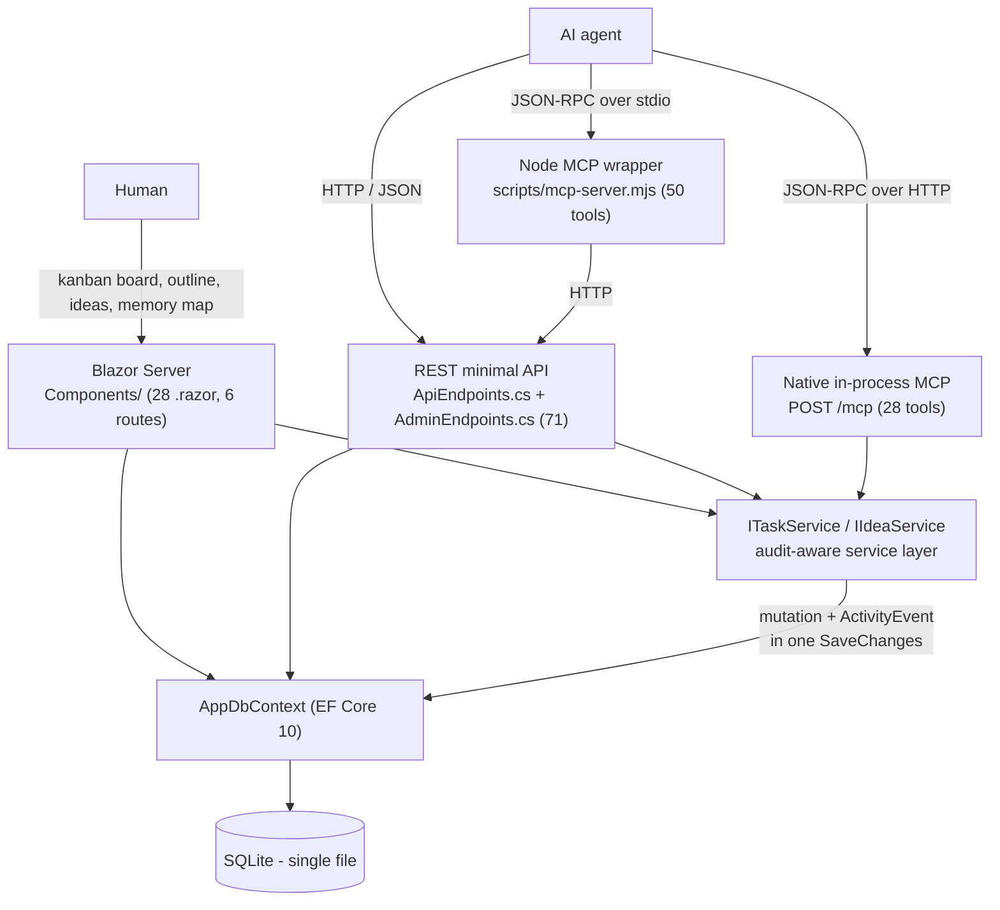
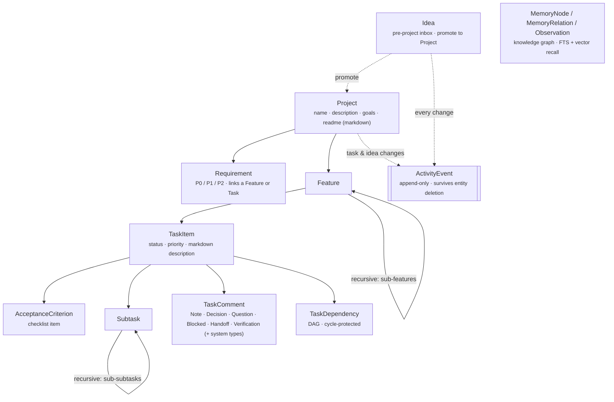
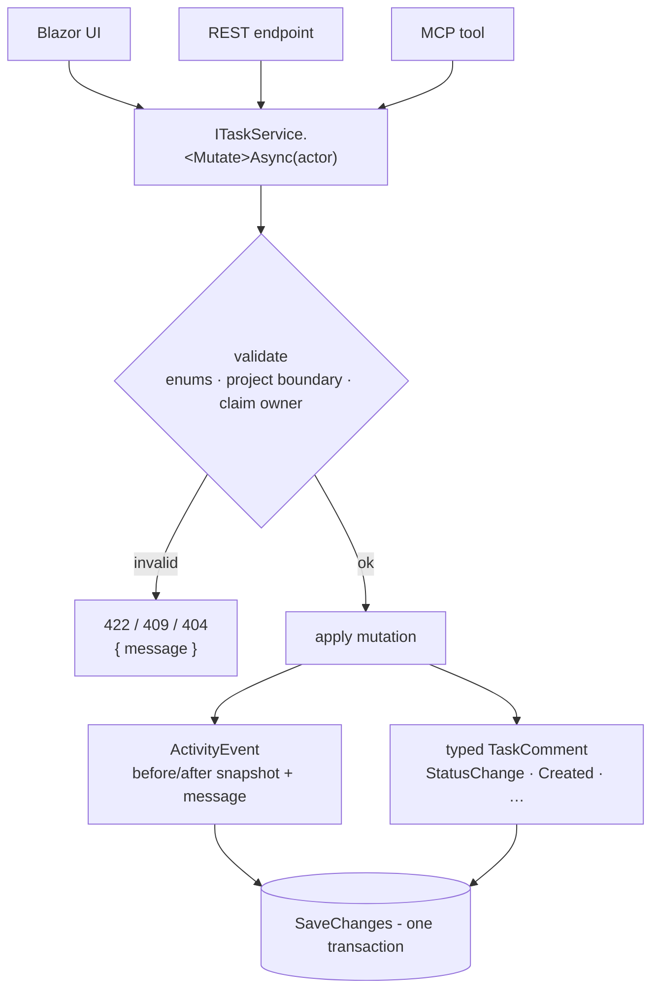

# Architecture & reference

Deep detail moved out of [`README.md`](../README.md) so the front page stays skimmable.
The README is the *product* view (what KanbanFlow is, how the GitHub sync works, how to run it).
This file is the *engineering* view: entity model, write paths, the full REST surface, the MCP
tool inventory, and the capability requirements matrix.

Every count in this file was derived from the code at the commit that introduced it, with the
command shown. If a number here disagrees with the code, the code wins — re-derive it.

---

## Contents

- [Runtime shape](#runtime-shape)
- [Entity model](#entity-model)
- [The write path & audit boundary](#the-write-path--audit-boundary)
- [REST surface (71 endpoints)](#rest-surface-71-endpoints)
- [MCP surface (28 native / 50 wrapper)](#mcp-surface-28-native--50-wrapper)
- [Who owns what](#who-owns-what)
- [Running it locally](#running-it-locally)
  - [Keeping it running: the scheduled task](#keeping-it-running-the-scheduled-task)
  - [The adoption trial’s instrument](#the-adoption-trials-instrument)
- [Optional LLM + embedding configuration](#optional-llm--embedding-configuration)
- [Capability requirements matrix](#capability-requirements-matrix)
- [Known gaps](#known-gaps)

---

## Runtime shape

One project, one assembly, one SQLite file. The simplicity is deliberate — there is no
service mesh, no message bus, no container, and no build pipeline to reason about.



Note the two arrows into `AppDbContext` that bypass `ITaskService`. Those are real, not a
drawing shortcut — see [The write path & audit boundary](#the-write-path--audit-boundary).

Verify the shape yourself:

```bash
grep -rn '@page' src/KanbanFlow/Components/ | sed -E 's/.*@page/@page/' | sort -u
grep -n 'MapMcp' src/KanbanFlow/Program.cs
```

---

## Entity model



Feature trees, subtask trees, and the dependency graph are all cycle-protected. Every text
field is documentation an agent can retrieve, summarise, or rewrite.

**Ideas** (`/api/ideas`, `/ideas`) are the pre-project inbox: capture raw, triage, then promote
one into a full project. `Promoted` is a **derived, terminal** status — only
`POST /api/ideas/{id}/promote` (MCP `promote_idea`) sets it, because only that path also
creates the linked project. `PATCH /api/ideas/{id}` and MCP `update_idea` therefore refuse to
move an idea *into* `Promoted` (#283) **or back out of it** (#285), returning 422 with a pointer
to the promote endpoint. Every other status transition is free, and a promoted idea's title,
body, plan, tags, and priority stay fully editable.

---

## The write path & audit boundary

The design intent is one write path: every mutation flows through `ITaskService` /
`IIdeaService`, which validates, applies the change, and records an `ActivityEvent` (plus a
typed `TaskComment`) in a single `SaveChanges`.



**That intent holds for tasks and ideas. It does not yet hold for every entity.** The honest
coverage table lives in the [README](../README.md#what-is-audited--and-what-is-not); the
mechanical evidence is:

```bash
# The whole REST layer has exactly ONE inline audit-event call site.
grep -n 'AddActivityEvent(' src/KanbanFlow/ApiEndpoints.cs
#   2247:  AddActivityEvent(..., "RequirementAssigned", ...)
#   2364:  private static void AddActivityEvent(...)   <- the helper itself
```

Everything else that reaches `AppDbContext` directly from an endpoint — features, subtasks,
acceptance criteria, dependencies, requirement create/update/delete, comment delete, and
project create/update — writes no `ActivityEvent`. That is issue
[#149](https://github.com/joelfuller2016/KanbanFlow-v2/issues/149).

Issue [#88](https://github.com/joelfuller2016/KanbanFlow-v2/issues/88) (route *UI* mutations
through the shared service layer) is **closed** — the Blazor components do call the services.
They also still hold an `AppDbContext` for reads and for the non-audited entity types, which is
why both arrows exist in the runtime diagram above:

```bash
grep -rln 'AppDbContext' src/KanbanFlow/Components/
grep -rln 'ITaskService\|IIdeaService' src/KanbanFlow/Components/
```

---

## REST surface (71 endpoints)

```bash
grep -cE '\.Map(Get|Post|Put|Patch|Delete)\(' src/KanbanFlow/ApiEndpoints.cs    # 66
grep -cE '\.Map(Get|Post|Put|Patch|Delete)\(' src/KanbanFlow/AdminEndpoints.cs  #  5
```

The machine-readable source of truth is the OpenAPI document at `/openapi/v1.json`
(`/openapi.json` 302s to it). The route map:

### Projects

| Route | Methods |
|---|---|
| `/api/projects` | `GET` list · `POST` create — `GET` carries `progress`, `nextTask`, `lastActivityAt` and `activeClaims` per project (R-1.7, #281) |
| `/api/projects/{id}` | `GET` · `PUT` · `DELETE` — `GET` carries `progress` at project and per-feature level (R-1.7) |
| `/api/projects/{id}/context` | `GET` — full graph in one AI-shaped payload, incl. `progress` at project and per-feature level (R-1.7) |
| `/api/projects/{id}/board` | `GET` — tasks grouped by status |
| `/api/projects/{id}/next-tasks` | `GET` — ranked direction (`?actor=&limit=`) |
| `/api/projects/{id}/activity` | `GET` — audit log (`?limit=`, clamped to 500) |
| `/api/projects/{id}/features` | `GET` · `POST` |
| `/api/projects/{id}/tasks` | `GET` — flat list |
| `/api/projects/{id}/requirements` | `GET` · `POST` |

### Features & tasks

| Route | Methods |
|---|---|
| `/api/features/{id}` | `GET` · `PUT` · `DELETE` |
| `/api/features/{id}/tasks` | `GET` · `POST` |
| `/api/tasks/{id}` | `GET` · `PUT` · `DELETE` (`?actor=`, optional; unset stays `null`) |
| `/api/tasks/{id}/context` | `GET` — one-call agent bundle (criteria + subtasks + deps + comments + activity) |
| `/api/tasks/{id}/status` | `PATCH` |
| `/api/tasks/{id}/feature` | `PATCH` — reassign to another feature |
| `/api/tasks/{id}/claim` | `POST` |
| `/api/tasks/{id}/release` | `POST` |
| `/api/tasks/{id}/activity` | `GET` |
| `/api/tasks/{id}/subtasks` | `GET` · `POST` |
| `/api/tasks/{id}/acceptance-criteria` | `GET` · `POST` |
| `/api/tasks/{id}/comments` | `GET` · `POST` |
| `/api/tasks/{id}/dependencies` | `GET` · `POST` |

### Leaf entities

| Route | Methods |
|---|---|
| `/api/subtasks/{id}` | `PUT` · `DELETE` — **no `GET`** |
| `/api/acceptance-criteria/{id}` | `PUT` · `DELETE` — **no `GET`** |
| `/api/requirements/{id}` | `PUT` · `DELETE` — **no `GET`** |
| `/api/requirements/{id}/assign` | `PATCH` — link a feature or task |
| `/api/comments/{id}` | `DELETE` |
| `/api/task-dependencies/{id}` | `GET` · `DELETE` |

> The three "no `GET`" rows are a correction: the README claimed `get/update/delete` for all
> three until this pass. Fetch them through their parent collection endpoint instead.

### Ideas

| Route | Methods |
|---|---|
| `/api/ideas` | `GET` (`?status=&tag=&q=&limit=&offset=`) · `POST` |
| `/api/ideas/{id}` | `GET` · `PATCH` · `DELETE` |
| `/api/ideas/{id}/promote` | `POST` — creates the linked project |
| `/api/ideas/{id}/activity` | `GET` |

### Memory (knowledge graph)

| Route | Methods |
|---|---|
| `/api/memory` | `POST` — remember |
| `/api/memory/search` | `GET` — recall; hybrid FTS + vector RRF, `k` must be greater than zero (422 otherwise) and is capped at 100 |

The UI route `/memory` reads the same store directly through `IMemoryService.ReadGraphAsync`; it
does not introduce a duplicate REST contract. The page defaults to Agent scope / `knowledge-graph`,
the native MCP tools' shared namespace, and projects explicit records into semantic lanes with a
bounded deterministic layout. Because MCP `entityType` is stored in `MemoryNode.Tags`, the projection
classifies both `MemoryType.Decision` and normalized tags. The page is a read-only view of deliberately
recorded summaries, observations, and relations. It does not request, infer, or reconstruct
model-hidden reasoning; capture clients must not write private scratchpads or secrets into the graph.
`ReadGraphAsync` caps the source at 900 nodes. The UI projection separately caps a rendered view at
80 nodes, 320 unique directed edges, and 50 observations per selected record; source and render
truncation are reported rather than silently presented as complete.

### GitHub external identity & write journal (#336)

| Route | Methods |
|---|---|
| `/api/external-work-item-links/github/by-node` | `GET` — global Active-link lookup by immutable issue node (`?externalNodeId=`) |
| `/api/projects/{id}/external-work-item-links` | `GET` — Active and Quarantined project rows |
| `/api/tasks/{id}/external-work-item-links/github` | `PUT` — verified idempotent registration/metadata transfer |
| `/api/tasks/{id}/external-work-item-quarantines/github` | `POST` — persist ambiguous legacy evidence |
| `/api/tasks/{id}/external-write-operations` | `POST` — prepare/freeze one outbound create |
| `/api/external-write-operations/{uuid}` | `GET` — read durable operation state |
| `/api/external-write-operations/{uuid}/resume` | `POST` — explicit lease/recovery step |
| `/api/external-write-operations/{uuid}/dispatch` | `POST` — persist pre-contact dispatch (manual retry requires fresh scan evidence) |
| `/api/external-write-operations/{uuid}/finalize` | `POST` — proof-finalize immutable issue result/link |
| `/api/external-write-operations/{uuid}/failure` | `POST` — persist fail-closed outcome |
| `/api/external-write-operations/{uuid}/authorize-ambiguous-retry` | `POST` — audited operator authorization after exhaustive raw zero-marker scan |

### Admin

| Route | Methods |
|---|---|
| `/api/admin/health` | `GET` — `{ status, app, startedAtUtc, checkedAtUtc, runtime, openApiUrl, db }` |
| `/api/admin/run-tests` | `POST` — `?suite=api\|ui\|service\|all` |
| `/api/admin/llm-ping` | `GET` — LLM connectivity self-test |
| `/api/admin/embed-ping` | `GET` — embedding connectivity self-test |
| `/api/admin/memory/reindex` | `POST` |

`status` is `ok`, `degraded` or `error`, and the endpoint returns **HTTP 200 in all three** —
a caller that cannot read the reason is worse off than one told nothing (#498). `db` carries
`{ path, exists, source, existedAtStartup, createdAtUtc, lastWriteUtc, sizeBytes,
shadowedPaths, projects, status, error, reasons, elapsedMs }`: the file that was actually
opened, the file's own facts as the app found them at boot, a real `COUNT(*)` read from it,
and every reason the top-level status is not `ok`.

**`db.status` is a different field from the top-level `status`, and it does not share its
vocabulary.** The top-level field grades the whole app; `db.status` answers exactly one question —
did the probe throw — so it stays `ok` through every one of the `degraded` reasons below, and only
a probe that actually threw moves it. A database that cannot be opened is reported by BOTH fields
at once, with different words: the top-level goes to `error`, `db.status` reports the probe outcome,
and `unreachable` appears in `db.reasons` either way.

**The one thing not to do is collapse them.** They are read separately — `scripts/smoke-api.ps1`
asserts `$health.db.status -eq "ok"`, while `scripts/register-kanbanflow-task.ps1` parses the
top-level field and has already been fixed once for matching the wrong one. The authoritative
values are the ones asserted in `AdminHealthEndpointTests`, which pins both fields in the same
case precisely so a later change cannot merge them.

The implemented database status contract is `ok` or `unreachable`, as required by the constraints
in [#498](https://github.com/joelfuller2016/KanbanFlow-v2/issues/498) and asserted in
`AdminHealthEndpointTests`. The issue's older implementation example uses `error` for this nested
field; that example does not describe the current endpoint. Top-level `error` remains unchanged.

`ok` means all of: the database opened, the read succeeded, the board is not empty, this
process did not CREATE the board it is serving, the board carries no trace of having been
copied into place just before the app started, and no second `kanbanflow.db` is shadowing the
one in use.

The reported reasons and their lifetimes (`unreachable` makes the top-level status `error`; the
others make it `degraded`):

| Reason | What it saw | How long it lasts |
|---|---|---|
| `unreachable` | the probe threw; `db.error` carries the SQLite message | until the database opens |
| `empty-board` | the read worked and returned zero projects | until a project exists |
| `created-at-startup` | the file was not on disk when the path was resolved | **this boot only** |
| `last-write-precedes-creation` | the startup snapshot records a last-write time before creation, consistent with a timestamp-preserving copy | until a restart captures a write at or after creation |
| `created-moments-before-startup` | the file came into existence within 15 minutes before this process started | until a restart more than 15 minutes after the file was created |
| `shadowed-by-another-database` | a second `kanbanflow.db` existed at one of the app's own anchors when the path was resolved | until a restart after that candidate is removed |

`DbPathResolution` is captured once before schema and seed work. Its existence-at-startup, file
facts and shadow list stay fixed for that process. Each request separately checks current file
existence and queries the current project count; those live checks do not refresh the startup
snapshot. The [September 8 review](reviews/2026-09-08-health-512.md) records a launcher, write and
restart check of this distinction.

**What these are worth, stated plainly, because a detector oversold is worse than none.** The
two file-fact reasons exist for the one case row counting cannot see: a launcher that
*successfully* restores the committed seed onto the wrong path, where the board exists and is
not empty. They are evidence, not proof:

- A write removes the copy signature from the file, but the running process retains its startup
  observation. On the next start the copy reason clears; the creation-window reason can still
  remain. An upgrade whose `Ensure*` patchers write at boot can remove the on-disk copy signal
  without a user edit. Because resolution precedes those patchers, that loss becomes visible at
  the following restart. Once both reasons are gone, neither identifies the wrong board.
- NTFS **file tunnelling** can preserve the original creation time when a file of the same
  name is deleted and recreated within roughly 15 seconds, hiding the copy.
- A user restoring their own board from a backup produces exactly this shape. That is a false
  positive, and it is why these are reported reasons carrying their evidence rather than
  errors or a refusal to start.
- A fresh install shows the same shape, and correctly: the launcher really does copy the seed in
  moments before the first start, so both reasons fire. Even with `-NoSeed`, where nothing is
  copied and the app makes the board itself, a restart inside 15 minutes still reports
  `created-moments-before-startup` — a board that new is not distinguishable from a restored one.
  Both are expected on a new deployment and both clear on the schedule in the table above.
- `last-write-precedes-creation` compares two stamps from a single `FileInfo` and so carries no
  clock slack, unlike its sibling — see `ClockSlack` in `AdminEndpoints.cs` for why slack here
  would suppress detections rather than false alarms. The residue is filesystem quantisation: per
  MS-FSA, FAT records creation at 10 ms but last write at **2 s**, so on a FAT volume an ordinary
  board could in principle read as written before it was created. Whether the rounding actually
  goes that way is unstated in the specification and untested here; NTFS, ReFS and exFAT record
  both stamps at equal granularity and are unaffected.

`shadowed-by-another-database` reads the application's **own** anchors — the launch directory,
the content root and the directory the binary sits in. It does not and cannot name a board at
the *launcher's* default location, because that path comes from a shell variable this process
would have to re-derive, and a second disagreeing implementation of that rule is the #354
defect itself.

So what the endpoint still cannot know is which database the operator *meant* — the launcher
pins `KANBANFLOW_DB_PATH` from its own computation, so the app faithfully opens whatever it is
handed. That half is finished by the caller, comparing `db.path` and the file facts against
what it expects. The sharpest of those comparisons is `db.sizeBytes` against the size of
`seed/kanbanflow.seed.db`: a restored copy is byte-identical to it. Read that direction only — a
match is consistent with the seed, not proof of it, because SQLite reuses freed pages instead of
growing the file, so a board that has been written to can still report the seed's size exactly.
The application cannot make the comparison itself — the seed is **not** in the publish output —
which is exactly why the size is reported rather than judged.

The probe opens the database **read-only**. `Microsoft.Data.Sqlite` defaults to
`Mode=ReadWriteCreate`, which invents an empty database when the file is absent — health would
convert the one condition it exists to detect into a condition that no longer holds, and hand
the next caller a board that was never real. `db.exists` is also read before the probe rather
than after, so the answer stays honest even if the mode ever regresses. Measured: with
`ReadWriteCreate` and an existing parent directory this reproduces on Windows.

Health takes a **shared read lock** where the pre-#498 endpoint took no locks at all. At
realistic polling intervals that is negligible, but it is not nothing: an external writer
committing at the same instant can fail on the lock. Stated because it was previously unstated.

The probe is bounded at a 2-second command timeout. SQLite runs here in rollback-journal
mode, so a competing writer blocks readers and the 30-second driver default would turn a
transient lock into a stalled health check — longer than `scripts/ui-e2e.mjs` waits before
declaring the app dead. Contention surfaces as `error` with the SQLite message in `db.error`,
in about two seconds, and clears itself. Measured uncontended against a seed-sized board:
`db.elapsedMs` 0.7–1.3 ms, full round trip 2–3 ms.

Plus `GET /openapi.json` in `Program.cs`, which 302s to `/openapi/v1.json`.

---

## MCP surface (28 native / 50 wrapper)

Two MCP servers ship, and they are **not** at parity. Tracked in
[#231](https://github.com/joelfuller2016/KanbanFlow-v2/issues/231).

```bash
grep -c '\[McpServerTool(' src/KanbanFlow/Mcp/KanbanMcpTools.cs   # 28 (native, in-process)
```

```bash
# 50 (Node wrapper) - ask the server itself, no parsing guesswork:
printf '%s\n' \
  '{"jsonrpc":"2.0","id":1,"method":"initialize","params":{"protocolVersion":"2025-06-18","capabilities":{},"clientInfo":{"name":"c","version":"1"}}}' \
  '{"jsonrpc":"2.0","id":2,"method":"tools/list","params":{}}' \
  | node scripts/mcp-server.mjs 2>/dev/null \
  | node -e 'let b="";process.stdin.on("data",d=>b+=d).on("end",()=>{for(const l of b.split("\n").filter(Boolean)){try{const m=JSON.parse(l);if(m.id===2)console.log(m.result.tools.length)}catch{}}})'
```

### Native (28) — `POST /mcp`, in-process, no HTTP hop

| Group | Tools |
|---|---|
| Projects (2) | `list_projects`, `get_project_context` |
| Tasks (8) | `get_task`, `get_next_tasks`, `create_task`, `update_task_status`, `delete_task`, `add_task_comment`, `claim_task`, `release_task` |
| Acceptance criteria (4) | `list_acceptance_criteria`, `create_acceptance_criterion`, `mark_acceptance_criterion_done`, `update_acceptance_criterion` |
| Ideas (5) | `create_idea`, `list_ideas`, `get_idea`, `update_idea`, `promote_idea` |
| Knowledge graph (9) | `create_entities`, `create_relations`, `add_observations`, `delete_entities`, `delete_observations`, `delete_relations`, `read_graph`, `search_nodes`, `open_nodes` |

### Node wrapper (50) — `scripts/mcp-server.mjs`, stdio, forwards to REST

Everything native has, **plus**: `get_project`, `list_project_tasks`, `get_project_board`,
`create_project`, `update_project`, `create_feature`, `update_feature`, `delete_feature`,
`update_task`, `reassign_task`, `get_step_context`, the five subtask tools, `delete_acceptance_criterion`,
the three dependency tools, and `list_project_activity` /
`list_task_activity`.

### The parity gap that bites

The native server has **no `create_project`**. An agent connected only to `/mcp` cannot onboard
a repo — which is exactly why `scripts/portfolio-sync.mjs` uses REST (`POST /api/projects`)
rather than MCP.

**Closed in #438:** the native server also had no acceptance-criteria tools, which stopped being
cosmetic the moment #428 gated `Done` on unmet criteria. An agent on `/mcp` could be refused the
move and had nothing to satisfy the gate with — only `overrideReason`. The gate's escape hatch was
its *only* exit, so the audit trail filled with overrides meaning "the tool was missing" rather
than "a human judged this done anyway". Four tools now close it, and
`McpAcceptanceCriteriaToolsTests` asserts a task with criteria reaches `Done` through the tool
surface alone with **no** `TaskDoneOverridden` event.

### Still missing from both

| Tool | Why |
|---|---|
| `list_requirements` / `get_requirement` / `create_requirement` / `update_requirement` / `assign_requirement` / `delete_requirement` | Requirements are the last entity with no MCP CRUD at all |
| `search_project` | Blocked on the search endpoint (R-1.5, not implemented) |

### Wiring the wrapper into Claude Code

```jsonc
// ~/.claude/.mcp.json (or your client's MCP config)
{
  "mcpServers": {
    "kanbanflow": {
      "command": "node",
      "args": ["C:/path/to/KanbanFlow-v2/scripts/mcp-server.mjs"],
      "env": {
        "KANBANFLOW_API_URL": "http://127.0.0.1:5123",
        "KANBANFLOW_MCP_TIMEOUT_MS": "10000"
      }
    }
  }
}
```

Start the web app on the matching URL **before** the agent connects.

---

## Who owns what

The board is not a mirror of GitHub, and reading it as one is the failure mode this section
exists to prevent. **GitHub stays the system of record for issues and PRs** — there is no
board→GitHub write path, and `README.md` records that absence as deliberate. What the board
owns is the execution state GitHub structurally cannot hold:

| Owned by GitHub | Owned by the board |
|---|---|
| Issues, PRs, review threads, labels, milestones | **Claims** — who is on it, right now |
| The permanent public record | **Dependencies** and next-task ranking |
| Anything another human reads | **Acceptance criteria** and the Definition-of-Done gate |
| | **Ordering** within a column |
| | The **memory graph** |

Every board-owned row is something an issue tracker cannot represent, which is the whole
argument for this layer: mirroring GitHub would add nothing. An agent that consults the board
*instead of* GitHub for issue state is acting on a read replica — file issues with `gh`, always.

Both agent skills (`.claude/skills/kanban-portfolio`, `.claude/skills/kanban-project-ops`)
restate this table, because a session that never opens this file still has to get it right.

---

## Running it locally

### The database lives outside the repo

`DbPathResolver` defaults the database to a path next to the binary — under `src/`, where
`*.db` is gitignored. That combination is a data-loss trap: `git clean -xdf` deletes ignored
files without prompting, so a routine clean silently destroys a real board. **`KANBANFLOW_DB_PATH`
takes precedence over that default (#354), so pin it somewhere outside the working tree.**
`scripts/start-kanbanflow.ps1` defaults it to `~/.kanbanflow/kanbanflow.db`.

### The seed is the committed starting point

`seed/kanbanflow.seed.db` is a tracked SQLite file holding a populated board — this repo's own
project, its milestones as features, and its open issues as tasks. It is the one `.db` escaped
from `.gitignore`; every other SQLite file, including the live database restored from it, stays
ignored.

```powershell
pwsh -File scripts/start-kanbanflow.ps1     # restores the seed if no live DB exists, then serves
npm run seed:snapshot                       # refresh the seed from the live DB
npm run seed:check                          # integrity-check the tracked seed, write nothing
```

The restore is guarded on the live database being **absent**, so the seed can never overwrite
working data — a start with a live DB present touches nothing and says so.

Refreshing uses SQLite's `VACUUM INTO` against the running app rather than a file copy. This is
not a stylistic preference — though the reason is not the one this section used to give. **The app
does not run in WAL mode.** Nothing in `src/` sets `journal_mode` and the committed seed reports
`delete`; that is the same fact the health probe's 2-second bound rests on above, and WAL is
tracked separately in [#209](https://github.com/joelfuller2016/KanbanFlow-v2/issues/209) rather
than enabled here.

The sidecar argument survives with the right sidecar. In rollback-journal mode a write goes into
`kanbanflow.db` **in place** while the original pages are held in `kanbanflow.db-journal`, so a
copy taken mid-transaction mixes pre- and post-write pages — silently, with no error, and no
symptom until someone restores it. Stopping the app first does not fix it either: a forced kill
leaves a hot journal behind, and a bare `.db` copy carries nothing to roll it back with.
`VACUUM INTO` runs inside a read transaction, so it sees only committed state and writes one
compact file with no sidecars. The app stays up throughout — at the cost of a shared read lock,
so a commit landing mid-snapshot waits on it rather than tearing the copy.

`scripts/snapshot-seed.mjs` needs `node:sqlite` (Node ≥ 22.5). The package floor stays at 18
because nothing at runtime needs it — only this maintainer tool does, and it says so if the
Node version is too old.

### Keeping it running: the scheduled task

An agent's tool call cannot start the app, so a board that is down is a board that does not exist.
`scripts/register-kanbanflow-task.ps1` registers the Windows scheduled task that keeps it up, and
is the only supported way to create it — a task made by hand at a console is machine state nobody
can review, reproduce on another box, or restore after a mistake, which is exactly the state #477
found.

```powershell
# ONE elevated run is required for reboot survival - see below
pwsh -File scripts/register-kanbanflow-task.ps1 -RequireStartupTrigger   # elevated: the real thing
powershell.exe -ExecutionPolicy Bypass -File scripts/register-kanbanflow-task.ps1   # unelevated: exits 3
pwsh -File scripts/register-kanbanflow-task.ps1 -WhatIf                             # dry run
pwsh -File scripts/register-kanbanflow-task.ps1 -Unregister                         # remove
```

Three triggers, and each covers a case the others cannot:

| Trigger | Job |
|---|---|
| **AtStartup** | The only one that survives an **unattended** reboot. Needs elevation to register. |
| **AtLogOn** | Covers a reboot that ends at a logon. |
| **Once + `PT5M`** | Keepalive. Revives the app within the configured interval after any exit, crash included (`-KeepaliveMinutes`, default 5). |

**Reboot survival requires one elevated run, and this is not a preference.** Windows refuses both
the boot trigger and the `S4U` principal to a non-elevated shell — measured three ways, all
`Access is denied`: `AtStartup`, `S4U`, and `Password`. An unelevated run therefore attempts the
correct definition, is refused, falls back to a logon-only task, quotes the refusal, prints the
elevated command, and **exits 3** — a distinct code, so a script reading the exit status is never
told a logon-only task succeeded. `-RequireStartupTrigger` turns that fallback into a hard failure
(exit 2) with the previous definition restored. Once the good definition exists, a later unelevated
run **refuses to downgrade it**: it restores the stronger task and fails rather than replacing it.

| Exit | Meaning |
|---|---|
| `0` | Registered as intended. |
| `2` | Failed; any previous definition was restored, or its absence is stated explicitly. |
| `3` | Registered, but **logon-only** — it will not survive an unattended reboot. |

With `-MultipleInstances IgnoreNew`, a repeat that finds the app already running is refused by Task
Scheduler with **`0x800710E0`** — "the operator or administrator has refused the request." That code
in the task history is the design working, **not a fault**; it is what makes a five-minute repeat free
while the app is healthy.

`RestartCount`/`RestartInterval` are set but **do not fire**: measured with these exact settings, a
task whose action exits non-zero ran once in 175 s (`LastTaskResult=0x00000001`). The keepalive is
the real crash-recovery path, so a crash costs up to `KeepaliveMinutes`, not a minute.

`-ExecutionTimeLimit PT0S` is not decoration either. The Task Scheduler default stops a task after
three days, and a server killed mid-week presents as "the board stopped answering" with nothing in
the app's own logs to explain it.

**The database path is resolved at registration time and pinned into the action as `-DbPath`.**
Without that, the launcher resolves it through `$HOME`, which differs between pwsh and Windows
PowerShell and is not guaranteed under an `S4U` logon — and when the path misses, the launcher
restores the committed seed and serves a board nobody asked for. `/api/admin/health` used to answer
`status: ok` through all of that, because it never opened the database.

Since [#498](https://github.com/joelfuller2016/KanbanFlow-v2/issues/498) it does. Measured through
the launcher itself, against a wrong root:

```text
pwsh -File scripts/start-kanbanflow.ps1 -DbPath "$env:TEMP\kf-wrongroot\kanbanflow.db" -Url http://127.0.0.1:5311

{"status":"degraded", ...,
 "db":{"path":"...\\kf-wrongroot\\kanbanflow.db","existedAtStartup":true,
       "createdAtUtc":"2026-09-07T21:30:30.5074753Z",
       "lastWriteUtc":"2026-09-07T20:07:00.3297704Z","sizeBytes":1282048,
       "projects":1,"reasons":["last-write-precedes-creation","created-moments-before-startup"]}}
```

Note what carries that verdict, because it is not the obvious thing. The launcher `Copy-Item`s the
seed into place **before** the app starts, so the file is already there when the path is resolved:
`existedAtStartup` is `true`, and the seed holds a real project, so counting rows reports a healthy
`projects: 1`. `created-at-startup` does not fire either. What fires is the file's own history — a
board last written an hour before it was created, at exactly the committed seed's 1,282,048 bytes.

`existedAtStartup` alone answers this scenario `ok`. It is also true from the second boot onward
even where it does fire, so it cannot carry a criterion evaluated after reboots *plural*. The file
facts are re-read from the file at every boot, so both reasons survive restarts — but they expire on
separate clocks, and the table above is the precise statement. `last-write-precedes-creation` clears
when a restart captures a post-creation write. `created-moments-before-startup` is untouched by
writes and ends at the first start more than 15 minutes after the file was created — so it can still
be firing on a board that has been written to, and it is gone from a board that has not.

The script is idempotent (`-Force` replaces), verifies afterwards that the triggers actually landed,
and **refuses to register the real task from a git worktree** (it asks `git rev-parse --git-dir`
rather than matching a path, so a junction or `subst` drive cannot slip past). A non-default
`-TaskName` is not a sandbox on its own — the action would still target the production port and
database — so it additionally requires `-HealthUrl` and `-DbPath`.

### The adoption trial's instrument

Issue #477 commits to adopting or reverting this whole integration on four measured signals. Three of them
are invisible to the audit trail: `get_next_tasks` is a read and emits no `ActivityEvent`, and a
caller's working directory was never recorded anywhere at all.

`scripts/usage-log.mjs` closes that gap. Every `tools/call` through the stdio wrapper appends one
JSONL row — tool, timestamp, per-process session id, caller cwd, outcome, duration — to
`~/.kanbanflow/mcp-usage.jsonl` (outside the repo, for the same `git clean -xdf` reason as the
database). Set `KANBANFLOW_USAGE_LOG` to move it, or to `off` to disable it.

Two properties are deliberate and tested:

- **Arguments go through an allowlist** (`projectId`, `taskId`, `actor`, plus the target status and
  a boolean DoD-override flag) — never the whole argument object. Task descriptions, comment bodies
  and search queries are arguments somewhere in this wrapper, and none belong in a usage log. An
  allowlist means a tool added later cannot leak a new field by default.
- **A logging failure can never break a tool call.** An instrument that can break the thing it
  measures is worse than no instrument, so every filesystem call is individually swallowed.

```powershell
npm run trial:report                      # render §11's table from the log + the audit trail
npm run trial:report -- --since 2026-08-30
npm run trial:report -- --json
```

The report takes each signal from whichever source can actually answer it — the log for who called
what from where, the board's `ActivityEvent` rows for what changed — and it says what it could not
measure rather than scoring it as a pass. Two refusals matter most: it will not treat "unprompted"
as measured, because nothing here knows whether the user asked; and it will not read zero collisions
as a pass when fewer than two sessions ever wrote, because that measures absence of *use*, not
absence of collision.

---

## Optional LLM + embedding configuration

Both are **fail-soft**: when the endpoint is unreachable nothing crashes and no request 500s —
calls return a typed error result, and the ping endpoints answer HTTP 200 with `ok: false`.

### Chat (`ILlmClient`, #218)

| Variable | Default | Purpose |
|---|---|---|
| `ZEROROUTER_URL` (or `KANBANFLOW_LLM_URL`) | `http://localhost:5256/v1` | OpenAI-compatible base URL — must include `/v1` |
| `KANBANFLOW_LLM_MODEL` | `gpt-4o-mini` | Model id |
| `ZEROROUTER_API_KEY` (or `KANBANFLOW_LLM_KEY`) | `zerorouter` | Placeholder credential for local ZeroRouter — deliberately never masked (see note) |
| `KANBANFLOW_LLM_TIMEOUT_MS` | `30000` | Per-attempt timeout |

> **On `ZEROROUTER_API_KEY` and masking.** The default is a **placeholder**, not a secret:
> ZeroRouter runs open on the local network and the OpenAI client merely requires a non-empty
> credential. Per the open-access charter this value is never masked in any UI, log, or response,
> and no auth or rate limiting is added — that is a deliberate product decision for a
> localhost-only tool, not an oversight ([`LlmOptions.cs`](../src/KanbanFlow/Services/LlmOptions.cs)).
>
> **That policy is scoped to the placeholder.** If you repoint `ZEROROUTER_URL` at a hosted
> provider and set a real API key, you inherit a no-masking policy that was chosen for a value
> with nothing to protect. KanbanFlow will not redact it for you. Either keep the local-ZeroRouter
> topology this project assumes, or treat that deployment as out of scope for the open-access
> charter and handle the credential accordingly.

```bash
curl http://127.0.0.1:5123/api/admin/llm-ping
# -> { ok, model, url, latencyMs, reply?, error? }
```

### Embeddings (`IEmbeddingService`, #219)

Identical text is embedded once (content-hash cache); batches are deduped and chunked. Reuses
the URL / key / timeout above and adds:

| Variable | Default | Purpose |
|---|---|---|
| `KANBANFLOW_EMBED_MODEL` | `text-embedding-3-small` | Embedding model id |
| `KANBANFLOW_EMBED_DIMENSIONS` | *(provider-native)* | Requested output dimensionality; only sent when set |
| `KANBANFLOW_EMBED_BATCH_SIZE` | `256` | Max texts per provider call |

```bash
curl http://127.0.0.1:5123/api/admin/embed-ping
# -> { ok, model, url, dimensions, latencyMs, error? }
```

---

## Capability requirements matrix

Requirements are organised by **capability**, not by entity. Every capability should be
reachable from both REST and MCP.

### C-1. Read everything

| # | Requirement | Status |
|---|---|---|
| R-1.1 | List and get every entity: project, feature, task, subtask, acceptance criterion, requirement, dependency, comment, activity event. | ⚠️ **REST:** yes, but the three leaf entities have no `GET` by id and are reachable only through their parent collection. **MCP:** neither server exposes requirements at all (#231) |
| R-1.2 | `GET /api/projects/{id}/context` returns the whole graph in one denormalised AI payload. | ✅ needs paging caps for large projects |
| R-1.3 | Activity queryable per project and per task, time-ordered, with `before`/`after` snapshots. | ✅ for tasks + ideas; ❌ other entities emit nothing (#149) |
| R-1.4 | List endpoints support `?limit=&offset=`. | ❌ only activity clamps `limit` (500); ideas take both; the rest are unbounded |
| R-1.5 | `GET /api/projects/{id}/search?q=` across descriptions, comments, requirements. | ❌ not implemented |
| R-1.7 | Completion computed **once, server-side** and served as a `progress` object (`completed`, `inProgress`, `blocked`, `total`, `percentComplete`) at project *and* feature level on `GET /api/projects/{id}` and `GET /api/projects/{id}/context`, and at project level on `GET /api/projects`, so no surface recomputes it. Feature progress is recursive (own tasks + all descendant features'); `blocked` counts *unfinished* tasks with an open blocker, matching `next-tasks.blockedTaskCount`; `percentComplete` is a number rounded to one decimal, `0.0` and never `NaN` when `total` is 0. | ⚠️ shared `Services/ProjectProgressCalculator` serves all three REST endpoints (#125, #281) and the Home card reads the list one through `Services/ProjectSummaryService` (#281); the `ProjectOutline` header (#111), MCP `get_project_context` and MCP `list_projects` still recompute or omit it |

### C-2. Write everything

| # | Requirement | Status |
|---|---|---|
| R-2.1 | Full REST CRUD for every entity. | ⚠️ 71 endpoints, but not *full* CRUD everywhere: `TaskComment` has create/list/delete and **no update route**, and `ActivityEvent` is read-only by design (append-only, R-7.3) |
| R-2.2 | Every REST capability has at least one MCP tool. | ❌ native 28, wrapper 50 — neither covers requirements (#231) |
| R-2.3 | UI mutations go through the same service layer as REST. | ✅ #88 closed; components call `ITaskService`/`IIdeaService` |
| R-2.4 | All entity mutations produce an `ActivityEvent`. | ❌ tasks + ideas only (#149) |
| R-2.5 | Project-boundary integrity across features, tasks, requirements. | ✅ #82 and #83 both closed — `CrossProjectReassignmentException` (`TaskService.cs:166`) plus 422 on cross-project requirement links |
| R-2.6 | Cycle protection on feature trees, subtask trees, dependency graphs. | ✅ |
| R-2.7 | Enum validation rejects undefined values (`Status: "99"` → 422). | ✅ #89 closed — `Enum.TryParse` + `Enum.IsDefined` pairs throughout `ApiEndpoints.cs` |

### C-3. Direct agents to the next step

| # | Requirement | Status |
|---|---|---|
| R-3.1 | `GET /api/projects/{id}/next-tasks?actor=&limit=` — priority-sorted, dependency-aware. | ✅ |
| R-3.2 | Each recommendation carries a human-readable `reason`. | ✅ shared `TaskRanking.RankNextTasks`, used by REST, MCP and the Home project card (#281) alike |
| R-3.3 | Tasks blocked by incomplete dependencies are excluded. | ✅ |
| R-3.4 | A step-context endpoint returns everything needed to act on one task. | ✅ `GET /api/tasks/{id}/context` (MCP `get_step_context`) |
| R-3.5 | `next-tasks` de-prioritises tasks claimed by other actors. | ✅ |
| R-3.6 | The ranking algorithm is documented so its output is predictable. | ❌ lives only in source — `TaskRanking.RankNextTasks`/`BuildReason` plus `BuildBlockedTaskReason` in `ApiEndpoints.cs` ([#366](https://github.com/joelfuller2016/KanbanFlow-v2/issues/366)) |

### C-4. Add and update documentation

| # | Requirement | Status |
|---|---|---|
| R-4.1 | `name`, `description`, `goals`, `readme` are first-class project doc fields. | ✅ schema; ⚠️ no *native* MCP tool updates them (wrapper's `update_project` does) |
| R-4.2 | Markdown rendered server-side via Markdig with HTML sanitisation. | ✅ `MarkdownRenderer` / `<MarkdownContent>` |
| R-4.3 | Typed comments: `Note`, `Decision`, `Question`, `Blocked`, `Handoff`, `Verification` + system types. | ✅ `AllowedUserCommentTypes` enforces the user/system split |
| R-4.4 | Acceptance criteria are first-class checklist items. | ✅ |
| R-4.5 | Activity records both a structured `BeforeJson`/`AfterJson` snapshot and a readable `Message`. | ✅ |
| R-4.6 | Adding a `Decision` or `Handoff` comment is one MCP call. | ✅ `add_task_comment` |

### C-5. Be self-describing

| # | Requirement | Status |
|---|---|---|
| R-5.1 | OpenAPI document covering every endpoint. | ✅ `/openapi/v1.json`; `/openapi.json` 302s to it |
| R-5.2 | Response types are records, not anonymous shapes. | ❌ ~25 anonymous shapes inline in `ApiEndpoints.cs` |
| R-5.3 | Each MCP tool has a rich description. | ✅ native tool descriptions are detailed; wrapper's are terser |
| R-5.4 | `docs/requirements.md` lists every endpoint, regenerated from OpenAPI. | ⚠️ hand-maintained; drifts |
| R-5.5 | Uniform error shape `{ message, errors?, details? }`. | ⚠️ mostly; some endpoints add ad-hoc fields |

### C-6. Be operationally simple

| # | Requirement | Status |
|---|---|---|
| R-6.1 | Zero setup: `dotnet run` produces a working app with seed data. | ✅ |
| R-6.2 | Single SQLite file; portable; no Docker. | ✅ |
| R-6.3 | A smoke suite runs in under 60 seconds. | ✅ `smoke-api.ps1` |
| R-6.4 | Schema evolves via EF Core migrations. | ❌ `EnsureCreated()` + `SchemaPatcher` (#86) |
| R-6.5 | A cross-platform Node smoke script for the API. | ❌ PowerShell only |
| R-6.6 | ~~CI runs build + smoke on every PR.~~ | **Withdrawn — see [no CI, on purpose](../README.md#deliberate-non-features).** `scripts/verify.ps1` plus the externally-scheduled `scripts/pr-ci.ps1` / `scripts/master-health.ps1` are the gate. |

### C-7. Be honest about the audit trail

| # | Requirement | Status |
|---|---|---|
| R-7.1 | The audit log is the single source of truth for "what changed when". | ⚠️ true for tasks + ideas; not yet a whole-graph guarantee (#149) |
| R-7.2 | UI and API mutations produce identical activity events. | ✅ for the entities the service layer owns (#88 closed) |
| R-7.3 | The audit log survives entity deletion. | ✅ `ActivityEvent` deliberately ignores the project FK (#85) |

---

## Known gaps

Ranked by how much they hurt an agent consuming this system.

| Gap | Issue | Effect on agents |
|---|---|---|
| Audit covers only tasks + ideas | [#149](https://github.com/joelfuller2016/KanbanFlow-v2/issues/149) | A feature rename or a deleted acceptance criterion leaves no trace; agents reading history see a partial past |
| Native/wrapper MCP divergence | [#231](https://github.com/joelfuller2016/KanbanFlow-v2/issues/231) | The same agent gets a different tool set depending on transport; `/mcp` cannot create a project |
| REST edge re-declares service-layer policy | [#302](https://github.com/joelfuller2016/KanbanFlow-v2/issues/302) | Comment-type policy, dead `isBlocked` fields, and actor/author collapse differ between surfaces |
| No repo link *column* on `Project` | [#237](https://github.com/joelfuller2016/KanbanFlow-v2/issues/237) | Largely mitigated: the immutable `<!-- github-node: R_… -->` marker is the primary identity key, so a linked project survives a rename and transfer. The mutable `<!-- github: owner/repo -->` marker is refreshed display/compatibility metadata. Case-insensitive short-name matching remains an upgrade-only fallback, and a name-only link still detaches on rename until `onboard` stamps both markers (safe to re-run). A real column would remove marker parsing, not restore a lost capability |
| Unbounded list endpoints | R-1.4 | A several-hundred-task board returns everything, every time |
| No search endpoint | R-1.5 | Agents must pull whole-project context to find anything |
| Anonymous response shapes | R-5.2 | The OpenAPI document under-describes responses |
| `EnsureCreated()` + hand-rolled patchers | [#86](https://github.com/joelfuller2016/KanbanFlow-v2/issues/86) | Schema changes are risky; no migration history |

---

## Related docs

- [`README.md`](../README.md) — product view, GitHub sync, runbook
- [`docs/GITHUB-SYNC.md`](GITHUB-SYNC.md) — full sync semantics *(lands via the `ghsync` branch)*
- [`docs/BACKLOG.md`](BACKLOG.md) — the generated log book *(lands via the `logbook` branch)*
- [`docs/requirements.md`](requirements.md) — original v1 requirements, partly superseded here
- [`docs/native-mcp-notes.md`](native-mcp-notes.md) — native MCP implementation notes
- [`docs/ci-without-actions.md`](ci-without-actions.md) — how the gate runs without GitHub Actions
- [`docs/ai-briefing-schema.md`](ai-briefing-schema.md) — the agent briefing payload shape
- [`docs/issue-quality-checklist.md`](issue-quality-checklist.md) — what a well-formed issue contains
- [`docs/test-cases/`](test-cases/) — feature-level test contracts and commit-pinned execution evidence
- [`.claude/skills/kanban-portfolio/reference/mapping.md`](../.claude/skills/kanban-portfolio/reference/mapping.md) — GitHub → board mapping, in full
