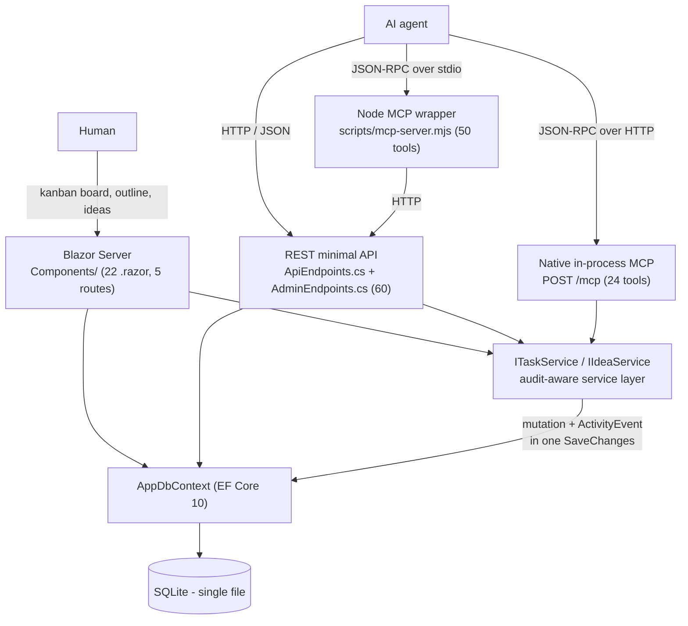
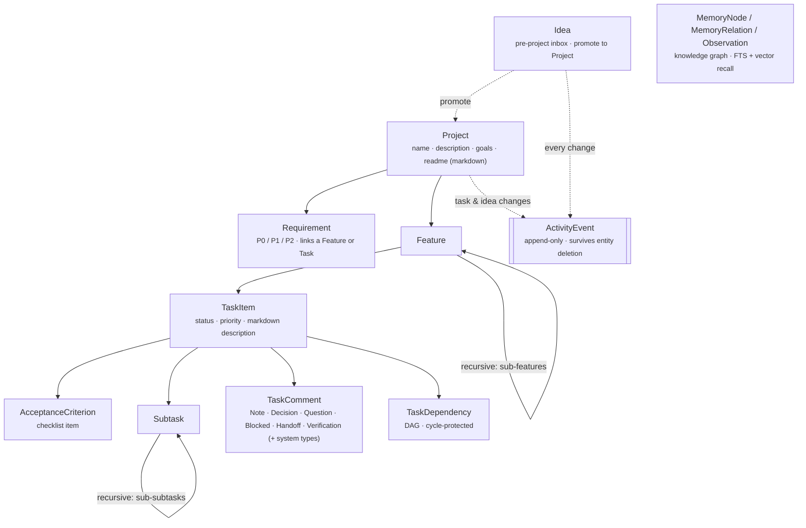
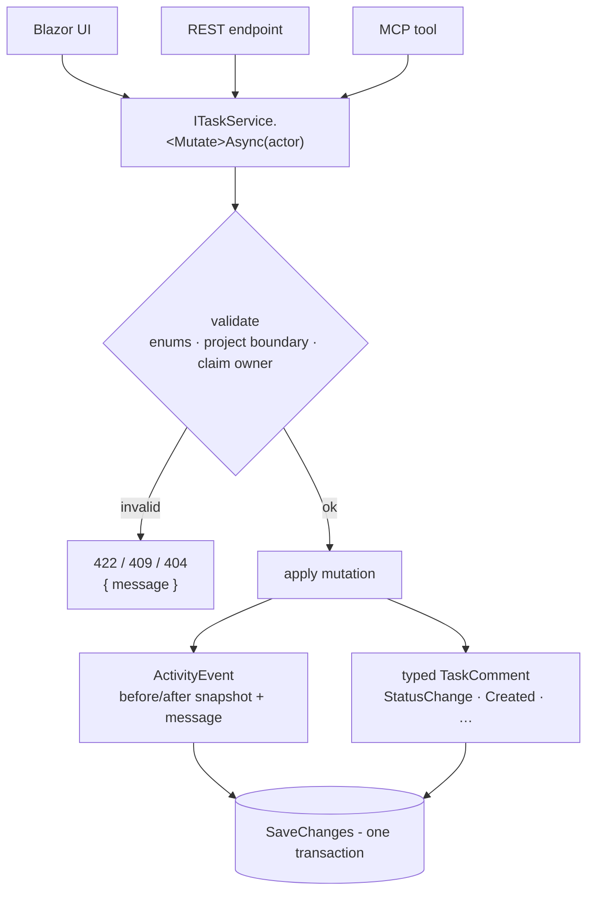

# Architecture & reference

Deep detail moved out of [`README.md`](../README.md) so the front page stays skimmable.
The README is the *product* view (what KanbanFlow is, how the GitHub sync works, how to run it).
This file is the *engineering* view: entity model, write paths, the full REST surface, the MCP
tool inventory, and the capability requirements matrix.

Every count in this file was derived from the code at the commit that introduced it, with the
command shown. If a number here disagrees with the code, the code wins — re-derive it.

---

## Contents

- [Runtime shape](#runtime-shape)
- [Entity model](#entity-model)
- [The write path & audit boundary](#the-write-path--audit-boundary)
- [REST surface (60 endpoints)](#rest-surface-60-endpoints)
- [MCP surface (24 native / 50 wrapper)](#mcp-surface-24-native--50-wrapper)
- [Optional LLM + embedding configuration](#optional-llm--embedding-configuration)
- [Capability requirements matrix](#capability-requirements-matrix)
- [Known gaps](#known-gaps)

---

## Runtime shape

One project, one assembly, one SQLite file. The simplicity is deliberate — there is no
service mesh, no message bus, no container, and no build pipeline to reason about.



Note the two arrows into `AppDbContext` that bypass `ITaskService`. Those are real, not a
drawing shortcut — see [The write path & audit boundary](#the-write-path--audit-boundary).

Verify the shape yourself:

```bash
grep -rn '@page' src/KanbanFlow/Components/ | sed -E 's/.*@page/@page/' | sort -u
grep -n 'MapMcp' src/KanbanFlow/Program.cs
```

---

## Entity model



Feature trees, subtask trees, and the dependency graph are all cycle-protected. Every text
field is documentation an agent can retrieve, summarise, or rewrite.

**Ideas** (`/api/ideas`, `/ideas`) are the pre-project inbox: capture raw, triage, then promote
one into a full project. `Promoted` is a **derived, terminal** status — only
`POST /api/ideas/{id}/promote` (MCP `promote_idea`) sets it, because only that path also
creates the linked project. `PATCH /api/ideas/{id}` and MCP `update_idea` therefore refuse to
move an idea *into* `Promoted` (#283) **or back out of it** (#285), returning 422 with a pointer
to the promote endpoint. Every other status transition is free, and a promoted idea's title,
body, plan, tags, and priority stay fully editable.

---

## The write path & audit boundary

The design intent is one write path: every mutation flows through `ITaskService` /
`IIdeaService`, which validates, applies the change, and records an `ActivityEvent` (plus a
typed `TaskComment`) in a single `SaveChanges`.



**That intent holds for tasks and ideas. It does not yet hold for every entity.** The honest
coverage table lives in the [README](../README.md#what-is-audited--and-what-is-not); the
mechanical evidence is:

```bash
# The whole REST layer has exactly ONE inline audit-event call site.
grep -n 'AddActivityEvent(' src/KanbanFlow/ApiEndpoints.cs
#   2247:  AddActivityEvent(..., "RequirementAssigned", ...)
#   2364:  private static void AddActivityEvent(...)   <- the helper itself
```

Everything else that reaches `AppDbContext` directly from an endpoint — features, subtasks,
acceptance criteria, dependencies, requirement create/update/delete, comment delete, and
project create/update — writes no `ActivityEvent`. That is issue
[#149](https://github.com/joelfuller2016/KanbanFlow-v2/issues/149).

Issue [#88](https://github.com/joelfuller2016/KanbanFlow-v2/issues/88) (route *UI* mutations
through the shared service layer) is **closed** — the Blazor components do call the services.
They also still hold an `AppDbContext` for reads and for the non-audited entity types, which is
why both arrows exist in the runtime diagram above:

```bash
grep -rln 'AppDbContext' src/KanbanFlow/Components/
grep -rln 'ITaskService\|IIdeaService' src/KanbanFlow/Components/
```

---

## REST surface (60 endpoints)

```bash
grep -cE '\.Map(Get|Post|Put|Patch|Delete)\(' src/KanbanFlow/ApiEndpoints.cs    # 55
grep -cE '\.Map(Get|Post|Put|Patch|Delete)\(' src/KanbanFlow/AdminEndpoints.cs  #  5
```

The machine-readable source of truth is the OpenAPI document at `/openapi/v1.json`
(`/openapi.json` 302s to it). The route map:

### Projects

| Route | Methods |
|---|---|
| `/api/projects` | `GET` list · `POST` create — `GET` carries `progress`, `nextTask`, `lastActivityAt` and `activeClaims` per project (R-1.7, #281) |
| `/api/projects/{id}` | `GET` · `PUT` · `DELETE` — `GET` carries `progress` at project and per-feature level (R-1.7) |
| `/api/projects/{id}/context` | `GET` — full graph in one AI-shaped payload, incl. `progress` at project and per-feature level (R-1.7) |
| `/api/projects/{id}/board` | `GET` — tasks grouped by status |
| `/api/projects/{id}/next-tasks` | `GET` — ranked direction (`?actor=&limit=`) |
| `/api/projects/{id}/activity` | `GET` — audit log (`?limit=`, clamped to 500) |
| `/api/projects/{id}/features` | `GET` · `POST` |
| `/api/projects/{id}/tasks` | `GET` — flat list |
| `/api/projects/{id}/requirements` | `GET` · `POST` |

### Features & tasks

| Route | Methods |
|---|---|
| `/api/features/{id}` | `GET` · `PUT` · `DELETE` |
| `/api/features/{id}/tasks` | `GET` · `POST` |
| `/api/tasks/{id}` | `GET` · `PUT` · `DELETE` |
| `/api/tasks/{id}/context` | `GET` — one-call agent bundle (criteria + subtasks + deps + comments + activity) |
| `/api/tasks/{id}/status` | `PATCH` |
| `/api/tasks/{id}/feature` | `PATCH` — reassign to another feature |
| `/api/tasks/{id}/claim` | `POST` |
| `/api/tasks/{id}/release` | `POST` |
| `/api/tasks/{id}/activity` | `GET` |
| `/api/tasks/{id}/subtasks` | `GET` · `POST` |
| `/api/tasks/{id}/acceptance-criteria` | `GET` · `POST` |
| `/api/tasks/{id}/comments` | `GET` · `POST` |
| `/api/tasks/{id}/dependencies` | `GET` · `POST` |

### Leaf entities

| Route | Methods |
|---|---|
| `/api/subtasks/{id}` | `PUT` · `DELETE` — **no `GET`** |
| `/api/acceptance-criteria/{id}` | `PUT` · `DELETE` — **no `GET`** |
| `/api/requirements/{id}` | `PUT` · `DELETE` — **no `GET`** |
| `/api/requirements/{id}/assign` | `PATCH` — link a feature or task |
| `/api/comments/{id}` | `DELETE` |
| `/api/task-dependencies/{id}` | `GET` · `DELETE` |

> The three "no `GET`" rows are a correction: the README claimed `get/update/delete` for all
> three until this pass. Fetch them through their parent collection endpoint instead.

### Ideas

| Route | Methods |
|---|---|
| `/api/ideas` | `GET` (`?status=&tag=&q=&limit=&offset=`) · `POST` |
| `/api/ideas/{id}` | `GET` · `PATCH` · `DELETE` |
| `/api/ideas/{id}/promote` | `POST` — creates the linked project |
| `/api/ideas/{id}/activity` | `GET` |

### Memory (knowledge graph)

| Route | Methods |
|---|---|
| `/api/memory` | `POST` — remember |
| `/api/memory/search` | `GET` — recall; hybrid FTS + vector RRF, `k` clamped 1–100 |

### Admin

| Route | Methods |
|---|---|
| `/api/admin/health` | `GET` — `{ status, app, startedAtUtc, checkedAtUtc, runtime, openApiUrl }` |
| `/api/admin/run-tests` | `POST` — `?suite=api\|ui\|service\|all` |
| `/api/admin/llm-ping` | `GET` — LLM connectivity self-test |
| `/api/admin/embed-ping` | `GET` — embedding connectivity self-test |
| `/api/admin/memory/reindex` | `POST` |

Plus `GET /openapi.json` in `Program.cs`, which 302s to `/openapi/v1.json`.

---

## MCP surface (24 native / 50 wrapper)

Two MCP servers ship, and they are **not** at parity. Tracked in
[#231](https://github.com/joelfuller2016/KanbanFlow-v2/issues/231).

```bash
grep -c '\[McpServerTool(' src/KanbanFlow/Mcp/KanbanMcpTools.cs   # 24 (native, in-process)
```

```bash
# 50 (Node wrapper) - ask the server itself, no parsing guesswork:
printf '%s\n' \
  '{"jsonrpc":"2.0","id":1,"method":"initialize","params":{"protocolVersion":"2025-06-18","capabilities":{},"clientInfo":{"name":"c","version":"1"}}}' \
  '{"jsonrpc":"2.0","id":2,"method":"tools/list","params":{}}' \
  | node scripts/mcp-server.mjs 2>/dev/null \
  | node -e 'let b="";process.stdin.on("data",d=>b+=d).on("end",()=>{for(const l of b.split("\n").filter(Boolean)){try{const m=JSON.parse(l);if(m.id===2)console.log(m.result.tools.length)}catch{}}})'
```

### Native (24) — `POST /mcp`, in-process, no HTTP hop

| Group | Tools |
|---|---|
| Projects (2) | `list_projects`, `get_project_context` |
| Tasks (8) | `get_task`, `get_next_tasks`, `create_task`, `update_task_status`, `delete_task`, `add_task_comment`, `claim_task`, `release_task` |
| Ideas (5) | `create_idea`, `list_ideas`, `get_idea`, `update_idea`, `promote_idea` |
| Knowledge graph (9) | `create_entities`, `create_relations`, `add_observations`, `delete_entities`, `delete_observations`, `delete_relations`, `read_graph`, `search_nodes`, `open_nodes` |

### Node wrapper (50) — `scripts/mcp-server.mjs`, stdio, forwards to REST

Everything native has, **plus**: `get_project`, `list_project_tasks`, `get_project_board`,
`create_project`, `update_project`, `create_feature`, `update_feature`, `delete_feature`,
`update_task`, `reassign_task`, `get_step_context`, the five subtask tools, the five
acceptance-criterion tools, the three dependency tools, and `list_project_activity` /
`list_task_activity`.

### The parity gap that bites

The native server has **no `create_project`**. An agent connected only to `/mcp` cannot onboard
a repo — which is exactly why `scripts/portfolio-sync.mjs` uses REST (`POST /api/projects`)
rather than MCP.

### Still missing from both

| Tool | Why |
|---|---|
| `list_requirements` / `get_requirement` / `create_requirement` / `update_requirement` / `assign_requirement` / `delete_requirement` | Requirements are the last entity with no MCP CRUD at all |
| `search_project` | Blocked on the search endpoint (R-1.5, not implemented) |

### Wiring the wrapper into Claude Code

```jsonc
// ~/.claude/.mcp.json (or your client's MCP config)
{
  "mcpServers": {
    "kanbanflow": {
      "command": "node",
      "args": ["C:/path/to/KanbanFlow-v2/scripts/mcp-server.mjs"],
      "env": {
        "KANBANFLOW_API_URL": "http://127.0.0.1:5123",
        "KANBANFLOW_MCP_TIMEOUT_MS": "10000"
      }
    }
  }
}
```

Start the web app on the matching URL **before** the agent connects.

---

## Optional LLM + embedding configuration

Both are **fail-soft**: when the endpoint is unreachable nothing crashes and no request 500s —
calls return a typed error result, and the ping endpoints answer HTTP 200 with `ok: false`.

### Chat (`ILlmClient`, #218)

| Variable | Default | Purpose |
|---|---|---|
| `ZEROROUTER_URL` (or `KANBANFLOW_LLM_URL`) | `http://localhost:5256/v1` | OpenAI-compatible base URL — must include `/v1` |
| `KANBANFLOW_LLM_MODEL` | `gpt-4o-mini` | Model id |
| `ZEROROUTER_API_KEY` (or `KANBANFLOW_LLM_KEY`) | `zerorouter` | Placeholder credential for local ZeroRouter — deliberately never masked (see note) |
| `KANBANFLOW_LLM_TIMEOUT_MS` | `30000` | Per-attempt timeout |

> **On `ZEROROUTER_API_KEY` and masking.** The default is a **placeholder**, not a secret:
> ZeroRouter runs open on the local network and the OpenAI client merely requires a non-empty
> credential. Per the open-access charter this value is never masked in any UI, log, or response,
> and no auth or rate limiting is added — that is a deliberate product decision for a
> localhost-only tool, not an oversight ([`LlmOptions.cs`](../src/KanbanFlow/Services/LlmOptions.cs)).
>
> **That policy is scoped to the placeholder.** If you repoint `ZEROROUTER_URL` at a hosted
> provider and set a real API key, you inherit a no-masking policy that was chosen for a value
> with nothing to protect. KanbanFlow will not redact it for you. Either keep the local-ZeroRouter
> topology this project assumes, or treat that deployment as out of scope for the open-access
> charter and handle the credential accordingly.

```bash
curl http://127.0.0.1:5123/api/admin/llm-ping
# -> { ok, model, url, latencyMs, reply?, error? }
```

### Embeddings (`IEmbeddingService`, #219)

Identical text is embedded once (content-hash cache); batches are deduped and chunked. Reuses
the URL / key / timeout above and adds:

| Variable | Default | Purpose |
|---|---|---|
| `KANBANFLOW_EMBED_MODEL` | `text-embedding-3-small` | Embedding model id |
| `KANBANFLOW_EMBED_DIMENSIONS` | *(provider-native)* | Requested output dimensionality; only sent when set |
| `KANBANFLOW_EMBED_BATCH_SIZE` | `256` | Max texts per provider call |

```bash
curl http://127.0.0.1:5123/api/admin/embed-ping
# -> { ok, model, url, dimensions, latencyMs, error? }
```

---

## Capability requirements matrix

Requirements are organised by **capability**, not by entity. Every capability should be
reachable from both REST and MCP.

### C-1. Read everything

| # | Requirement | Status |
|---|---|---|
| R-1.1 | List and get every entity: project, feature, task, subtask, acceptance criterion, requirement, dependency, comment, activity event. | ⚠️ **REST:** yes, but the three leaf entities have no `GET` by id and are reachable only through their parent collection. **MCP:** neither server exposes requirements at all (#231) |
| R-1.2 | `GET /api/projects/{id}/context` returns the whole graph in one denormalised AI payload. | ✅ needs paging caps for large projects |
| R-1.3 | Activity queryable per project and per task, time-ordered, with `before`/`after` snapshots. | ✅ for tasks + ideas; ❌ other entities emit nothing (#149) |
| R-1.4 | List endpoints support `?limit=&offset=`. | ❌ only activity clamps `limit` (500); ideas take both; the rest are unbounded |
| R-1.5 | `GET /api/projects/{id}/search?q=` across descriptions, comments, requirements. | ❌ not implemented |
| R-1.7 | Completion computed **once, server-side** and served as a `progress` object (`completed`, `inProgress`, `blocked`, `total`, `percentComplete`) at project *and* feature level on `GET /api/projects/{id}` and `GET /api/projects/{id}/context`, and at project level on `GET /api/projects`, so no surface recomputes it. Feature progress is recursive (own tasks + all descendant features'); `blocked` counts *unfinished* tasks with an open blocker, matching `next-tasks.blockedTaskCount`; `percentComplete` is a number rounded to one decimal, `0.0` and never `NaN` when `total` is 0. | ⚠️ shared `Services/ProjectProgressCalculator` serves all three REST endpoints (#125, #281) and the Home card reads the list one through `Services/ProjectSummaryService` (#281); the `ProjectOutline` header (#111), MCP `get_project_context` and MCP `list_projects` still recompute or omit it |

### C-2. Write everything

| # | Requirement | Status |
|---|---|---|
| R-2.1 | Full REST CRUD for every entity. | ⚠️ 60 endpoints, but not *full* CRUD everywhere: `TaskComment` has create/list/delete and **no update route**, and `ActivityEvent` is read-only by design (append-only, R-7.3) |
| R-2.2 | Every REST capability has at least one MCP tool. | ❌ native 24, wrapper 50 — neither covers requirements (#231) |
| R-2.3 | UI mutations go through the same service layer as REST. | ✅ #88 closed; components call `ITaskService`/`IIdeaService` |
| R-2.4 | All entity mutations produce an `ActivityEvent`. | ❌ tasks + ideas only (#149) |
| R-2.5 | Project-boundary integrity across features, tasks, requirements. | ✅ #82 and #83 both closed — `CrossProjectReassignmentException` (`TaskService.cs:166`) plus 422 on cross-project requirement links |
| R-2.6 | Cycle protection on feature trees, subtask trees, dependency graphs. | ✅ |
| R-2.7 | Enum validation rejects undefined values (`Status: "99"` → 422). | ✅ #89 closed — `Enum.TryParse` + `Enum.IsDefined` pairs throughout `ApiEndpoints.cs` |

### C-3. Direct agents to the next step

| # | Requirement | Status |
|---|---|---|
| R-3.1 | `GET /api/projects/{id}/next-tasks?actor=&limit=` — priority-sorted, dependency-aware. | ✅ |
| R-3.2 | Each recommendation carries a human-readable `reason`. | ✅ shared `TaskRanking.RankNextTasks`, used by REST, MCP and the Home project card (#281) alike |
| R-3.3 | Tasks blocked by incomplete dependencies are excluded. | ✅ |
| R-3.4 | A step-context endpoint returns everything needed to act on one task. | ✅ `GET /api/tasks/{id}/context` (MCP `get_step_context`) |
| R-3.5 | `next-tasks` de-prioritises tasks claimed by other actors. | ✅ |
| R-3.6 | The ranking algorithm is documented so its output is predictable. | ❌ lives only in source — `TaskRanking.RankNextTasks`/`BuildReason` plus `BuildBlockedTaskReason` in `ApiEndpoints.cs` ([#366](https://github.com/joelfuller2016/KanbanFlow-v2/issues/366)) |

### C-4. Add and update documentation

| # | Requirement | Status |
|---|---|---|
| R-4.1 | `name`, `description`, `goals`, `readme` are first-class project doc fields. | ✅ schema; ⚠️ no *native* MCP tool updates them (wrapper's `update_project` does) |
| R-4.2 | Markdown rendered server-side via Markdig with HTML sanitisation. | ✅ `MarkdownRenderer` / `<MarkdownContent>` |
| R-4.3 | Typed comments: `Note`, `Decision`, `Question`, `Blocked`, `Handoff`, `Verification` + system types. | ✅ `AllowedUserCommentTypes` enforces the user/system split |
| R-4.4 | Acceptance criteria are first-class checklist items. | ✅ |
| R-4.5 | Activity records both a structured `BeforeJson`/`AfterJson` snapshot and a readable `Message`. | ✅ |
| R-4.6 | Adding a `Decision` or `Handoff` comment is one MCP call. | ✅ `add_task_comment` |

### C-5. Be self-describing

| # | Requirement | Status |
|---|---|---|
| R-5.1 | OpenAPI document covering every endpoint. | ✅ `/openapi/v1.json`; `/openapi.json` 302s to it |
| R-5.2 | Response types are records, not anonymous shapes. | ❌ ~25 anonymous shapes inline in `ApiEndpoints.cs` |
| R-5.3 | Each MCP tool has a rich description. | ✅ native tool descriptions are detailed; wrapper's are terser |
| R-5.4 | `docs/requirements.md` lists every endpoint, regenerated from OpenAPI. | ⚠️ hand-maintained; drifts |
| R-5.5 | Uniform error shape `{ message, errors?, details? }`. | ⚠️ mostly; some endpoints add ad-hoc fields |

### C-6. Be operationally simple

| # | Requirement | Status |
|---|---|---|
| R-6.1 | Zero setup: `dotnet run` produces a working app with seed data. | ✅ |
| R-6.2 | Single SQLite file; portable; no Docker. | ✅ |
| R-6.3 | A smoke suite runs in under 60 seconds. | ✅ `smoke-api.ps1` |
| R-6.4 | Schema evolves via EF Core migrations. | ❌ `EnsureCreated()` + `SchemaPatcher` (#86) |
| R-6.5 | A cross-platform Node smoke script for the API. | ❌ PowerShell only |
| R-6.6 | ~~CI runs build + smoke on every PR.~~ | **Withdrawn — see [no CI, on purpose](../README.md#deliberate-non-features).** `scripts/verify.ps1` plus the externally-scheduled `scripts/pr-ci.ps1` / `scripts/master-health.ps1` are the gate. |

### C-7. Be honest about the audit trail

| # | Requirement | Status |
|---|---|---|
| R-7.1 | The audit log is the single source of truth for "what changed when". | ⚠️ true for tasks + ideas; not yet a whole-graph guarantee (#149) |
| R-7.2 | UI and API mutations produce identical activity events. | ✅ for the entities the service layer owns (#88 closed) |
| R-7.3 | The audit log survives entity deletion. | ✅ `ActivityEvent` deliberately ignores the project FK (#85) |

---

## Known gaps

Ranked by how much they hurt an agent consuming this system.

| Gap | Issue | Effect on agents |
|---|---|---|
| Audit covers only tasks + ideas | [#149](https://github.com/joelfuller2016/KanbanFlow-v2/issues/149) | A feature rename or a deleted acceptance criterion leaves no trace; agents reading history see a partial past |
| Native/wrapper MCP divergence | [#231](https://github.com/joelfuller2016/KanbanFlow-v2/issues/231) | The same agent gets a different tool set depending on transport; `/mcp` cannot create a project |
| REST edge re-declares service-layer policy | [#302](https://github.com/joelfuller2016/KanbanFlow-v2/issues/302) | Comment-type policy, dead `isBlocked` fields, and actor/author collapse differ between surfaces |
| No repo link *column* on `Project` | [#237](https://github.com/joelfuller2016/KanbanFlow-v2/issues/237) | Largely mitigated: the sync's primary identity key is a `<!-- github: owner/repo -->` marker in `Project.Description`, so a marker-linked project **survives a rename**. Case-insensitive short-name matching remains only as a legacy fallback, and a name-only link *does* still detach on rename until `onboard` stamps it (safe to re-run). A real column would remove the marker parsing, not restore a lost capability |
| Unbounded list endpoints | R-1.4 | A several-hundred-task board returns everything, every time |
| No search endpoint | R-1.5 | Agents must pull whole-project context to find anything |
| Anonymous response shapes | R-5.2 | The OpenAPI document under-describes responses |
| `EnsureCreated()` + hand-rolled patchers | [#86](https://github.com/joelfuller2016/KanbanFlow-v2/issues/86) | Schema changes are risky; no migration history |

---

## Related docs

- [`README.md`](../README.md) — product view, GitHub sync, runbook
- [`docs/GITHUB-SYNC.md`](GITHUB-SYNC.md) — full sync semantics *(lands via the `ghsync` branch)*
- [`docs/BACKLOG.md`](BACKLOG.md) — the generated log book *(lands via the `logbook` branch)*
- [`docs/requirements.md`](requirements.md) — original v1 requirements, partly superseded here
- [`docs/native-mcp-notes.md`](native-mcp-notes.md) — native MCP implementation notes
- [`docs/ci-without-actions.md`](ci-without-actions.md) — how the gate runs without GitHub Actions
- [`docs/ai-briefing-schema.md`](ai-briefing-schema.md) — the agent briefing payload shape
- [`docs/issue-quality-checklist.md`](issue-quality-checklist.md) — what a well-formed issue contains
- [`.claude/skills/kanban-portfolio/reference/mapping.md`](../.claude/skills/kanban-portfolio/reference/mapping.md) — GitHub → board mapping, in full
