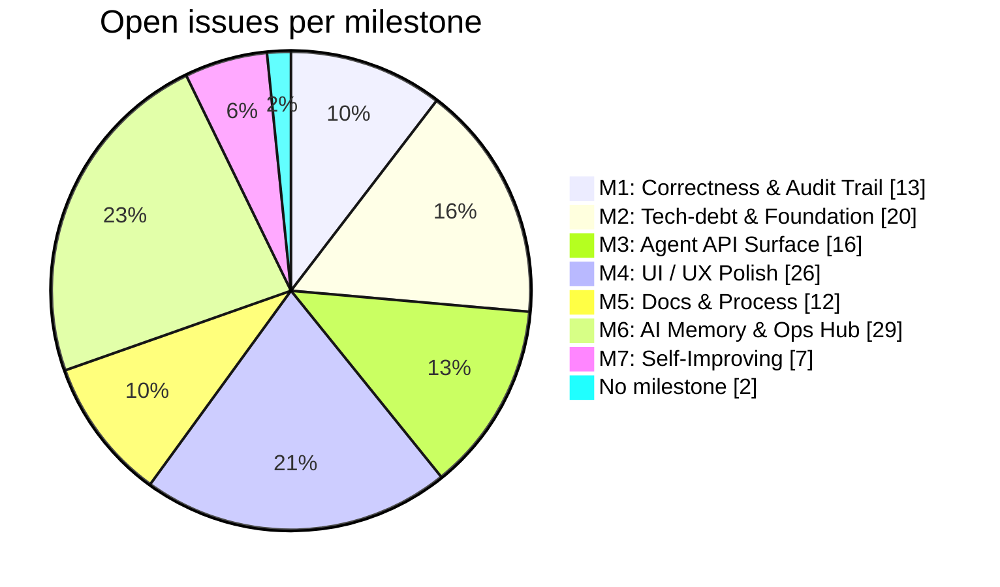

# 📓 KanbanFlow-v2 Backlog — Authoritative Log Book

> **This file is the authoritative log book for this repo.** Every open issue is listed
> below, ordered highest to lowest priority, and every completed issue is recorded in the
> ✅ ledger. Read it to know what is next and what has been done.
>
> **What "authoritative" means here — and what it does not.** This file is the single
> sanctioned *ranking* and the *completion record*: the priority order below is the one to
> work from, and a finished issue is logged here. It is **not** a second source of truth for
> issue state — **GitHub remains the source of truth**, and this file is a verified projection
> of it, accurate as of the timestamp below. It goes stale the moment anyone edits an issue.
>
> **So never trust it blind — prove it.** `npm run backlog:check` exits non-zero the instant
> this file and GitHub disagree, and again if the file was hand-edited (it carries a content
> digest). A green check is what converts this from a snapshot into something you can rely on;
> run it before acting on the order below.
>
> **This file is GENERATED — do not hand-edit it.** `scripts/backlog-sync.mjs` is the only
> sanctioned way to update it. To change what appears here, change the issue on GitHub and
> regenerate with `npm run backlog`.

| | |
| :--- | :--- |
| **Generated** | `2026-08-03T01:14:15.911Z` |
| **Against** | `origin/master` @ [`8894e9d7`](https://github.com/joelfuller2016/KanbanFlow-v2/commit/8894e9d75d8da0fa6adeca0d0d1203dc9dcf9a58) |
| **Open issues** | **125** |
| **Closed issues** | **104** — 101 completed, 3 not planned |
| **Regenerate** | `npm run backlog` &nbsp;·&nbsp; verify with `npm run backlog:check` |
| **Content digest** | `sha256:be7a53188263e36a1f2cb79ec3154ccf74b3100648520029ef49af3dd33ea0d8` |

<!-- backlog-sync:body -->
## 📊 At a glance

| Tier | Meaning | Open | What it covers |
| :--- | :--- | ---: | :--- |
| 🔴 **P0 · Critical** | `P0` | 12 | Correctness, data integrity, and the audit trail. Fix before anything else. |
| 🟠 **P1 · High** | `P1` | 33 | Foundation and agent-facing surface. The work that unblocks the rest. |
| 🟡 **P2 · Medium** | `P2` | 69 | Feature build-out, UI/UX polish, docs. Real work, not urgent. |
| 🟢 **P3 · Low** | `P3` | 11 | Speculative, nice-to-have, or explicitly deferred. |
| | **Total open** | **125** | |

### Open issues per milestone

### 🧩 Open epics (14)

Epics are containers — their children are the ordinary issues listed in the tiers below.

| Issue | Tier | Milestone | Title |
| :--- | :--- | :--- | :--- |
| [#302](https://github.com/joelfuller2016/KanbanFlow-v2/issues/302) | 🔴 P0 | M1 | Epic: the REST edge layer re-declares what the service layer owns — three verified divergences (comment-type policy, dead isBlocked fields, actor/author collapse) |
| [#279](https://github.com/joelfuller2016/KanbanFlow-v2/issues/279) | 🟡 P2 | M4 | Epic: Make the agent dimension visible — the UI renders none of what the backend records |
| [#322](https://github.com/joelfuller2016/KanbanFlow-v2/issues/322) | 🟡 P2 | M4 | EPIC: Give KanbanFlow a visual language — make the knowledge graph visible, not just queryable |
| [#323](https://github.com/joelfuller2016/KanbanFlow-v2/issues/323) | 🟡 P2 | M4 | EPIC: The human must see the AI working — live board, agent presence, readable audit, one tool contract per transport |
| [#308](https://github.com/joelfuller2016/KanbanFlow-v2/issues/308) | 🟡 P2 | M5 | 📊 Backlog blocker map: the critical path, the parallel set, and what's actually dead |
| [#216](https://github.com/joelfuller2016/KanbanFlow-v2/issues/216) | 🟡 P2 | M6 | Epic: AI Memory & Ops Hub — KanbanFlow as memory + PM + knowledge store for AI |
| [#225](https://github.com/joelfuller2016/KanbanFlow-v2/issues/225) | 🟡 P2 | M6 | Epic: Cross-project knowledge storage — queryable KB over the board |
| [#226](https://github.com/joelfuller2016/KanbanFlow-v2/issues/226) | 🟡 P2 | M6 | Epic: AI project-management brain — plan, estimate, sequence |
| [#229](https://github.com/joelfuller2016/KanbanFlow-v2/issues/229) | 🟡 P2 | M6 | Epic: MCP surface hardening — toolsets, parity, resources |
| [#232](https://github.com/joelfuller2016/KanbanFlow-v2/issues/232) | 🟡 P2 | M6 | Epic: Claude Code integration — hooks, slash commands, plugin |
| [#236](https://github.com/joelfuller2016/KanbanFlow-v2/issues/236) | 🟡 P2 | M6 | Epic: PR & git management — link tasks to branches/PRs, surface review status |
| [#238](https://github.com/joelfuller2016/KanbanFlow-v2/issues/238) | 🟡 P2 | M6 | Epic: Deployment orchestration hub — track & trigger deploys for managed projects (Azure) |
| [#326](https://github.com/joelfuller2016/KanbanFlow-v2/issues/326) | 🟡 P2 | M6 | EPIC: KanbanFlow is GitHub, visualized — authoritative log book, complete item history, full sync lifecycle |
| [#242](https://github.com/joelfuller2016/KanbanFlow-v2/issues/242) | 🟢 P3 | M7 | Epic: Self-improving KanbanFlow — a learning loop over the board's own outcomes |

---

## 📋 Open backlog — highest to lowest priority

All **125** open issues, each appearing exactly once. `Rank` is the global work order.

### 🔴 P0 · Critical — 12 open

_Correctness, data integrity, and the audit trail. Fix before anything else._

| Rank | Issue | Title | Milestone | Labels | Age |
| ---: | :--- | :--- | :--- | :--- | ---: |
| 1 | [#187](https://github.com/joelfuller2016/KanbanFlow-v2/issues/187) | REST add-comment sets audit Actor = author (diverges from MCP actor/author split) | M1 | `ai-agent` `api` `bug` | 70d |
| 2 | [#304](https://github.com/joelfuller2016/KanbanFlow-v2/issues/304) | Comment-type policy is declared 4 times and REST gates on its own private copy — the documented "single source of truth" is false, and the UI has already drifted (offers 6 of 7 types) | M1 | `ai-agent` `api` `bug` `tech-debt` | 21d |
| 3 | [#311](https://github.com/joelfuller2016/KanbanFlow-v2/issues/311) | MCP wrapper never sends 'actor' to /next-tasks — so an agent that claims a task then asks what's next watches its own task sink | M1 | `ai-agent` `api` `bug` | 21d |
| 4 | [#332](https://github.com/joelfuller2016/KanbanFlow-v2/issues/332) | GET /api/{entity}/{id}/activity: a 500-event lifetime cap with no cursor, and an unstable sort — history past 500 is unreachable and the order can change between renders | M1 | `ai-agent` `api` `bug` `tech-debt` | 0d |
| 5 | [#333](https://github.com/joelfuller2016/KanbanFlow-v2/issues/333) | portfolio-sync forces status to Done over a hand-set value — the 'never overrides a hand-set status' invariant holds in only one direction | M1 | `api` `bug` `tech-debt` | 0d |
| 6 | [#337](https://github.com/joelfuller2016/KanbanFlow-v2/issues/337) | API serializes DateTime with Kind=Unspecified — every timestamp goes out without a 'Z' and every consumer silently mis-zones it | M1 | `ai-agent` `api` `bug` `tech-debt` | 0d |
| 7 | [#349](https://github.com/joelfuller2016/KanbanFlow-v2/issues/349) | portfolio-sync misreports both halves of the mirror: the comment headline over-counts every bodyless review (60 vs 40 today), and an edited issue body never reaches the board | M1 | `bug` `documentation` `tech-debt` | 0d |
| 8 | [#302](https://github.com/joelfuller2016/KanbanFlow-v2/issues/302) | 🧩 Epic: the REST edge layer re-declares what the service layer owns — three verified divergences (comment-type policy, dead isBlocked fields, actor/author collapse) | M1 | `ai-agent` `api` `epic` `tech-debt` | 21d |
| 9 | [#270](https://github.com/joelfuller2016/KanbanFlow-v2/issues/270) | Per-feature SortOrder allocation is non-atomic (maxSort+1 race across CreateAsync/Reassign/children) | M2 | `api` `bug` `tech-debt` | 30d |
| 10 | [#305](https://github.com/joelfuller2016/KanbanFlow-v2/issues/305) | ProjectView.ParsePriority is the last unguarded enum parse in src/ — "99" yields (TaskPriority)99 instead of the Low fallback (closes the #89 → #205 arc) | M2 | `bug` `tech-debt` `ui` | 21d |
| 11 | [#330](https://github.com/joelfuller2016/KanbanFlow-v2/issues/330) | Missing .gitattributes + core.autocrlf=true: a fresh clone hands back CRLF, so any byte-comparing guard is red on arrival | M2 | `bug` `tech-debt` | 0d |
| 12 | [#350](https://github.com/joelfuller2016/KanbanFlow-v2/issues/350) | Subtask, AcceptanceCriterion and Requirement have no GET by id — and all three POSTs return a 201 Location pointing at that 404 | M3 | `ai-agent` `api` `bug` `documentation` | 0d |

### 🟠 P1 · High — 33 open

_Foundation and agent-facing surface. The work that unblocks the rest._

| Rank | Issue | Title | Milestone | Labels | Age |
| ---: | :--- | :--- | :--- | :--- | ---: |
| 13 | [#149](https://github.com/joelfuller2016/KanbanFlow-v2/issues/149) | P1: Audit trail only covers Task entities — extend ActivityEvent to all mutations (UI + REST) | M1 | `ai-agent` `api` `bug` `tech-debt` | 70d |
| 14 | [#320](https://github.com/joelfuller2016/KanbanFlow-v2/issues/320) | P1: Sanitizer-bypass CVE under the app's only XSS defence — suppression comment is wrong on all 3 claims, and the gated suite can't catch a bypass | M1 | `bug` `dependencies` `tech-debt` `testing` | 0d |
| 15 | [#338](https://github.com/joelfuller2016/KanbanFlow-v2/issues/338) | P1: smoke-api.ps1 is RED on master: /api/memory/search clamps k&lt;=0 to 1 and returns 200, but the smoke gate asserts 422 — and the catch block for it is unreachable | M1 | `ai-agent` `api` `bug` `testing` | 0d |
| 16 | [#340](https://github.com/joelfuller2016/KanbanFlow-v2/issues/340) | P1: MarkdownRenderer's attribute allow-list is global, not per-tag — stored markdown can inject a live &lt;input&gt; text box, and the comment claims the opposite | M1 | `bug` `tech-debt` | 0d |
| 17 | [#167](https://github.com/joelfuller2016/KanbanFlow-v2/issues/167) | Blazor correctness & UX hardening (eval, @key, [Parameter] mutation, full-page error takeover, HttpClient) | M2 | `tech-debt` `ui` | 70d |
| 18 | [#191](https://github.com/joelfuller2016/KanbanFlow-v2/issues/191) | Minor correctness cleanup: run-tests concurrency, dead CommentType, master-health title match, leaf-first depth cache, CreateAsync SortOrder | M2 | `tech-debt` | 70d |
| 19 | [#202](https://github.com/joelfuller2016/KanbanFlow-v2/issues/202) | test: add WebApplicationFactory HTTP-level endpoint tests (suite is DbContext-only) | M2 | `tech-debt` | 70d |
| 20 | [#208](https://github.com/joelfuller2016/KanbanFlow-v2/issues/208) | test: assert next-tasks ranking order + cycle-guard correctness + enum-rejection negatives | M2 | `testing` | 56d |
| 21 | [#209](https://github.com/joelfuller2016/KanbanFlow-v2/issues/209) | Minor correctness cleanup (round 2): no-op assign audit, SQLite WAL/busy_timeout, full-table feature-delete scan, mojibake separator | M2 | `tech-debt` | 56d |
| 22 | [#250](https://github.com/joelfuller2016/KanbanFlow-v2/issues/250) | Add DB-backed, UI-editable settings (AppSetting store + Settings UI + DB→env→default precedence) | M2 | `ai-agent` `api` `enhancement` `ui` | 35d |
| 23 | [#120](https://github.com/joelfuller2016/KanbanFlow-v2/issues/120) | P1: GET /api/projects/{id}/diff?since=&lt;iso&gt; for incremental sync | M3 | `ai-agent` `api` `enhancement` | 84d |
| 24 | [#121](https://github.com/joelfuller2016/KanbanFlow-v2/issues/121) | P1: GET /api/projects/{id}/events Server-Sent Events stream | M3 | `ai-agent` `api` `enhancement` | 84d |
| 25 | [#122](https://github.com/joelfuller2016/KanbanFlow-v2/issues/122) | P1: Add task.readiness derived field to project + task context responses | M3 | `ai-agent` `api` `enhancement` | 84d |
| 26 | [#123](https://github.com/joelfuller2016/KanbanFlow-v2/issues/123) | P1: Expand isBlocked to a structured blockedBy list in /next-tasks | M3 | `ai-agent` `api` `enhancement` | 84d |
| 27 | [#124](https://github.com/joelfuller2016/KanbanFlow-v2/issues/124) | P1: Include ac/comment/blocker counts on task entries in project context | M3 | `ai-agent` `api` `enhancement` | 84d |
| 28 | [#125](https://github.com/joelfuller2016/KanbanFlow-v2/issues/125) | P1: Add progress object at project and feature level | M3 | `api` `enhancement` | 84d |
| 29 | [#173](https://github.com/joelfuller2016/KanbanFlow-v2/issues/173) | Task organization: milestone sequencing layer + AI orientation briefing (make the whole process AI-legible) | M3 | `ai-agent` `api` `enhancement` `ui` | 70d |
| 30 | [#264](https://github.com/joelfuller2016/KanbanFlow-v2/issues/264) | Parallel work-batch endpoint: return K conflict-minimal tasks for N concurrent agents | M3 | `ai-agent` `api` `enhancement` | 30d |
| 31 | [#265](https://github.com/joelfuller2016/KanbanFlow-v2/issues/265) | Critical-path & slack signal over the dependency DAG (CPM forward/backward pass) | M3 | `ai-agent` `api` `enhancement` | 30d |
| 32 | [#306](https://github.com/joelfuller2016/KanbanFlow-v2/issues/306) | TaskDetailPanel renders two clocks: comments in local time, Created/Updated/Completed in raw UTC — and #116's plan silently skips exactly the three broken lines | M4 | `bug` `ui` | 21d |
| 33 | [#341](https://github.com/joelfuller2016/KanbanFlow-v2/issues/341) | MarkdownRenderer strips class and id, so code-fence highlighting, heading anchors, and task-list CSS hooks are all silently dead | M4 | `bug` `tech-debt` | 0d |
| 34 | [#343](https://github.com/joelfuller2016/KanbanFlow-v2/issues/343) | The empty-state placeholder can exceed its column and paint outside it — an absolutely-positioned overlay cannot size the box that is meant to contain it | M4 | `bug` `ui` | 0d |
| 35 | [#357](https://github.com/joelfuller2016/KanbanFlow-v2/issues/357) | Task Description is the only markdown field never rendered — both surfaces bind it into a raw textarea, so a synced task shows '&lt;!-- kanbanflow-sync --&gt;' and dead URLs as literal text | M4 | `bug` `ui` | 0d |
| 36 | [#359](https://github.com/joelfuller2016/KanbanFlow-v2/issues/359) | Timeline renders every description change as X → X: the 60-char truncation cuts 10 chars INSIDE a 70-char constant sync prefix, so no synced description can ever show a delta (lands with PR #339) | M4 | `bug` `ui` | 0d |
| 37 | [#367](https://github.com/joelfuller2016/KanbanFlow-v2/issues/367) | a11y: white text on --bs-primary measures 4.24:1 — below WCAG AA for .kf-chip-active and its class | M4 | `bug` `ui` | 0d |
| 38 | [#109](https://github.com/joelfuller2016/KanbanFlow-v2/issues/109) | P1: Surface dependencies, recent activity, and related requirements in the task detail panel | M4 | `enhancement` `ui` | 84d |
| 39 | [#110](https://github.com/joelfuller2016/KanbanFlow-v2/issues/110) | P1: Show claimedBy on kanban cards | M4 | `enhancement` `ui` | 84d |
| 40 | [#111](https://github.com/joelfuller2016/KanbanFlow-v2/issues/111) | P1: Add project progress summary header on /project/{id} | M4 | `enhancement` `ui` | 84d |
| 41 | [#112](https://github.com/joelfuller2016/KanbanFlow-v2/issues/112) | P1: Add filter/search controls to the kanban board | M4 | `enhancement` `ui` | 84d |
| 42 | [#113](https://github.com/joelfuller2016/KanbanFlow-v2/issues/113) | P1: Replace 'Coming soon' tooltip with visible badge for disabled AI buttons | M4 | `enhancement` `ui` | 84d |
| 43 | [#114](https://github.com/joelfuller2016/KanbanFlow-v2/issues/114) | P1: Add per-card actions to /next-tasks recommendations panel | M4 | `ai-agent` `enhancement` `ui` | 84d |
| 44 | [#309](https://github.com/joelfuller2016/KanbanFlow-v2/issues/309) | Dependabot proposes breaking major bumps with no gate to catch them (PR #275: OpenApi 2.7.5→3.7.0 doesn't compile) | M5 | `dependencies` `tech-debt` | 21d |
| 45 | [#364](https://github.com/joelfuller2016/KanbanFlow-v2/issues/364) | The board and the backlog log book will disagree on 14 of 122 issues — #355 forbids the topical-label promotion #339 depends on | M5 | `bug` `documentation` `tech-debt` | 0d |

### 🟡 P2 · Medium — 69 open

_Feature build-out, UI/UX polish, docs. Real work, not urgent._

| Rank | Issue | Title | Milestone | Labels | Age |
| ---: | :--- | :--- | :--- | :--- | ---: |
| 46 | [#368](https://github.com/joelfuller2016/KanbanFlow-v2/issues/368) | P2: /api/projects/{id}/activity has no actor filter — portfolio-sync reports "last sync: never" for a project that synced minutes ago | M1 | `ai-agent` `api` `enhancement` | 0d |
| 47 | [#189](https://github.com/joelfuller2016/KanbanFlow-v2/issues/189) | P2: EnsureActivityEventTable rebuild can drop column drift / orphan the table (data-loss path) | M2 | `bug` `tech-debt` | 70d |
| 48 | [#351](https://github.com/joelfuller2016/KanbanFlow-v2/issues/351) | P2: ui-e2e defaults to a fixed port, so two concurrent runs corrupt each other's results — and the loser reports plausible WRONG numbers, not an error (cost 2 agents time on PR #335) | M2 | `bug` | 0d |
| 49 | [#352](https://github.com/joelfuller2016/KanbanFlow-v2/issues/352) | P2: two concurrent ui-e2e runs contend for the same build output — a RUNNING app holds KanbanFlow.exe while the other run builds (MSB3027), so a failure points at your last edit instead of the collision | M2 | `bug` `tech-debt` `testing` | 0d |
| 50 | [#354](https://github.com/joelfuller2016/KanbanFlow-v2/issues/354) | P2: database path resolves against Environment.CurrentDirectory — the README's own start command opens a different DB than the one on disk (silent empty board) | M2 | `bug` `tech-debt` | 0d |
| 51 | [#86](https://github.com/joelfuller2016/KanbanFlow-v2/issues/86) | P2: Replace manual schema patching with EF migrations | M2 | `enhancement` | 91d |
| 52 | [#152](https://github.com/joelfuller2016/KanbanFlow-v2/issues/152) | P2: Split ApiEndpoints.cs (2,482 lines) + replace anonymous response shapes with records (R-5.2) | M2 | `api` `tech-debt` | 70d |
| 53 | [#154](https://github.com/joelfuller2016/KanbanFlow-v2/issues/154) | P2: List endpoints lack ?limit/?offset paging except /activity (R-1.4) | M2 | `ai-agent` `api` `enhancement` | 70d |
| 54 | [#344](https://github.com/joelfuller2016/KanbanFlow-v2/issues/344) | P2: SqliteTestFactory shares one :memory: connection, so any concurrency test written against it CANNOT fail — a fake-green generator in the test fixture (blocks credible verification of #270) | M2 | `tech-debt` `testing` | 0d |
| 55 | [#347](https://github.com/joelfuller2016/KanbanFlow-v2/issues/347) | P2: TaskMoveConcurrencyTests can PASS against an unserialized subject — the barrier's timeout release is also the correct path, so it cannot discriminate (proven: same subject 3/3 FAIL at 1.5s, 3/3 PASS at 1ms) + 3 smaller test gaps | M2 | `tech-debt` `testing` | 0d |
| 56 | [#353](https://github.com/joelfuller2016/KanbanFlow-v2/issues/353) | P2: a ui-e2e run can measure a completely UNSTYLED page and nothing notices — 200 response, zero CSS rules, plausible wrong geometry (cost 2 invalidated runs on PR #335) | M2 | `tech-debt` `testing` | 0d |
| 57 | [#126](https://github.com/joelfuller2016/KanbanFlow-v2/issues/126) | P2: GET /api/agents/{name}/work — see all tasks claimed/assigned to an actor | M3 | `ai-agent` `api` `enhancement` | 84d |
| 58 | [#127](https://github.com/joelfuller2016/KanbanFlow-v2/issues/127) | P2: Add task.staleness signal (e.g., "3d_unchanged") to context responses | M3 | `ai-agent` `api` `enhancement` | 84d |
| 59 | [#128](https://github.com/joelfuller2016/KanbanFlow-v2/issues/128) | P2: Add task.next_action server-generated hint | M3 | `ai-agent` `api` `enhancement` | 84d |
| 60 | [#129](https://github.com/joelfuller2016/KanbanFlow-v2/issues/129) | P2: Return both raw and rendered markdown for project goals + readme | M3 | `ai-agent` `api` `enhancement` | 84d |
| 61 | [#130](https://github.com/joelfuller2016/KanbanFlow-v2/issues/130) | P2: Optional requirementId link on AcceptanceCriterion | M3 | `api` `enhancement` | 84d |
| 62 | [#131](https://github.com/joelfuller2016/KanbanFlow-v2/issues/131) | P2: Expose MCP resources alongside tools (e.g., kanbanflow://project/1/context) | M3 | `ai-agent` `api` `enhancement` | 84d |
| 63 | [#183](https://github.com/joelfuller2016/KanbanFlow-v2/issues/183) | P2: AI-tools panel race — rapid clicks can show mismatched title/data (ProjectView) | M4 | `ai-agent` `bug` `ui` | 70d |
| 64 | [#279](https://github.com/joelfuller2016/KanbanFlow-v2/issues/279) | 🧩 Epic: Make the agent dimension visible — the UI renders none of what the backend records | M4 | `ai-agent` `epic` `ui` | 21d |
| 65 | [#322](https://github.com/joelfuller2016/KanbanFlow-v2/issues/322) | 🧩 EPIC: Give KanbanFlow a visual language — make the knowledge graph visible, not just queryable | M4 | `enhancement` `epic` `ui` | 0d |
| 66 | [#323](https://github.com/joelfuller2016/KanbanFlow-v2/issues/323) | 🧩 EPIC: The human must see the AI working — live board, agent presence, readable audit, one tool contract per transport | M4 | `ai-agent` `api` `epic` `ui` | 0d |
| 67 | [#115](https://github.com/joelfuller2016/KanbanFlow-v2/issues/115) | P2: Add a global Cmd-K command palette | M4 | `enhancement` `ui` | 84d |
| 68 | [#116](https://github.com/joelfuller2016/KanbanFlow-v2/issues/116) | P2: Use relative timestamps with absolute on hover | M4 | `enhancement` `ui` | 84d |
| 69 | [#117](https://github.com/joelfuller2016/KanbanFlow-v2/issues/117) | P2: Add hover tooltips for truncated task and feature names | M4 | `enhancement` `ui` | 84d |
| 70 | [#119](https://github.com/joelfuller2016/KanbanFlow-v2/issues/119) | P2: Improve empty kanban column UX with inline + button | M4 | `enhancement` `ui` | 84d |
| 71 | [#200](https://github.com/joelfuller2016/KanbanFlow-v2/issues/200) | a11y: confirm-action modals (delete/promote) lack Esc dismissal + focus-trap | M4 | `enhancement` | 70d |
| 72 | [#281](https://github.com/joelfuller2016/KanbanFlow-v2/issues/281) | Home project card doesn't earn its space — no progress, no next-task, no recency, no agent state | M4 | `ai-agent` `enhancement` `ui` | 21d |
| 73 | [#328](https://github.com/joelfuller2016/KanbanFlow-v2/issues/328) | The task modal shows comments but not the ActivityEvent trail — a task's real history is recorded, queryable, and invisible | M4 | `ai-agent` `enhancement` `ui` | 0d |
| 74 | [#342](https://github.com/joelfuller2016/KanbanFlow-v2/issues/342) | #290's fix shipped but its own AC5 did not — the empty-column placeholder has ZERO e2e coverage on either board | M4 | `testing` `ui` | 0d |
| 75 | [#346](https://github.com/joelfuller2016/KanbanFlow-v2/issues/346) | P2: "every colour is a --bs-* so dark mode stays reachable" is not true — 10 hardcoded bg-white/bg-light utilities pin the shell to light, and nothing tests the claim | M4 | `enhancement` `ui` | 0d |
| 76 | [#308](https://github.com/joelfuller2016/KanbanFlow-v2/issues/308) | 🧩 📊 Backlog blocker map: the critical path, the parallel set, and what's actually dead | M5 | `epic` | 21d |
| 77 | [#147](https://github.com/joelfuller2016/KanbanFlow-v2/issues/147) | Harden the PR-review workflow: execution gate (CI without GitHub Actions), merge gating, honest thread resolution | M5 | `ai-agent` `enhancement` `tech-debt` `testing` | 70d |
| 78 | [#253](https://github.com/joelfuller2016/KanbanFlow-v2/issues/253) | fix(verify.ps1): advisory format step leaks its exit code → gate reports failure despite green build+test | M5 | `tech-debt` `testing` | 34d |
| 79 | [#314](https://github.com/joelfuller2016/KanbanFlow-v2/issues/314) | ui-e2e prints no summary line when the harness itself dies — a run that never happened greps identical to a clean one | M5 | `testing` | 20d |
| 80 | [#327](https://github.com/joelfuller2016/KanbanFlow-v2/issues/327) | docs/BACKLOG.md: an authoritative, generated log book — every issue ranked, every completion logged | M5 | `ai-agent` `documentation` `enhancement` | 0d |
| 81 | [#331](https://github.com/joelfuller2016/KanbanFlow-v2/issues/331) | 32 of 96 open issues have no milestone — which is why 62 of them default into one undifferentiated P2 tier | M5 | `documentation` `tech-debt` | 0d |
| 82 | [#345](https://github.com/joelfuller2016/KanbanFlow-v2/issues/345) | Docs pin exact measured test output that nothing re-checks — four claims silently went stale in one PR, one contradicting code in the same commit | M5 | `tech-debt` `testing` | 0d |
| 83 | [#366](https://github.com/joelfuller2016/KanbanFlow-v2/issues/366) | docs: document the next-tasks ranking algorithm so its output is predictable (closes R-3.6) | M5 | `ai-agent` `documentation` | 0d |
| 84 | [#369](https://github.com/joelfuller2016/KanbanFlow-v2/issues/369) | P2: R-3.6 is not undocumented — it is documented WRONG: none of the four "Ranking rules (current)" in docs/requirements.md exist in TaskRanking | M5 | `ai-agent` `api` `documentation` | 0d |
| 85 | [#216](https://github.com/joelfuller2016/KanbanFlow-v2/issues/216) | 🧩 Epic: AI Memory & Ops Hub — KanbanFlow as memory + PM + knowledge store for AI | M6 | `ai-agent` `enhancement` `epic` | 35d |
| 86 | [#225](https://github.com/joelfuller2016/KanbanFlow-v2/issues/225) | 🧩 Epic: Cross-project knowledge storage — queryable KB over the board | M6 | `ai-agent` `enhancement` `epic` | 35d |
| 87 | [#226](https://github.com/joelfuller2016/KanbanFlow-v2/issues/226) | 🧩 Epic: AI project-management brain — plan, estimate, sequence | M6 | `ai-agent` `epic` | 35d |
| 88 | [#229](https://github.com/joelfuller2016/KanbanFlow-v2/issues/229) | 🧩 Epic: MCP surface hardening — toolsets, parity, resources | M6 | `ai-agent` `api` `epic` | 35d |
| 89 | [#232](https://github.com/joelfuller2016/KanbanFlow-v2/issues/232) | 🧩 Epic: Claude Code integration — hooks, slash commands, plugin | M6 | `ai-agent` `epic` | 35d |
| 90 | [#236](https://github.com/joelfuller2016/KanbanFlow-v2/issues/236) | 🧩 Epic: PR & git management — link tasks to branches/PRs, surface review status | M6 | `api` `epic` | 35d |
| 91 | [#238](https://github.com/joelfuller2016/KanbanFlow-v2/issues/238) | 🧩 Epic: Deployment orchestration hub — track & trigger deploys for managed projects (Azure) | M6 | `deploy` `epic` | 35d |
| 92 | [#326](https://github.com/joelfuller2016/KanbanFlow-v2/issues/326) | 🧩 EPIC: KanbanFlow is GitHub, visualized — authoritative log book, complete item history, full sync lifecycle | M6 | `ai-agent` `api` `documentation` `enhancement` `epic` | 0d |
| 93 | [#227](https://github.com/joelfuller2016/KanbanFlow-v2/issues/227) | Add spec-&gt;plan-&gt;tasks decomposition (REST + MCP tool) | M6 | `ai-agent` `api` | 35d |
| 94 | [#228](https://github.com/joelfuller2016/KanbanFlow-v2/issues/228) | Add LLM-aware next_task: complexity scoring + auto-prioritization | M6 | `ai-agent` `api` | 35d |
| 95 | [#230](https://github.com/joelfuller2016/KanbanFlow-v2/issues/230) | Add MCP toolset grouping + read-only mode to /mcp | M6 | `ai-agent` `api` | 35d |
| 96 | [#231](https://github.com/joelfuller2016/KanbanFlow-v2/issues/231) | Finish native C# MCP parity (15-&gt;~30 tools); retire Node-wrapper drift | M6 | `ai-agent` `api` | 35d |
| 97 | [#233](https://github.com/joelfuller2016/KanbanFlow-v2/issues/233) | Add event-sync hooks (SessionStart/PostToolUse/Stop -&gt; /api/activity + memory) | M6 | `ai-agent` | 35d |
| 98 | [#234](https://github.com/joelfuller2016/KanbanFlow-v2/issues/234) | Ship /kanban slash-command suite (next/plan/start/update/ship/status) | M6 | `ai-agent` | 35d |
| 99 | [#235](https://github.com/joelfuller2016/KanbanFlow-v2/issues/235) | Package KanbanFlow as an installable Claude Code plugin (commands + hooks + MCP config) | M6 | `ai-agent` | 35d |
| 100 | [#237](https://github.com/joelfuller2016/KanbanFlow-v2/issues/237) | Add GitLink model + auto branch+PR from a task (Octokit + LibGit2Sharp) | M6 | `ai-agent` `api` | 35d |
| 101 | [#239](https://github.com/joelfuller2016/KanbanFlow-v2/issues/239) | Add DeploymentTarget model + per-project deploy status board (read-only first) | M6 | `api` `deploy` | 35d |
| 102 | [#254](https://github.com/joelfuller2016/KanbanFlow-v2/issues/254) | MemoryService.GetNodeAsync — make AccessCount increment atomic (multi-reader safety) | M6 | `memory` `tech-debt` | 34d |
| 103 | [#255](https://github.com/joelfuller2016/KanbanFlow-v2/issues/255) | Add host-level startup smoke test (WebApplicationFactory) for memory schema + DI wiring | M6 | `memory` `tech-debt` | 34d |
| 104 | [#258](https://github.com/joelfuller2016/KanbanFlow-v2/issues/258) | MemorySearch: extend the vector signal to rank superseded versions when IncludeSuperseded=true | M6 | `enhancement` `memory` | 34d |
| 105 | [#263](https://github.com/joelfuller2016/KanbanFlow-v2/issues/263) | Bi-temporal MemoryRelation edges: conflict-driven soft-invalidation + point-in-time (asOf) graph reads | M6 | `ai-agent` `api` `memory` | 30d |
| 106 | [#266](https://github.com/joelfuller2016/KanbanFlow-v2/issues/266) | Enable structured MCP tool output (UseStructuredContent + outputSchema) + behavioral annotations | M6 | `ai-agent` `api` | 30d |
| 107 | [#267](https://github.com/joelfuller2016/KanbanFlow-v2/issues/267) | Graph-expansion retrieval: bounded neighborhood hops over the RRF seed set | M6 | `ai-agent` `api` `memory` | 30d |
| 108 | [#276](https://github.com/joelfuller2016/KanbanFlow-v2/issues/276) | Add TaskAttempt / AgentSession / AttemptCommit model — record agent work attempts + a commit ledger with rewind | M6 | `ai-agent` `api` `enhancement` | 21d |
| 109 | [#278](https://github.com/joelfuller2016/KanbanFlow-v2/issues/278) | Generate the MCP server 'instructions' string from the actually-registered tools (kill tool-list prose drift) | M6 | `ai-agent` `api` `tech-debt` | 21d |
| 110 | [#289](https://github.com/joelfuller2016/KanbanFlow-v2/issues/289) | portfolio-sync: 78% of the board lands in a flat 'Unsorted' bucket — add a label-based grouping fallback | M6 | `ai-agent` `enhancement` | 21d |
| 111 | [#329](https://github.com/joelfuller2016/KanbanFlow-v2/issues/329) | The sync has one verb: mirror. Add onboard / push-issue / status so the board is a real view over GitHub | M6 | `ai-agent` `api` `documentation` `enhancement` | 0d |
| 112 | [#336](https://github.com/joelfuller2016/KanbanFlow-v2/issues/336) | Durable issue link + resumable create — the title prefix cannot safely key an issue the board originates | M6 | `ai-agent` `api` `enhancement` `tech-debt` | 0d |
| 113 | [#361](https://github.com/joelfuller2016/KanbanFlow-v2/issues/361) | Board → GitHub write-back for EXISTING issues: the scope decision, plus the read-only lock #336 assumes exists but doesn't | M6 | `ai-agent` `api` `enhancement` | 0d |
| 114 | [#164](https://github.com/joelfuller2016/KanbanFlow-v2/issues/164) | Epic: competitive feature-gap analysis — features from similar tools to adopt | — | `ai-agent` `api` `enhancement` | 70d |

### 🟢 P3 · Low — 11 open

_Speculative, nice-to-have, or explicitly deferred._

| Rank | Issue | Title | Milestone | Labels | Age |
| ---: | :--- | :--- | :--- | :--- | ---: |
| 115 | [#159](https://github.com/joelfuller2016/KanbanFlow-v2/issues/159) | P3: Remove dead code + de-duplicate leaf-first subtask deletion | M2 | `tech-debt` | 70d |
| 116 | [#370](https://github.com/joelfuller2016/KanbanFlow-v2/issues/370) | P3: The 4.24:1 contrast figure in app.css is wrong — white on --bs-primary measures 4.5008:1 and PASSES AA by 0.0008; decide the primary-pairing policy | M4 | `documentation` `tech-debt` `ui` | 0d |
| 117 | [#277](https://github.com/joelfuller2016/KanbanFlow-v2/issues/277) | docs: README under-reports the surface — 53→60 endpoints, memory endpoints missing from the API table, 41→50 wrapper tools | M5 | `documentation` | 21d |
| 118 | [#242](https://github.com/joelfuller2016/KanbanFlow-v2/issues/242) | 🧩 Epic: Self-improving KanbanFlow — a learning loop over the board's own outcomes | M7 | `ai-agent` `epic` `self-improving` | 35d |
| 119 | [#243](https://github.com/joelfuller2016/KanbanFlow-v2/issues/243) | Build a trajectory + outcome labeler over ActivityEvent + comments | M7 | `ai-agent` `self-improving` | 35d |
| 120 | [#244](https://github.com/joelfuller2016/KanbanFlow-v2/issues/244) | Add a ReasoningBank strategy distiller (ILlmClient → memory store) | M7 | `ai-agent` `memory` `self-improving` | 35d |
| 121 | [#245](https://github.com/joelfuller2016/KanbanFlow-v2/issues/245) | Recall + inject learned strategies into get_next_tasks/get_task (the "Coach") | M7 | `ai-agent` `api` `self-improving` | 35d |
| 122 | [#246](https://github.com/joelfuller2016/KanbanFlow-v2/issues/246) | Self-tuning recommender + offline backtest harness (A/B + rollback) | M7 | `ai-agent` `api` `self-improving` | 35d |
| 123 | [#247](https://github.com/joelfuller2016/KanbanFlow-v2/issues/247) | Failure-reflection loop — CommentType.Reflection on reopen/Blocked/failed-Verification | M7 | `ai-agent` `self-improving` | 35d |
| 124 | [#248](https://github.com/joelfuller2016/KanbanFlow-v2/issues/248) | Growing playbook library from recurring success patterns (Voyager-style) | M7 | `ai-agent` `self-improving` | 35d |
| 125 | [#163](https://github.com/joelfuller2016/KanbanFlow-v2/issues/163) | 🗺️ Roadmap & execution plan (M1–M5) — the KanbanFlow-v2 backlog | — | `documentation` | 70d |

---

## ✅ Completed

**101** issues closed as completed, newest first. This is the ledger half of the log book: when an issue is finished it is recorded here, with the PR that closed it when GitHub can resolve one.

| Issue | Title | Closed | Milestone | Closed by |
| :--- | :--- | :--- | :--- | :--- |
| [#355](https://github.com/joelfuller2016/KanbanFlow-v2/issues/355) | P1: derivePriority() ignores the P0-P3 title prefix — 91 of 91 KanbanFlow-v2 cards are Medium because this repo has zero priority labels | 2026-08-03 | M6 | [#360](https://github.com/joelfuller2016/KanbanFlow-v2/pull/360) |
| [#307](https://github.com/joelfuller2016/KanbanFlow-v2/issues/307) | OnCardMoved uses a DOM index as a DB index — the board reindexes SortOrder from the RENDERED order, so any filtered/partial board silently corrupts data (blocks #112) | 2026-08-02 | M1 | [#325](https://github.com/joelfuller2016/KanbanFlow-v2/pull/325) |
| [#321](https://github.com/joelfuller2016/KanbanFlow-v2/issues/321) | fix: MCP stdio wrapper is unreachable by spec-compliant clients (LSP Content-Length framing) — and its smoke test shares the defect | 2026-08-02 | — | [#324](https://github.com/joelfuller2016/KanbanFlow-v2/pull/324) |
| [#312](https://github.com/joelfuller2016/KanbanFlow-v2/issues/312) | e2e gate reds at random: clickUntil re-clicks its opener, and 3 call sites pass a dropdown TOGGLE — the retry closes the menu it just opened | 2026-07-13 | — | [#313](https://github.com/joelfuller2016/KanbanFlow-v2/pull/313) |
| [#297](https://github.com/joelfuller2016/KanbanFlow-v2/issues/297) | portfolio-sync: derivePriority() matched no real label — all 404 synced tasks were Medium (direction engine ranked against a constant) | 2026-07-13 | M6 | — |
| [#301](https://github.com/joelfuller2016/KanbanFlow-v2/issues/301) | P1: every persisted enum is stored as a raw ordinal (no HasConversion) — #159/#191's "remove the dead CommentType members" silently re-maps every comment row, and tests clean on this box | 2026-07-13 | M1 | [#310](https://github.com/joelfuller2016/KanbanFlow-v2/pull/310) |
| [#299](https://github.com/joelfuller2016/KanbanFlow-v2/issues/299) | Dragging a card corrupts the board's render — an untouched card teleports and the count badges contradict the cards (task board + outline, live on master) | 2026-07-13 | M1 | [#300](https://github.com/joelfuller2016/KanbanFlow-v2/pull/300) |
| [#296](https://github.com/joelfuller2016/KanbanFlow-v2/issues/296) | [P1] Promote confirm never states the action is irreversible — the only justification for keeping the confirm is missing from its copy | 2026-07-13 | — | [#300](https://github.com/joelfuller2016/KanbanFlow-v2/pull/300) |
| [#295](https://github.com/joelfuller2016/KanbanFlow-v2/issues/295) | [P1] Ideas board: the Promoted column's "Promote from a card. One-way." hint is below the fold — the cue that stops it reading as broken never reaches the user | 2026-07-13 | — | [#300](https://github.com/joelfuller2016/KanbanFlow-v2/pull/300) |
| [#294](https://github.com/joelfuller2016/KanbanFlow-v2/issues/294) | [P0] Ideas board: dragging a card corrupts the render — unrelated cards jump columns and counts contradict the cards shown | 2026-07-13 | — | [#300](https://github.com/joelfuller2016/KanbanFlow-v2/pull/300) |
| [#293](https://github.com/joelfuller2016/KanbanFlow-v2/issues/293) | Ideas board: card ⋮ menu buried by the next card (.board-card:hover transform creates a stacking context) — fix shipped in PR #300 but UNGUARDED | 2026-07-13 | M4 | [#300](https://github.com/joelfuller2016/KanbanFlow-v2/pull/300) |
| [#290](https://github.com/joelfuller2016/KanbanFlow-v2/issues/290) | Dragging an empty column's placeholder breaks OnCardMoved (NaN task id) — it's a child of the SortableJS container | 2026-07-13 | M4 | [#300](https://github.com/joelfuller2016/KanbanFlow-v2/pull/300) |
| [#282](https://github.com/joelfuller2016/KanbanFlow-v2/issues/282) | IdeaCard never renders Idea.Plan — the inbox can't tell a worked-out idea from a brain-dump | 2026-07-13 | M4 | [#300](https://github.com/joelfuller2016/KanbanFlow-v2/pull/300) |
| [#280](https://github.com/joelfuller2016/KanbanFlow-v2/issues/280) | Ideas is a pipeline rendered as a flat grid — rebuild it on the existing board components; make Promote first-class | 2026-07-13 | M4 | [#300](https://github.com/joelfuller2016/KanbanFlow-v2/pull/300) |
| [#262](https://github.com/joelfuller2016/KanbanFlow-v2/issues/262) | EmbeddingServiceTests.EmbedAsync_Timeout_IsTreatedAsTransient_RetriesThenFailsSoft is timing-flaky under parallel load | 2026-07-13 | — | [#298](https://github.com/joelfuller2016/KanbanFlow-v2/pull/298) |
| [#84](https://github.com/joelfuller2016/KanbanFlow-v2/issues/84) | [Deferred / future] Restrict CORS or document local-only API assumptions | 2026-07-13 | M1 | [#303](https://github.com/joelfuller2016/KanbanFlow-v2/pull/303) |
| [#220](https://github.com/joelfuller2016/KanbanFlow-v2/issues/220) | Epic: AI memory store — semantic memory for agents over the kanban graph | 2026-07-12 | M6 | — |
| [#217](https://github.com/joelfuller2016/KanbanFlow-v2/issues/217) | Epic: LLM integration layer (ZeroRouter) — chat + embeddings foundation | 2026-07-12 | M6 | — |
| [#291](https://github.com/joelfuller2016/KanbanFlow-v2/issues/291) | Mirror GitHub issue/PR comments onto the board + make the issue/PR links clickable | 2026-07-12 | M6 | [#292](https://github.com/joelfuller2016/KanbanFlow-v2/pull/292) |
| [#287](https://github.com/joelfuller2016/KanbanFlow-v2/issues/287) | Add kanban-portfolio skill: reconcile GitHub -&gt; board, then report cross-project status (the board is empty) | 2026-07-12 | M6 | [#288](https://github.com/joelfuller2016/KanbanFlow-v2/pull/288) |
| [#285](https://github.com/joelfuller2016/KanbanFlow-v2/issues/285) | Promotion isn't modelled as a transition: Promoted → New leaves PromotedProjectId set (the other half of #283) | 2026-07-12 | M1 | [#286](https://github.com/joelfuller2016/KanbanFlow-v2/pull/286) |
| [#284](https://github.com/joelfuller2016/KanbanFlow-v2/issues/284) | [testing] TestRunnerService UI suite asserts the layout brand string — UI:ProjectView passes with zero board columns rendered | 2026-07-12 | M2 | [#286](https://github.com/joelfuller2016/KanbanFlow-v2/pull/286) |
| [#283](https://github.com/joelfuller2016/KanbanFlow-v2/issues/283) | [P1] IdeaService.UpdateAsync can set Status=Promoted without a project — permanently unrecoverable orphan (the door #206 left open) | 2026-07-12 | M1 | [#286](https://github.com/joelfuller2016/KanbanFlow-v2/pull/286) |
| [#168](https://github.com/joelfuller2016/KanbanFlow-v2/issues/168) | Node MCP wrapper: crash-safety + native-parity drift | 2026-07-03 | — | [#273](https://github.com/joelfuller2016/KanbanFlow-v2/pull/273) |
| [#188](https://github.com/joelfuller2016/KanbanFlow-v2/issues/188) | P2: /next-tasks REST vs MCP ranking diverges (tie-break + in-progress + claim ordering) | 2026-07-03 | — | — |
| [#151](https://github.com/joelfuller2016/KanbanFlow-v2/issues/151) | P1: /api/projects/{id}/next-tasks ignores ?actor — REST has no actor de-prioritization | 2026-07-03 | M1 | [#272](https://github.com/joelfuller2016/KanbanFlow-v2/pull/272) |
| [#190](https://github.com/joelfuller2016/KanbanFlow-v2/issues/190) | P2: PUT /api/tasks/{id} writes SortOrder in a second non-atomic transaction | 2026-07-03 | — | [#271](https://github.com/joelfuller2016/KanbanFlow-v2/pull/271) |
| [#207](https://github.com/joelfuller2016/KanbanFlow-v2/issues/207) | ReassignToFeatureAsync does not recompute SortOrder -&gt; collision / non-deterministic order in destination feature | 2026-07-03 | — | [#269](https://github.com/joelfuller2016/KanbanFlow-v2/pull/269) |
| [#206](https://github.com/joelfuller2016/KanbanFlow-v2/issues/206) | IdeaService.PromoteAsync: double-promote race + misleading orphan-project error message | 2026-07-03 | — | [#268](https://github.com/joelfuller2016/KanbanFlow-v2/pull/268) |
| [#260](https://github.com/joelfuller2016/KanbanFlow-v2/issues/260) | P1: PUT /api/requirements/{id} NULLs omitted Description on partial update (data loss) — #203 sibling | 2026-07-03 | — | — |
| [#153](https://github.com/joelfuller2016/KanbanFlow-v2/issues/153) | Requirement PUT parses Priority/Status enums twice (validate then re-parse) | 2026-07-03 | M2 | — |
| [#205](https://github.com/joelfuller2016/KanbanFlow-v2/issues/205) | Enum validation missing Enum.IsDefined on requirement-create + dependency-create (missed #89 sites) | 2026-07-03 | — | — |
| [#224](https://github.com/joelfuller2016/KanbanFlow-v2/issues/224) | Expose memory over MCP: official 8 KG tools + remember/recall REST | 2026-07-02 | M6 | [#259](https://github.com/joelfuller2016/KanbanFlow-v2/pull/259) |
| [#223](https://github.com/joelfuller2016/KanbanFlow-v2/issues/223) | Add hybrid retrieval service (sqlite-vec + FTS5 BM25 + recency/usefulness fusion) | 2026-06-29 | M6 | [#257](https://github.com/joelfuller2016/KanbanFlow-v2/pull/257) |
| [#222](https://github.com/joelfuller2016/KanbanFlow-v2/issues/222) | Integrate sqlite-vec for vector recall (vec0 virtual tables + VectorSearch service) | 2026-06-29 | M6 | [#256](https://github.com/joelfuller2016/KanbanFlow-v2/pull/256) |
| [#221](https://github.com/joelfuller2016/KanbanFlow-v2/issues/221) | Add memory data model: MemoryNode / Observation / MemoryRelation (bi-temporal) | 2026-06-29 | M6 | [#252](https://github.com/joelfuller2016/KanbanFlow-v2/pull/252) |
| [#249](https://github.com/joelfuller2016/KanbanFlow-v2/issues/249) | Spike: evaluate Microsoft.SemanticKernel.Connectors.SqliteVec vs hand-rolled vec0+FTS hybrid | 2026-06-29 | M6 | — |
| [#219](https://github.com/joelfuller2016/KanbanFlow-v2/issues/219) | Add IEmbeddingGenerator (ZeroRouter) with embed-on-write + batch/cache | 2026-06-29 | M6 | [#251](https://github.com/joelfuller2016/KanbanFlow-v2/pull/251) |
| [#218](https://github.com/joelfuller2016/KanbanFlow-v2/issues/218) | Add ILlmClient abstraction backed by ZeroRouter (:5256) chat completions | 2026-06-29 | M6 | [#241](https://github.com/joelfuller2016/KanbanFlow-v2/pull/241) |
| [#214](https://github.com/joelfuller2016/KanbanFlow-v2/issues/214) | build(master): NU1903 warnaserror gate broken — SQLitePCLRaw.lib.e_sqlite3 2.1.11 advisory blocks -warnaserror build | 2026-06-28 | — | [#240](https://github.com/joelfuller2016/KanbanFlow-v2/pull/240) |
| [#203](https://github.com/joelfuller2016/KanbanFlow-v2/issues/203) | P1: PUT /api/projects/{id} & /api/features/{id} NULL omitted fields on partial update (data loss) | 2026-06-07 | — | — |
| [#204](https://github.com/joelfuller2016/KanbanFlow-v2/issues/204) | P1: Blazor subtask delete crashes the circuit on a parent subtask (Restrict FK, no leaf-first, no try/catch) | 2026-06-07 | — | [#211](https://github.com/joelfuller2016/KanbanFlow-v2/pull/211) |
| [#82](https://github.com/joelfuller2016/KanbanFlow-v2/issues/82) | P0: Enforce project scoping for requirement feature/task links | 2026-05-25 | M1 | [#98](https://github.com/joelfuller2016/KanbanFlow-v2/pull/98), [#201](https://github.com/joelfuller2016/KanbanFlow-v2/pull/201) |
| [#186](https://github.com/joelfuller2016/KanbanFlow-v2/issues/186) | P1: RequirementAssigned activity event mislabeled as Task with a Requirement-shaped snapshot | 2026-05-24 | — | [#198](https://github.com/joelfuller2016/KanbanFlow-v2/pull/198) |
| [#180](https://github.com/joelfuller2016/KanbanFlow-v2/issues/180) | Epic: Idea capture — a brainstorming inbox ('create Idea') via MCP + REST + UI | 2026-05-24 | — | [#197](https://github.com/joelfuller2016/KanbanFlow-v2/pull/197) |
| [#195](https://github.com/joelfuller2016/KanbanFlow-v2/issues/195) | P3: claim/release emit a redundant Tasks UPDATE on the audit SaveChanges | 2026-05-24 | M2 | [#199](https://github.com/joelfuller2016/KanbanFlow-v2/pull/199) |
| [#157](https://github.com/joelfuller2016/KanbanFlow-v2/issues/157) | P2: List/board endpoints cartesian Includes (no AsSplitQuery) + project list loads full task graph to count | 2026-05-24 | M2 | [#196](https://github.com/joelfuller2016/KanbanFlow-v2/pull/196) |
| [#156](https://github.com/joelfuller2016/KanbanFlow-v2/issues/156) | P2: Claim/release ActivityEvent is not atomic with the claim (two transactions) | 2026-05-24 | M1 | [#194](https://github.com/joelfuller2016/KanbanFlow-v2/pull/194) |
| [#85](https://github.com/joelfuller2016/KanbanFlow-v2/issues/85) | P2: Keep deleted project activity accessible or document retention semantics | 2026-05-24 | M2 | [#178](https://github.com/joelfuller2016/KanbanFlow-v2/pull/178) |
| [#150](https://github.com/joelfuller2016/KanbanFlow-v2/issues/150) | P2: In-app test runner pollutes the live audit trail with orphaned ActivityEvents | 2026-05-24 | M1 | [#172](https://github.com/joelfuller2016/KanbanFlow-v2/pull/172) |
| [#155](https://github.com/joelfuller2016/KanbanFlow-v2/issues/155) | P1: Deleting a project with nested subtasks crashes from the UI (home page) | 2026-05-24 | M1 | [#162](https://github.com/joelfuller2016/KanbanFlow-v2/pull/162) |
| [#158](https://github.com/joelfuller2016/KanbanFlow-v2/issues/158) | P2: ProjectView self-calls its own REST API with new HttpClient() per click | 2026-05-24 | M2 | [#182](https://github.com/joelfuller2016/KanbanFlow-v2/pull/182) |
| [#166](https://github.com/joelfuller2016/KanbanFlow-v2/issues/166) | a11y: Add/Edit modals lack focus trap, role=dialog, consistent Esc | 2026-05-24 | — | [#179](https://github.com/joelfuller2016/KanbanFlow-v2/pull/179) |
| [#169](https://github.com/joelfuller2016/KanbanFlow-v2/issues/169) | Remove /mcp RequireHost to align with open-access policy | 2026-05-24 | — | — |
| [#165](https://github.com/joelfuller2016/KanbanFlow-v2/issues/165) | fix(ui): High-priority badge invisible (bg-orange undefined) + favicon 404 | 2026-05-24 | — | [#171](https://github.com/joelfuller2016/KanbanFlow-v2/pull/171) |
| [#145](https://github.com/joelfuller2016/KanbanFlow-v2/issues/145) | docs: overhaul README — overview, problem statement, Mermaid architecture + workflow diagrams | 2026-05-24 | M5 | [#146](https://github.com/joelfuller2016/KanbanFlow-v2/pull/146) |
| [#88](https://github.com/joelfuller2016/KanbanFlow-v2/issues/88) | P1: Route UI mutations through shared validation and audit logic | 2026-05-24 | — | [#143](https://github.com/joelfuller2016/KanbanFlow-v2/pull/143), [#339](https://github.com/joelfuller2016/KanbanFlow-v2/pull/339) |
| [#138](https://github.com/joelfuller2016/KanbanFlow-v2/issues/138) | P2: Add issue/PR templates + CODEOWNERS for the P1/P2 + agent workflow | 2026-05-24 | — | [#140](https://github.com/joelfuller2016/KanbanFlow-v2/pull/140) |
| [#137](https://github.com/joelfuller2016/KanbanFlow-v2/issues/137) | P2: Repo hygiene — LICENSE, description/topics, secret scanning + push protection | 2026-05-24 | — | [#140](https://github.com/joelfuller2016/KanbanFlow-v2/pull/140) |
| [#136](https://github.com/joelfuller2016/KanbanFlow-v2/issues/136) | P2: Add Dependabot (NuGet) + manage vendored client libs via LibMan | 2026-05-24 | — | [#140](https://github.com/joelfuller2016/KanbanFlow-v2/pull/140) |
| [#135](https://github.com/joelfuller2016/KanbanFlow-v2/issues/135) | P2: Add a one-command local verification script (build + test + format) | 2026-05-24 | — | [#140](https://github.com/joelfuller2016/KanbanFlow-v2/pull/140) |
| [#134](https://github.com/joelfuller2016/KanbanFlow-v2/issues/134) | P1: Add an automated xUnit test project with real coverage (services, API, MCP) | 2026-05-24 | — | [#141](https://github.com/joelfuller2016/KanbanFlow-v2/pull/141) |
| [#89](https://github.com/joelfuller2016/KanbanFlow-v2/issues/89) | P1: Reject undefined numeric enum values in API DTO validation | 2026-05-10 | — | [#98](https://github.com/joelfuller2016/KanbanFlow-v2/pull/98) |
| [#83](https://github.com/joelfuller2016/KanbanFlow-v2/issues/83) | P0: Prevent task reassignment across project boundaries | 2026-05-10 | — | [#98](https://github.com/joelfuller2016/KanbanFlow-v2/pull/98), [#103](https://github.com/joelfuller2016/KanbanFlow-v2/pull/103) |
| [#74](https://github.com/joelfuller2016/KanbanFlow-v2/issues/74) | P1 Accessibility: Add dialog semantics and focus handling to task detail panel | 2026-04-28 | — | — |
| [#69](https://github.com/joelfuller2016/KanbanFlow-v2/issues/69) | P1 Mobile UX: Replace placeholder '?' glyphs in project outline controls | 2026-04-28 | — | — |
| [#42](https://github.com/joelfuller2016/KanbanFlow-v2/issues/42) | P1 Phase 4: Show and edit acceptance criteria in task detail UI | 2026-04-28 | — | [#80](https://github.com/joelfuller2016/KanbanFlow-v2/pull/80) |
| [#73](https://github.com/joelfuller2016/KanbanFlow-v2/issues/73) | P2 Accessibility: Expose progressbar names and values | 2026-04-28 | — | [#79](https://github.com/joelfuller2016/KanbanFlow-v2/pull/79) |
| [#70](https://github.com/joelfuller2016/KanbanFlow-v2/issues/70) | P1 Accessibility: Add dialog semantics and focus handling to project modals | 2026-04-28 | — | [#78](https://github.com/joelfuller2016/KanbanFlow-v2/pull/78) |
| [#75](https://github.com/joelfuller2016/KanbanFlow-v2/issues/75) | P2 Accessibility: Programmatically associate form labels with controls | 2026-04-28 | — | [#77](https://github.com/joelfuller2016/KanbanFlow-v2/pull/77) |
| [#40](https://github.com/joelfuller2016/KanbanFlow-v2/issues/40) | P1 Phase 3: Show blocked dependency state on board cards and task detail | 2026-04-28 | — | [#76](https://github.com/joelfuller2016/KanbanFlow-v2/pull/76) |
| [#39](https://github.com/joelfuller2016/KanbanFlow-v2/issues/39) | P0 Phase 3: Use task dependencies in project context and next-task recommendations | 2026-04-28 | — | [#71](https://github.com/joelfuller2016/KanbanFlow-v2/pull/71) |
| [#44](https://github.com/joelfuller2016/KanbanFlow-v2/issues/44) | P1 Phase 5: Add typed handoff comments for human and AI collaboration | 2026-04-28 | — | [#55](https://github.com/joelfuller2016/KanbanFlow-v2/pull/55) |
| [#38](https://github.com/joelfuller2016/KanbanFlow-v2/issues/38) | P0 Phase 3: Add task dependency API model with project-scoped validation | 2026-04-28 | — | [#54](https://github.com/joelfuller2016/KanbanFlow-v2/pull/54) |
| [#41](https://github.com/joelfuller2016/KanbanFlow-v2/issues/41) | P0 Phase 4: Add task acceptance criteria API | 2026-04-28 | — | [#53](https://github.com/joelfuller2016/KanbanFlow-v2/pull/53) |
| [#43](https://github.com/joelfuller2016/KanbanFlow-v2/issues/43) | P0 Phase 5: Add durable project activity event trail | 2026-04-28 | — | [#52](https://github.com/joelfuller2016/KanbanFlow-v2/pull/52) |
| [#32](https://github.com/joelfuller2016/KanbanFlow-v2/issues/32) | P1: Make outline task/subtask plus buttons match created item type | 2026-04-28 | — | [#51](https://github.com/joelfuller2016/KanbanFlow-v2/pull/51) |
| [#61](https://github.com/joelfuller2016/KanbanFlow-v2/issues/61) | P2 Responsive UX: Improve narrow-screen project layout | 2026-04-28 | — | [#67](https://github.com/joelfuller2016/KanbanFlow-v2/pull/67) |
| [#60](https://github.com/joelfuller2016/KanbanFlow-v2/issues/60) | P1 Accessibility: Improve keyboard and aria support for clickable rows and overflow menus | 2026-04-28 | — | [#66](https://github.com/joelfuller2016/KanbanFlow-v2/pull/66) |
| [#58](https://github.com/joelfuller2016/KanbanFlow-v2/issues/58) | P1 UX: Collapse or compact AI controls and requirements above board | 2026-04-28 | — | [#65](https://github.com/joelfuller2016/KanbanFlow-v2/pull/65) |
| [#56](https://github.com/joelfuller2016/KanbanFlow-v2/issues/56) | P1 UX: Clarify add-button scope and creation flows | 2026-04-28 | — | [#62](https://github.com/joelfuller2016/KanbanFlow-v2/pull/62) |
| [#57](https://github.com/joelfuller2016/KanbanFlow-v2/issues/57) | P1 UX: Add first-run board interaction guidance | 2026-04-28 | — | [#63](https://github.com/joelfuller2016/KanbanFlow-v2/pull/63) |
| [#59](https://github.com/joelfuller2016/KanbanFlow-v2/issues/59) | P1 UX: Make requirements empty state human-actionable | 2026-04-28 | — | [#64](https://github.com/joelfuller2016/KanbanFlow-v2/pull/64) |
| [#31](https://github.com/joelfuller2016/KanbanFlow-v2/issues/31) | P1: Preserve outline collapse state after task and board updates | 2026-04-28 | — | [#50](https://github.com/joelfuller2016/KanbanFlow-v2/pull/50) |
| [#37](https://github.com/joelfuller2016/KanbanFlow-v2/issues/37) | P1 Phase 2: Show and add task comments in the task detail panel | 2026-04-27 | — | [#49](https://github.com/joelfuller2016/KanbanFlow-v2/pull/49) |
| [#36](https://github.com/joelfuller2016/KanbanFlow-v2/issues/36) | P1 Phase 2: Add requirements panel to the project UI | 2026-04-27 | — | [#48](https://github.com/joelfuller2016/KanbanFlow-v2/pull/48) |
| [#35](https://github.com/joelfuller2016/KanbanFlow-v2/issues/35) | P0 Phase 2: Add MCP discovery and task inspection tools | 2026-04-27 | — | [#47](https://github.com/joelfuller2016/KanbanFlow-v2/pull/47) |
| [#34](https://github.com/joelfuller2016/KanbanFlow-v2/issues/34) | P0 Phase 1: Make MCP smoke tests non-destructive | 2026-04-27 | — | [#46](https://github.com/joelfuller2016/KanbanFlow-v2/pull/46) |
| [#33](https://github.com/joelfuller2016/KanbanFlow-v2/issues/33) | P0 Phase 1: Harden MCP stdio and JSON-RPC request handling | 2026-04-27 | — | [#45](https://github.com/joelfuller2016/KanbanFlow-v2/pull/45) |
| [#25](https://github.com/joelfuller2016/KanbanFlow-v2/issues/25) | P1: Document or fix local UI runs without launch profile | 2026-04-27 | — | [#30](https://github.com/joelfuller2016/KanbanFlow-v2/pull/30) |
| [#27](https://github.com/joelfuller2016/KanbanFlow-v2/issues/27) | P1: Make the whole Kanban card open task details | 2026-04-27 | — | [#29](https://github.com/joelfuller2016/KanbanFlow-v2/pull/29) |
| [#26](https://github.com/joelfuller2016/KanbanFlow-v2/issues/26) | P0: Prevent Blazor unhandled error banner during project navigation | 2026-04-27 | — | [#28](https://github.com/joelfuller2016/KanbanFlow-v2/pull/28) |
| [#14](https://github.com/joelfuller2016/KanbanFlow-v2/issues/14) | P2: Add minimal MCP server wrapper over the REST API | 2026-04-27 | — | [#24](https://github.com/joelfuller2016/KanbanFlow-v2/pull/24) |
| [#13](https://github.com/joelfuller2016/KanbanFlow-v2/issues/13) | P2: Add minimal API smoke tests | 2026-04-27 | — | [#23](https://github.com/joelfuller2016/KanbanFlow-v2/pull/23) |
| [#12](https://github.com/joelfuller2016/KanbanFlow-v2/issues/12) | P1: Harden recursive nesting validation and delete behavior | 2026-04-27 | — | [#22](https://github.com/joelfuller2016/KanbanFlow-v2/pull/22) |
| [#11](https://github.com/joelfuller2016/KanbanFlow-v2/issues/11) | P1: Split ProjectView into smaller components | 2026-04-27 | — | [#21](https://github.com/joelfuller2016/KanbanFlow-v2/pull/21) |
| [#10](https://github.com/joelfuller2016/KanbanFlow-v2/issues/10) | P1: Improve board UI testability and empty states | 2026-04-27 | — | [#20](https://github.com/joelfuller2016/KanbanFlow-v2/pull/20) |
| [#9](https://github.com/joelfuller2016/KanbanFlow-v2/issues/9) | P1: Add visible AI action bar to project board | 2026-04-27 | — | [#19](https://github.com/joelfuller2016/KanbanFlow-v2/pull/19) |
| [#8](https://github.com/joelfuller2016/KanbanFlow-v2/issues/8) | P0: Add lightweight task claim/release for AI agents | 2026-04-27 | — | [#17](https://github.com/joelfuller2016/KanbanFlow-v2/pull/17) |
| [#7](https://github.com/joelfuller2016/KanbanFlow-v2/issues/7) | P0: Add next-task recommendation endpoint | 2026-04-27 | — | [#16](https://github.com/joelfuller2016/KanbanFlow-v2/pull/16) |
| [#6](https://github.com/joelfuller2016/KanbanFlow-v2/issues/6) | P0: Add AI project context endpoint | 2026-04-27 | — | [#15](https://github.com/joelfuller2016/KanbanFlow-v2/pull/15) |

---

## 🚫 Closed — not planned

**3** issues closed without being done (wontfix, superseded, duplicate). Recorded so the history is complete — **these are not accomplishments** and are deliberately kept out of the ✅ ledger above.

| Issue | Title | Closed | Milestone |
| :--- | :--- | :--- | :--- |
| [#358](https://github.com/joelfuller2016/KanbanFlow-v2/issues/358) | Description history rows are illegible: MaxValueLength=60 collapses all 144 synced descriptions to one identical string, so a change shows two identical values | 2026-08-03 | — |
| [#356](https://github.com/joelfuller2016/KanbanFlow-v2/issues/356) | Task description is the only description field never rendered — users read raw markdown and a literal &lt;!-- kanbanflow-sync --&gt; comment (144/144 synced tasks) | 2026-08-03 | — |
| [#118](https://github.com/joelfuller2016/KanbanFlow-v2/issues/118) | P2: Compact mobile layout for Settings test results table | 2026-07-12 | M4 |

---

## 🧮 How the ranking is computed

Ordering is a pure function of the issue payload — no hand-placed rows, no engine order.
Signals are applied in this precedence:

1. **Explicit title prefix** — a `P0:`/`P1:`/`P2:`/`P3:` prefix in the issue title wins outright and is never adjusted. It is a human's stated decision.
2. **Milestone** — otherwise the tier is inherited from the milestone: `M1`→P0, `M2`→P1, `M3`→P1, `M4`→P2, `M5`→P2, `M6`→P2, `M7`→P3, no milestone→P2.
3. **Labels** — a derived tier is promoted one step by `bug` / `dependencies` / `security`, and demoted one step when the issue is `documentation`-only. Within a band: defects → epics → build-out → docs.
4. **Age, then issue number** — older first; the issue number is the final tiebreak. Because numbers are unique the order is *total*, so re-running the generator over unchanged input reproduces this file byte for byte.

Source of truth: <https://github.com/joelfuller2016/KanbanFlow-v2/issues>. This file is its ordered projection.
