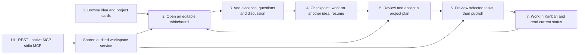
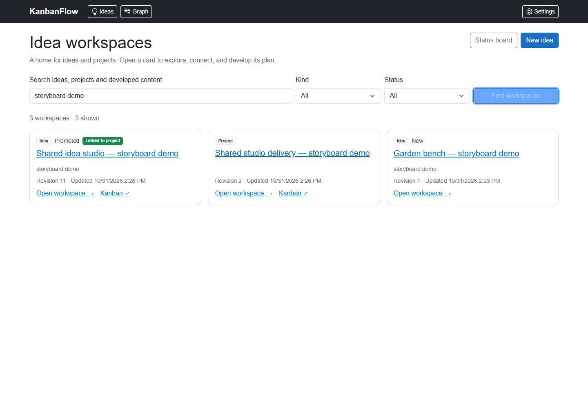
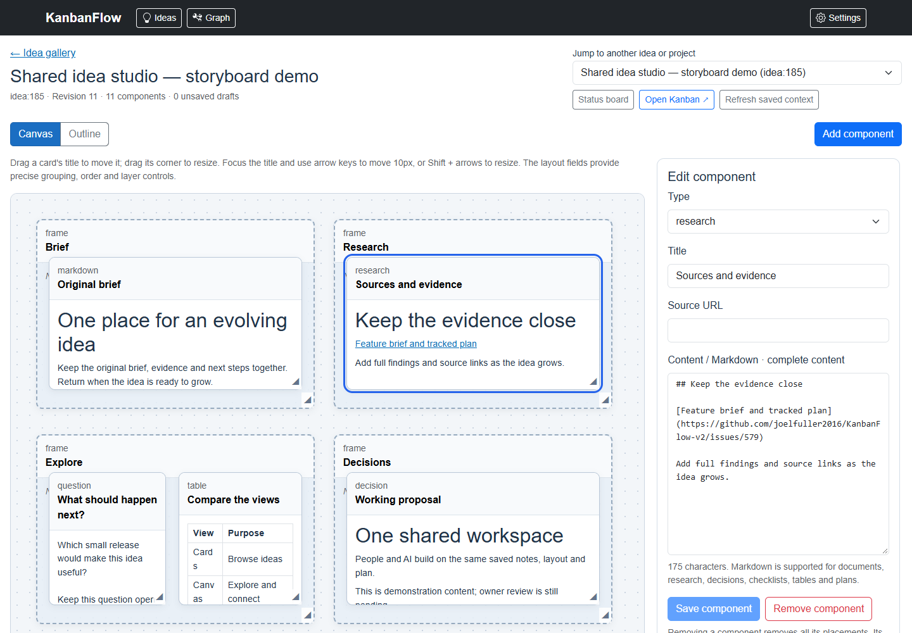
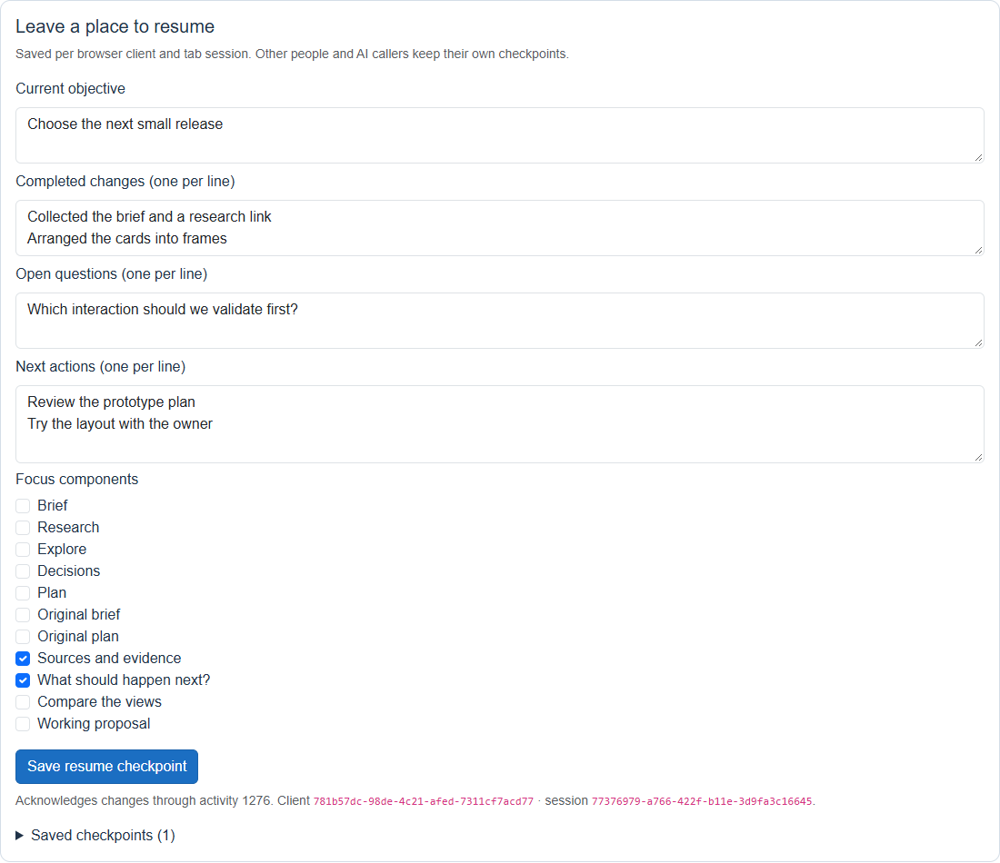
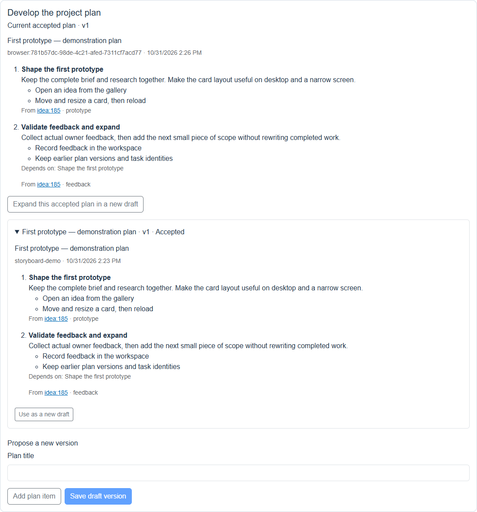
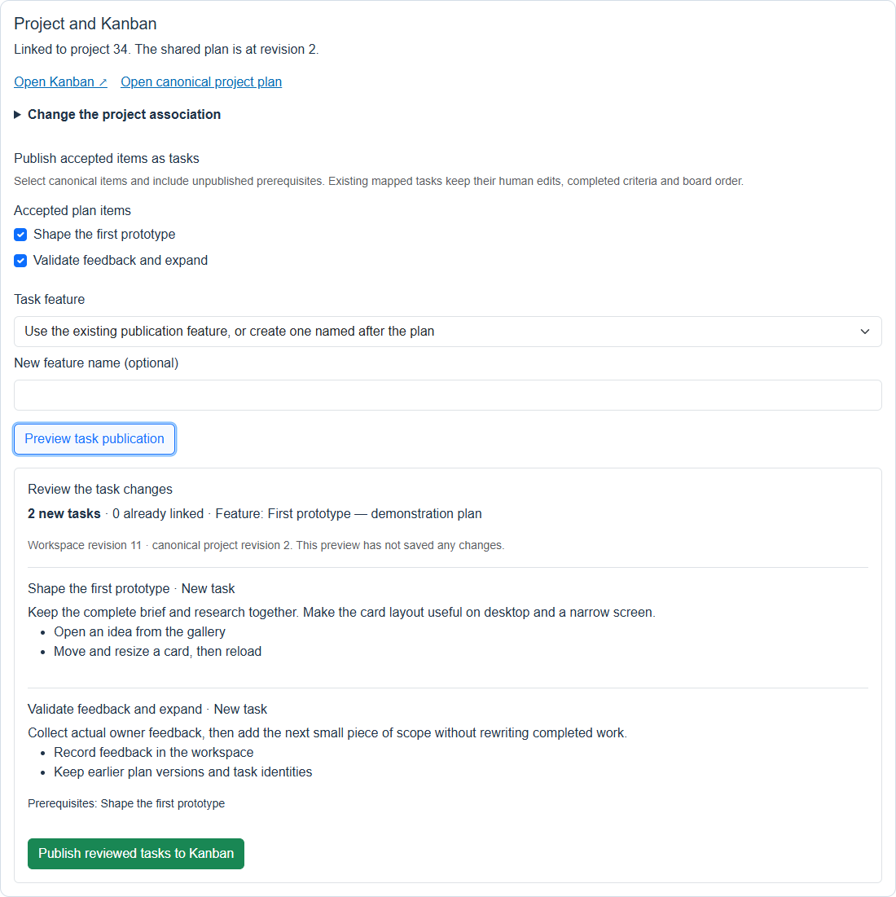
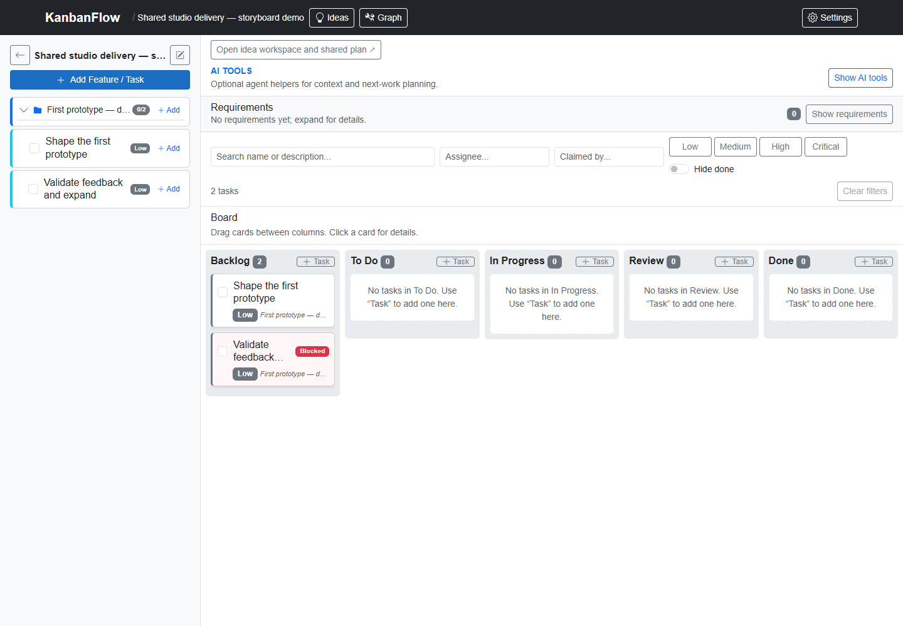

# An idea becomes a working project

This walkthrough shows the local implementation for [issue #579](https://github.com/joelfuller2016/KanbanFlow-v2/issues/579). It is for the owner trying the UI and for an AI client using the same saved workspaces. [The workspace guide](idea-workspaces.md) owns the contracts and connection examples; the issue owns delivery status.

The gallery is the entrance. Each card opens a persistent workspace where the idea, its research, discussion and plan can grow. A project has its own workspace too. Linking an idea to a project keeps the idea's workspace and connects it to that project's shared accepted plan and existing Kanban.

## The seven scenes

| Scene | What the person or AI does | What remains saved | Recovery or next action |
|---|---|---|---|
| **1. Choose a card** | Open **Ideas**. Search and filter ideas, standalone projects or linked ideas. Follow **Load more** for the complete catalog. | Each card has a stable `idea:N` or `project:N` identity. Discovering it performs no save. | Open a card, or capture a new idea without creating a project first. The previous Ideas status board remains under **Status board**. |
| **2. Shape the workspace** | Add notes, Markdown, research, questions, decisions, checklists, tables, images or task references. Move and resize their independent appearances; put them in frames. | Content and placement are separate. A component can appear in several places. Moving a frame retains its children's offsets. | Use **Outline**, numeric placement fields or arrow keys if dragging is inconvenient. Removing one appearance retains its content. |
| **3. Develop the thinking** | Store source links and complete findings on research cards. Add discussion or replies. Draw labeled connections. Keep open questions next to the proposed approach. | Full text, capture attribution, component content, positions and module history survive a reload. Source versions observed during successful module writes are retained separately from the original. | An AI can research online using its own browsing tools, then save the full findings and URL through MCP/API. The app does not itself perform web research or live coauthoring. |
| **4. Leave and return** | Save **Resume** with the objective, focused cards, completed changes, questions and next actions. Switch to another idea, work there, then return. | Checkpoints are separate for each workspace and caller/session. Browser drafts and exact pending operations are kept separately from server checkpoints. | Read current context and every page of changes. Refresh compares external saves with a retained draft; explicit **Reapply** chooses the newer baseline. |
| **5. Review the project plan** | Create a project or link an existing one. Draft plan items with descriptions, acceptance criteria and prerequisites. Review the saved revision and accept it. | The project workspace owns one shared accepted plan. Two contributing ideas keep their own notes and drafts; their contributions expand that shared plan. | Both the source and project revision must match. A stale proposal requires review of the current shared plan. Copying an accepted plan retains its validated item provenance and asks for explicit confirmation before replacing the current browser draft. |
| **6. Turn scope into tasks** | In **Project and Kanban**, choose canonical plan items and a feature. Read the complete preview, then explicitly publish. | Real Tasks, criteria, dependencies and durable item/task mappings commit together with workspace state, audit and the operation receipt. | Preview performs no save. Changed selection or revisions require another preview. An identical retry returns its receipt; publishing already mapped items preserves their task IDs and human edits. |
| **7. Deliver, then keep exploring** | Open **Kanban**, update a task there, and use **Open idea workspace and shared plan** to return. Read current task status in the workspace inspector. | Canonical status comes from the actual Task. Later scope adds new items while retaining completed work and prior accepted versions. | Missing tasks or projects are shown explicitly. Saved sources and history remain; publication does not silently recreate deleted targets. |

## Screens from the working application

Captured October 31, 2026 in the isolated Windows app from local source `0439acd0adb8bf16d2c3e302dbb7acd4d66d9e90` plus the verified T07 test-runner correction. These are actual Blazor pages and controls, with explicitly labeled demonstration records. The sample idea is `idea:185`, the separate idea is `idea:186`, and the linked project is `project:34`. The demonstration created real local tasks 532 and 533; it does not record owner approval of the proposal.

1. **Browse three related cards:** an idea, another independent idea and a project workspace. The gallery search narrows this screenshot to the demonstration.

   

2. **Open and arrange the thinking:** source brief, research, question, comparison table and a proposed approach appear inside frames. Selecting the research card opens its complete Markdown in the inspector. Its source link points to the tracked feature brief.

   

3. **Resume after switching:** use the saved AI checkpoint, switch to the independent garden-bench idea and return. This screenshot retains the objective and next actions in the first workspace's browser buffer.

   

4. **Review the accepted demonstration plan:** the two complete plan items retain their descriptions, criteria and prerequisite. Earlier versions remain accessible.

   

5. **Preview before publication:** the application reports two new tasks, shows their complete specifications and prerequisite, and confirms that preview saved nothing. Publication is a separate action.

   

6. **Deliver in the existing Kanban:** the two real tasks appear in Backlog, with the second blocked by its prerequisite. The header opens the primary project workspace and shared plan. The captured walkthrough followed that link and verified the same accepted-plan and task identities.

   

## Owner walkthrough

Use disposable data for this local trial. Try opening two cards, adding and moving a component, saving a checkpoint, switching away and returning, finding the plan, opening Kanban, and returning to the workspace. Record what was easy to find, what was confusing and any missing action. Automated browser results do not substitute for this feedback.

Owner usability feedback and adoption remain pending. No deployment, live-board migration or code publication is implied by this walkthrough.

## Evidence and limits

The walkthrough describes implemented behavior. Runtime evidence, source commits, failed checks and corrections are recorded in [JOURNAL.md](../JOURNAL.md). Repeatable browser scripts cover [gallery](../scripts/workspace-gallery-smoke.browser.mjs), [whiteboard](../scripts/workspace-ui-smoke.browser.mjs), [storage recovery](../scripts/workspace-ui-recovery.browser.mjs), [restoration and independent tabs](../scripts/workspace-ui-restoration.browser.mjs) and [project delivery](../scripts/workspace-delivery.browser.mjs). The PR-review correction gate passed 1,492 .NET tests and 353 script tests. Fresh corrected-app checks passed ten restoration/recovery/tab scenarios, 18 whiteboard scenarios, five storage-recovery scenarios, 11 delivery scenarios and a 55-member stable gallery traversal. Actual read/write/delivery transport checks and process-restart verification also passed after review corrections. Earlier implementation checks passed all 56 legacy browser scenarios; the guide's four unchanged PowerShell blocks previously ran with the intervening documented operations and passed 56 assertions. The six pictured scenes were exercised in the actual UI, including A/B/A, plan acceptance, read-only preview, publication and the canonical return route; the capture script initially missed a collapsed checkpoint disclosure and expected a different notice label, then passed after those harness corrections.

Current collaboration uses complete saved revisions, comments, checkpoints and periodic refresh. It has no live cursors or character-by-character merge. The whole project workspace revision conservatively guards shared plan changes, so an unrelated project edit can require another review. Source history captures only versions actually observed by successful module writes; an external edit made and deleted between observations cannot be recovered by this module.
