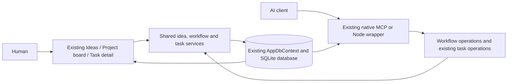
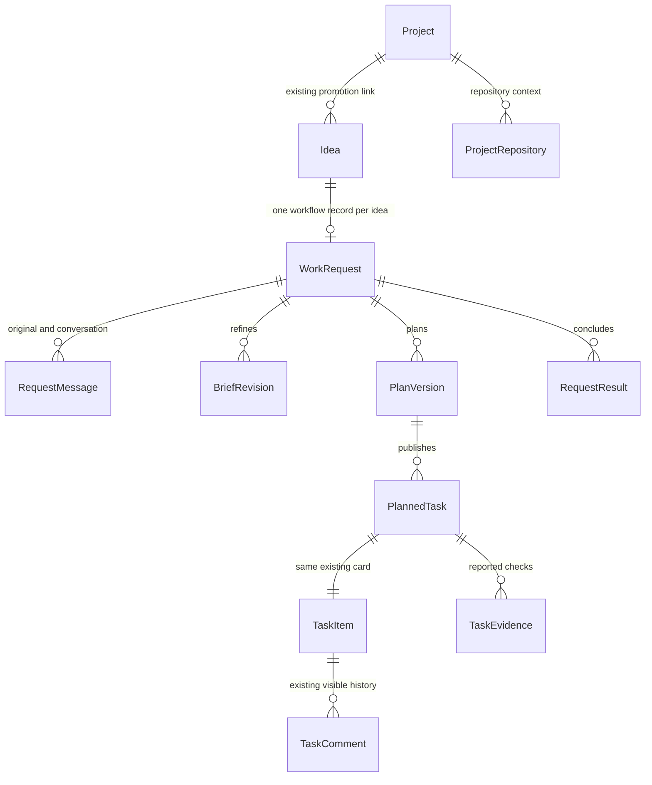
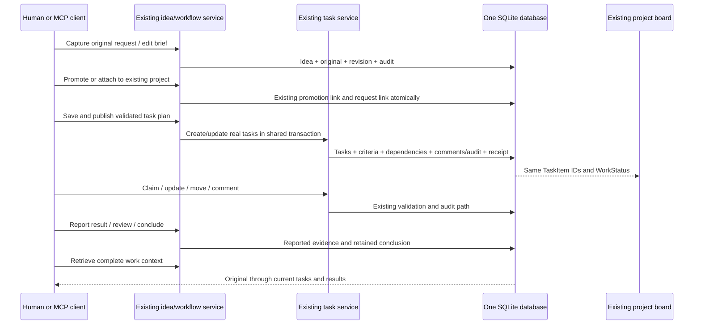

# Unified idea-to-result workflow in the existing KanbanFlow app

## Outcome and controlling direction

Extend the existing KanbanFlow application so an idea, its project, its plan and its tasks have one traceable path for a person and an AI. Keep the existing Ideas board, project board, outline, task cards, detail panel, ordering, filters, statuses, database, services, REST API and MCP server. Add the missing request history, versioned brief/plan, repository context and results around those records.

The user's September 6 clarification supersedes the separate-preview approach previously recorded in this issue and its appendices:

> I want this in the same app and see the same board per idea/project/task. everything needs to follow the same path visiable by a human of the status and the AI should be able to use the MCP to get and put any details. Look at the current proejct of all the details, it is already very well built

> I do like the ides you provided but build the plan in a github issue, and everything in a new PR

The September 7 direction adds a continuing validation and human-control requirement:

> you always need to rebuild and test your PR, you need to think abotu having a human be able to verify and interact with the board, understand what is happening and be able to make descisions which should redirect the AI agent. But i dont want any major ui changes unlesss we full verify and user test each change.

**Delivery:** [PR #511](https://github.com/joelfuller2016/KanbanFlow-v2/pull/511) from `feat/unified-workflow-509` contains the implementation, tests and curated documentation. Latest rebuilt application/case source: `dbdacfebc3869beca4568f55e6f9f86955d597e5`, including newer review fixes and the September 7 refresh correction. Existing user changes unrelated to this work remain outside the PR. [Issue #509](https://github.com/joelfuller2016/KanbanFlow-v2/issues/509) remains open for the complete initiative. Automated verification and actual human usability approval are separate; the latter remains pending. The PR is open and has not been merged.

**Source baseline:** `53a300066e118b0e5a1b0ac9d02294169d2e076f`. **Environment:** Windows, PowerShell 7.6.5, .NET SDK 10.0.400, existing .NET 10/Blazor Server/EF Core SQLite application. No Docker. **Owner:** repository maintainer. **Date:** September 6, 2026.

## Preserve the original user request

> Look at the kanban repo and I want this to be the centeral board for all project ideas and tasks. So how can we build this that everythign you do is created here and your plan is defined and the responses and conclusion of results in the board. The user should be able to manage the tasks from here. So each project should start off with the actaul request from the user as its own section, then rebuild the ask in a better promopt then build out the taks list?
>
> think though this and plan out how we can do this. maybe use codex cli to make calls from the board as well to bbuild each task defined the repo, defined the file references, and should be well orgainzed in the board

**Improved brief:** Make the existing KanbanFlow app the common workspace for project ideas and execution tasks. Capture the actual user request before normalization or refinement, retain subsequent clarifications, develop a versioned brief and task plan, publish real tasks into the existing project board, and keep visible progress, responses, checked results and conclusions with their originating work. A human and an MCP client must read and update the same records and see the same statuses. Each implementation task identifies its repository, relevant files, dependencies and acceptance checks. Managed Codex execution can follow this shared workflow; launching a separate board is not the intended product.

## Existing capabilities to reuse

| Existing source | Verified behavior | Integration change |
|---|---|---|
| `Components/Pages/Ideas.razor`, `Shared/IdeaCard.razor`, `Shared/IdeaModal.razor` | Existing idea status board, editing, promotion and project link. | Add access to the original, brief, task plan and history from each existing idea. |
| `Services/IdeaService.cs` | Atomic create/promotion, race protection, terminal Promoted state, audit. Body and Plan are normalized and mutable. | Preserve the exact original before normalization; extend the existing promotion transaction for existing-project attachment; record edits without rewriting the original. |
| `Components/Pages/ProjectView.razor` | Existing outline, shared board, filters, task links, AI context, drag ordering. | Add request selection/workflow detail while rendering the same TaskItem cards and status controls. |
| `Shared/TaskDetailPanel.razor`, `Models/TaskComment.cs` | Description, criteria, subtasks, dependency information, typed comments and history. | Add linked request, repository/files and reported results in the existing detail panel. |
| `Services/TaskService.cs` | Audit-aware creation, edits, claims, status, ordering, Done checks and explicit audited override. | Extract transaction-aware helpers where compound publication/result operations need them. Preserve the current public task mutation behavior. |
| `Data/AppDbContext.cs`, `Data/SchemaPatcher.cs`, `Program.cs` | One application database with existing additive SQLite upgrade conventions. | Add workflow child records to this context and test fresh/populated/repeated upgrade and deletion behavior. No second production database. |
| `Mcp/KanbanMcpTools.cs`, `scripts/mcp-server.mjs` | Native MCP and Node wrapper access the application. Their capability sets differ; native get_task omits comments. | Share complete workflow/detail reads and writes; close the relevant native gaps and expose matching wrapper operations. |
| `MarkdownRenderer`, `ActivityTimeline`, existing tests | Sanitized Markdown, human-readable history, substantial service/script/browser coverage. | Reuse these presentation and verification paths. |

Paths above are relative to `src/KanbanFlow/` except `scripts/`.

## Architecture: one application and one data graph

The workflow is application data, not a second application. The original source's existing local-access configuration is retained for this integration; an unrelated host/login redesign is not a prerequisite. The abandoned preview's separate host, login, startup instructions and project reference are retired from the deliverable. Its local data is retained separately until any deliberate adoption is verified.

### Identity and history

`Idea.Id` remains the user-facing starting identity. A unique `WorkRequest.IdeaId` attaches workflow children without creating another idea or project. Existing idea/project/task status enums retain their persisted values. Publication maps stable draft IDs to real `TaskItem.Id` values and a feature in the existing project. Task status is read from that task row; there is no parallel execution-status board.

Existing ideas need an honest adoption path: capture their current content as a labelled legacy snapshot when the exact original is unavailable. Do not manufacture historical wording or authorship. Existing mutable summary fields remain usable and their edits are recorded; they do not overwrite the preserved original or silently replace a published task plan.

### End-to-end flow

### Status and evidence

```mermaid
flowchart LR
  N[Idea: New] --> TRI[Idea: Triaging]
  TRI --> P[Promoted or attached project]
  P --> D[Versioned draft plan]
  D -->|atomic publication| TODO[Existing task: Todo]
  TODO --> IP[Existing task: InProgress]
  IP --> R[Existing task: Review]
  R -->|existing Done checks / explicit recorded review| DONE[Existing task: Done]
  DONE --> RESULT[Request conclusion with retained evidence]
  DONE -->|reopen or revise| TODO
```

The existing task service remains authoritative for task completion and its audited override. Reported evidence and reviewer acceptance are separate facts. A manual report cannot claim that a worker ran or that code was independently inspected. Result review checks the current task/criteria/dependency scope, including edits made through existing UI/REST/MCP paths. Missing, removed or changed required work must not produce a false completed-request conclusion.

## Detailed implementation checklist

### U-01 — Integrate into the existing app and retire the split

- [x] Keep one `src/KanbanFlow` application, one normal startup path and the current board interface.
- [x] Reuse the useful workflow model/service logic inside that application.
- [x] Remove the preview host project and test project reference from the solution deliverable.
- [x] Retire preview-only login/bootstrap/storage/launcher and document the replacement.
- [x] Preserve preview data and unrelated user changes; adopt only deliberately matched records, without duplicating existing project/task identities.
- [x] Rewrite the active plan and operating guide to reflect the integrated implementation; mark earlier issue appendices superseded.

### U-02 — Shared data and upgrade

- [x] Add the workflow child entities to the existing `AppDbContext`; enforce one workflow per idea.
- [x] Configure application-assigned GUIDs, unique revision/draft/receipt keys, and explicit foreign-key/deletion behavior.
- [x] Preserve current persisted enum values and existing project/task keys.
- [x] Add an additive, transactional schema upgrade through the owning existing startup path.
- [x] Verify fresh schema, populated legacy database copy, repeated upgrade, foreign-key integrity and existing memory/FTS data.
- [x] Back up existing data before local adoption; verify the chosen database path rather than starting another empty board accidentally.
- [x] Define what remains readable after idea/task/project deletion and prevent silent success from missing required task mappings.

### U-03 — Capture and promotion through existing ideas

- [x] Capture exact original text and provenance in the existing idea-creation transaction before normalization.
- [x] Add an explicit legacy-snapshot path for existing ideas with unavailable originals.
- [x] Record follow-ups and current-summary edits without overwriting the original.
- [x] Extend the existing race-safe promotion path to attach to an existing project where requested.
- [x] Keep promotion, project linking, workflow linking and their audit atomic.
- [x] Reject conflicting repeated promotion; prevent duplicate projects, workflow records and orphan links.
- [x] Provide stable navigation from the idea to its project, plan, existing task cards and results.

### U-04 — Versioned brief, plan and repository context

- [x] Store editable brief revisions with outcome, scope, constraints and acceptance outcomes.
- [x] Store draft plan revisions independently of published tasks.
- [x] Support task title, description, acceptance checks, repository/files, priority, assignee and dependencies.
- [x] Validate identifiers, text bounds, repository ownership, relative file leads, dependency membership and cycles.
- [x] Register multiple project repositories under the user's Projects directory; reject linked-directory escapes.
- [x] Treat file leads as planning references until explicitly inspected; do not claim generated paths were verified.
- [x] Publish feature/task/criterion/dependency mappings, audit and retry receipt in one SQLite transaction.
- [x] Use transaction-aware existing task helpers so published tasks retain normal task comments and audit behavior.
- [x] Preserve task identity on replanning and surface edits made directly to existing cards. Carry original-read task edit tokens through save and compare the saved baseline again at publication.
- [x] Refuse destructive silent retirement/replacement of active or completed required work.
- [x] Prove a forced mid-publication failure rolls back every partial record and a retry creates one graph.

### U-05 — Human interface on existing boards

- [x] Add original/brief/plan/conversation/result access from existing idea cards and editing flow.
- [x] Add request selection and workflow detail inside the existing project page.
- [x] Render published tasks through the existing board, outline, filters, ordering and task detail panel.
- [x] Add the originating request and repository/file context to existing task detail.
- [x] Keep normal task status, priority, assignment, claims, criteria, dependencies and comments on their shared paths.
- [x] Retain deep links and show a visible response when stale versions or invalid operations are rejected.
- [x] Preserve unsaved user input during refresh and avoid silently overwriting edits from another surface.
- [x] Make AI-authored activity/status visible to the human through refresh/update behavior.
- [x] Reuse sanitized Markdown and the current design/accessibility conventions.
- [x] Verify keyboard access, mobile layout and the existing board's drag/filter behavior.

### U-06 — MCP and REST parity

- [x] Expose workflow discovery and complete idea/project/task context through native MCP and the Node wrapper.
- [x] Expose capture, brief revision, plan save/publication, conversation, repository context, reported results, review and conclusion operations.
- [x] Keep task status/claims/comments/field edits on the existing task services and tool names.
- [x] Close relevant native gaps, including task comments and field updates/work-context retrieval.
- [x] Use common typed contracts and service validation for UI, REST, native MCP and wrapper MCP.
- [x] Include stable IDs, current versions, provenance, task links, file leads, actual statuses, criteria, comments and result history in context.
- [x] Add expected revisions and scoped operation keys/payload hashes/receipts for compound workflow writes.
- [x] Reject null/invalid payloads, foreign references and conflicting retries consistently; cap input fields and plan sizes and return finite context DTOs.
- [x] Add OpenAPI metadata and a `.http` example for each new endpoint.
- [x] Verify actual MCP `tools/list` and `tools/call`, including wrapper dispatch; REST-only checks are insufficient.

### U-07 — Results, review and conclusions

- [x] Keep progress, questions, decisions and final assistant responses with the originating idea/request.
- [x] Record reported result summary, actual checks, checked reference, author and time against the existing task.
- [x] Expose result context from the existing task detail and MCP task context.
- [x] Bind a report to the task specification and its current board/criterion/dependency context.
- [x] Detect changed scope even when edited through existing task or criterion APIs, not only the new plan editor.
- [x] Apply acceptance through shared task validation and preserve current audited override behavior.
- [x] Retain prior evidence/conclusions and label stale or historical reports honestly.
- [x] Require current required work and evidence before recording a completed request conclusion.
- [x] Show remaining work and limitations instead of inferring a successful outcome from a model exit or task count alone.

### U-08 — Verification, documentation and PR

- [x] Test the complete chain: MCP capture → human idea/brief → promotion → publication → same board cards → human status/update → MCP result → readable conclusion.
- [x] Prove UI/native MCP/wrapper MCP reads return the same identities and persisted values.
- [x] Test concurrent edits, duplicate delivery, changed payload retry, stale versions, rollback, invalid graphs and cross-project references with real SQLite.
- [x] Re-run relevant existing service, MCP, script, API and browser checks; investigate regressions without weakening assertions.
- [x] Verify restart on the same database and retain existing project/task data.
- [x] Update README/architecture/operation guidance and local editable diagrams with source revision and actual checks.
- [x] Put only this task's implementation and documentation into the new PR; retain unrelated working-tree changes locally.
- [x] Link the PR back to this issue and describe completed behavior, evidence and remaining scope accurately.

### U-09 — Rebuild and verify human control

- [x] Fetch and inspect the latest PR changes, preserve unrelated work, and rebuild current source before testing.
- [x] Run the required solution gate, script suite, API smoke and actual native/stdio MCP checks; record source revision, commands, results and limitations.
- [x] Exercise a browser decision → MCP read → specific acknowledgement → revised brief/plan → same task cards, including stale-plan refusal.
- [x] Reproduce and correct the existing refresh action leaving board cards stale; preserve filters, unsaved drafts and keyboard access without a layout change.
- [x] Repeat the complete request-to-result browser walkthrough on the rebuilt app.
- [x] Back up and restart the normal board; verify every prior row remains intact.
- [x] Record the repeatable case, human walkthrough and per-area usability checks in the owning test-case registry.
- [x] Persist the rebuild/test and human-review requirements in repository instructions and the PR template.

### U-10 — Actual human usability review

- [ ] A person can locate the original request, interpreted brief, current tasks, progress and reported evidence without implementation knowledge.
- [ ] A person can distinguish a saved decision from an agent acknowledgement and a change applied to the plan/cards.
- [ ] A person redirects work through Updates, verifies the acknowledgement and inspects the revised scope on the same tasks.
- [ ] Record actual feedback for every affected UI area in the linked test-case checklist and resolve accepted feedback.
- [ ] Before adopting any major UI change, verify each affected interaction and user-test the concrete change.

The [TC-509 case and human checklist](../test-cases/509-unified-workflow/README.md) owns these review steps. The normal board has separate U-09 automation/fix and U-10 human-review cards. An automated walkthrough or an agent's source review cannot complete U-10.

## Revalidation evidence — September 7, 2026

The [pinned run](../test-cases/509-unified-workflow/runs/2026-09-07-dbdacfebc386.md) records the incoming PR head, the reproduced stale-card failure, the six-line handler correction, the rebuild and passing checks. The current correction keeps the existing layout and controls. Full rebuild: zero warnings/errors. Required gate: 1,160 .NET tests passed. Script suite: 223 passed. Actual native/stdio MCP, browser decision/replan, complete request-to-result browser flow and configured API smoke passed. Default embedding-provider latency remains unverified.

The normal app was rebuilt and restarted with a SQLite-consistent backup. All prior rows in 28 tables matched after restart, with 176 existing tasks and no foreign-key violations before adding the two follow-up cards. The user's new decision, the agent's acknowledgement and the revised brief/plan are recorded on the same real board. Actual human usability review remains pending.

## Verified implementation evidence — September 6, 2026

The implementation runs in the existing app and normal launcher at port 5123. No prior live database existed on this PC, so the launcher restored the repository's existing 168-task seed into its normal location. A SQLite-consistent seed backup was retained first. After upgrade, adding this request's eight work cards and restart, every original domain/FTS row still matched the backup and `PRAGMA foreign_key_check` returned no violations. The current task's original, brief, plan, progress and reported results are recorded under its existing KanbanFlow-v2 project.

The full solution build passed with zero warnings/errors. Full .NET/script counts are recorded in the [operating guide](../request-workflow.md#verification-and-local-operation). Actual native and stdio `tools/list`/`tools/call` passed through the live app: 33 native tools, 54 wrapper tools and matching workflow schemas. The transport smoke includes exact capture, duplicate delivery, stale request versions, read/edit/save task conflicts, real card identity, task comments and stale evidence rejection.

The exact `scripts/verify.ps1` gate passed with 1,160 tests; formatting remains advisory and reported whitespace drift. The existing `scripts/smoke-api.ps1` passed with process-local `KANBANFLOW_LLM_TIMEOUT_MS=1000`. Its initial default run exceeded the smoke script's five-second timeout during memory recall. The single-variable retry bounded optional embedding and exercised the existing keyword fallback without changing source or assertions; default embedding-provider latency remains unverified. The script suite passed all 223 tests.

The final browser walkthrough passed: original request, revisioned brief, repository registration, task plan/publication, actual existing board cards, human progress, result report, checked acceptance, Done and current conclusion. Separate checks passed for existing task status changes visible through native MCP, filtering, keyboard activation, 390px layout, preserved idea-original whitespace and actual SortableJS drag/status persistence. Draft text survives section navigation and refresh. The browser checks also exposed and resolved startup-click readiness and Markdown binding defects.

| Requirement | Executable regression evidence |
|---|---|
| Preserve exact original and existing identity | `ExistingIdeaCreation_PreservesExactOriginalAndCreatesOneWorkflow`; `PublicationAndNormalTaskEdits_AreVisibleThroughExistingBoardAndNativeContexts` |
| Keep normal completion / override behavior | `NormalDoneAndAuditedOverride_KeepSameTaskWithoutInventingAcceptedEvidence` |
| Preserve old data and rollback upgrade | `PopulatedLegacySeed_UpgradePreservesEveryExistingRowAndMemorySearchOnRepeat`; `UpgradeFailure_RollsBackAllAddedTablesAndLeavesLegacyDataUsableForRetry` |
| Avoid lost concurrent revisions | `ConcurrentMutations_KeepTheWinningRevisionAcrossIndependentConnections`; `SavingPlanFromEarlierContext_ConflictsAfterHumanEditWithoutResamplingItsTokens` |
| Respect board-edited dependencies and fields | `PublishingRevisedTask_CannotCreateCycleWithDependencyAddedOnUnchangedBoardTask`; `PublishingSavedRevision_ConflictsAfterHumanChangesSameTaskAndPreservesTheEdit` |
| Keep conclusions honest after clarification | `ChangedRequestIntent_MakesConclusionHistoricalUntilBriefAndPlanAreRefreshed` |

Review discovered and fixed: archived promoted requests restored by unrelated idea edits; lost editor drafts on tab navigation; cycles combining plan and ordinary board edges; stale fields overwritten before plan save or before publication; and conclusions remaining current after new intent. The [current guide](../request-workflow.md) owns operation and recovery instructions. The five local diagram sources are in `docs/plans/assets/`; all rendered successfully with Mermaid CLI.

## Later execution work, on the same records

- [ ] Add paginated request discovery and history windows; current discovery returns the latest 200 matching requests and context includes full revision/message history.

Managed Codex calls are a follow-on to this unified foundation. They must use these same idea/request/task IDs and visible state rather than introduce another board.

- [ ] Resolve the installed Codex executable safely on Windows and preserve existing model/reasoning/access settings.
- [ ] Implement the adapter against the installed protocol, record thread/turn/attempt identity and capture visible progress/results.
- [ ] Persist dispatch intent, ownership and acknowledgements before relying on an accepted launch.
- [ ] Run independently of browser lifetime and retain a bounded local journal for restart/outage replay.
- [ ] Support queued user input, stop/continue and truthful delivery/uncertainty states.
- [ ] Execute only the selected task's repository/scope; preserve user edits and attribute changes to the actual checked state.
- [ ] Distinguish observed execution evidence from manually reported results.
- [ ] Provide registered connected-client capture and offline replay; do not promise passive capture of arbitrary chats or terminal commands.
- [ ] Demonstrate one bounded repository task, interrupted continuation and board-outage recovery before expanding execution.

## Acceptance checks for the first integrated PR

1. Opening the normal KanbanFlow app shows the existing projects and boards; the new workflow is reachable there without another app/login.
2. Creating an idea through either MCP transport preserves its original text, and the human can inspect it in that same app.
3. Refining/promoting/planning retains the idea identity and publishes actual TaskItem rows on the existing project board.
4. A human task edit and an MCP edit are mutually visible and use the same statuses, comments and validation.
5. Both MCP transports retrieve the complete request/plan/task/result chain and can write the supported workflow details.
6. Repeated publication does not duplicate work; a failed publication leaves no partial graph.
7. Reported results and conclusions remain attributable and cannot silently satisfy changed or removed required scope.
8. Restart and schema adoption preserve existing project/task/memory data.
9. The new PR contains the integration, its meaningful tests and its current documentation; the separate-preview architecture is not presented as the delivered product.

The earlier separate-host diagrams/checklists in this issue's historical appendices are superseded by this plan for the unified product. Canonical migration/runtime issues remain useful related work; their earlier proposed topology is not used to override the user's clarified same-app requirement.
