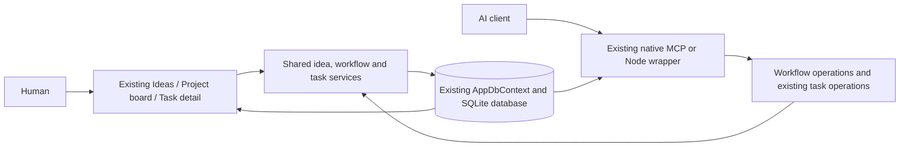
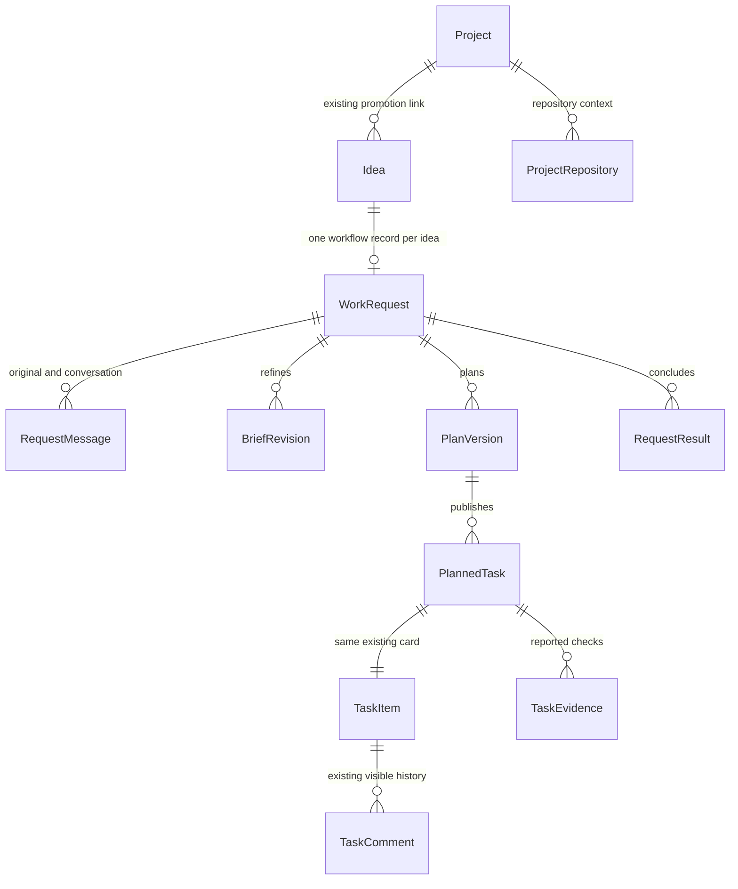
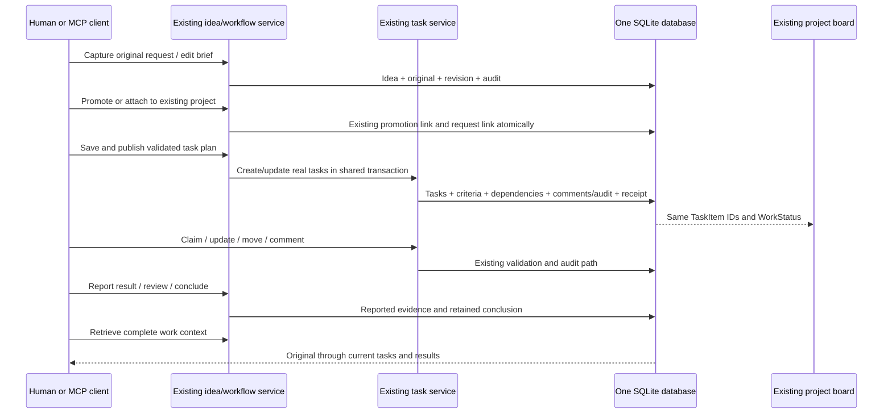
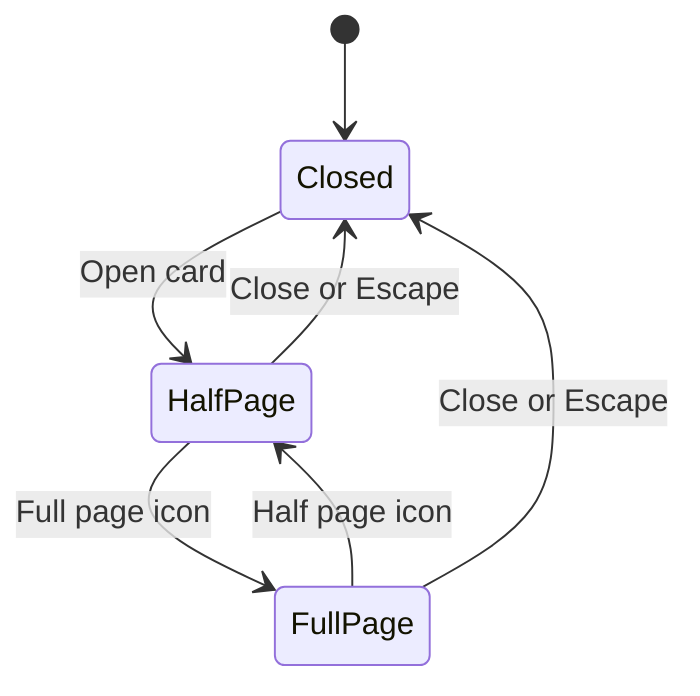
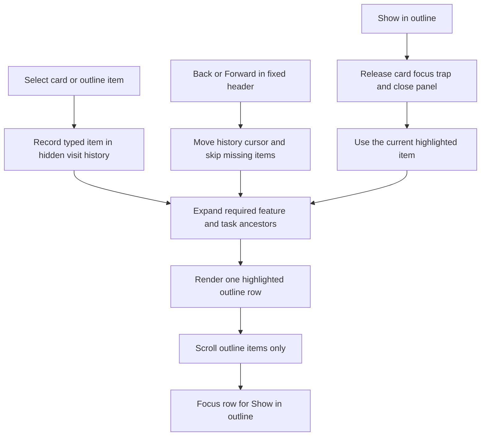
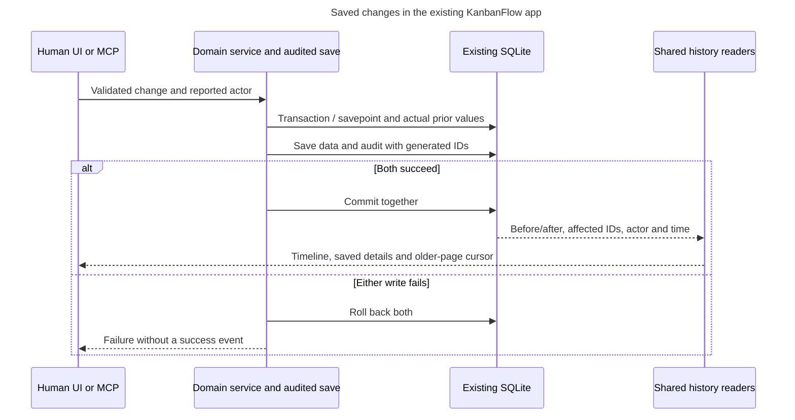
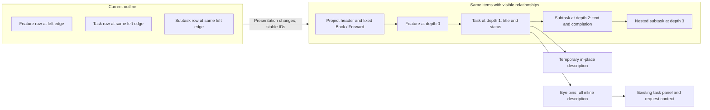
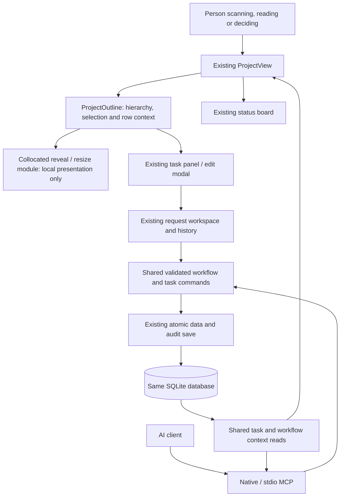

# Unified idea-to-result workflow in the existing KanbanFlow app

## Outcome and controlling direction

Extend the existing KanbanFlow application so an idea, its project, its plan and its tasks have one traceable path for a person and an AI. Keep the existing Ideas board, project board, outline, task cards, detail panel, ordering, filters, statuses, database, services, REST API and MCP server. Add the missing request history, versioned brief/plan, repository context and results around those records.

The user's September 6 clarification supersedes the separate-preview approach previously recorded in this issue and its appendices:

> I want this in the same app and see the same board per idea/project/task. everything needs to follow the same path visiable by a human of the status and the AI should be able to use the MCP to get and put any details. Look at the current proejct of all the details, it is already very well built

> I do like the ides you provided but build the plan in a github issue, and everything in a new PR

The September 7 direction adds a continuing validation and human-control requirement:

> you always need to rebuild and test your PR, you need to think abotu having a human be able to verify and interact with the board, understand what is happening and be able to make descisions which should redirect the AI agent. But i dont want any major ui changes unlesss we full verify and user test each change.

The subsequent card interaction request is captured verbatim:

> I want the card to be able to open to full page /half page or close with an icons in the top right corner

The subsequent outline interaction request is captured verbatim:

> The show in outline button should move to the the already highlighted item on the outline. when clicking on an item, the item in the outline is highlighted and moves to that item. We should also have a hidden breadcrumb that tracks the user going from item to item and we can have a back and forward buttons at the top of the outline that should be frozen with the header of the outline.

**Delivery:** [PR #511](https://github.com/joelfuller2016/KanbanFlow-v2/pull/511) from `feat/unified-workflow-509` contains the implementation, tests and curated documentation. Latest delivered application changes: `50ad5afc3009b51047834279dcc0bbdf015f2a4d`, including saved-change history, outline selection/reveal and frozen Back/Forward controls, card size controls and review/navigation fixes. The [outline visibility follow-up](#outline-visibility-and-context--staged-proposal) is a documented proposal with separate future implementation cards. Existing user changes unrelated to this work remain outside the PR. [Issue #509](https://github.com/joelfuller2016/KanbanFlow-v2/issues/509) remains open for the complete initiative. Automated verification and actual human usability approval are separate; the latter remains pending. The PR is open and has not been merged.

**Source baseline:** `53a300066e118b0e5a1b0ac9d02294169d2e076f`. **Environment:** Windows, PowerShell 7.6.5, .NET SDK 10.0.400, existing .NET 10/Blazor Server/EF Core SQLite application. No Docker. **Owner:** repository maintainer. **Date:** September 6, 2026.

## Preserve the original user request

> Look at the kanban repo and I want this to be the centeral board for all project ideas and tasks. So how can we build this that everythign you do is created here and your plan is defined and the responses and conclusion of results in the board. The user should be able to manage the tasks from here. So each project should start off with the actaul request from the user as its own section, then rebuild the ask in a better promopt then build out the taks list?
>
> think though this and plan out how we can do this. maybe use codex cli to make calls from the board as well to bbuild each task defined the repo, defined the file references, and should be well orgainzed in the board

**Improved brief:** Make the existing KanbanFlow app the common workspace for project ideas and execution tasks. Capture the actual user request before normalization or refinement, retain subsequent clarifications, develop a versioned brief and task plan, publish real tasks into the existing project board, and keep visible progress, responses, checked results and conclusions with their originating work. A human and an MCP client must read and update the same records and see the same statuses. Each implementation task identifies its repository, relevant files, dependencies and acceptance checks. Managed Codex execution can follow this shared workflow; launching a separate board is not the intended product.

## Existing capabilities to reuse

| Existing source | Verified behavior | Integration change |
|---|---|---|
| `Components/Pages/Ideas.razor`, `Shared/IdeaCard.razor`, `Shared/IdeaModal.razor` | Existing idea status board, editing, promotion and project link. | Add access to the original, brief, task plan and history from each existing idea. |
| `Services/IdeaService.cs` | Atomic create/promotion, race protection, terminal Promoted state, audit. Body and Plan are normalized and mutable. | Preserve the exact original before normalization; extend the existing promotion transaction for existing-project attachment; record edits without rewriting the original. |
| `Components/Pages/ProjectView.razor` | Existing outline, shared board, filters, task links, AI context, drag ordering. | Add request selection/workflow detail while rendering the same TaskItem cards and status controls. |
| `Shared/TaskDetailPanel.razor`, `Models/TaskComment.cs` | Description, criteria, subtasks, dependency information, typed comments and history. | Add linked request, repository/files and reported results in the existing detail panel. |
| `Services/TaskService.cs` | Audit-aware creation, edits, claims, status, ordering, Done checks and explicit audited override. | Extract transaction-aware helpers where compound publication/result operations need them. Preserve the current public task mutation behavior. |
| `Data/AppDbContext.cs`, `Data/SchemaPatcher.cs`, `Program.cs` | One application database with existing additive SQLite upgrade conventions. | Add workflow child records to this context and test fresh/populated/repeated upgrade and deletion behavior. No second production database. |
| `Mcp/KanbanMcpTools.cs`, `scripts/mcp-server.mjs` | Native MCP and Node wrapper access the application. Their capability sets differ; native get_task omits comments. | Share complete workflow/detail reads and writes; close the relevant native gaps and expose matching wrapper operations. |
| `MarkdownRenderer`, `ActivityTimeline`, existing tests | Sanitized Markdown, human-readable history, substantial service/script/browser coverage. | Reuse these presentation and verification paths. |

Paths above are relative to `src/KanbanFlow/` except `scripts/`.

## Architecture: one application and one data graph

The workflow is application data, not a second application. The original source's existing local-access configuration is retained for this integration; an unrelated host/login redesign is not a prerequisite. The abandoned preview's separate host, login, startup instructions and project reference are retired from the deliverable. Its local data is retained separately until any deliberate adoption is verified.

### Identity and history

`Idea.Id` remains the user-facing starting identity. A unique `WorkRequest.IdeaId` attaches workflow children without creating another idea or project. Existing idea/project/task status enums retain their persisted values. Publication maps stable draft IDs to real `TaskItem.Id` values and a feature in the existing project. Task status is read from that task row; there is no parallel execution-status board.

Existing ideas need an honest adoption path: capture their current content as a labelled legacy snapshot when the exact original is unavailable. Do not manufacture historical wording or authorship. Existing mutable summary fields remain usable and their edits are recorded; they do not overwrite the preserved original or silently replace a published task plan.

### End-to-end flow

### Status and evidence

```mermaid
flowchart LR
  N[Idea: New] --> TRI[Idea: Triaging]
  TRI --> P[Promoted or attached project]
  P --> D[Versioned draft plan]
  D -->|atomic publication| TODO[Existing task: Todo]
  TODO --> IP[Existing task: InProgress]
  IP --> R[Existing task: Review]
  R -->|existing Done checks / explicit recorded review| DONE[Existing task: Done]
  DONE --> RESULT[Request conclusion with retained evidence]
  DONE -->|reopen or revise| TODO
```

The existing task service remains authoritative for task completion and its audited override. Reported evidence and reviewer acceptance are separate facts. A manual report cannot claim that a worker ran or that code was independently inspected. Result review checks the current task/criteria/dependency scope, including edits made through existing UI/REST/MCP paths. Missing, removed or changed required work must not produce a false completed-request conclusion.

## Detailed implementation checklist

### U-01 — Integrate into the existing app and retire the split

- [x] Keep one `src/KanbanFlow` application, one normal startup path and the current board interface.
- [x] Reuse the useful workflow model/service logic inside that application.
- [x] Remove the preview host project and test project reference from the solution deliverable.
- [x] Retire preview-only login/bootstrap/storage/launcher and document the replacement.
- [x] Preserve preview data and unrelated user changes; adopt only deliberately matched records, without duplicating existing project/task identities.
- [x] Rewrite the active plan and operating guide to reflect the integrated implementation; mark earlier issue appendices superseded.

### U-02 — Shared data and upgrade

- [x] Add the workflow child entities to the existing `AppDbContext`; enforce one workflow per idea.
- [x] Configure application-assigned GUIDs, unique revision/draft/receipt keys, and explicit foreign-key/deletion behavior.
- [x] Preserve current persisted enum values and existing project/task keys.
- [x] Add an additive, transactional schema upgrade through the owning existing startup path.
- [x] Verify fresh schema, populated legacy database copy, repeated upgrade, foreign-key integrity and existing memory/FTS data.
- [x] Back up existing data before local adoption; verify the chosen database path rather than starting another empty board accidentally.
- [x] Define what remains readable after idea/task/project deletion and prevent silent success from missing required task mappings.

### U-03 — Capture and promotion through existing ideas

- [x] Capture exact original text and provenance in the existing idea-creation transaction before normalization.
- [x] Add an explicit legacy-snapshot path for existing ideas with unavailable originals.
- [x] Record follow-ups and current-summary edits without overwriting the original.
- [x] Extend the existing race-safe promotion path to attach to an existing project where requested.
- [x] Keep promotion, project linking, workflow linking and their audit atomic.
- [x] Reject conflicting repeated promotion; prevent duplicate projects, workflow records and orphan links.
- [x] Provide stable navigation from the idea to its project, plan, existing task cards and results.

### U-04 — Versioned brief, plan and repository context

- [x] Store editable brief revisions with outcome, scope, constraints and acceptance outcomes.
- [x] Store draft plan revisions independently of published tasks.
- [x] Support task title, description, acceptance checks, repository/files, priority, assignee and dependencies.
- [x] Validate identifiers, text bounds, repository ownership, relative file leads, dependency membership and cycles.
- [x] Register multiple project repositories under the user's Projects directory; reject linked-directory escapes.
- [x] Treat file leads as planning references until explicitly inspected; do not claim generated paths were verified.
- [x] Publish feature/task/criterion/dependency mappings, audit and retry receipt in one SQLite transaction.
- [x] Use transaction-aware existing task helpers so published tasks retain normal task comments and audit behavior.
- [x] Preserve task identity on replanning and surface edits made directly to existing cards. Carry original-read task edit tokens through save and compare the saved baseline again at publication.
- [x] Refuse destructive silent retirement/replacement of active or completed required work.
- [x] Prove a forced mid-publication failure rolls back every partial record and a retry creates one graph.

### U-05 — Human interface on existing boards

- [x] Add original/brief/plan/conversation/result access from existing idea cards and editing flow.
- [x] Add request selection and workflow detail inside the existing project page.
- [x] Render published tasks through the existing board, outline, filters, ordering and task detail panel.
- [x] Add the originating request and repository/file context to existing task detail.
- [x] Keep normal task status, priority, assignment, claims, criteria, dependencies and comments on their shared paths.
- [x] Retain deep links and show a visible response when stale versions or invalid operations are rejected.
- [x] Preserve unsaved user input during refresh and avoid silently overwriting edits from another surface.
- [x] Make AI-authored activity/status visible to the human through refresh/update behavior.
- [x] Reuse sanitized Markdown and the current design/accessibility conventions.
- [x] Verify keyboard access, mobile layout and the existing board's drag/filter behavior.

### U-06 — MCP and REST parity

- [x] Expose workflow discovery and complete idea/project/task context through native MCP and the Node wrapper.
- [x] Expose capture, brief revision, plan save/publication, conversation, repository context, reported results, review and conclusion operations.
- [x] Keep task status/claims/comments/field edits on the existing task services and tool names.
- [x] Close relevant native gaps, including task comments and field updates/work-context retrieval.
- [x] Use common typed contracts and service validation for UI, REST, native MCP and wrapper MCP.
- [x] Include stable IDs, current versions, provenance, task links, file leads, actual statuses, criteria, comments and result history in context.
- [x] Add expected revisions and scoped operation keys/payload hashes/receipts for compound workflow writes.
- [x] Reject null/invalid payloads, foreign references and conflicting retries consistently; cap input fields and plan sizes and return finite context DTOs.
- [x] Add OpenAPI metadata and a `.http` example for each new endpoint.
- [x] Verify actual MCP `tools/list` and `tools/call`, including wrapper dispatch; REST-only checks are insufficient.

### U-07 — Results, review and conclusions

- [x] Keep progress, questions, decisions and final assistant responses with the originating idea/request.
- [x] Record reported result summary, actual checks, checked reference, author and time against the existing task.
- [x] Expose result context from the existing task detail and MCP task context.
- [x] Bind a report to the task specification and its current board/criterion/dependency context.
- [x] Detect changed scope even when edited through existing task or criterion APIs, not only the new plan editor.
- [x] Apply acceptance through shared task validation and preserve current audited override behavior.
- [x] Retain prior evidence/conclusions and label stale or historical reports honestly.
- [x] Require current required work and evidence before recording a completed request conclusion.
- [x] Show remaining work and limitations instead of inferring a successful outcome from a model exit or task count alone.

### U-08 — Verification, documentation and PR

- [x] Test the complete chain: MCP capture → human idea/brief → promotion → publication → same board cards → human status/update → MCP result → readable conclusion.
- [x] Prove UI/native MCP/wrapper MCP reads return the same identities and persisted values.
- [x] Test concurrent edits, duplicate delivery, changed payload retry, stale versions, rollback, invalid graphs and cross-project references with real SQLite.
- [x] Re-run relevant existing service, MCP, script, API and browser checks; investigate regressions without weakening assertions.
- [x] Verify restart on the same database and retain existing project/task data.
- [x] Update README/architecture/operation guidance and local editable diagrams with source revision and actual checks.
- [x] Put only this task's implementation and documentation into the new PR; retain unrelated working-tree changes locally.
- [x] Link the PR back to this issue and describe completed behavior, evidence and remaining scope accurately.

### U-09 — Rebuild and verify human control

- [x] Fetch and inspect the latest PR changes, preserve unrelated work, and rebuild current source before testing.
- [x] Run the required solution gate, script suite, API smoke and actual native/stdio MCP checks; record source revision, commands, results and limitations.
- [x] Exercise a browser decision → MCP read → specific acknowledgement → revised brief/plan → same task cards, including stale-plan refusal.
- [x] Reproduce and correct the existing refresh action leaving board cards stale; preserve filters, unsaved drafts and keyboard access without a layout change.
- [x] Correct same-project task links, direct-entry backdrop cleanup and request/draft loss after filter debounce; verify actual clicks, close/refresh/Clear and unknown/foreign task IDs.
- [x] Repeat the complete request-to-result browser walkthrough on the rebuilt app.
- [x] Back up and restart the normal board; verify every prior row remains intact.
- [x] Record the repeatable case, human walkthrough and per-area usability checks in the owning test-case registry.
- [x] Persist the rebuild/test and human-review requirements in repository instructions and the PR template.

### U-10 — Actual human usability review

- [ ] A person can locate the original request, interpreted brief, current tasks, progress and reported evidence without implementation knowledge.
- [ ] A person can distinguish a saved decision from an agent acknowledgement and a change applied to the plan/cards.
- [ ] A person redirects work through Updates, verifies the acknowledgement and inspects the revised scope on the same tasks.
- [ ] Record actual feedback for every affected UI area in the linked test-case checklist and resolve accepted feedback.
- [ ] Before adopting any major UI change, verify each affected interaction and user-test the concrete change.

The [TC-509 case and human checklist](../test-cases/509-unified-workflow/README.md) owns these review steps. The normal board has separate U-09 automation/fix and U-10 human-review cards. An automated walkthrough or an agent's source review cannot complete U-10.

### U-11 — Card full-page, half-page and close controls

- [x] Capture the exact request in the same board history, acknowledge it and revise the brief/plan while preserving existing tasks.
- [x] Add Half page and Full page icon buttons beside the existing top-right Close icon in `TaskDetailPanel.razor`.
- [x] Use scoped `TaskDetailPanel.razor.css`: half the desktop viewport, full viewport on expansion, and available width below 992px.
- [x] Keep the same mounted task/editor; size changes preserve drafts and do not write task/workflow records.
- [x] Keep title and icons from overlapping, label icon actions, indicate active size, and preserve existing close/Escape/focus behavior.
- [x] Rebuild and verify current source, desktop/mobile sizing, unsent comments, full-page save through MCP, close/reopen, navigation and decision regressions.
- [x] Rebuild the normal app after a consistent backup and verify its real controls and all existing rows.
- [x] Record the repeatable browser case, source-pinned evidence and bounded UI change in the same PR/issue.
- [ ] Record actual user feedback on the three icons and apply requested adjustments; this remains part of U-10's human review.

Both display modes use the same task panel. A fresh open starts in half-page mode; narrow screens use the available width. Size changes retain task identity and drafts.

### U-12 — Synchronized outline selection and hidden visit history

- [x] Record the exact outline request, acknowledge decision `372ff340-2d13-4c76-ae71-6fb39eb2f15f`, revise the brief/plan, and publish U-12 as task 185 on the same project/request.
- [x] Use typed feature/task/subtask identities for a single current outline selection; retain it after the existing editor closes.
- [x] Expand the selected item's ancestors and reveal its highlighted row by scrolling only the outline's item area.
- [x] Replace Show in outline's unscoped page selector with a parent callback; release the card focus trap, close the card, open the mobile outline if necessary, and focus the current selected row.
- [x] Keep hidden visit history within the current project visit. Suppress consecutive duplicates, disable unavailable navigation, and discard the forward branch after a new visit from an older position.
- [x] Add Back/Forward icons beside Add Feature / Task under the project title. Keep that header fixed while the item list scrolls. Navigation highlights/reveals without reopening an editor.
- [x] Skip deleted entries and reset selection/history when the project changes. Preserve filters and current task/request query behavior within the same project.
- [x] Use a collocated JavaScript module and typed interop wrapper for reveal/focus; preserve sortable task-ID anchors around subtask siblings.
- [x] Rebuild and run required .NET/script gates, real native/stdio MCP, the new outline case and all three existing workflow/card browser cases. Rebuild the normal app and verify its actual controls without changing task data.
- [x] Update this issue plan, operating guide, repeatable case, source-pinned run and PR #511. Keep the request's implementation result in Review.
- [ ] Record actual human feedback on highlight, reveal, history and header behavior; apply any requested adjustment. U-10 remains the separate human review task.

| Interaction | Before | With U-12 |
|---|---|---|
| Select a card or outline item | Editor opens; no durable current outline selection | Existing editor opens; exact feature/task/subtask row stays highlighted and is revealed |
| Show in outline | First matching task element anywhere on the page; collapsed parents and mobile visibility not handled | Parent-controlled reveal of the current item, with ancestor expansion, panel close and outline focus |
| Browse prior items | No outline visit history | Hidden per-visit history with Back/Forward; no editor reopens on history navigation |
| Scroll a long outline | Header scrolls with the tree | Header and navigation controls stay fixed; only items scroll |
| Project switch or deletion | No selection/history policy | New project resets history; removed items are skipped after refresh |

The hidden history is presentation state for the current project visit, not another persisted breadcrumb or a task/workflow mutation. Existing editors, board cards, task data and MCP access use the same paths. A reload or leaving the project starts a new history. On narrow screens Show in outline opens the existing outline drawer.

## Outline navigation verification — September 7, 2026

The [outline run](../test-cases/509-unified-workflow/runs/2026-09-07-829ab2ca5ba2.md) pins source `829ab2ca5ba28c0d5f76759240623ec944f40334`. Nonincremental rebuild: zero warnings/errors. Required gate: 1,160 .NET tests passed; scripts: 223 passed. Native/stdio MCP, outline selection/history/hierarchy/drag/mobile checks and the existing display, decision and navigation cases passed. All 180 tasks and every prior row in 28 tables survived the normal restart, with no foreign-key violations. Real tasks 185 and 184 were checked using presentation controls only. Actual human feedback remains pending.

## Card display verification — September 7, 2026

The [card display run](../test-cases/509-unified-workflow/runs/2026-09-07-b923a62b6a9c.md) pins the earlier card-specific application/case source and records the initial state-attribute failure and correction. Full rebuild: zero warnings/errors. Required gate: 1,160 .NET tests passed. Scripts: 223 passed. Real MCP, card sizing/editing/close, decision and navigation browser cases passed. All 179 tasks and existing rows in 28 tables survived restart. The normal card's actual icons were exercised. User feedback remains pending; automated checks do not approve the UI.

## Revalidation evidence — September 7, 2026

The [pinned run](../test-cases/509-unified-workflow/runs/2026-09-07-04af1cbe40f7.md) records the stale-card refresh correction and the subsequent reproduced task-link, backdrop and filter-context failures. Fresh browser cases cover actual same-project links, close/refresh/Clear, request/draft preservation after debounce, keyboard access and mobile acknowledgement. The corrections keep the existing layout and controls. Full rebuild: zero warnings/errors. Required gate: 1,160 .NET tests passed. Script suite: 223 passed. Actual native/stdio MCP, browser decision/replan, complete request-to-result browser flow and configured API smoke passed. Default embedding-provider latency remains unverified.

The normal app was rebuilt and restarted with a SQLite-consistent backup. All prior rows in 28 tables matched after restart, with all 178 tasks and no foreign-key violations. The real link from Updates to the human-review task was clicked successfully after the restart. The user's new decision, the agent's acknowledgement and the revised brief/plan are recorded on the same real board. Actual human usability review remains pending.

## Verified implementation evidence — September 6, 2026

The implementation runs in the existing app and normal launcher at port 5123. No prior live database existed on this PC, so the launcher restored the repository's existing 168-task seed into its normal location. A SQLite-consistent seed backup was retained first. After upgrade, adding this request's eight work cards and restart, every original domain/FTS row still matched the backup and `PRAGMA foreign_key_check` returned no violations. The current task's original, brief, plan, progress and reported results are recorded under its existing KanbanFlow-v2 project.

The full solution build passed with zero warnings/errors. Full .NET/script counts are recorded in the [operating guide](../request-workflow.md#verification-and-local-operation). Actual native and stdio `tools/list`/`tools/call` passed through the live app: 33 native tools, 54 wrapper tools and matching workflow schemas. The transport smoke includes exact capture, duplicate delivery, stale request versions, read/edit/save task conflicts, real card identity, task comments and stale evidence rejection.

The exact `scripts/verify.ps1` gate passed with 1,160 tests; formatting remains advisory and reported whitespace drift. The existing `scripts/smoke-api.ps1` passed with process-local `KANBANFLOW_LLM_TIMEOUT_MS=1000`. Its initial default run exceeded the smoke script's five-second timeout during memory recall. The single-variable retry bounded optional embedding and exercised the existing keyword fallback without changing source or assertions; default embedding-provider latency remains unverified. The script suite passed all 223 tests.

The final browser walkthrough passed: original request, revisioned brief, repository registration, task plan/publication, actual existing board cards, human progress, result report, checked acceptance, Done and current conclusion. Separate checks passed for existing task status changes visible through native MCP, filtering, keyboard activation, 390px layout, preserved idea-original whitespace and actual SortableJS drag/status persistence. Draft text survives section navigation and refresh. The browser checks also exposed and resolved startup-click readiness and Markdown binding defects.

| Requirement | Executable regression evidence |
|---|---|
| Preserve exact original and existing identity | `ExistingIdeaCreation_PreservesExactOriginalAndCreatesOneWorkflow`; `PublicationAndNormalTaskEdits_AreVisibleThroughExistingBoardAndNativeContexts` |
| Keep normal completion / override behavior | `NormalDoneAndAuditedOverride_KeepSameTaskWithoutInventingAcceptedEvidence` |
| Preserve old data and rollback upgrade | `PopulatedLegacySeed_UpgradePreservesEveryExistingRowAndMemorySearchOnRepeat`; `UpgradeFailure_RollsBackAllAddedTablesAndLeavesLegacyDataUsableForRetry` |
| Avoid lost concurrent revisions | `ConcurrentMutations_KeepTheWinningRevisionAcrossIndependentConnections`; `SavingPlanFromEarlierContext_ConflictsAfterHumanEditWithoutResamplingItsTokens` |
| Respect board-edited dependencies and fields | `PublishingRevisedTask_CannotCreateCycleWithDependencyAddedOnUnchangedBoardTask`; `PublishingSavedRevision_ConflictsAfterHumanChangesSameTaskAndPreservesTheEdit` |
| Keep conclusions honest after clarification | `ChangedRequestIntent_MakesConclusionHistoricalUntilBriefAndPlanAreRefreshed` |

Review discovered and fixed: archived promoted requests restored by unrelated idea edits; lost editor drafts on tab navigation; cycles combining plan and ordinary board edges; stale fields overwritten before plan save or before publication; and conclusions remaining current after new intent. The [current guide](../request-workflow.md) owns operation and recovery instructions. The five local diagram sources are in `docs/plans/assets/`; all rendered successfully with Mermaid CLI.

## Saved-change logging and later execution work

### U-13 — Log saved board changes and development work

Original direction, September 7, 2026: “Anytime there is any changes it should be logged”. Decision `01f1a495-83cd-4f66-94ea-26e16c04dcd1` is explicitly acknowledged on request `1e9c0ecd-33e4-4098-a5af-9c61c00fa2cb`. Its revised plan preserves the twelve existing cards and adds task 186 under the same feature. Improved ask: retain an attributable, inspectable history of every supported saved board mutation and record development work on its owning request/card; data and audit must succeed or fail together.

| Area | Before | Changes and owning files |
|---|---|---|
| Direct saves | Project/feature/child writes often bypassed activity | New `Services/ChangeAudit.cs`; route `ApiEndpoints.cs`, `TaskDependencyService`, native criteria tools and Home/AddItemModal/EditItemModal/TaskDetailPanel/ProjectView saves through it |
| Accurate values | Detached or concurrently edited objects could yield stale snapshots | Read persisted values inside a transaction, merge modified fields, reconcile semantic events, suppress timestamp-only no-ops, and restore generated IDs/savepoints after failed audit inserts |
| Task order and lease | Bare reorders and fresh heartbeats were silent | `TaskService.cs` adds TaskReordered/TaskClaimHeartbeat without discussion comments or heartbeat UpdatedAt churn; bulk completion logs changed subtasks |
| Deletion | Unloaded cascades/SetNull effects disappeared | `ProjectGraphDeleter.cs`, TaskService and IdeaService load children, comments, dependencies, requirements, planned mappings/evidence, request revisions, repositories and surviving promoted-idea/project links |
| Schema | No child-to-task historical context | `ActivityEvent.cs`, `AppDbContext.cs`, `SchemaPatcher.cs`, `Program.cs` add nullable TaskId/RelatedTaskId and indexes, with no cascading audit FK |
| Actors | Direct EF writes lacked a label path | HttpContext accessor supplies REST attribution; wrapper supplies MCP attribution; editors supply User; existing domain actors remain supported |
| Human history | Task-root events only | `ActivityTimeline.razor` and model include children, subject identity, more field diffs and complete saved details; reuse the rail inside project/feature editors and refresh after child/MCP saves |
| MCP history | Native had no reader; wrapper only one recent window | New `ActivityLogReader.cs`, native tools, REST and wrapper share scope/cursor ordering, retained deletions and a compatible optional paging envelope |
| Workflow/development | Sparse operation audit content | WorkspaceService retains operation/payload/result and prior request state; AGENTS.md requires request/task development records |
| Tests | Reorders expected silence; browser fixtures assumed project 1 | Update policy expectations and failure-injection overloads; discover actual projects and add SQLite, transport and UI regressions |

Detailed editable source: [board-change-audit.mmd](assets/board-change-audit.mmd). One host, database and board remain in use. [The operating guide](../request-workflow.md#inspect-and-record-changes) owns scope, actor meaning, paging, recovery and external-capture limitations.

- [x] Record original direction, acknowledgement, revised brief and U-13 on the existing board.
- [x] Add the standing development logging agreement to the repository.
- [x] Implement actual old/new snapshots, generated-key handling, no-op suppression, semantic reconciliation and atomic rollback/outer-transaction behavior.
- [x] Route silent UI/REST/native writes, reorders, dependency writes, plan child writes and fresh claim heartbeats.
- [x] Preserve deletion descendants and cleared links, including workflow history and promoted ideas.
- [x] Add historical task columns/indexes idempotently and preserve existing audit rows.
- [x] Expose shared paging through REST, native and stdio MCP, including deleted subjects and invalid-cursor refusal.
- [x] Reuse the existing timeline, show full saved details, and refresh after child saves.
- [x] Add 29 real SQLite persistence/schema cases and update existing policy tests without removing rollback checks.
- [x] Verify native/stdio paging and cascades, browser UI/MCP mutual visibility and project/feature history.
- [x] Rebuild with zero warnings/errors, pass 1,288 .NET and 223 script tests; rerun card, steering, navigation and outline cases.
- [x] Back up, rebuild/restart the normal app and compare prior values across schema adoption: all 181 tasks and all prior values in 28 tables preserved; zero FK violations.
- [x] Record [source-pinned evidence](../test-cases/509-unified-workflow/runs/2026-09-07-50ad5afc3009.md) for source `50ad5afc3009b51047834279dcc0bbdf015f2a4d` and report U-13 for Review on the existing request. This issue/PR remains the publication target; actual human acceptance remains pending.
- [ ] Obtain actual human History/Saved details feedback; U-10 remains pending.

Independent review closed unlogged promoted-idea links, stale semantic snapshots and timestamp-only pseudo-edits. Test development corrected the SaveChanges overload used for failure injection. Browser verification corrected a fixed seed-project assumption and a selector matching nested summaries. These checks do not constitute human usability approval.

## Outline visibility and context — staged proposal

**Audience:** the person managing work and the developer implementing the next UI increments. **Date:** September 7, 2026. **Inspected source:** `65de739994a4a050c9fb81becbb00438989b70f4`; its application code matches the delivered `50ad5afc3009` build. **Status:** planning and baseline observation; the indentation, divider and previews below are not implemented by this follow-up. U-14/task 187 records this planning work; U-15/188, U-16/189 and U-17/190 are future Todo cards on the same project/request. U-10 remains the human review task.

The user supplied two further directions, preserved verbatim on the board as decisions `6731dba4-be8f-40b5-8fa6-802290bde97e` and `6796f489-b74f-4e17-9595-b7facb073044`:

> The cards in the outline needs to follow proper indentation and the cards should be able to be expanded slightly in the outline to view the details better on hover,fully expended on an eye icon click, The hover shouls slightly expand the card in place, also the left outline area boarders should be allowed to be moved to provide visbalilty of more description to see what the cards are and the context. There is so much info we need to plan out a better plan to visbaility see what is goign on with the card and the tasks/project

> Think about how azure devops and github use boards and viable context and kanban.

**Refined ask:** Help a person scan the existing hierarchy, understand an item's purpose and current state, expose more context without losing their place, and decide what should happen next. Add real indentation, a movable outline divider and progressive inline descriptions. Keep original request, plan, normal task, decision and result connected through the existing records and MCP. Deliver and user-test bounded increments before adopting a larger layout change.

### Product lessons and the proposed application here

These are design inferences from the linked primary documentation, consulted September 7, 2026. The specific hover, eye and divider interaction is our proposal; it is not a claim that either product implements that combination.

| Product pattern | What the documentation establishes | Application to this board |
|---|---|---|
| [Azure Boards card fields](https://learn.microsoft.com/en-us/azure/devops/boards/boards/customize-cards?view=azure-devops) | Teams choose visible fields, including Parent, use field/tag styling and expose related-item annotations. | Start with title, status and owner; add an attention indicator only when actionable. Move the full description and supporting context into progressive disclosure. Keep meaningful text beside color. |
| [Azure backlog hierarchy](https://learn.microsoft.com/en-us/azure/devops/boards/backlogs/organize-backlog?view=azure-devops) | Parent relationships, expandable hierarchy and mapping support organizing backlog items. | Use the actual Project → Feature → Task → Subtask relationships and full ancestor path. The outline answers where work belongs; status columns answer where it stands. |
| [Azure backlog rollups](https://learn.microsoft.com/en-us/azure/devops/boards/backlogs/backlogs-overview?view=azure-devops) | Portfolio backlogs can show descendant counts and progress. | Label the existing descendant task count, count each task once, and distinguish Done status from accepted evidence. |
| [GitHub board customization](https://docs.github.com/en/issues/planning-and-tracking-with-projects/customizing-views-in-your-project/customizing-the-board-layout) | A board chooses visible fields, grouping, sorting and slices; column limits give feedback. Sorted views constrain manual ordering. | Keep filters and ordering understandable and consistent with persistence. Viewing another slice must not silently move work. Preserve the existing task-ID drag contract. |
| [GitHub parent and sub-issue fields](https://docs.github.com/en/issues/planning-and-tracking-with-projects/understanding-fields/about-parent-issue-and-sub-issue-progress-fields) | Parent and sub-issue progress fields expose relationships and completed-child counts. | Keep a task's parent/request close to its summary and use explicitly scoped counts. Do not substitute the currently selected request for that task's actual request. |

The core design is three coordinated views of the same work: **outline for scope, board for status, existing detail/request panels for context and decisions**. No Azure/GitHub synchronization, new work-item types or second application is required. Saved views, roadmaps, configurable card-field menus, WIP limits and cycle-time analytics remain later options after the immediate readability problem is tested. In particular, a useful WIP policy needs an agreed scope and treatment of Review/blocked work; it should not be inferred from a color or a count.

### What exists and what changes

At 1440 × 1000 in the real app, the outline measured 320px wide. Feature 13 and its task 186 both started at x=18px and were 283px wide. The task title used `white-space: nowrap`; no resize separator existed. A screenshot and DOM measurements support these observations. Source review additionally establishes the editor and data-loading contracts below; those are not new usability-test results.

| Area | Existing behavior / owning source | Bounded change |
|---|---|---|
| Hierarchy | `Shared/ProjectOutline.razor` passes depth to border colors but does not indent rows. Feature counts already include descendant features' tasks. | Apply logical indentation to every depth; keep full parent context reachable and label the count's scope. Preserve the existing count rather than adding another competing total. |
| Child disclosure | Feature and task buttons expand descendants; nested subtask arrows are decorative and nested children always render. | Preserve current behavior in U-15; in U-16 add an explicit independent nested-subtask disclosure state if needed for the tested hierarchy. Do not let the eye toggle descendants. |
| Width | `wwwroot/app.css` fixes both width and minimum width at 320px; below 992px the outline is a drawer. | U-15 adds a desktop separator with bounded width and keyboard support; retain the drawer behavior. |
| Reading | Single-line titles compete with priority and Add controls. No inline description exists. | Wrap compact titles to at most two lines; U-16 adds a small temporary peek and an explicit full inline description. Keep action targets stable. |
| Opening an item | `Pages/ProjectView.razor.cs` routes outline task clicks to the edit modal. Board cards open `Shared/TaskDetailPanel.razor`, which includes `Workflows/TaskRequestContext.razor`. Both existing editors have history. | Preserve row editing. Offer an explicit **Open task panel** action from pinned context for request/evidence and half/full controls. Preserve subtask identity when displaying its parent task. |
| Navigation | Typed `OutlineItem` selection, hidden visit history, scoped reveal and fixed header already exist. | Hover stays local. Eye uses existing visit deduplication: a different identity adds one visit; the current identity and closing add none. Back/Forward closes the old preview and reveals the selected item's header without reopening editors. |
| Context | Project loading already supplies descriptions, task status, assignee, criteria and dependencies. Full workflow context loads graph/history and task hashes. | U-16 uses loaded data. U-17 adds only the missing shared read projection or lazy request context required by the reviewed fields; never mount a full workflow query on every hovered row. |
| Changes | Existing services/audited save log persisted UI/API/MCP mutations. | Keep all writes on that path. Width, hover and navigation are presentation state; development work and actual saved edits remain recorded. |

Component paths in this table are relative to `src/KanbanFlow/Components/`, except `wwwroot/`.

Editable source: [outline-context-hierarchy.mmd](assets/outline-context-hierarchy.mmd). Arrows inside the proposed outline indicate ownership; descriptions remain inside their row rather than covering adjacent cards.

### The reading and navigation contract

1. **Scan:** show a two-line title with existing controls; U-17 adds a restrained status/owner row. Keep the chevron, checkbox and eye recognizable as separate actions. Put overflow metadata on a secondary line before squeezing the title into a few characters. Text wraps safely for long file paths and words.
2. **Peek:** after a provisional 250ms fine-pointer hover or title focus, expose up to two description lines and up to three title lines in that row, growing it by at most roughly 72px. This is a trial value to measure. There is no overlay, data fetch, selection change, auto-scroll or editor open. Leaving both pointer and focus collapses after a short delay; Escape dismisses and suppresses reopening until a fresh entry. Touch uses the eye.
3. **Pin context:** eye toggles the complete title/description without line clamping, with a full ancestor path and the applicable context fields below. Keep only one pinned item; while pinned, suppress other transient peeks so the list stays stable. Opening another eye replaces it. Place the eye at a stable header position; label it with the item name and expose `aria-expanded`/`aria-controls`. Eye uses existing typed selection: opening a different identity adds one visit; opening/reopening the current identity adds none. Reveal only the header if needed; eye close leaves selection/history unchanged.
4. **Read deeper or edit:** pinned content is read-only. **Open task panel** uses the existing panel and half/full/close controls; normal row/title editing remains available. For a subtask, show its full text/completion and parent path, and label the panel link as opening its parent task. Do not invent subtask description, priority or assignee fields. Request/history details can remain in the existing panels rather than placing an unbounded activity feed in every row.
5. **Return:** Back/Forward, project switches and explicit navigation cancel temporary previews. History navigation closes pinned context rather than leaving context for a different selection on screen. Descendant collapse closes a hidden pin. Deletion invalidates it. Refresh resolves the typed identity against fresh data instead of retaining an old EF object; async responses cannot replace a newer selection. Presentation changes while the same editor remains mounted preserve drafts. Closing or changing the task keeps the existing editor's draft/reset behavior; this proposal does not add draft recovery after close.

**Provisional preference:** the eye means full inline description/context. An optional preference question was raised; no user answer has been recorded. This is a documented design assumption for review, not usability approval. If the person prefers the eye to open the existing task panel, change U-16's contract and case before implementation.

Long pinned descriptions use the outline's existing scroller, with the header and eye still easy to reach; avoid an extra tiny scroller inside each card. Section links expose the original request, brief, plan, evidence and history through their existing owners. “Full inline context” and the panel's “Full page” remain distinct labels.

```mermaid
stateDiagram-v2
    [*] --> Compact
    Compact --> Peek: Delayed hover or title focus
    Peek --> Compact: Leave or Escape
    Compact --> Pinned: Eye; select with existing visit deduplication
    Peek --> Pinned: Eye; select with existing visit deduplication
    Pinned --> Compact: Eye again or scoped Escape
    Pinned --> Pinned: Another eye replaces current item
    Pinned --> Compact: History navigation, hidden/deleted item, project change
    Pinned --> ExistingPanel: Open task panel
    ExistingPanel --> Pinned: Close panel; retain valid pinned context
    note right of Peek
        No selection, history, fetch or saved change
        Freeze preview geometry during drag or resize
    end note
```

Editable source: [outline-context-reading.mmd](assets/outline-context-reading.mmd). Child expansion is an independent state; panel size is another independent state. Scoped Escape first respects an open modal's existing behavior.

### Indentation and movable width

Use a provisional 16px indentation step through feature, task and recursive subtask depth. Leave enough room for the title and controls; when a deep hierarchy cannot fit a minimum readable row, allow horizontal scrolling inside the item area while keeping the header fixed. Test depth 0, 1, 2, 4, 8 and 12 with long labels. Do not silently flatten deep levels or rely only on repeating border colors. The pin's complete ancestor path helps a person recover context. The minimum row width and two-line compact layout need actual readability testing.

Add the separator between the outline and board, outside the outline scroller and all task drag containers. Trial values: default 320px, minimum 280px, maximum `min(640px, project-shell width - 480px - separator width)`. The 480px value reserves a usable board area and must be checked with existing columns; never create a negative/invalid range. Re-clamp on viewport change. Below the existing 992px breakpoint, remove the desktop separator from pointer and keyboard interaction and retain the existing drawer width.

Use pointer capture and local animation-frame CSS updates so resizing does not rerender the whole board through Blazor on every pointer event. Commit the final width once to presentation state. Pointer cancellation, lost capture and Escape restore the starting width; cleanup removes only this component's handlers. Offer a labeled focusable vertical separator with current/minimum/maximum values; Left/Right adjust by 16px, Shift by 64px, Home/End select bounds, and a reset action/double-click restores 320px subject to the current bounds. Respect reduced-motion settings and use a visible focus indicator.

Keep width local to the project visit in the first trial, with no storage dependency. A remembered width can follow human feedback; it would store only a bounded presentation preference and must tolerate blocked storage or stale values. This adds no database schema or board audit traffic.

### Context fields and truthful progress

| Scope | Compact scan | Pinned/deeper context | Source and meaning |
|---|---|---|---|
| Project | Existing name and navigation | Purpose, related requests and attention totals when actually available | Existing Project and linked requests; a project can contain several requests, so do not assume a single project-wide original ask. |
| Feature | Title; labeled Done task count | Description, ancestor path, descendant Todo/In progress/Review/Done counts | Existing hierarchy and unique descendant TaskItem IDs. Current `GetFeatureTaskCounts` already recurses through child features. |
| Task | Title; status and assignee/unassigned; one actionable attention indicator | Full description, parent/request, priority, incomplete dependencies, criteria/subtask counts | Existing TaskItem, requirements and dependency edges; no parallel status enum. Blocked is a dependency condition, not a new column. Missing dependency data is unknown, not zero blockers. |
| Subtask | Text and completion | Full text, ancestor path and clearly labeled parent-task context | Existing Subtask has Text/Completed/ParentSubtaskId; parent task state must not be presented as this child's own status/owner. |
| Request/evidence | Only an attention indication when verified data is loaded | Exact ask → current brief → published plan → this task → report/checks/source → human acceptance | Actual task-to-request mapping and WorkflowContext. Show absent mapping/context honestly; never borrow the request selected elsewhere in the workspace. |

Use separately labeled counts: **2 of 8 tasks Done**, **3 tasks in Review**, **4 of 6 criteria checked**, **1 current accepted report**. These are different facts. Never combine tasks and subtasks into one denominator or turn a Done count into a claim of accepted results. A zero-task feature has “No tasks,” not 100% complete. If board filters hide work, label total versus visible scope; the existing full outline must not silently become filtered. Archived/deleted items and tasks moved to another feature must be excluded or labeled according to the selected scope, with no double counting.

An In progress card or `ClaimedBy` value is reported work/lease state, not proof that an AI process is running. A saved decision is visible immediately; an acknowledgement is a separate attributed message that explicitly references it, and an applied decision requires inspecting the revised brief/plan/cards. `NeedsBriefReview` clearing alone proves neither delivery nor application. U-17 can surface the existing records and links; automatic acknowledgement/delivery/stop badges require future structured receipts and the deferred managed runner.

### Component, data and change ownership

Editable source: [outline-context-data-flow.mmd](assets/outline-context-data-flow.mmd). Rendering does not save domain data. Actual edits retain the existing actor, validation and before/after audit paths. Workflow commands additionally retain request versions and plan/task baselines. Ordinary task updates do not currently carry an optimistic concurrency token; universal task conflict protection would be separate work.

| Owner / candidate change | Responsibility and implementation boundary |
|---|---|
| `Components/Pages/ProjectView.razor` and `.razor.cs` | Own current unfiltered project, hierarchy expansion, typed selection/history and panel routing. Pass row data/state down and receive explicit callbacks. Preserve request/filter query behavior. |
| `Components/Shared/ProjectOutline.razor` and `.razor.css` | Apply row depth, compact wrapping and labeled controls while retaining direct task roots and current callbacks. If extraction improves readability, introduce focused `OutlineRow` / `OutlineContextPreview` components; avoid replacing recursion and event ownership wholesale. |
| `Components/Shared/OutlineItem.cs`, `ProjectOutline.razor.js`, `ProjectOutlineInterop.cs` | Identify preview by project plus item kind/ID; add disposal-safe resize handling and header-scoped reveal. Keep temporary/pinned preview separate from child disclosure and visit history. |
| `wwwroot/app.css`, `wwwroot/js/kanbanflow.js` | Replace desktop fixed width/min-width together; preserve drawer rules. Keep `.feature-tasks[data-feature-id]` and direct `[data-task-id]` roots, task-ID ordering and Blazor DOM restoration. Preview bodies stay inside their row; their links/text cannot start a drag or open the row editor. Freeze geometry from drag start through completion/cancel. |
| `Components/Shared/TaskDetailPanel.razor`, `Components/Workflows/TaskRequestContext.razor` | Reuse existing task context and editing. Add a subtask-aware panel route rather than changing the selection to its parent task. Preserve drafts and half/full state. |
| `Components/Workflows/RequestWorkspace.razor`, `Services/Workflows/WorkspaceService.Context.cs`, `Models/Workflows/WorkflowContext.cs` | U-17 reuses current request/evidence semantics. If a small summary projection is needed, compute it in shared reads; do not duplicate rules inside Razor. Bind it to the task's real mapping and invalidate on refreshed version/scope. |
| `Mcp/KanbanMcpTools.cs`, `scripts/mcp-server.mjs` | Only change these in U-17 if a new shared context read is required; expose matching meanings and explicit unavailable fields. Presentation controls need no MCP mutation/tool. |

Paths in this ownership table are relative to `src/KanbanFlow/`, except `scripts/`. Candidate component extraction is an implementation choice, not a promise to create every listed component.

Pre-index feature children and counts once per loaded project if profiling shows recursive work is material. Hover uses only loaded text; do not fetch or render all request histories. Any lazy pinned read must be cancellable or reject late results, carry identity/version, have an explicit refresh path and show failure/unknown state. Measure render/query behavior with 200 and 1,000 synthetic rows before considering virtualization, which could break reveal and Sortable's identity assumptions. These are future experiments, not measured performance claims.

### Detailed staged checklist

The stages below correspond to actual cards on the existing request; dependencies express sequence, and each stage's acceptance text requires actual human review before normal-board adoption. Test on the same application's disposable review instance using labeled fixture data. A review instance is for verification, not a replacement product.

**U-14 / task 187 — Plan and baseline**

- [x] Record both exact decisions, explicit acknowledgement and revised brief/plan using native MCP; preserve all thirteen prior task IDs/names/statuses.
- [x] Inspect outline, editor paths, workflow reads, data contracts and drag identity; measure the current real outline and inspect its screenshot.
- [x] Compare primary Azure/GitHub documentation and document the inferred principles, provisional eye choice, alternatives and limits.
- [x] Specify interaction states, source ownership, context meaning, diagrams and future cards 188–190.
- [x] Rebuild/test the current PR, validate local documentation/diagram links, record the [dated baseline](../test-cases/509-unified-workflow/runs/2026-09-07-65de739994a4.md) and prepare the reviewed plan for issue #509 / PR #511.
- [ ] Human reviews the proposed eye behavior and staged approach; retain feedback in Updates. This remains a pending human check after the planning result is reported.

**U-15 / task 188 — Readable hierarchy and width**

- [ ] Implement logical depth spacing and compact title wrapping without changing sortable task-root identity; distinguish recursive subtask ancestry.
- [ ] Protect title/control space and provide deep-tree overflow/parent context; check Done styling and selected-row contrast.
- [ ] Implement separator sizing, local pointer capture, keyboard bounds, cancel/reset, disposal and responsive re-clamping; keep first-trial width ephemeral.
- [ ] Preserve fixed header, scoped reveal, selection/history, filters, existing editors and mobile drawer accessibility.
- [ ] Run deep/wide/long-label and breakpoint browser checks, actual task drag around expanded subtasks, and compare persisted data/audit before/after viewing.
- [ ] Rebuild and pass the required gate; give a person the bounded review build, record their findings and apply corrections before normal-board adoption.

**U-16 / task 189 — Peek and pinned context**

- [ ] Implement cancellable hover/focus timing, capped in-place growth, touch/keyboard eye control and reduced-motion behavior.
- [ ] Keep one typed pinned context, stable action positions, independent child expansion and explicit close/navigation/deletion behavior; implement nested-subtask disclosure only as a separately tested part of this stage.
- [ ] Show complete applicable title/description/text with parent path and read-only context; reuse sanitized rendering and wrap long paths safely.
- [ ] Preserve original row edit actions; add the existing task-panel route while retaining selected subtask identity and unsaved drafts.
- [ ] Keep preview controls/text out of drag initiation and editor bubbling; freeze/cancel preview geometry during sorting and resizing; do not perform per-hover workflow reads.
- [ ] Test rapid crossing, bottom-visible rows, long descriptions, focus/escape, touch, stale refresh/delete, real drag and existing A10–A16 regressions.
- [ ] Rebuild, record UI/MCP state equality and actual human feedback on eye meaning/readability; tune delay/spacing before adoption.

**U-17 / task 190 — Project/task context and attention**

- [ ] User-test the smallest visible field set, full parent/request path and project purpose; keep the underlying board/status layout.
- [ ] Reuse and label unique descendant task rollups; distinguish Done, Review, criteria/subtask progress and current accepted evidence, including empty/filtered scopes.
- [ ] Surface incomplete dependencies and unknown data honestly; do not add a second task status or infer a running agent from assignment/claim.
- [ ] Link the actual task request, repository, files, report/checks/source and history through existing records; handle unmapped ordinary tasks and multiple requests in one project.
- [ ] Expose matching shared summaries through UI/native/stdio only where new reads are needed; test late responses, refresh/version invalidation, query volume and unavailable context.
- [ ] Walk through a human decision, explicit acknowledgement and revised brief/plan on unchanged task IDs; keep saved, acknowledged, applied and executed evidence distinct.
- [ ] Preserve workflow version/baseline checks and ordinary task-service validation; verify all intended writes remain audited, rebuild/test affected surfaces, and record a person's orientation/decision feedback before adoption.

### Human verification and alternatives

The [TC-509 visibility review](../test-cases/509-unified-workflow/README.md#outline-visibility-review-proposed) owns the executable human script and pending acceptance matrix. Use the same fixture before/after so the comparison measures visibility rather than familiarity with new task names. Have the person identify parent, purpose, current state, blocking work and the next decision without coaching; record mistakes, unnecessary editor openings, time to answer and their explanation. Readability and predictability determine acceptance; automated success alone does not.

The independent source critic identified two useful counterexamples: indentation can make a narrow title less readable, and hovering a card must not trigger the existing selection/reveal path because that changes history and recenters the list. The plan therefore pairs indentation with usable width and keeps hover local. Preview height changes during sorting and full-request reads per row are anticipated risks to test, not reproduced defects.

| Alternative considered | Decision and resolving check |
|---|---|
| Always show all descriptions | Keep compact scan plus explicit context. Compare a long outline; reject the trial if hover still creates pointer chasing or too much movement. |
| Eye opens the existing task panel immediately | Retain as the preference alternative. The provisional inline eye meets the requested in-place reading; confirm with the person before implementing U-16. |
| Tooltip/floating preview | Use in-place growth as requested; test bottom rows and keyboard/touch so content is reachable without an overlay or hover-only dependency. |
| New dashboard, global state store or copied workflow statuses | Reuse current view/component/service ownership. Add a shared read projection only when the selected context cannot be served economically by existing reads. |
| Persist width or virtualize the tree immediately | Begin with visit-local width and existing DOM identity. Add persistence or virtualization only after the specific usability/performance need is demonstrated. |

If an increment fails, leave the normal board on the previously verified build, retain the failed case and recorded feedback, and revise that stage on the same card. Before eventual normal adoption, back up the existing SQLite consistently, rebuild the approved source, restart only its owned process, compare prior data and recheck the real controls. No data migration is planned for U-15/U-16. The plan introduces no access code or login change.

## Deferred managed execution

- [ ] Add paginated request discovery and history windows; current discovery returns the latest 200 matching requests and context includes full revision/message history.

Managed Codex calls are a follow-on to this unified foundation. They must use these same idea/request/task IDs and visible state rather than introduce another board.

- [ ] Resolve the installed Codex executable safely on Windows and preserve existing model/reasoning/access settings.
- [ ] Implement the adapter against the installed protocol, record thread/turn/attempt identity and capture visible progress/results.
- [ ] Persist dispatch intent, ownership and acknowledgements before relying on an accepted launch.
- [ ] Run independently of browser lifetime and retain a bounded local journal for restart/outage replay.
- [ ] Support queued user input, stop/continue and truthful delivery/uncertainty states.
- [ ] Execute only the selected task's repository/scope; preserve user edits and attribute changes to the actual checked state.
- [ ] Distinguish observed execution evidence from manually reported results.
- [ ] Provide registered connected-client capture and offline replay; do not promise passive capture of arbitrary chats or terminal commands.
- [ ] Demonstrate one bounded repository task, interrupted continuation and board-outage recovery before expanding execution.

## Acceptance checks for the first integrated PR

1. Opening the normal KanbanFlow app shows the existing projects and boards; the new workflow is reachable there without another app/login.
2. Creating an idea through either MCP transport preserves its original text, and the human can inspect it in that same app.
3. Refining/promoting/planning retains the idea identity and publishes actual TaskItem rows on the existing project board.
4. A human task edit and an MCP edit are mutually visible and use the same statuses, comments and validation.
5. Both MCP transports retrieve the complete request/plan/task/result chain and can write the supported workflow details.
6. Repeated publication does not duplicate work; a failed publication leaves no partial graph.
7. Reported results and conclusions remain attributable and cannot silently satisfy changed or removed required scope.
8. Restart and schema adoption preserve existing project/task/memory data.
9. The new PR contains the integration, its meaningful tests and its current documentation; the separate-preview architecture is not presented as the delivered product.

The earlier separate-host diagrams/checklists in this issue's historical appendices are superseded by this plan for the unified product. Canonical migration/runtime issues remain useful related work; their earlier proposed topology is not used to override the user's clarified same-app requirement.
