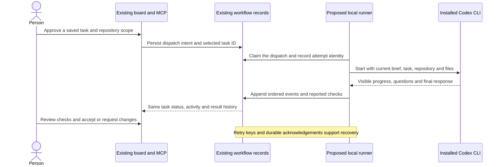

# Central board product direction

Reviewed September 6, 2026. Source baseline: `53a300066e118b0e5a1b0ac9d02294169d2e076f`. Audience: the board owner and contributors. The [implementation checklist](central-project-board-implementation.md) and [issue #509](https://github.com/joelfuller2016/KanbanFlow-v2/issues/509) own the detailed work. The [operating guide](../request-workflow.md) owns current behavior and observed verification.

## Purpose and constraint

Each idea begins with the actual user request. A clearer brief follows, then a reviewable task list, the work itself, progress and responses, and an attributable conclusion. A person can manage that path in the existing KanbanFlow app; an AI client can read and write the same records through MCP. The existing Idea → Project → Feature → TaskItem identities, board columns, claims, criteria and audit services remain authoritative.

The earlier separate-host preview was an experiment and is retired. It is not the delivered architecture. The foundation now extends `src/KanbanFlow`, its existing database and its existing Ideas/Project/task-detail components. [The local architecture diagram](assets/central-project-board.mmd) is editable source.

## Delivered foundation

One workflow per idea preserves the original before normalization, stores revisioned briefs/plans, and publishes actual board tasks atomically. Repository/file context, conversation, reported results, review and conclusions belong to that request. Native MCP and the stdio wrapper expose the same four workflow tools. Existing task tools remain the path for normal task edits.

The person uses Request & plan on an idea card, or Requests & plans within a project, then returns to the same board. A task's existing detail panel links back to the request and its repository/files. Version conflicts preserve drafts; plan publication checks newer board edits and the full dependency graph. Evidence and conclusions become historical after relevant changes.

## Proposed Codex execution path

This is later work, not an implemented launch button. Verify the installed CLI protocol before choosing its adapter. Preserve the user's selected model, effort and access settings. Keep dispatch and attempt records separate from task status; show when launch, delivery or recovery is uncertain. A closed browser must not terminate accepted work. Stop/continue and queued questions need visible acknowledgements, and events need replay after a board outage.

“Everything the AI does is on the board” requires connected clients to capture a request before work, attach a plan, associate every task/run, and append visible progress and results. The board cannot silently observe arbitrary chats or unrelated terminal sessions. Begin with one explicit connected client and one bounded task, prove interruption and outage recovery, then extend adoption. Keep private reasoning out of records; save useful plans, decisions, observable actions and conclusions.

## Next implementation order

1. Review and merge the integrated foundation PR after its evidence is accepted.
2. Implement a small CLI adapter using the installed protocol and one existing task/repository scope.
3. Add durable dispatch/attempt/event storage and a recoverable worker alongside the existing application records.
4. Add run/stop/continue/question controls to the current task detail and MCP contracts.
5. Prove a complete task, cancellation/continuation, restart and board-outage replay before enabling broader connected-client capture.

Every later phase is explicitly unchecked in [the issue checklist](central-project-board-implementation.md#later-execution-work-on-the-same-records).
