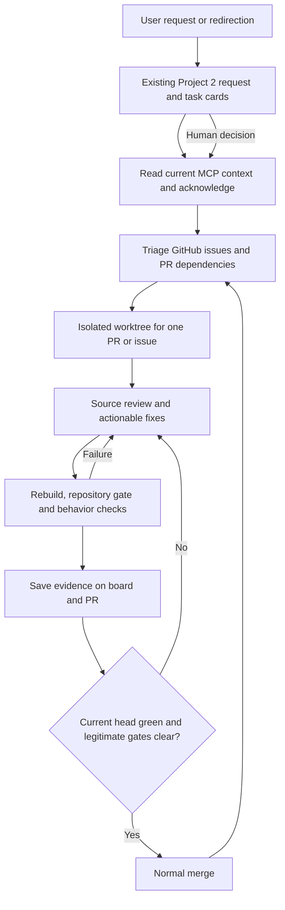

# KanbanFlow review and delivery cycle — 2026-09-08

This record lets the user and agents follow the current repository review, repair and merge cycle in the existing KanbanFlow app. It continues [the unified workflow plan](central-project-board-implementation.md), with a separate maintenance request in Project 2 so the original feature request and its human checks remain intact.

## September 13 follow-up

The current request is to obtain CodeRabbit reviews, fix PR findings and commit. Merge and deployment are outside this follow-up. [The TC-509 run](../test-cases/509-unified-workflow/runs/2026-09-13-pr511-coderabbit.md) records the current PR #511 integration and remaining verification limits; Project 2 task 189 holds its progress in the running board.

## Original request

> /gsd So continue through the issues/PR, complete a code code review and fix any issues you find, If its an issue that doesnt have a PR then build the feature and work through the list, the cycle back trhough. Test everything, build ouot the issues into PRs on what you think is more improtant

The earlier merge instruction remains active: review every PR, determine merge order, merge when green and mergeable, then cycle through the remaining PRs.

## Refined brief and acceptance

Review all open PRs against their current source and complete review discussions. Repair valid findings and integration conflicts. Rebuild and run the repository gate before every push, with script, HTTP, native/stdio MCP and browser checks where behavior changes. Merge through normal repository protection only after the exact reviewed head is ready. Inspect the entire issue backlog for already shipped behavior, overlapping work, dependencies and user impact; implement the most important uncovered defects as separate PRs and repeat review.

Preserve the original checkout's unrelated documentation, the normal app and its database, the complete source text, and the shared board/MCP identities. Keep every saved change and development result logged. Actual human usability approval remains separate from automated browser checks. Major UI changes retain their human review gate. No Docker, GitHub Actions, admin merge bypass or invented completion evidence.

## Architecture and operating flow

The existing app at `http://127.0.0.1:5123` owns requests, plans, real task cards, progress and result evidence in its SQLite database. GitHub owns issues, PR discussions and merge state. Isolated Git worktrees hold each PR's source. Disposable local app processes/databases provide HTTP, MCP and browser validation. Agents read fresh board context before updating through native MCP and the established audited workflow boundary.

## Baseline

- Environment: Windows, PowerShell 7, local .NET 10 / Node / GitHub CLI; no container.
- Source: original workflow head `b9d9ea0dcf32b17a2ec6a1f1f3b913243cb1e4f6`; fetched master `d89fd41`.
- Discovery: four open PRs and 183 open issues, all retained in the backlog snapshot below. Issue titles and existing priority markers are triage inputs; they are not proof a defect still exists.
- All four PRs started as drafts with `CHANGES_REQUESTED`. CodeRabbit status was successful, but no current local cycle validation had yet run.
- Branch protection requires resolved conversations and dismisses stale reviews; zero approving reviewers are required. No admin bypass is part of this cycle.
- Normal board request: [Review, repair and merge the KanbanFlow backlog](http://127.0.0.1:5123/project/2?request=2a1272d9-1d11-49a8-b8f7-a1580d9705e1).

## Current cycle status — September 9, 02:54 UTC

The initial four PRs have completed independent source review, fixes and local validation. All 106 existing review threads are now resolved (29 workflow, 17 health, 38 durable-link and 22 card threads). This is a statement about their dispositions, not a claim that every backlog issue or human acceptance check is complete.

| Work | Source and verified outcome | Current next step |
|---|---|---|
| #253 / [PR #516](https://github.com/joelfuller2016/KanbanFlow-v2/pull/516) / task 229 | Merged normally at `8073b3e5bccd227e503f0ecd888ccad8199e97d2`; 980 .NET and 231 script tests passed, with seven real PowerShell invocation cases and red-before evidence. Board result accepted against all four task criteria. | Broader formatting cleanup remains open in #253. |
| #498 / PR #512 / task 224 | Pushed `8d9522fac030936f51dae0aa955fa9fd12c86006`; fresh gate 998 .NET and 231 script tests passed. Earlier actual launcher/copy/write/restart checks remain source-applicable. | Normal approval/merge transition. Keep the historical live 38 MB / 50 ms criterion pending. The proposed #477 reboot criterion was posted with path/count requirements. |
| #336 / PR #506 / task 225 | Pushed `5efb16ff8a4638671efb0dad83a8cb501bcf7ed9`; checked source `5f4126562a41` passed 1,081 .NET, 287 script and 52 UI scenarios. Rejected identity performs no mutation; full diagnostic text and trusted badge state are preserved. | Normal approval/merge; #507 must pass before treating the combined board as free of orphan imports. Native durable-link read parity remains a recorded follow-on. |
| #481 / PR #487 / task 226 | Pushed `2de8292280f5c122b8a0c2c83c0de161c0433bf9`; 1,036 .NET and 231 script tests passed after master integration. Actual Chromium/Firefox/WebKit Tab, drag, content and hover checks passed on unchanged application source. CodeRabbit's current chat review found no new actionable defect. | Normal approval/merge, preserving the shared badge and metadata-reader changes when combined. Broad density/human feedback remains pending. |
| #509 / PR #511 / task 227 | Source `3a07aa855551797263abac73fc91331097dbecf2`: 1,311 .NET and 244 scripts passed. Context/save/publish reads for 12/100 tasks are 17/18/31, with compatible hashes. Missing dependencies now refuse report/accept/conclude. Release API/native/stdio and six existing browser scripts passed; [complete run](../test-cases/509-unified-workflow/runs/2026-09-08-3a07aa855551.md). | Publish evidence, combine preceding merged changes, then rerun affected integration checks and normal merge gates. |
| #462 / [PR #517](https://github.com/joelfuller2016/KanbanFlow-v2/pull/517) / task 231 | Published `91edf715f43ca98d0e4edb62d79b813dd8ed7ca3`; 980 .NET, 231 scripts, framing and 190 real transport scenarios passed. Restoring the old helper reproduced all nine lost clears. | Current review found checklist validation and smoke SSE parsing concerns; verify and repair before merge. |
| #463 / [PR #518](https://github.com/joelfuller2016/KanbanFlow-v2/pull/518) / task 232 | Published `e9164b76bb3a95f16d82a2472dc4190b1e303bf0`; exact-head gate 980 .NET, 231 scripts and 53 UI scenarios passed. Three new browser cases failed before and passed after the tiny lifecycle guard. | Review current feedback and merge through normal gates. Existing form markup/layout unchanged. |
| #507 / task 230 | A separate stacked implementation now creates the task and verified link in one transaction, with REST/native/stdio entry points. Preliminary real SQLite concurrency/rollback cases and importer cases pass. | Finish exact-source gates and runtime verification, then publish its own PR. Preliminary results are not final acceptance. |

The review service exhausted its included allowance during this cycle. A successful CodeRabbit status has sometimes meant only that the request was rate limited. Current source reviews and local checks are recorded separately. After verifying no unresolved findings, the cycle requests the documented `@coderabbitai approve` transition; this is the service's normal workflow command, not a branch-protection change or admin merge. See [CodeRabbit's command reference](https://docs.coderabbit.ai/reference/review-commands#comment-management). Its approval transition must not be described as a new full automated review unless one actually ran.

The next uncovered integrity candidate is #458: feature/subtask ancestor checks currently happen before the write transaction, including the workflow branch's audit save boundary. Scope review is in progress; no implementation or runtime proof is claimed yet. Read-only triage is also checking #149, #446, #455 and #465 against both current master and pending workflow source before proposing closures.

## Review checklist and proposed order

Order is provisional until source review and integration prove it. Health is independent. Durable links and card rendering precede the larger workflow integration so complete-content changes are retained when branches overlap.

| Order | PR / board task | Required change and review |
|---|---|---|
| 1 | [#512](https://github.com/joelfuller2016/KanbanFlow-v2/pull/512), task 224 | Review real database health probing, identity diagnostics and failure behavior; verify local launch and HTTP responses. |
| 2 | [#506](https://github.com/joelfuller2016/KanbanFlow-v2/pull/506), task 225 | Review durable issue identity, retries, ownership guards and importer mutations; fix rejected-identity writes if reproduced. |
| 3 | [#487](https://github.com/joelfuller2016/KanbanFlow-v2/pull/487), task 226 | Review bounded existing card title/hover/link changes; validate malformed link handling and browser interactions. |
| 4 | [#511](https://github.com/joelfuller2016/KanbanFlow-v2/pull/511), task 227 | Combine current master safely; preserve dry-run argument validation and full-content recovery; remove repeated task/dependency reads without changing conflict/evidence hashes. |
| 5 | Uncovered issues, task 228 | Start separate PRs for the verification exit-code defect (#253, task 229), atomic inbound projection (#507, task 230) and nullable-text clears through stdio MCP (#462, task 231). Shared GitHub input shape (#514) remains next in the integrity queue. |

For each PR:

- [ ] Read full diff, review threads, current branch and base.
- [ ] Reproduce valid defects and record a disposition for every remaining finding.
- [ ] Implement the smallest complete repair and meaningful regression checks.
- [ ] Integrate preceding merged changes while preserving both behaviors.
- [ ] Run `scripts/verify.ps1` on the source that will be pushed.
- [ ] Run relevant script, API, native/stdio MCP and Playwright CLI checks; preserve complete logs locally.
- [ ] Update source-pinned evidence, PR description, same board task and outstanding human checks.
- [ ] Recheck current remote head; publish only the tested source.
- [ ] Clear legitimate review findings, mark ready when appropriate and merge without admin bypass.
- [ ] Fetch master and repeat for affected PRs; close linked issues only when their acceptance is fulfilled.

## Review findings and next implementation decisions

1. PR #511 has two unresolved performance threads. Context, save and publish repeatedly traverse dependency graphs per task. The repair must batch reachable task data and compute the exact existing hashes in memory. Evidence currency, direct board-edit conflicts, transitive dependencies, missing tasks and read consistency must remain correct. Query-count regression checks must distinguish the old implementation.
2. PR #511 conflicts with master's dry-run flag parsing. Preserve strict value validation for active flags and the explicit rejection of the removed comment-clipping option. Both complete-content and CLI safety tests must pass.
3. PR #506 review is investigating a rejected source identity that can still reach subsequent sync writes. Reproduce before changing it; rejection should preserve the task and its comments.
4. PR #487 review is investigating malformed issue paths and previously deferred browser coverage. Keep any repair within the existing card behavior. Human usability checks remain honestly pending.
5. Issue #507 is a high-priority follow-on because a task and its durable issue link can persist separately. Its PR should prove atomic commit, rollback and retry behavior, including audit preservation.

## First review pass: measured results and remaining work

- **#511:** merged current master into the isolated worktree at `77c44fc`; all 31 importer tests passed with both dry-run guards and complete-content recovery retained. A real SQLite query counter reproduced 648 context reads, 337 save reads and 75 publish reads for a 12-task chain. The operation-local graph snapshot reduced these to 17, 18 and 31 respectively. The same counts hold at 100 tasks; a one-task publish uses 30 reads. The three pinned pre-change task-state hashes match exactly. All 110 Workspace cases passed, followed by the required gate (1,309 .NET tests, zero build warnings/errors) and 237 script tests. Current integration API, MCP and browser checks remain pending until preceding changes are combined.
- **#506:** independent review reproduced writes after source-identity rejection, clipped saved errors/reasons, and a quarantined durable link falling back to mutable description identity. Repairs and new regressions are in progress. Atomic projection remains separate in #507; an intermediate merge of #506 must not imply that #336's no-orphan acceptance is complete or update the normal board to that intermediate implementation.
- **#487:** five new malformed-link/record-reader cases failed against the old source and passed after repair. Browser verification also found a WebKit keyboard-focus issue. Checks and correction are in progress. No actual human approval was found; broad density/visibility acceptance stays pending.
- **#512:** reviewed follow-up `e7fda131f95a61894531f7598edd586c6f96a63a` corrects boot-snapshot warning documentation. Its exact-commit gate passed (998 .NET tests), and 224 script tests, HTTP smoke and launcher/write/restart checks passed. A consistent copy of the current 5,844,992-byte board had slow first responses followed by inexpensive steady-state probes. The historical live-38-MB/50-ms acceptance remains unverified in #498; complete samples are in its review document. The branch is pushed for renewed review, with no admin bypass.
- **#253:** both independent reviewers observed a successful callable verification script leaving `LASTEXITCODE=2` after advisory format drift. A separate PR is being built to preserve hard failures while returning success truthfully.
- **#462:** source still converts an explicit empty string to omission. This defeats the documented clear operation in nine nullable fields; a separate PR will prove preserve/set/clear over the actual stdio transport.

The independent reviewers agreed on the proposed merge order but raised two constraints that are adopted: #253 may precede #512 if renewed health review waits, and #507 must pass before the combined durable-link board is called ready. The workflow batch uses only stable IDs in its recursive `UNION`, parameterizes root IDs, preserves missing-target detection and per-root hash ordering, and keeps reads inside each operation's existing transaction. A later operation always loads fresh state.

## Evidence and recovery procedure

1. Read the current source/head and latest board context. Expected result: the plan and checked source refer to current state. This prevents stale tests or decisions from authorizing new changes. On conflict, read again and explicitly reconcile.
2. Review/fix in the owning worktree. Expected result: only the intended PR changes. This preserves unrelated local edits. Retain failed attempts and logs; diagnose rather than resetting another checkout.
3. Build/test before publication. Expected result: actual exit codes and test results recorded for that source. Use disposable databases and named browser sessions. If a check fails, keep the PR pending and repair the cause.
4. Publish evidence and recheck merge state. Expected result: reviewable code, complete findings and honest remaining human work. If the remote head changes, fetch and validate affected source again.
5. Merge through normal gates, update the board, then re-evaluate dependents. Expected result: source and status remain traceable. Never record a merge or acceptance that did not happen.
6. Stop only task-created verification processes and browsers. Expected result: the normal board stays available and scratch processes do not leak. Check process identity before stopping it.

## Backlog snapshot

Every issue below was open at discovery. This complete title inventory provides the next-pass queue; the issue itself owns its full request, discussion and acceptance criteria. A source-review status of **pending** is deliberate, not an assertion that the feature is absent.

| Issue | Title | Source review |
|---|---|---|
| [#514](https://github.com/joelfuller2016/KanbanFlow-v2/issues/514) | P2: Normalize the two GitHub issue record shapes at the fetch boundary — `issue.node_id \|\| issue.id` is load-bearing in both directions | pending |
| [#513](https://github.com/joelfuller2016/KanbanFlow-v2/issues/513) | P3: DbPathResolver's Stat returns Existed=true with a null Snapshot for an unreadable file, so the documented "cannot disagree" contract is false | pending |
| [#509](https://github.com/joelfuller2016/KanbanFlow-v2/issues/509) | P1: Unified idea-to-result workflow in the existing KanbanFlow app — UI and MCP | pending |
| [#507](https://github.com/joelfuller2016/KanbanFlow-v2/issues/507) | P1: Make inbound GitHub projection atomic — task creation and durable link can leave an orphan | pending |
| [#503](https://github.com/joelfuller2016/KanbanFlow-v2/issues/503) | [P1][control-plane][Phase 0] Prove the GSD to KanbanFlow read-only integration with a scrubbed, replayable run | pending |
| [#502](https://github.com/joelfuller2016/KanbanFlow-v2/issues/502) | [P0][prototype] Kanban Phase 0 — offline fixture importer and read-only Runs cockpit | pending |
| [#501](https://github.com/joelfuller2016/KanbanFlow-v2/issues/501) | [P0][decision][security] WP-SEC — isolate and protect the orchestration surface | pending |
| [#500](https://github.com/joelfuller2016/KanbanFlow-v2/issues/500) | [P2][bug] The registered MCP server is not the instrumented one — #485 merged and sessions still spawn a branch without usage-log.mjs, and nothing surfaces it | pending |
| [#499](https://github.com/joelfuller2016/KanbanFlow-v2/issues/499) | [P2] The Definition-of-Done gate is a no-op on 603 of 604 tasks — "Done through the DoD gate" measures nothing, so #477 §11 signal 3 cannot reach ADOPT | pending |
| [#498](https://github.com/joelfuller2016/KanbanFlow-v2/issues/498) | [P1][bug] /api/admin/health returns "ok" without ever opening the database — #477 §9's reboot criterion passes on an empty board | pending |
| [#495](https://github.com/joelfuller2016/KanbanFlow-v2/issues/495) | Refresh mirrored descriptions without clobbering hand edits — fingerprint the sync header | pending |
| [#493](https://github.com/joelfuller2016/KanbanFlow-v2/issues/493) | [P1][architecture] GSD ↔ KanbanFlow AI delivery control plane — canonical event model, UI map, and consolidation report | pending |
| [#492](https://github.com/joelfuller2016/KanbanFlow-v2/issues/492) | P1: Add a high-density Task Table view alongside the Kanban board | pending |
| [#491](https://github.com/joelfuller2016/KanbanFlow-v2/issues/491) | P1: Add a GitHub sync inspector with provenance, field ownership, publish, and conflict resolution | pending |
| [#490](https://github.com/joelfuller2016/KanbanFlow-v2/issues/490) | P2: Render Mermaid fences securely with an accessible source fallback | pending |
| [#489](https://github.com/joelfuller2016/KanbanFlow-v2/issues/489) | P1: Add GitHub-compatible Markdown rendering and Write/Preview authoring | pending |
| [#488](https://github.com/joelfuller2016/KanbanFlow-v2/issues/488) | P1: Store complete GitHub issue bodies and durable sync provenance outside editable Markdown | pending |
| [#486](https://github.com/joelfuller2016/KanbanFlow-v2/issues/486) | [P2][bug] npm run test:mcp fails on a fresh clone — smoke-mcp defaults to project 1 but the committed seed only has project 2 | pending |
| [#484](https://github.com/joelfuller2016/KanbanFlow-v2/issues/484) | [P2][bug] Unticking a done card returns it to To Do, not the column it came from — the original column is silently lost | pending |
| [#482](https://github.com/joelfuller2016/KanbanFlow-v2/issues/482) | [P1][a11y] Keyboard users cannot reach the board — 547 tab presses to the search box, 556 to the first card | pending |
| [#481](https://github.com/joelfuller2016/KanbanFlow-v2/issues/481) | [P2][ui] Board cards show only 22% of a task title — 168/168 are truncated, so a task cannot be identified without opening it | pending |
| [#477](https://github.com/joelfuller2016/KanbanFlow-v2/issues/477) | P2: KanbanFlow is fully built and never connected — wire the MCP server, promote the skills, and prove adoption with a two-week kill criterion | pending |
| [#475](https://github.com/joelfuller2016/KanbanFlow-v2/issues/475) | P3: list_acceptance_criteria pays a "Listed." Message on every row and drops the timestamps REST returns — the list projection wants get_task's lean shape | pending |
| [#474](https://github.com/joelfuller2016/KanbanFlow-v2/issues/474) | P3: The native tool surface is described wrongly in the two places #278 can't reach — the class doc says 7 read + 8 write (it's 6 + 9) and native-mcp-notes.md still says 15 tools with acceptance-criteria "remaining" | pending |
| [#473](https://github.com/joelfuller2016/KanbanFlow-v2/issues/473) | P3: Two comments in TaskService.cs state opposite transaction-placement rules — one was fixed in e06c917, its duplicate 87 lines away was not | pending |
| [#472](https://github.com/joelfuller2016/KanbanFlow-v2/issues/472) | P3: two (Enum)int.Parse casts escaped the #89-#305 guard — Ideas.razor's throws on the render path and takes the Blazor circuit with it | pending |
| [#471](https://github.com/joelfuller2016/KanbanFlow-v2/issues/471) | P3: EnumParse is the shared guard for 2 of 22 enum parses — 20 sites still hand-roll it, including a same-named ParsePriority that calls itself "One DRY enum-parse" | pending |
| [#470](https://github.com/joelfuller2016/KanbanFlow-v2/issues/470) | P3: A skewed-clock claim takeover writes a negative age into the permanent audit trail — "claim was -3.2h old" | pending |
| [#469](https://github.com/joelfuller2016/KanbanFlow-v2/issues/469) | P3: ClaimAsync takes the process-wide SQLite writer lock on every call including four no-op paths — contradicting the rule ChangeStatusAsync documents 870 lines above it | pending |
| [#467](https://github.com/joelfuller2016/KanbanFlow-v2/issues/467) | P2: #438's four acceptance-criteria tools are under-tested at both layers — the update path's guards are unexercised, one assertion is a tautology, and no test crosses the wire | pending |
| [#466](https://github.com/joelfuller2016/KanbanFlow-v2/issues/466) | P2: Seven docstrings on master describe behaviour the code does not have — three added to clear an 80% coverage gate that counts presence, in a build that never parses a doc comment | pending |
| [#465](https://github.com/joelfuller2016/KanbanFlow-v2/issues/465) | P1 regression: Task detail declares aria-modal but its "focus helper" has no focus trap | pending |
| [#464](https://github.com/joelfuller2016/KanbanFlow-v2/issues/464) | P1: Idea "None" priority is a no-op — the UI and every update API cannot clear an existing priority | pending |
| [#463](https://github.com/joelfuller2016/KanbanFlow-v2/issues/463) | P1: AddItemModal erases in-progress drafts whenever ProjectView re-renders | pending |
| [#462](https://github.com/joelfuller2016/KanbanFlow-v2/issues/462) | P1: stdio MCP turns explicit empty-string clears into omitted fields — documented clears silently no-op | pending |
| [#460](https://github.com/joelfuller2016/KanbanFlow-v2/issues/460) | P1: search_nodes truncates before match filtering and can miss an exact match | pending |
| [#459](https://github.com/joelfuller2016/KanbanFlow-v2/issues/459) | P1: Unicode case-equivalent release returns success while the task remains claimed | pending |
| [#458](https://github.com/joelfuller2016/KanbanFlow-v2/issues/458) | P1: Concurrent opposite feature/subtask reparents can persist hierarchy cycles | pending |
| [#457](https://github.com/joelfuller2016/KanbanFlow-v2/issues/457) | P2: ClaimAsync's reconcile block documents a mechanism that measurement shows no longer operates — and #437's acceptance criteria are unachievable against the current transaction ordering | pending |
| [#456](https://github.com/joelfuller2016/KanbanFlow-v2/issues/456) | P1: Native MCP memory idempotency is non-atomic — concurrent create_entities/create_relations/add_observations persist duplicates | pending |
| [#455](https://github.com/joelfuller2016/KanbanFlow-v2/issues/455) | P2: TaskClaimStolen is unmapped in the activity timeline — the takeover badge renders as the raw event name with a "field edit" pencil | pending |
| [#454](https://github.com/joelfuller2016/KanbanFlow-v2/issues/454) | [P2][docs] `README.md:20` promises "localhost only" but nothing binds or enforces loopback — the same README's charter row says "Open access by design — trust the network"; the two contradict | pending |
| [#453](https://github.com/joelfuller2016/KanbanFlow-v2/issues/453) | [P2][bug] Dev URL drift: `README.md:20` states the app "Runs at http://127.0.0.1:5123" but `launchSettings.json` binds `http://localhost:5148` — `dotnet run` without `--urls` starts a board no documented client can reach | pending |
| [#452](https://github.com/joelfuller2016/KanbanFlow-v2/issues/452) | P1: --include-closed backfills closed issues without their merged PR conversations — fresh boards lose review history | pending |
| [#451](https://github.com/joelfuller2016/KanbanFlow-v2/issues/451) | P1: The agent-facing MCP tool schema still describes pre-#429 claim behaviour — and claim_task's conflict message steers agents AWAY from the recovery path #429 built | pending |
| [#450](https://github.com/joelfuller2016/KanbanFlow-v2/issues/450) | P2: mark_acceptance_criterion_done is the cheapest exit from a criterion you shouldn't have made — native MCP has no delete, and falsifying leaves LESS trace than the override #438 replaced | pending |
| [#448](https://github.com/joelfuller2016/KanbanFlow-v2/issues/448) | P2: portfolio-sync collapses multiple PRs that close one issue — only the first conversation is mirrored and the rest are reported as orphaned | pending |
| [#447](https://github.com/joelfuller2016/KanbanFlow-v2/issues/447) | P3: Requirement links render a U+FFFD replacement glyph between Feature and Task | pending |
| [#446](https://github.com/joelfuller2016/KanbanFlow-v2/issues/446) | P2: “Show in outline” can scroll the board card instead of revealing the outline task | pending |
| [#445](https://github.com/joelfuller2016/KanbanFlow-v2/issues/445) | P3: Clock injection reaches 1 of ~19 sites — ReleaseAsync and the rest still call DateTime.UtcNow directly | pending |
| [#437](https://github.com/joelfuller2016/KanbanFlow-v2/issues/437) | P2: The claim-takeover predicate is not proven under a real race — no test forces two stale readers to reach ExecuteUpdateAsync together | pending |
| [#434](https://github.com/joelfuller2016/KanbanFlow-v2/issues/434) | DOC: 2026-08-29 session record + machine-migration hand-off — taskmaster comparison, DoD gate (#428/PR #431), and where every rescued branch lives | pending |
| [#433](https://github.com/joelfuller2016/KanbanFlow-v2/issues/433) | P3: EditItemModal shows raw exception text when the Definition-of-Done gate refuses a save — the same rule speaks in two voices | pending |
| [#432](https://github.com/joelfuller2016/KanbanFlow-v2/issues/432) | P2: ui-e2e.mjs covers neither defect class PR #431 shipped — panel state surviving a task switch, and a refusal taking the page-destroying error channel | pending |
| [#430](https://github.com/joelfuller2016/KanbanFlow-v2/issues/430) | P2: Completion has no artifact — the test runner writes to no task and CommentType.Verification is read by nothing | pending |
| [#425](https://github.com/joelfuller2016/KanbanFlow-v2/issues/425) | P2: Add project portfolio metadata — focus, pinning, lifecycle, and tags | pending |
| [#424](https://github.com/joelfuller2016/KanbanFlow-v2/issues/424) | P1: Ideas board silently hides records after 100 — add truthful per-status paging | pending |
| [#423](https://github.com/joelfuller2016/KanbanFlow-v2/issues/423) | P1: Add portfolio search/filter/sort and accessible compact list/card modes | pending |
| [#422](https://github.com/joelfuller2016/KanbanFlow-v2/issues/422) | P1: Rebuild Home around Active / Needs attention / All portfolio lenses | pending |
| [#421](https://github.com/joelfuller2016/KanbanFlow-v2/issues/421) | P1: Order Home by real activity and derive deterministic portfolio state | pending |
| [#420](https://github.com/joelfuller2016/KanbanFlow-v2/issues/420) | P1: EPIC: Portfolio command center — make projects and ideas readable at a glance | pending |
| [#419](https://github.com/joelfuller2016/KanbanFlow-v2/issues/419) | P3: SQLite busy-timeout on dependency creation surfaces as an opaque 500 — no `SqliteException` catch, so a retryable condition looks like a server bug | pending |
| [#417](https://github.com/joelfuller2016/KanbanFlow-v2/issues/417) | [P2][tech-debt] .gitignore has no env/secret patterns — a local .env would be committed silently | pending |
| [#412](https://github.com/joelfuller2016/KanbanFlow-v2/issues/412) | Enhancement: Tier 2 feature backlog (7 lower-priority ideas) | pending |
| [#411](https://github.com/joelfuller2016/KanbanFlow-v2/issues/411) | Enhancement: Dependency graph / critical path view (from ProjectFlow+Flux) | pending |
| [#410](https://github.com/joelfuller2016/KanbanFlow-v2/issues/410) | Enhancement: Board-level permissions with agent roles (from Ticky) | pending |
| [#409](https://github.com/joelfuller2016/KanbanFlow-v2/issues/409) | Enhancement: Card link types - blocks/relates/duplicates (from Ticky) | pending |
| [#408](https://github.com/joelfuller2016/KanbanFlow-v2/issues/408) | Enhancement: Project wiki with markdown pages (from Mirai) | pending |
| [#407](https://github.com/joelfuller2016/KanbanFlow-v2/issues/407) | Enhancement: Dependency visualization on board (from ProjectFlow) | pending |
| [#406](https://github.com/joelfuller2016/KanbanFlow-v2/issues/406) | Feature: GitHub Issues two-way sync | pending |
| [#405](https://github.com/joelfuller2016/KanbanFlow-v2/issues/405) | Feature: generate_task_outline AI task decomposition | pending |
| [#392](https://github.com/joelfuller2016/KanbanFlow-v2/issues/392) | Pivot to GitHub Issues as Kanban Data Source | pending |
| [#389](https://github.com/joelfuller2016/KanbanFlow-v2/issues/389) | kanban-sprint skill: deliver the plan→decompose→sprint loop agent-side, unblocked by the LLM epic (complements #226/#227) | pending |
| [#388](https://github.com/joelfuller2016/KanbanFlow-v2/issues/388) | Roadmap #163 still carries the pre-#170 charter - it instructs future work to lock CORS to loopback, which was rejected | pending |
| [#387](https://github.com/joelfuller2016/KanbanFlow-v2/issues/387) | P2: portfolio-sync onboard fails on 20/189 repos — issue-fetch error aborts project creation, and --no-comments doesn't reduce the query | pending |
| [#384](https://github.com/joelfuller2016/KanbanFlow-v2/issues/384) | P3: DbPathResolver's probe cannot tell an absent database from an unreadable one — File.Exists returns false for both, so a real database is silently skipped | pending |
| [#383](https://github.com/joelfuller2016/KanbanFlow-v2/issues/383) | P3: DbPathResolver's bin/<Config>/<Tfm> strip misses RID builds — the database is created inside bin/, the exact outcome its remarks claim to prevent | pending |
| [#382](https://github.com/joelfuller2016/KanbanFlow-v2/issues/382) | P3: TaskRanking forces every caller to materialise full TaskItem entities — close the input shape instead of projecting per call site | pending |
| [#370](https://github.com/joelfuller2016/KanbanFlow-v2/issues/370) | P3: The 4.24:1 contrast figure in app.css is wrong — white on --bs-primary measures 4.5008:1 and PASSES AA by 0.0008; decide the primary-pairing policy | pending |
| [#369](https://github.com/joelfuller2016/KanbanFlow-v2/issues/369) | P2: R-3.6 is not undocumented — it is documented WRONG: none of the four "Ranking rules (current)" in docs/requirements.md exist in TaskRanking | pending |
| [#368](https://github.com/joelfuller2016/KanbanFlow-v2/issues/368) | P2: /api/projects/{id}/activity has no actor filter — portfolio-sync reports "last sync: never" for a project that synced minutes ago | pending |
| [#361](https://github.com/joelfuller2016/KanbanFlow-v2/issues/361) | Board → GitHub write-back for EXISTING issues: the scope decision, plus the read-only lock #336 assumes exists but doesn't | pending |
| [#353](https://github.com/joelfuller2016/KanbanFlow-v2/issues/353) | P2: a ui-e2e run can measure a completely UNSTYLED page and nothing notices — 200 response, zero CSS rules, plausible wrong geometry (cost 2 invalidated runs on PR #335) | pending |
| [#352](https://github.com/joelfuller2016/KanbanFlow-v2/issues/352) | P2: two concurrent ui-e2e runs contend for the same build output — a RUNNING app holds KanbanFlow.exe while the other run builds (MSB3027), so a failure points at your last edit instead of the collision | pending |
| [#351](https://github.com/joelfuller2016/KanbanFlow-v2/issues/351) | P2: ui-e2e defaults to a fixed port, so two concurrent runs corrupt each other's results — and the loser reports plausible WRONG numbers, not an error (cost 2 agents time on PR #335) | pending |
| [#350](https://github.com/joelfuller2016/KanbanFlow-v2/issues/350) | Subtask, AcceptanceCriterion and Requirement have no GET by id — and all three POSTs return a 201 Location pointing at that 404 | pending |
| [#349](https://github.com/joelfuller2016/KanbanFlow-v2/issues/349) | portfolio-sync misreports both halves of the mirror: the comment headline over-counts every bodyless review (60 vs 40 today), and an edited issue body never reaches the board | pending |
| [#347](https://github.com/joelfuller2016/KanbanFlow-v2/issues/347) | P2: TaskMoveConcurrencyTests can PASS against an unserialized subject — the barrier's timeout release is also the correct path, so it cannot discriminate (proven: same subject 3/3 FAIL at 1.5s, 3/3 PASS at 1ms) + 3 smaller test gaps | pending |
| [#346](https://github.com/joelfuller2016/KanbanFlow-v2/issues/346) | P2: "every colour is a --bs-* so dark mode stays reachable" is not true — 10 hardcoded bg-white/bg-light utilities pin the shell to light, and nothing tests the claim | pending |
| [#345](https://github.com/joelfuller2016/KanbanFlow-v2/issues/345) | Docs pin exact measured test output that nothing re-checks — four claims silently went stale in one PR, one contradicting code in the same commit | pending |
| [#344](https://github.com/joelfuller2016/KanbanFlow-v2/issues/344) | P2: SqliteTestFactory shares one :memory: connection, so any concurrency test written against it CANNOT fail — a fake-green generator in the test fixture (blocks credible verification of #270) | pending |
| [#342](https://github.com/joelfuller2016/KanbanFlow-v2/issues/342) | #290's fix shipped but its own AC5 did not — the empty-column placeholder has ZERO e2e coverage on either board | pending |
| [#341](https://github.com/joelfuller2016/KanbanFlow-v2/issues/341) | MarkdownRenderer strips class and id, so code-fence highlighting, heading anchors, and task-list CSS hooks are all silently dead | pending |
| [#337](https://github.com/joelfuller2016/KanbanFlow-v2/issues/337) | API serializes DateTime with Kind=Unspecified — every timestamp goes out without a 'Z' and every consumer silently mis-zones it | pending |
| [#336](https://github.com/joelfuller2016/KanbanFlow-v2/issues/336) | Durable issue link + resumable create — the title prefix cannot safely key an issue the board originates | pending |
| [#333](https://github.com/joelfuller2016/KanbanFlow-v2/issues/333) | portfolio-sync forces status to Done over a hand-set value — the 'never overrides a hand-set status' invariant holds in only one direction | pending |
| [#332](https://github.com/joelfuller2016/KanbanFlow-v2/issues/332) | GET /api/{entity}/{id}/activity: a 500-event lifetime cap with no cursor, and an unstable sort — history past 500 is unreachable and the order can change between renders | pending |
| [#331](https://github.com/joelfuller2016/KanbanFlow-v2/issues/331) | 32 of 96 open issues have no milestone — which is why 62 of them default into one undifferentiated P2 tier | pending |
| [#323](https://github.com/joelfuller2016/KanbanFlow-v2/issues/323) | EPIC: The human must see the AI working — live board, agent presence, readable audit, one tool contract per transport | pending |
| [#322](https://github.com/joelfuller2016/KanbanFlow-v2/issues/322) | EPIC: Give KanbanFlow a visual language — make the knowledge graph visible, not just queryable | pending |
| [#314](https://github.com/joelfuller2016/KanbanFlow-v2/issues/314) | ui-e2e prints no summary line when the harness itself dies — a run that never happened greps identical to a clean one | pending |
| [#311](https://github.com/joelfuller2016/KanbanFlow-v2/issues/311) | MCP wrapper never sends 'actor' to /next-tasks — so an agent that claims a task then asks what's next watches its own task sink | pending |
| [#309](https://github.com/joelfuller2016/KanbanFlow-v2/issues/309) | Dependabot proposes breaking major bumps with no gate to catch them (PR #275: OpenApi 2.7.5→3.7.0 doesn't compile) | pending |
| [#308](https://github.com/joelfuller2016/KanbanFlow-v2/issues/308) | 📊 Backlog blocker map: the critical path, the parallel set, and what's actually dead | pending |
| [#306](https://github.com/joelfuller2016/KanbanFlow-v2/issues/306) | TaskDetailPanel renders two clocks: comments in local time, Created/Updated/Completed in raw UTC — and #116's plan silently skips exactly the three broken lines | pending |
| [#304](https://github.com/joelfuller2016/KanbanFlow-v2/issues/304) | Comment-type policy is declared 4 times and REST gates on its own private copy — the documented "single source of truth" is false, and the UI has already drifted (offers 6 of 7 types) | pending |
| [#302](https://github.com/joelfuller2016/KanbanFlow-v2/issues/302) | Epic: the REST edge layer re-declares what the service layer owns — three verified divergences (comment-type policy, dead isBlocked fields, actor/author collapse) | pending |
| [#289](https://github.com/joelfuller2016/KanbanFlow-v2/issues/289) | portfolio-sync: 78% of the board lands in a flat 'Unsorted' bucket — add a label-based grouping fallback | pending |
| [#279](https://github.com/joelfuller2016/KanbanFlow-v2/issues/279) | Epic: Make the agent dimension visible — the UI renders none of what the backend records | pending |
| [#278](https://github.com/joelfuller2016/KanbanFlow-v2/issues/278) | Generate the MCP server 'instructions' string from the actually-registered tools (kill tool-list prose drift) | pending |
| [#276](https://github.com/joelfuller2016/KanbanFlow-v2/issues/276) | Add TaskAttempt / AgentSession / AttemptCommit model — record agent work attempts + a commit ledger with rewind | pending |
| [#270](https://github.com/joelfuller2016/KanbanFlow-v2/issues/270) | Per-feature SortOrder allocation is non-atomic (maxSort+1 race across CreateAsync/Reassign/children) | pending |
| [#267](https://github.com/joelfuller2016/KanbanFlow-v2/issues/267) | Graph-expansion retrieval: bounded neighborhood hops over the RRF seed set | pending |
| [#266](https://github.com/joelfuller2016/KanbanFlow-v2/issues/266) | Enable structured MCP tool output (UseStructuredContent + outputSchema) + behavioral annotations | pending |
| [#265](https://github.com/joelfuller2016/KanbanFlow-v2/issues/265) | Critical-path & slack signal over the dependency DAG (CPM forward/backward pass) | pending |
| [#264](https://github.com/joelfuller2016/KanbanFlow-v2/issues/264) | Parallel work-batch endpoint: return K conflict-minimal tasks for N concurrent agents | pending |
| [#263](https://github.com/joelfuller2016/KanbanFlow-v2/issues/263) | Bi-temporal MemoryRelation edges: conflict-driven soft-invalidation + point-in-time (asOf) graph reads | pending |
| [#258](https://github.com/joelfuller2016/KanbanFlow-v2/issues/258) | MemorySearch: extend the vector signal to rank superseded versions when IncludeSuperseded=true | pending |
| [#255](https://github.com/joelfuller2016/KanbanFlow-v2/issues/255) | Add host-level startup smoke test (WebApplicationFactory) for memory schema + DI wiring | pending |
| [#254](https://github.com/joelfuller2016/KanbanFlow-v2/issues/254) | MemoryService.GetNodeAsync — make AccessCount increment atomic (multi-reader safety) | pending |
| [#253](https://github.com/joelfuller2016/KanbanFlow-v2/issues/253) | fix(verify.ps1): advisory format step leaks its exit code → gate reports failure despite green build+test | pending |
| [#250](https://github.com/joelfuller2016/KanbanFlow-v2/issues/250) | Add DB-backed, UI-editable settings (AppSetting store + Settings UI + DB→env→default precedence) | pending |
| [#248](https://github.com/joelfuller2016/KanbanFlow-v2/issues/248) | Growing playbook library from recurring success patterns (Voyager-style) | pending |
| [#247](https://github.com/joelfuller2016/KanbanFlow-v2/issues/247) | Failure-reflection loop — CommentType.Reflection on reopen/Blocked/failed-Verification | pending |
| [#246](https://github.com/joelfuller2016/KanbanFlow-v2/issues/246) | Self-tuning recommender + offline backtest harness (A/B + rollback) | pending |
| [#245](https://github.com/joelfuller2016/KanbanFlow-v2/issues/245) | Recall + inject learned strategies into get_next_tasks/get_task (the "Coach") | pending |
| [#244](https://github.com/joelfuller2016/KanbanFlow-v2/issues/244) | Add a ReasoningBank strategy distiller (ILlmClient → memory store) | pending |
| [#243](https://github.com/joelfuller2016/KanbanFlow-v2/issues/243) | Build a trajectory + outcome labeler over ActivityEvent + comments | pending |
| [#242](https://github.com/joelfuller2016/KanbanFlow-v2/issues/242) | Epic: Self-improving KanbanFlow — a learning loop over the board's own outcomes | pending |
| [#239](https://github.com/joelfuller2016/KanbanFlow-v2/issues/239) | Add DeploymentTarget model + per-project deploy status board (read-only first) | pending |
| [#238](https://github.com/joelfuller2016/KanbanFlow-v2/issues/238) | Epic: Deployment orchestration hub — track & trigger deploys for managed projects (Azure) | pending |
| [#237](https://github.com/joelfuller2016/KanbanFlow-v2/issues/237) | Add GitLink model + auto branch+PR from a task (Octokit + LibGit2Sharp) | pending |
| [#236](https://github.com/joelfuller2016/KanbanFlow-v2/issues/236) | Epic: PR & git management — link tasks to branches/PRs, surface review status | pending |
| [#235](https://github.com/joelfuller2016/KanbanFlow-v2/issues/235) | Package KanbanFlow as an installable Claude Code plugin (commands + hooks + MCP config) | pending |
| [#234](https://github.com/joelfuller2016/KanbanFlow-v2/issues/234) | Ship /kanban slash-command suite (next/plan/start/update/ship/status) | pending |
| [#233](https://github.com/joelfuller2016/KanbanFlow-v2/issues/233) | Add event-sync hooks (SessionStart/PostToolUse/Stop -> /api/activity + memory) | pending |
| [#232](https://github.com/joelfuller2016/KanbanFlow-v2/issues/232) | Epic: Claude Code integration — hooks, slash commands, plugin | pending |
| [#231](https://github.com/joelfuller2016/KanbanFlow-v2/issues/231) | Finish native C# MCP parity (15->~30 tools); retire Node-wrapper drift | pending |
| [#230](https://github.com/joelfuller2016/KanbanFlow-v2/issues/230) | Add MCP toolset grouping + read-only mode to /mcp | pending |
| [#229](https://github.com/joelfuller2016/KanbanFlow-v2/issues/229) | Epic: MCP surface hardening — toolsets, parity, resources | pending |
| [#228](https://github.com/joelfuller2016/KanbanFlow-v2/issues/228) | Add LLM-aware next_task: complexity scoring + auto-prioritization | pending |
| [#227](https://github.com/joelfuller2016/KanbanFlow-v2/issues/227) | Add spec->plan->tasks decomposition (REST + MCP tool) | pending |
| [#226](https://github.com/joelfuller2016/KanbanFlow-v2/issues/226) | Epic: AI project-management brain — plan, estimate, sequence | pending |
| [#225](https://github.com/joelfuller2016/KanbanFlow-v2/issues/225) | Epic: Cross-project knowledge storage — queryable KB over the board | pending |
| [#216](https://github.com/joelfuller2016/KanbanFlow-v2/issues/216) | Epic: AI Memory & Ops Hub — KanbanFlow as memory + PM + knowledge store for AI | pending |
| [#209](https://github.com/joelfuller2016/KanbanFlow-v2/issues/209) | Minor correctness cleanup (round 2): no-op assign audit, SQLite WAL/busy_timeout, full-table feature-delete scan, mojibake separator | pending |
| [#208](https://github.com/joelfuller2016/KanbanFlow-v2/issues/208) | test: assert next-tasks ranking order + cycle-guard correctness + enum-rejection negatives | pending |
| [#202](https://github.com/joelfuller2016/KanbanFlow-v2/issues/202) | test: add WebApplicationFactory HTTP-level endpoint tests (suite is DbContext-only) | pending |
| [#200](https://github.com/joelfuller2016/KanbanFlow-v2/issues/200) | a11y: confirm-action modals (delete/promote) lack Esc dismissal + focus-trap | pending |
| [#191](https://github.com/joelfuller2016/KanbanFlow-v2/issues/191) | Minor correctness cleanup: run-tests concurrency, dead CommentType, master-health title match, leaf-first depth cache, CreateAsync SortOrder | pending |
| [#189](https://github.com/joelfuller2016/KanbanFlow-v2/issues/189) | P2: EnsureActivityEventTable rebuild can drop column drift / orphan the table (data-loss path) | pending |
| [#187](https://github.com/joelfuller2016/KanbanFlow-v2/issues/187) | REST add-comment sets audit Actor = author (diverges from MCP actor/author split) | pending |
| [#183](https://github.com/joelfuller2016/KanbanFlow-v2/issues/183) | P2: AI-tools panel race — rapid clicks can show mismatched title/data (ProjectView) | pending |
| [#173](https://github.com/joelfuller2016/KanbanFlow-v2/issues/173) | Task organization: milestone sequencing layer + AI orientation briefing (make the whole process AI-legible) | pending |
| [#167](https://github.com/joelfuller2016/KanbanFlow-v2/issues/167) | Blazor correctness & UX hardening (eval, @key, [Parameter] mutation, full-page error takeover, HttpClient) | pending |
| [#164](https://github.com/joelfuller2016/KanbanFlow-v2/issues/164) | Epic: competitive feature-gap analysis — features from similar tools to adopt | pending |
| [#163](https://github.com/joelfuller2016/KanbanFlow-v2/issues/163) | 🗺️ Roadmap & execution plan (M1–M5) — the KanbanFlow-v2 backlog | pending |
| [#159](https://github.com/joelfuller2016/KanbanFlow-v2/issues/159) | P3: Remove dead code + de-duplicate leaf-first subtask deletion | pending |
| [#154](https://github.com/joelfuller2016/KanbanFlow-v2/issues/154) | P2: List endpoints lack ?limit/?offset paging except /activity (R-1.4) | pending |
| [#152](https://github.com/joelfuller2016/KanbanFlow-v2/issues/152) | P2: Split ApiEndpoints.cs (2,482 lines) + replace anonymous response shapes with records (R-5.2) | pending |
| [#149](https://github.com/joelfuller2016/KanbanFlow-v2/issues/149) | P1: Audit trail only covers Task entities — extend ActivityEvent to all mutations (UI + REST) | pending |
| [#147](https://github.com/joelfuller2016/KanbanFlow-v2/issues/147) | Harden the PR-review workflow: execution gate (CI without GitHub Actions), merge gating, honest thread resolution | pending |
| [#131](https://github.com/joelfuller2016/KanbanFlow-v2/issues/131) | P2: Expose MCP resources alongside tools (e.g., kanbanflow://project/1/context) | pending |
| [#130](https://github.com/joelfuller2016/KanbanFlow-v2/issues/130) | P2: Optional requirementId link on AcceptanceCriterion | pending |
| [#129](https://github.com/joelfuller2016/KanbanFlow-v2/issues/129) | P2: Return both raw and rendered markdown for project goals + readme | pending |
| [#128](https://github.com/joelfuller2016/KanbanFlow-v2/issues/128) | P2: Add task.next_action server-generated hint | pending |
| [#127](https://github.com/joelfuller2016/KanbanFlow-v2/issues/127) | P2: Add task.staleness signal (e.g., "3d_unchanged") to context responses | pending |
| [#126](https://github.com/joelfuller2016/KanbanFlow-v2/issues/126) | P2: GET /api/agents/{name}/work — see all tasks claimed/assigned to an actor | pending |
| [#124](https://github.com/joelfuller2016/KanbanFlow-v2/issues/124) | P1: Include ac/comment/blocker counts on task entries in project context | pending |
| [#123](https://github.com/joelfuller2016/KanbanFlow-v2/issues/123) | P1: Expand isBlocked to a structured blockedBy list in /next-tasks | pending |
| [#122](https://github.com/joelfuller2016/KanbanFlow-v2/issues/122) | P1: Add task.readiness derived field to project + task context responses | pending |
| [#121](https://github.com/joelfuller2016/KanbanFlow-v2/issues/121) | P1: GET /api/projects/{id}/events Server-Sent Events stream | pending |
| [#120](https://github.com/joelfuller2016/KanbanFlow-v2/issues/120) | P1: GET /api/projects/{id}/diff?since=<iso> for incremental sync | pending |
| [#119](https://github.com/joelfuller2016/KanbanFlow-v2/issues/119) | P2: Improve empty kanban column UX with inline + button | pending |
| [#117](https://github.com/joelfuller2016/KanbanFlow-v2/issues/117) | P2: Add hover tooltips for truncated task and feature names | pending |
| [#116](https://github.com/joelfuller2016/KanbanFlow-v2/issues/116) | P2: Use relative timestamps with absolute on hover | pending |
| [#115](https://github.com/joelfuller2016/KanbanFlow-v2/issues/115) | P2: Add a global Cmd-K command palette | pending |
| [#114](https://github.com/joelfuller2016/KanbanFlow-v2/issues/114) | P1: Add per-card actions to /next-tasks recommendations panel | pending |
| [#113](https://github.com/joelfuller2016/KanbanFlow-v2/issues/113) | P1: Replace 'Coming soon' tooltip with visible badge for disabled AI buttons | pending |
| [#111](https://github.com/joelfuller2016/KanbanFlow-v2/issues/111) | P1: Add project progress summary header on /project/{id} | pending |
| [#110](https://github.com/joelfuller2016/KanbanFlow-v2/issues/110) | P1: Show claimedBy on kanban cards | pending |
| [#109](https://github.com/joelfuller2016/KanbanFlow-v2/issues/109) | P1: Surface dependencies, recent activity, and related requirements in the task detail panel | pending |
| [#86](https://github.com/joelfuller2016/KanbanFlow-v2/issues/86) | P1: Replace manual schema patching with EF migrations | pending |
