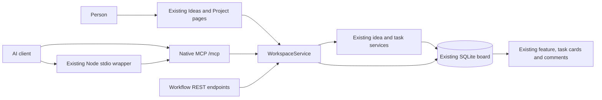

# Requests, plans and results on the existing board

For the person managing projects and the AI clients doing their work. Revalidated September 7, 2026 on Windows 11, PowerShell 7.6.5, .NET SDK 10.0.400 and Node 24. Source baseline: `53a300066e118b0e5a1b0ac9d02294169d2e076f`; tested application and steering case: `dbdacfebc3869beca4568f55e6f9f86955d597e5` in [PR #511](https://github.com/joelfuller2016/KanbanFlow-v2/pull/511), planned in [issue #509](https://github.com/joelfuller2016/KanbanFlow-v2/issues/509). Maintainer: repository owner. Automated verification and actual human usability approval are separate.

KanbanFlow now keeps the original request, improved brief, task plan, conversation, reported results and conclusion alongside its existing ideas and board cards. A request belongs to one existing idea. Promotion connects that idea to a project. Publishing a plan creates real tasks under a feature on that project's current board. The person and MCP clients see and change those same records.

The normal app remains at [http://127.0.0.1:5123](http://127.0.0.1:5123). It uses the existing local access policy; there is **no access code or separate workflow login**. The earlier isolated preview is retired.

## Architecture, processes and data



The [editable diagram](plans/assets/central-project-board.mmd) describes one running ASP.NET Core process and its existing SQLite file. The optional Node wrapper is an MCP transport, not another application or database. Existing GitHub import behavior stays as documented in the [architecture](ARCHITECTURE.md); this change adds local workflow records and does not add automatic GitHub writes.

| Component | Responsibility / source |
|---|---|
| `IdeaService` | Capture raw original text before normalizing idea notes; preserve the existing atomic promotion path, including explicit attachment to an existing project. |
| `WorkspaceService` | Versioned brief/plan/history/result writes, validation, SQLite transaction and retry receipt. See [service](../src/KanbanFlow/Services/Workflows/WorkspaceService.cs). |
| `TaskService` | Existing card creation, field/status edits, comments, completion gate and audit. Transaction-aware helpers let plan publication share the same transaction. |
| Workflow components | Focused editors within existing pages; task context added to the current task detail panel. See [components](../src/KanbanFlow/Components/Workflows). |
| Native and stdio MCP | Four identical workflow tool schemas and shared execution; native `get_task` now includes comments and native `update_task` uses the existing service. |
| `WorkflowSchema` | Transactionally creates nine new tables and their indexes from allowlisted EF-generated DDL. Does not rebuild old tables or alter persisted enum values. |

`WorkRequest.IdeaId` is unique. `PlannedTask` maps a stable plan draft ID to a real `TaskItem.Id`; it is not a second card or execution record. Workflow child rows use explicit foreign keys. A project deletion preserves the idea/request history and clears its project/feature link; deleted tasks lose their live mappings and associated evidence rows. Original plan revisions, request messages, copied result reports and previous conclusions remain readable. Deleting the owning idea deletes its workflow history, consistent with explicit idea deletion. Missing required mappings prevent a new completed conclusion.

| Configuration | Meaning |
|---|---|
| `KANBANFLOW_DB_PATH` | Existing database resolver's explicit file choice. Use the normal launcher for the normal board. Startup logs and Settings identify the opened path. |
| `Workflow:ProjectsRoot` / `Workflow__ProjectsRoot` | Repository registry root; defaults to the user's `Projects` directory. Registered paths must be existing Git repositories/worktrees below it. |
| `KANBANFLOW_API_URL` | Existing Node wrapper's app URL; defaults to `http://127.0.0.1:5123`. |
| `KANBANFLOW_USAGE_LOG=off` | Used by the verification harness so synthetic traffic does not count as real adoption. |

Repository file references are relative paths, one per line. Registry validation rejects traversal and linked-directory escapes. Registration does not read code, inspect the named files, or prove that a reference exists.

## One complete human workflow

1. **Capture the actual request.** Open Ideas, create an idea using the existing form, then use its **Request & plan** link. New ideas automatically preserve the exact original body (or original title when no body was supplied). For an older idea, choose **Start request history**; the app explicitly labels the available notes as a legacy snapshot because earlier exact input cannot be recovered.
2. **Refine the brief.** In **Brief**, write the desired outcome, scope, constraints and acceptance outcomes. Choose **Save brief revision**. The original stays intact and previous brief revisions remain readable. Add later clarification or scope decisions under **Updates**, then revise the brief and plan to acknowledge them.
3. **Choose the existing project or promote into a new one.** Use the project selector and **Promote into project**, or **Create project from request**. Already promoted ideas retain their existing project identity. A published request cannot silently move its work to another project.
4. **Define the plan.** In **Plan & tasks**, optionally register the project repositories. Add task drafts with work description, line-separated checks, repository/files, priority, assignee and dependencies. Choose **Save plan revision**. A draft does not create cards yet.
5. **Publish to the current board.** Choose **Publish saved plan to board**. Real task cards and criteria appear under the request's feature in the existing project outline and board. Existing filters, drag/drop, task detail, claims, comments and task services remain available. Collapse **Requests & plans** for the full board view.
6. **Work and communicate.** Open a real task card. Its detail shows the originating request and repository/file references. Edit status, criteria and comments using the existing controls. In the request's **Updates**, record progress, questions, decisions and assistant responses. **Refresh saved details** reads changes made by MCP. Refresh and section switching preserve unsaved draft fields; an explicit conflict does not silently merge another writer's change. Review the refreshed history before selecting **Keep draft and use current request version**.
7. **Report and review.** In **Results**, expand the task and record its result summary, observed checks and checked source/document reference. The task moves through the existing status service to Review and gains a normal Verification comment. Review each current check, then choose **Accept result and mark Done**. The existing completion gate still applies to ordinary task changes; an audited task override does not invent accepted workflow evidence.
8. **Conclude the request.** When every required task has a current accepted report and completed checks, record a conclusion and limitations. The app preserves prior conclusions and marks them historical after relevant intent, plan or task changes. Further work belongs in a revised plan or explicitly linked request.

The author field and MCP actor are attribution supplied by the caller, not authenticated identity. Reports state what that caller observed. Neither a checked card nor a reported result claims that a Codex process ran.

### Human decisions and verification

A person redirects work through **Updates → decision → Add update**. The connected agent must read the latest context, explicitly acknowledge the decision, revise the brief and plan, and show the resulting change on the same cards. **Refresh saved details** now reloads both request details and the existing project board while preserving drafts and filters. A saved decision alone does not prove that an agent read it, applied it, or stopped a process.

[TC-509](test-cases/509-unified-workflow/README.md) owns the human walkthrough, per-area usability checklist and repeatable browser/MCP case. Major UI changes require verification of each affected interaction and actual user testing before adoption. The current refresh correction adds no visual element or layout change. Human usability checks remain pending until a person performs them and records feedback.

## MCP and REST reference

Start native MCP at the existing `/mcp` endpoint or use `node scripts/mcp-server.mjs`. Discover schemas through `tools/list`.

| MCP tool | Input and result |
|---|---|
| `list_requests` | Optional `projectId`; latest 200 requests, versions, project and task counts. |
| `get_request_context` | `requestId`; original/messages, brief/plan revisions, real task IDs/statuses/comments/checks, repositories, reports, conclusions and relative human links. |
| `get_task_workflow` | Existing `taskId`; the parent request and full workflow context. Unlinked older tasks continue to use existing task/project context tools. |
| `workflow_command` | `{ "input": { ... } }`, using the operations below. Returns request ID/version or created resource ID. |

Existing `get_task`, `update_task_status`, task claims, comments, criteria and dependency tools continue to work. Native `update_task` takes `taskId`, an `update` object, and optional `actor`; the existing wrapper's `update_task` keeps its established flat arguments. The wrapper's existing richer per-task bundle is named **`get_step_context`**. Use `get_task_workflow` on either transport for the new request chain.

Every workflow mutation requires nonempty `actor` and `key`. Reuse the exact key and payload when retrying a lost response. Changed content with the same actor/operation/key is a conflict. All operations except `capture`, `adopt_idea`, `create_project` and `register_repository` also require `requestId` and `expectedVersion` from the latest context. Fetch again on a conflict, review the differences, and submit revised content under a new key. These controls prevent duplicate compound writes; they do not authenticate the caller.

| `input.operation` | Additional fields |
|---|---|
| `capture` | `capture: { title, original, projectId?, source }` |
| `adopt_idea` | `ideaId` |
| `create_project` | `name` |
| `register_repository` | `projectId`, `name`, absolute `path` |
| `attach_project` | `projectId` |
| `save_brief` | `brief: { outcome, scope, constraints, acceptance }` |
| `save_plan` | `tasks: [{ id, title, description, acceptance, repositoryId?, fileReferences, priority, assignee, dependencies }]`; stable GUID draft IDs, dependencies are other draft GUIDs. Maximum 100 drafts. When revising published work, also pass `taskBaselines: { "TASK_ID": "EDIT_TOKEN" }` for every current task, copied from the context originally read. |
| `publish_plan` | `planId`, selecting the latest saved plan |
| `add_message` | `kind` (`clarification`, `assistant-report`, `progress`, `question`, `decision`), `text` |
| `set_task_state` | `itemId` (workflow task mapping GUID), `status` |
| `report_result` | `itemId`, `evidence: { summary, checks, codeReference }` |
| `accept_result` | `itemId`, `evidenceId`, exact set of current `checkedCriterionIds` |
| `conclude` | `text`, `limitations` |
| `archive` | `archived` boolean; active work must leave In progress first |

MCP schemas use enum names (`Todo`, `Review`, `Medium`). REST keeps the existing numeric enums: status Backlog=0, Todo=1, InProgress=2, Review=3, Done=4; priority Low=0, Medium=1, High=2, Critical=3.

REST adds `GET /api/workflows/`, `GET /api/workflows/{requestId}`, `GET /api/workflows/idea/{ideaId}`, `GET /api/workflows/task/{taskId}` and `POST /api/workflows/commands`. See the executable [HTTP examples](../src/KanbanFlow/Requests/workflows.http), [endpoint source](../src/KanbanFlow/WorkflowEndpoints.cs) and live `/openapi/v1.json`. Reads return finite DTOs rather than EF navigation graphs. Validated failures return Problem Details with 404 (missing), 409 (conflict), or 422 (invalid); malformed JSON returns 400.

## Conflict, evidence and recovery rules

- Publication, task/criterion/dependency creation, normal audit and retry receipt commit together. A failure rolls everything back. Updating a draft keeps its published task identity. Published tasks cannot simply disappear from a revised plan.
- A context's task `editToken` values and fields come from one consistent SQLite snapshot. Carry those tokens through `save_plan` as `taskBaselines`; normal board edits during the editing window cause a conflict before saving. Publication then checks the saved baseline again before replacing a task specification. Reload the task, explicitly combine the work in the plan, and save a revised plan. The editor shows differences from current board fields and offers an explicit reviewed rebase; ordinary refresh does not silently replace tokens or draft text.
- Dependency validation examines the resulting persisted graph, including edges added through ordinary board tools. A cycle is rejected inside the same transaction.
- A report binds to the task scope when submitted: current specification plus actual task description, criteria/subtask definitions and transitive dependency scope/completion. Subsequent scope edits make it historical, including edits outside the plan editor. The checked code reference remains the caller's assertion; file content and a remote commit are not independently inspected by this feature.
- Clarification and decision messages invalidate an earlier conclusion and require brief/plan review before a new conclusion. Routine progress messages retain a current conclusion. Reopening work, changing required checks, or deleting required tasks also prevents false completion.
- Archive preserves readable history. Editing the title of an archived promoted idea does not restore its workflow. Deletion behavior is described above; back up the board before destructive maintenance.
- Context includes full revision/message history and caps individual fields/plans; very long histories can produce large MCP responses. Discovery returns the latest 200 matching requests. Pagination and bounded history windows remain follow-on work.

## Verification and local operation

Use the [normal launcher](../scripts/start-kanbanflow.ps1) for the existing board:

```powershell
pwsh -File scripts/start-kanbanflow.ps1
```

Before opening an older database with the new build, stop its owning process and create a SQLite-consistent backup (the SQLite backup API, or copy the main/WAL/SHM files together while stopped). Confirm startup's database path. The additive upgrade preserves prior rows and memory search; reopening the same upgraded database is supported. If startup fails, retain the logs and backup, resolve the error and retry; do not overwrite the existing board with a new seed.

For a disposable verification instance, publish into an ignored `_sandbox` directory, set `KANBANFLOW_DB_PATH` to a disposable database there, and use another port. The recorded walkthrough used port 5126. It does not replace the normal board. Run the transport harness against that instance:

```powershell
node scripts/smoke-workflow.mjs http://127.0.0.1:5126
```

The harness creates a labeled test project and leaves it for browser inspection. It exercises actual native and stdio `tools/list`/`tools/call`, schema parity, exact capture, retry/conflict handling, brief/plan/publication, real task identity, comments, stale-result rejection and REST parity. It prints the board/task links. Open the printed board link and follow steps 2–8 above; use the existing task editor to change a status, then read it through MCP. Stop only the verification process you started.

Revalidated on September 7, 2026; the [pinned run record](test-cases/509-unified-workflow/runs/2026-09-07-dbdacfebc386.md) records the earlier failure and the passing correction:

| Check | Result |
|---|---|
| Full nonincremental solution build | 0 warnings/errors. |
| Full .NET suite | 1,160 passed, 0 failed/skipped (980 existing + 180 workflow cases). |
| Script suite | 223 passed (215 existing + 8 workflow wrapper regressions). |
| Required `scripts/verify.ps1` gate | Exit 0; build/tests passed. Formatting remains advisory and reported whitespace drift in existing and new files; no broad formatting changes applied. |
| Existing `scripts/smoke-api.ps1` | Passed with process-local `KANBANFLOW_LLM_TIMEOUT_MS=1000`. Initial default run exceeded the script's five-second memory recall timeout. Bounding optional embedding exercised its existing keyword fallback; source/assertions unchanged. Default provider latency remains unverified. |
| Native/stdio transport harness | Passed; 33 native tools, 54 wrapper tools, matching four workflow schemas. |
| Real legacy SQLite seed upgrade | Every existing row preserved; repeated upgrade, foreign keys and memory/FTS search checked; forced DDL failure rolled back. |
| Publication/concurrency | Independent SQLite connections, duplicate delivery, changed retry payloads, mid-publication rollback, actual-board cycles and concurrent human scope edits covered. |
| Browser walkthrough | Native-created request → original → brief → repository/task plan → existing cards → human progress → reported results → accepted Done tasks → current conclusion → existing task detail context. Drafts survive section changes and refresh. |
| Human-decision browser/MCP case | Browser decision → explicit MCP acknowledgement → revised brief/plan → same task ID. Old-plan publication refused; refresh updates the card and preserves draft/filter state; keyboard and 390px checks passed. Automated simulation, not human approval. |
| Normal app rebuild/restart | A SQLite-consistent backup preceded restart; every prior row in 28 tables remained equal, with 176 existing tasks and zero foreign-key violations before adding follow-up work cards. |

Key regression names and further execution evidence are recorded in [the implementation plan](plans/central-project-board-implementation.md). Temporary databases, raw logs and screenshots stay under the repository's ignored verification folders.

## Later Codex execution

The current PR provides manual and MCP authoring/review. It does not launch Codex or passively capture unrelated sessions. [Issue #509](https://github.com/joelfuller2016/KanbanFlow-v2/issues/509) retains the explicit follow-on checklist: task-scoped CLI adapter, visible dispatch/run/attempt records, configured model/access preservation, output capture, stop/continue, durable recovery and connected-client capture. Those additions must write to these same request and task IDs. Read the [product direction](plans/central-project-board.md) before implementing them.
