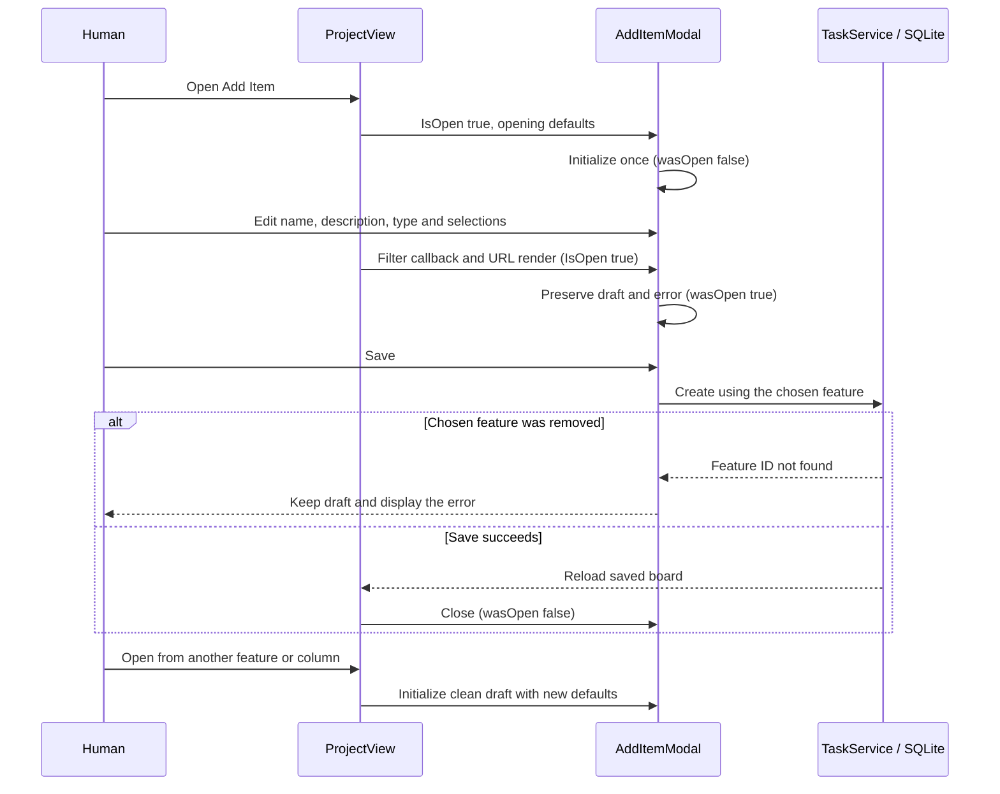

# Add Item draft preservation — issue #463

This review records the bounded fix for [#463](https://github.com/joelfuller2016/KanbanFlow-v2/issues/463), for maintainers and people verifying the existing board. An unrelated parent render previously erased an open Add Item draft. The form now initializes on a fresh close-to-open transition and keeps its fields, selections and errors during ordinary renders.

Date: September 8, 2026, America/New_York (browser/gate artifacts use September 9 UTC). Base: `8073b3e5bccd227e503f0ecd888ccad8199e97d2`, including the separately merged verification exit fix. Environment: Windows, PowerShell 7.6.5, .NET SDK 10.0.401, Node 24.20.0; the repository lock installs Playwright 1.60.0. Work was isolated on `fix/463-preserve-add-drafts`; the normal board and original checkout were not modified by this review agent. The maintenance work is recorded on board task 232 by the coordinating agent.

## Existing behavior and the change

`ProjectView` supplies `AddItemModal` with `IsOpen`, a feature list, and opening defaults. A board-filter callback renders that parent immediately and synchronizes its URL after 250 ms. Blazor treats complex parameters as potentially changed and can invoke `OnParametersSet` even when a primitive parameter is unchanged. See [Microsoft's lifecycle documentation](https://learn.microsoft.com/aspnet/core/blazor/components/lifecycle?view=aspnetcore-10.0#after-parameters-are-set-onparameterssetasync).

Previously the component tested only `if (IsOpen)` and reset every draft on each parameter set. The fix in [AddItemModal.razor](../../src/KanbanFlow/Components/Shared/AddItemModal.razor) adds `wasOpen`, checks `IsOpen && !wasOpen`, and records `wasOpen = IsOpen` on every parameter set. This matches the sibling `IdeaModal` convention. Defaults and reset contents are unchanged.

The task service already rejects a missing feature before persisting a task. Keeping the chosen ID now allows that error to remain visible instead of resetting or silently retargeting the draft. The browser regression deletes the selected feature through the real API while its draft remains open, submits the form, then proves that no task was created in another feature. No service validation, REST/MCP contract, database schema, saved-content normalization, or audit behavior changes.

The production change touches only component state and its lifecycle guard. It does not change markup, layout, labels, controls, dialog initialization, focus trapping, Escape handling, or opener restoration. No production test hook, test framework or package version was added.

## Regression evidence

The three named scenarios are part of the existing [UI harness](../../scripts/ui-e2e.mjs), between the `BEGIN/END AddItemModal draft regression (#463)` markers. Each creates a separate disposable project and two features and deletes that project in `finally`. The parent render uses the existing board-filter input event and waits for the matching URL write plus 600 ms, covering the delayed render as well as the immediate callback.

| Test | Assertions |
| --- | --- |
| `AddItemModal preserves every task field and caret across parent renders (#463)` | Exact name, description including Markdown whitespace/Unicode, chosen feature, Review status, Critical priority, task type, focused textarea and selection range 3–11. A subsequent real save persists the chosen feature/status/priority. |
| `AddItemModal preserves a feature draft and adopts defaults on fresh reopen (#463)` | Keyboard type change and text entry survive the render; Cancel then a different feature opener clears fields and adopts task/feature/Backlog/Medium defaults; 12 Tab stops remain inside; Escape restores opener focus; project-level reopening adopts its feature type default. |
| `AddItemModal retains a failed-save draft and missing-feature error across renders (#463)` | A real concurrent API deletion makes Save report `Feature <id> not found.`; every draft field and that exact error survive a parent render; the board contains zero tasks; Cancel and a Review-column reopen clear the error/draft and adopt fresh context. |

The Playwright CLI run used a generated scratch wrapper around these same scenario blocks, with `page.request` for API calls. It ran in named sessions `drafts463-red` and `drafts463-green` against a rebuilt disposable local app on `http://127.0.0.1:52363`. The wrapper did not change application code or add a callback.

Before the fix, the rebuilt `d89fd4113b3ebf4b74213b6f304843ecaa1893aa` component failed **all three** scenarios. Each reported the distinctive draft name had become `""`. After adding the guard and updating to master `8073b3e`, all three passed in the real browser. The final project-opener assertion was added afterward and is also included in the full-harness run. This is red-before/green-after proof against the actual old guard; a helper-only unit test would not exercise Blazor's parent/child lifecycle.

Scratch logs retain complete results under `_sandbox/drafts463/` in this worktree. `browser-red.json` and `browser-green.json` contain the three outcomes, while the `.log` counterparts include the complete executed CLI code. Source-only reasoning about parameter changes is separate from the browser-observed deletion and rerender results.

The initial full-harness integration runs were also useful failures: **51/53** and then **52/53**. The new cases passed, but their navigation interrupted the existing create/drag/done scenario chain: first cleanup returned Home, then restoring the URL rebuilt the circuit before the immediate drag. The fixture now restores its caller's URL, and the three cases run after that existing chain. No drag assertion, timeout, or production drag behavior was changed. These failed checks remain in `ui-full-ready.log` and `ui-full-final.log`.

The next **52/53** run exposed a test timing assumption: a keyboard toggle checks the native radio immediately, before the Blazor render removes the task-only controls. Tabbing immediately could enter description text before the feature form was ready. The test now waits for the status control to disappear and for description focus before typing. `ui-full-ordered.log` records that failure. The final scenario blocks then passed **three consecutive Playwright CLI runs** (all three cases each time), recorded in `browser-keyboard-1.json` through `browser-keyboard-3.json`. No production code or assertion was weakened for these test corrections.

## Acceptance checklist

- [x] Ordinary parent renders preserve draft fields, selections, error and focus.
- [x] Opening defaults are sampled once per closed-to-open transition.
- [x] Cancel/close and a fresh opener reset the form and adopt the opener's context.
- [x] A failed save preserves the complete draft and actionable error.
- [x] A removed selected feature produces an explicit error without creating a task elsewhere.
- [x] Browser scenarios fail against the old guard and pass with the correction.
- [x] The change preserves API, database, schema and audit behavior.
- [ ] A human records hands-on verification of the deployed form.

## Rebuild and verification

1. Install the repository's locked dev dependency with `npm ci --ignore-scripts`, and install its matching Chromium with `node node_modules/playwright/cli.js install chromium` if it is absent. Expected: browser launch succeeds without changing `package-lock.json`. In this run both were initially missing in the fresh worktree; those two setup attempts failed before any UI test and were retained in `ui-full.log` and `ui-full-installed.log`. Browser downloads and temporary files were directed into the ignored worktree scratch directory.
2. Run `pwsh -NoProfile -File scripts/verify.ps1` from the checkout. Expected: restore, warnings-as-errors build and .NET tests pass; existing formatting drift remains advisory. The working-source run exited **0**, with **980 passed, 0 failed, 0 skipped**, and a build with **0 warnings and 0 errors**. Its complete result is `verify-precommit.log` / `.json`, completed at `2026-09-09T02:38:35.1501456Z`.
3. Run `node scripts/ui-e2e.mjs` with a free `UI_E2E_PORT`. This run uses `52364`, scratch `TEMP`/`TMP`, the installed scratch `PLAYWRIGHT_BROWSERS_PATH`, and `KANBANFLOW_LLM_TIMEOUT_MS=1000` for the existing optional embedding fallback. `SKIP_BUILD=1` is valid here only because the same application source was just rebuilt by the gate. The final full suite passed **53/53**, exit **0**, at `2026-09-09T02:48:12.9190081Z`; complete results are in `ui-full-green.log` / `.json`.
4. Before publishing, validate the final commit and preserve its exact source ID, exit status and results in the PR evidence. If a later application/test change is made, rebuild and rerun the affected checks. All three named browser sessions and their disposable application processes were closed; the full harness owns and tears down its own app.

`npm run test:scripts` also passed **231/231**, exit **0**, with no skipped/cancelled tests (`node-suite.log`). `node --check scripts/ui-e2e.mjs` and `git diff --check` passed. No test assertion was removed and no dependency lockfile changed.

The corrected component SHA-256 is `AECD27EF7DD039FD3F652FF0B4E5DE6231CD574433702EFB4A3E093780BE89AA` (raw working-tree file bytes). This distinguishes tested code from a branch name that can advance. The coordinating agent owns the PR publication, current-head review and merge decision.

## Human verification

Automated checks do not represent human usability acceptance. A person can verify the existing form after deployment by opening Add Task, entering distinctive details and selections, leaving an unrelated AI request or filter synchronization to complete, and confirming the draft stays intact. Cancel and reopen from a different column or feature to confirm the intended fresh defaults; enter details by keyboard and verify Escape returns focus to the opener. If the draft changes unexpectedly, keep the dialog open, record the opener/filter action and current source version, and inspect the lifecycle guard before broadening the UI scope.

Actual human feedback remains pending. No major UI change is proposed by this fix.
