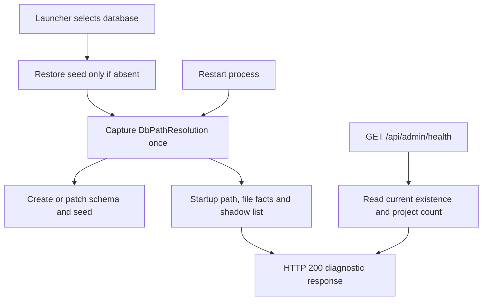

# Database health review — PR #512

This review is for the maintainer merging [PR #512](https://github.com/joelfuller2016/KanbanFlow-v2/pull/512)
and operators interpreting `/api/admin/health`. It checks that health reads the selected database,
reports failures without creating a replacement file, and explains the evidence a human must
compare with the intended board. The owning request is [#498](https://github.com/joelfuller2016/KanbanFlow-v2/issues/498).

Reviewed September 8, 2026, America/New_York (execution continued into September 9 UTC), from
`8d2f1f2b5f71e4a22ea3958e48951f1dd1f81282`. Environment: Windows, PowerShell 7, .NET SDK
10.0.401, `net10.0`, xUnit 2.9.3 through VSTest, local SQLite and Kestrel. All application processes,
database copies and logs for this review were owned by the isolated review worktree. The normal
board was read through SQLite's online backup API; this review did not run an older app against it.

## Recommendation and scope

Merge the health implementation before the larger workflow PR after the current local gate and
GitHub review requirements are satisfied. It is independent of GitHub link persistence, preserves
the existing HTTP fields, and has real database/HTTP checks for success, missing files and locks.
All 17 inline review threads were already resolved when inspected; that does not itself constitute
approval of the current PR. The recorded review decision was still `CHANGES_REQUESTED`.

Confidence is high for the Windows functional behavior and limited for cross-platform timestamps
and an unconditional latency guarantee. A reproducible probe write, lost current project count,
unbounded lock wait, or review rejection of the stated performance limits would change this
recommendation. The historical live-board latency acceptance check remains open below.

This review changes documentation and source comments only. It corrects the lifetime of startup
warnings and states the already-implemented nested `db.status` contract. It does not change database
selection, the query, status values, or the UI.

## Data and request flow

The launcher restores a seed only when its selected file is absent. `DbPathResolver` then captures
the path, startup existence, file metadata and shadow candidates before schema/seed work. Health
combines that immutable startup record with a read-only query on each request.

The file facts and shadow list do not refresh when a health request arrives. This distinction is
important after repairing a warning: a human can see current project counts alongside a warning
that still describes startup. See the [API contract](../ARCHITECTURE.md#admin).

## Finding fixed: warning lifetimes were described incorrectly

The README said a write clears `last-write-precedes-creation` immediately. The architecture table
also said removing a shadow clears its warning. Both fields come from the captured singleton, so
the running process retains those observations until restart. The architecture section also grouped
`unreachable` under reasons for `degraded`, although that reason produces top-level `error`.

The following real launcher experiment proved the distinction before changing the explanations:

| Step | Current projects | Startup last-write value | Reported reasons |
|---|---:|---|---|
| Launch with absent scratch path; launcher restores seed | 1 | `2026-09-09T01:53:30.1891262Z` | Copy signature and recent creation |
| Restart the same unchanged file | 1 | Same | Same |
| Create a project through the API | 2 | Same | Same |
| Restart after that write, with a second candidate present | 2 | `2026-09-09T02:01:43.1587049Z` | Recent creation and shadow candidate |
| Remove the shadow candidate while that process runs | 2 | Same | Same |

Every response in this experiment remained HTTP 200 with `db.status: "ok"`. The copy reason cleared
only when restart captured the changed file; the shadow warning remained after removal because
its list was captured at boot. README, architecture reference and source comments now agree.

## Verification performed

| Check | Command or action | Observed result |
|---|---|---|
| Repository gate | `& ./scripts/verify.ps1` | Restore and warnings-as-errors build passed, 0 warnings/errors; `Passed: 998, Failed: 0, Skipped: 0`. Advisory format found existing drift. The caller observed exit 2 despite the success message; tracked separately in [#253](https://github.com/joelfuller2016/KanbanFlow-v2/issues/253). |
| Script tests | `npm run test:scripts` | Exit 0; 224 passed, 0 failed/skipped. |
| HTTP API smoke | `& ./scripts/smoke-api.ps1` | Exit 0; full smoke passed, including fresh-board `degraded`, exact pinned database path, current project count and all three file-fact fields. |
| Actual launcher path | Three runs of `scripts/start-kanbanflow.ps1` against one disposable database | Seed restore, unchanged restart, audited project write and shadow removal produced the states above. |
| Current-board workload copy | SQLite online backup from a `mode=ro` source connection | Copy size 5,844,992 bytes, 1 project, 191 tasks; `PRAGMA integrity_check` returned `ok`. |
| Workload timing | Published Release app, one first request followed by 20 sequential HTTP probes using one `HttpClient` | All database reads succeeded. Full timing results below. |

The smoke invocation set `TEMP` and `TMP` inside the ignored worktree scratch directory and set
`KANBANFLOW_LLM_TIMEOUT_MS=1000` for that disposable process so the existing embedding fallback
finished within the smoke client's timeout. It supplied the PowerShell default
`Start-Process:WindowStyle=Hidden`. No provider model or normal app configuration was changed.

The .NET suite includes real Kestrel/SQLite tests proving that health does not create a missing
database, reports unreachable reads, recovers after a writer releases an exclusive lock, preserves
legacy fields, and reports copy/creation/shadow reasons. Those checks were executed, not inferred
from test names. No existing assertion was weakened.

Raw local evidence is retained under `_sandbox/health-review/` in the review worktree:
`verify-baseline.log`, `node-baseline.log`, `smoke-api.log`, `launcher-evidence.json`,
`workload-metadata.json` and `latency-evidence.json`. These files are deliberately ignored rather
than uploaded with the source. Every app launched for these checks was stopped by its recorded
launcher/child process identity.

### Timing result and remaining acceptance check

The historical issue describes a 38 MB database at a different profile path. The current normal
database here was 5,844,992 bytes at capture time. Measurements below are on its consistent copy,
served by the reviewed Release application, not on the still-running normal app.

The first successful response took **476.0612 ms**; its reported database
probe took **97.4 ms**. The next 20 end-to-end samples, without removing any observations, were:

| Sample | End-to-end ms | Database ms |
|---:|---:|---:|
| 1 | 154.6428 | 139.4 |
| 2 | 6.2975 | 1.6 |
| 3 | 7.0918 | 1.6 |
| 4 | 7.9867 | 1.5 |
| 5 | 3.1504 | 1.4 |
| 6 | 3.6608 | 1.9 |
| 7 | 3.3717 | 1.6 |
| 8 | 5.0594 | 3.1 |
| 9 | 4.2293 | 1.2 |
| 10 | 3.5557 | 1.1 |
| 11 | 3.3798 | 1.6 |
| 12 | 3.7339 | 1.8 |
| 13 | 3.9497 | 1.5 |
| 14 | 2.9790 | 1.3 |
| 15 | 3.9316 | 1.1 |
| 16 | 5.6485 | 1.1 |
| 17 | 3.9689 | 2.4 |
| 18 | 3.9468 | 1.3 |
| 19 | 3.2908 | 1.2 |
| 20 | 24.3315 | 1.6 |

The mean of those 20 samples was **12.91033 ms** and the maximum was **154.6428 ms**. Nineteen
consecutive later probes were under 50 ms. This supports inexpensive steady-state reads; it does
not prove every request is under 50 ms, identify the cause of the two initial slower responses, or
satisfy the historical live-38-MB check. Record a current normal-app measurement after the combined
changes are deployed; retain this limitation when updating #498.

## Review-thread dispositions

All IDs below were `isResolved: true` in the GitHub thread query at this review. The dispositions
describe the inspected code rather than treating a bot success status as approval.

| Thread ID | Finding and disposition |
|---|---|
| `PRRT_kwDOSA8y6s6gBhWW` | JSON Windows-path escapes: current README sample escapes backslashes. |
| `PRRT_kwDOSA8y6s6gBlgO` | Snapshot/journal explanation: current docs use rollback-journal behavior and `VACUUM INTO`. |
| `PRRT_kwDOSA8y6s6gBlgQ` | Readiness wording: scheduled-task success says serving and accepts both `ok` and `degraded`. |
| `PRRT_kwDOSA8y6s6gBlgS` | Failure log: caught health failures log their operation and database path. |
| `PRRT_kwDOSA8y6s6gBlgX` | Configured-path shadows: the override branch calls `OtherExistingBoards`; launcher experiment confirms reporting. |
| `PRRT_kwDOSA8y6s6gBlga` | Lock bound: existing test uses the independent six-second ceiling; suite passed. |
| `PRRT_kwDOSA8y6s6gBlgc` | Host cleanup: fixture disposes the app if startup fails before ownership transfers. |
| `PRRT_kwDOSA8y6s6gCtQ4` | Probe observation: candidate selection uses the `Stat` result before returning an existing path. |
| `PRRT_kwDOSA8y6s6gCwqD` | Nested status contract: current code/tests emit `unreachable`; docs now state it directly. |
| `PRRT_kwDOSA8y6s6gCwqH` | Example fence: architecture uses the `text` language for mixed shell/response content. |
| `PRRT_kwDOSA8y6s6gCwqI` | Separate timestamp lifetimes: this review additionally corrects the missing restart requirement for captured copy facts. |
| `PRRT_kwDOSA8y6s6gCwqM` | Nullable snapshot: current doc comments allow it and health guards it; #513 remains a separate follow-up. |
| `PRRT_kwDOSA8y6s6gCwqQ` | Established fixture: current test backdates both creation and write and documents platform limits. |
| `PRRT_kwDOSA8y6s6gCwqT` | Cleanup access error: fixture handles `UnauthorizedAccessException` as well as `IOException`. |
| `PRRT_kwDOSA8y6s6gCwqU` | Copy timestamp portability: both real-file tests explicitly assert their filesystem precondition and passed on Windows here. No Linux/macOS execution is claimed. |
| `PRRT_kwDOSA8y6s6gDX4t` | Launch override: documented launch sets `KANBANFLOW_DB_PATH`. |
| `PRRT_kwDOSA8y6s6gDX4w` | Vanished first candidate: resolver now tries the remaining stat-confirmed candidates; changing absent-all-candidates policy is outside this health increment. |

The latest changes-requested review, `PRR_kwDOSA8y6s8AAAABMiFTew`, also contains two comments
outside the diff. Its latency request is only partly answered by the measured workload copy above.
Its suggestion to substitute synthetic timestamps for the copy fixture would remove that fixture's
real-filesystem evidence. The existing explicit Windows/filesystem precondition is retained; a
separate cross-platform predicate fixture can be considered without weakening that evidence.

## Recovery and follow-up

1. Compare `db.path` with the board the user intended. If wrong, stop only the process serving that
   wrong path and restart through the launcher with the correct explicit `-DbPath`. A diagnostic
   reason alone does not identify which file a human intended.
2. After changing files or completing a restore, restart to refresh startup metadata. Expect a recent
   creation warning to remain until a start outside its fifteen-minute window. This is evidence of
   the recent file history, not a refusal to serve it.
3. Keep [#513](https://github.com/joelfuller2016/KanbanFlow-v2/issues/513) separate. The current
   consumer is null-safe, and the original biconditional prose has already been narrowed. A future
   unreadable-file test must establish a real metadata failure: denying file-content access does
   not by itself prove that stat metadata is unreadable. The documented `FileInfo.Exists` API also
   returns false on inspection errors, which relates to [#384](https://github.com/joelfuller2016/KanbanFlow-v2/issues/384).
   See [Microsoft's `FileInfo.Exists` contract](https://learn.microsoft.com/dotnet/api/system.io.fileinfo.exists?view=net-10.0).
4. Fix the callable gate's success exit in #253, recheck the current commit through the normal gate,
   and refresh the GitHub review state. Do not bypass a remaining requested change with an admin merge.
