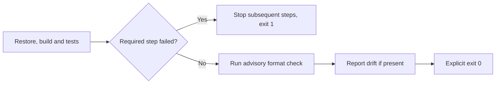

# Verification gate exit status — issue #253

This record is for humans and automation consuming `scripts/verify.ps1`. A successful build/test
gate must report success even when its advisory formatter finds drift. A real restore, build or
test failure must still stop the gate and report failure.

Reviewed September 8, 2026, America/New_York; final validation completed September 9 UTC.
Source baseline: `d89fd4113b3ebf4b74213b6f304843ecaa1893aa`, with the explicit-exit change and
invocation tests in this PR. Environment: Windows, PowerShell 7.6.5, Node.js 24.20.0, .NET SDK
10.0.401. This is the primary exit-status repair in
[#253](https://github.com/joelfuller2016/KanbanFlow-v2/issues/253). Broad formatting cleanup and
promoting formatting to a hard gate remain separate follow-on work.

## Cause and resulting behavior

The advisory `dotnet format --verify-no-changes` process returns 2 for formatting drift. The gate
handled that result by printing a warning and continuing, but had no explicit successful exit.
When called from another PowerShell script, it therefore left `$LASTEXITCODE=2` while its final
message said the required checks passed. The patch makes the final exit depend only on
`$script:verifyFailed`: 1 for a caught required-step failure, otherwise 0.

The reproduction narrows one claim in the issue: on PowerShell 7.6.5 here, direct
`pwsh -File scripts/verify.ps1` already returned 0 before the fix. The failing case was
`& ./scripts/verify.ps1` followed by reading or forwarding `$LASTEXITCODE`. Both forms are now
explicitly tested. This distinction matches
[PowerShell's documented exit-code rules](https://learn.microsoft.com/powershell/module/microsoft.powershell.core/about/about_automatic_variables?view=powershell-7.6#lastexitcode).

The existing `finally` restores the caller's working directory before either exit. Formatting
continues to report its warning and does not become a required gate in this change.

## Evidence

The focused tests copy the actual gate into a new ignored fixture directory, then start real
PowerShell processes. A native `dotnet` stand-in supplies chosen command exits and records the
commands it receives. This isolates orchestration from application compilation while still
exercising PowerShell's actual script-call and exit behavior. Separate verification below uses the
real .NET SDK and application tests.

| Requirement | Evidence |
|---|---|
| “Make `scripts/verify.ps1`'s **process exit code authoritative** (driven by build+test)” | `verify exits zero after advisory format drift through call invocation` and `verify exits zero after advisory format drift through file invocation` assert exit 0, the full step sequence, the warning and the success message. |
| “A genuine build failure or test failure still exits **non-zero** (1).” | `verify exits one and stops after a build failure` and `verify exits one and stops after a test failure` assert normalized exit 1, exact stopped sequences and absence of the success message. |
| Required restore failures remain failures | `verify exits one and stops after a restore failure` asserts exit 1 and that no build, test or format command runs. |
| Clean and no-test-project paths remain supported | `verify exits zero when every step is clean` and `verify preserves the documented no-test-project path and advisory exit` exercise those paths independently. |
| Caller state remains usable | Every call-operator case asserts that the caller's working directory is restored, its recorded exit equals the process exit, and PowerShell's success flag agrees. |

Before the production change, `node --test scripts/verify.test.mjs` exited **1** with **5 passed,
2 failed**. Both failures were advisory-drift calls that left exit 2, including the no-test-project
path. The direct `-File` case and all three required-step failure cases already passed.

After the change:

| Command | Result |
|---|---|
| `node --test scripts/verify.test.mjs` | Exit 0; 7 passed, 0 failed/skipped. |
| `npm run test:scripts` | Exit 0; 231 passed, 0 failed/skipped. |
| `& ./scripts/verify.ps1` | Exit 0 and `$?=True`; restore/build passed with 0 warnings/errors; `Passed: 980, Failed: 0, Skipped: 0`. Existing formatting drift was reported as advisory. |
| `git diff --check` | Exit 0. |

The real gate invocation completed at `2026-09-09T02:18:41.636367Z` on the review worktree's
prepared patch. Its logs and caller-state JSON are under ignored `_sandbox/gate-review/`; test
fixtures live under ignored `_sandbox/verify-tests/` and each test removes only its own generated
directory. The tests use hidden child processes and make no GitHub or board writes.

No application UI, schema, production data, package versions or format policy changed. No browser
check is required for this process-exit repair. Keep #253's secondary formatting cleanup and later
format-gate promotion pending; this evidence does not claim either was completed.

## Use and recovery

1. Run the [current-checkout gate](../ci-without-actions.md#verify-the-current-checkout). Expect exit
   0 only after the required build/test steps pass. Preserve any advisory formatting warning in the
   run record.
2. If the gate returns 1, use the reported failing restore/build/test step to diagnose that failure.
   Later steps should not have run; the invocation tests check that behavior.
3. If a caller still reports a format-only failure, confirm it is running the updated script and
   reads the gate's exit before launching another native command. Each later native command can
   replace `$LASTEXITCODE` with its own result.
