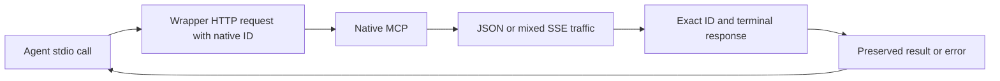

# Workflow and transport regression contract

This record is for maintainers reviewing or rerunning the November 1 regression expansion. The source baseline is `789c6b4743f42663365cc04d1bb1e5429788a9d4`; [the implementation plan](../plans/2026-11-01-pr-review-and-regression-expansion.md) owns scope and acceptance. Request `9327981b-5625-4912-90ee-efdae8ad9928`, project 2, owns actual task state and results. Root `JOURNAL.md` and the resulting PR record full-gate and merge receipts.

## Behavior and data flow

The stdio wrapper sends native `tools/call` requests to the ASP.NET Core `/mcp` endpoint. An HTTP response can contain JSON or SSE traffic. SSE requests and notifications can precede the response. The wrapper must identify the exact terminal response before returning a result or error to its caller.

The production change in [mcp-server.mjs](../../scripts/mcp-server.mjs) validates JSON-RPC 2.0, exact ID type/value, absence of a request method, mutually exclusive result/error, and a valid error object. Unmatched frames are never a fallback result. Valid error code `0`, empty messages, falsey data and absent optional data keep their meaning. Failed responses do not trigger an implicit HTTP retry; a caller can retry explicitly with the same business key.

This follows the [JSON-RPC response/error contract](https://www.jsonrpc.org/specification) and the [pinned MCP Streamable HTTP transport](https://modelcontextprotocol.io/specification/2025-06-18/basic/transports), which permits request/notification traffic before the matching response. It introduces no authentication, network access policy, domain field limit or workflow schema change.

Workflow service behavior is unchanged. New real-SQLite assertions protect complete report copies, existing public field limits, atomic rejection and a coherent graph/edit-token snapshot during an independent writer. The browser harness now recognizes real creation audit activity rather than suppressing it to satisfy an obsolete fixture assumption.

## Requirement-to-test matrix

| Contract | Exact test name or family | Distinguishing assertion |
|---|---|---|
| Complete report reaches both human surfaces | `RecordEvidence_MirrorsCompleteAuthoredReportIntoMessageAndTaskComment` | Entire independently constructed Markdown/Unicode report equals both request message and task comment; author/source/identity, Review and unaccepted evidence also checked |
| Existing report-field boundaries | `RecordEvidence_FieldLengthBoundary_PreservesOrRejectsAtomically` | Nine cases: Summary/Checks 20,000 and CodeReference 2,000, each at limit−1/limit/limit+1; exact accepted text and unchanged rejected version/rows/audit/receipt |
| Existing conclusion-field boundaries | `Conclude_FieldLengthBoundary_PreservesOrRejectsAtomically` | Six cases: Conclusion 50,000 and Limitations 10,000, before/at/after; exact accepted content and atomic rejection |
| Graph and token share one read snapshot | `ContextAsync_ConcurrentTaskEdit_DoesNotPairOldFieldsWithNewEditToken` | Actual independent SQLite writer at the graph/snapshot boundary; coherent old fields/token, then committed new description/different fresh token; no sleeps |
| Mixed SSE selects the real response | `wrapper selects the matching terminal SSE response after unrelated traffic` | Heartbeat/progress, foreign result and same-ID server request precede exact full Markdown/Unicode result |
| Invalid or unmatched envelopes cannot become receipts | `wrapper rejects native responses without a matching terminal ID (...)` | Sixteen partitions in both JSON/SSE; no successful result, explicit recovery, exactly one HTTP call per client call and unchanged business key |
| Correlated errors remain complete | `wrapper preserves correlated native errors in JSON (...)` and `wrapper preserves correlated native errors after unrelated SSE traffic (...)` | Exact code/message/nested data, code zero/empty message, and absence of optional data |
| New empty project has truthful recency | `A new empty project shows creation recency without work placeholders` | No progress/next-task/claim placeholder; displayed time equals actual API creation activity |

Sources: [workflow result tests](../../tests/KanbanFlow.Tests/Services/WorkspaceService.ResultsTests.cs), [query tests](../../tests/KanbanFlow.Tests/Services/WorkspaceService.QueryTests.cs), [real wrapper tests](../../scripts/workflow-tools.test.mjs), and [existing browser suite](../../scripts/ui-e2e.mjs).

## Executed focused evidence

The unchanged final wrapper tests produced **16 passed / 37 failed** against the original production implementation, then **53/53 passed**, exit 0, after the repair. The existing fourteen cases remained; thirty-nine cases were added. The real spawned wrapper is tested, rather than a copied parser. The HTTP fixture collects bytes and decodes UTF-8 once, and its raw/multiple-frame path does not manufacture valid response IDs.

Seventeen new workflow cases across four methods passed as part of a fresh **123/123** owning-class run with warnings as errors, zero warnings/failures/skips, exit 0. Two production C# files were temporarily changed for controls and restored byte-identically; no production C# change remains.

Nine focused controls proved that the new assertions can fail: shortened report copy, narrowed Summary maximum, widened Conclusion maximum, removed context read transaction, loose native ID comparison, removed method guard, dropped error data, falsey error-code fallback and fractional-code acceptance. Each landed mutation was observed failing its intended check and then restored. Raw TRX, logs, source hashes and red/green receipts remain under ignored `_sandbox/testing-expansion-20261101/{workflow,transport}/`.

The unmodified current-primary UI baseline was **55/56**, exit 1, with only the creation-recency assertion failing. All 459 pinned inputs and HEAD stayed unchanged. The small browser fix retains keyboard assertions and actual Home/audit behavior; its full verification belongs to the final gate receipts. The retained baseline database is a cold post-suite copy after normal fixture cleanup, not a claim that its failing project remains.

## Rerun and recovery

1. **Use this repository checkout and pinned packages.** Run `npm ci` for script/browser dependencies if absent. Expected: local project dependencies install successfully. Keep package versions; resolve an actual missing prerequisite before changing the toolchain.
2. **Run the focused production-wrapper suite:** `node --test --test-concurrency=1 --test-reporter=tap scripts/workflow-tools.test.mjs`. Expected: 53 passing cases. A failure reports the exact envelope partition; inspect that case and its forwarded request rather than adding retries or weakening ID checks.
3. **Run the canonical gate:** `./scripts/verify.ps1` from PowerShell 7. Expected: restore/build/tests exit 0 with no compiler warnings/errors. Existing formatter drift remains advisory. A `--no-build` unit run is evidence only after rebuilding that exact source.
4. **Run all script units:** `node --test --test-concurrency=1 'scripts/*.test.mjs'`. Expected: a complete clean summary, including real local Git/HTTP child fixtures. Keep HEAD and relevant source frozen through the run; save actual exit/counts.
5. **Run the broad browser suite on a free alternate port:** set process-local `UI_E2E_PORT=5202`, then `npm run test:ui`. Expected: all 56 scenarios pass and the owned app stops afterward. Its fresh temporary database must not be the normal board. If a port is occupied, choose a different free port; do not stop another process.
6. **Check real native/stdio compatibility** with the existing [fresh-manifest procedure](../request-workflow.md#verification-and-local-operation), `workflow-smoke-instance.mjs` and `smoke-workflow.mjs`. Expected: a passed single-use manifest whose read-only health proof matches its exact disposable database. Never reuse a completed manifest or target port 5123.

After the PR merges, fetch the actual merged primary, freshly build/run the unit suite and collect the already-installed coverlet output where supported. Report its measured scope, not an inferred coverage percentage. Static pairing, test counts and successful controlled mutations each provide different evidence; none alone proves every branch is covered. The separate UI human-usability/adoption gate remains pending.
