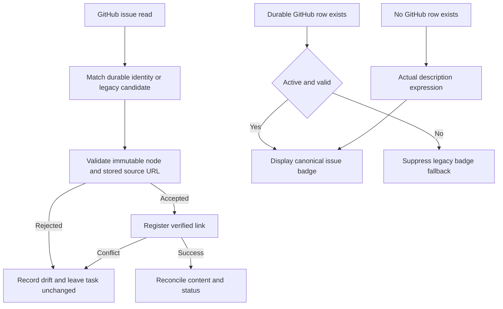

# TC-336: durable GitHub links and review safety

This case helps maintainers and human reviewers verify [issue #336](https://github.com/joelfuller2016/KanbanFlow-v2/issues/336) and [PR #506](https://github.com/joelfuller2016/KanbanFlow-v2/pull/506) in the existing KanbanFlow app. The operating contract lives in [GitHub sync](../../GITHUB-SYNC.md). The repository review cycle is tracked in [issue #515](https://github.com/joelfuller2016/KanbanFlow-v2/issues/515).

The app owns the SQLite task, durable issue link, quarantine decision and external write journal. The sync script performs GitHub reads and submits board mutations to the service/API boundary. The card, detail panel and task editor display that identity. Legacy descriptions supply a display fallback only until a GitHub row exists.

The ordinary first import still has a split task-create/link-register transaction in this PR. [Issue #507](https://github.com/joelfuller2016/KanbanFlow-v2/issues/507) owns the atomic projection follow-on. Until that acceptance passes, do not describe concurrent inbound projection as duplicate-free or issue #336 as fully complete. [Issue #514](https://github.com/joelfuller2016/KanbanFlow-v2/issues/514) separately normalizes the two GitHub fetch record shapes; deleting either existing node-ID fallback before that normalization would break a real caller.

## Repeatable checks

1. Inspect the current PR commit, then run `pwsh -NoProfile -File scripts/verify.ps1`. Expect a clean rebuild and all .NET tests passing. The inherited #516 fix makes both invocation forms return the explicit gate result; older revisions could leave the advisory formatter's native exit value in a caller's `$LASTEXITCODE`. If a build/test fails, fix that cause before using any existing artifacts.
2. Run `npm run test:scripts`. The [sync tests](../../../scripts/portfolio-sync.test.mjs) call the real sync function through its transport boundary. Rejected foreign repositories, different issue numbers, ambiguous provenance and numeric node IDs must make no task, comment, link or feature mutation; a later valid issue must still progress. A refused registration must stop every subsequent mutation to that candidate.
3. Check the [service tests](../../../tests/KanbanFlow.Tests/ExternalWorkItemServiceTests.cs). Long Unicode/CRLF errors and quarantine explanations must match exactly after a fresh SQLite read. Repeating quarantine must preserve one row and one audit event. Manual retry reasons retain their whitespace within the existing explicit validation limit. Explicit validation failure remains acceptable; silently cutting text does not.
4. Publish current source to an ignored folder and start a disposable app with an explicit SQLite path and port. Keep the normal app/database separate. Send full failure and quarantine payloads through REST and read them back. All seven body-bound external work-item routes must reject literal JSON `null` with `400`. Native MCP `get_task` must read the fixture; `node scripts/framing-ab.mjs all` and `node scripts/smoke-mcp.mjs <fixture-project-id>` must pass with `KANBANFLOW_API_URL` pointing at the disposable app.
5. Open that app in a named Playwright CLI session and run the committed [browser check](../../../scripts/external-work-item.browser.js): `playwright-cli -s=review506 run-code --filename=<absolute-path-to-script>`. It creates its own labeled project and deletes that project in `finally`. Expect a returned object with `passed: true`; a `### Error` result is a failed check regardless of wrapper exit handling. The test exercises actual card, detail and editor controls, the legacy fallback, quarantine suppression, retained source descriptions, verified URL precedence, and Project/Feature negative controls with a positive task PR control.
6. Stop only the app and browser processes created for the check. Keep full transient logs/database snapshots in the owning checkout's ignored folder. Record source commit, runtime, process exits, actual counts and any failed attempts in the run record.

## Human review

- On an existing project, confirm the card, detail and task editor all open the same intended GitHub issue.
- Confirm a legacy card retains its issue chip before its first durable-link sync.
- Confirm a quarantined card preserves readable source context without presenting the rejected identity as an active issue badge.
- Review the drift explanation before resolving conflicting source identities; unrelated issues should continue syncing.
- Inspect complete failure/quarantine evidence and use an explicit human decision for retry or repair.

Automated checks are not human usability acceptance. This PR changes existing bindings and the meaning of an existing badge; it does not introduce a new board layout. Actual human feedback remains pending until recorded.

## Known integration limits

Native MCP's `get_task` in this PR returns the older `TaskDetail` shape without durable links/journal details, whereas the stdio wrapper uses the REST task payload. The review cycle must close or explicitly track that parity gap before claiming that every board detail is available through both transports. The live GitHub crash harness remains opt-in and performs real external writes; a local review must not claim to have rerun it unless it actually did.

Razor string parameters require an `@` prefix to pass a C# expression. Without it, `Description="Task.Description"` is literal text, which was the observed reason the legacy chip failed despite a passing resolver test. See the [official component parameter documentation](https://learn.microsoft.com/aspnet/core/blazor/components/?view=aspnetcore-10.0#component-parameters).

## Runs

- [2026-09-08 review at `5f4126562a41`](runs/2026-09-08-5f4126562a41.md)
