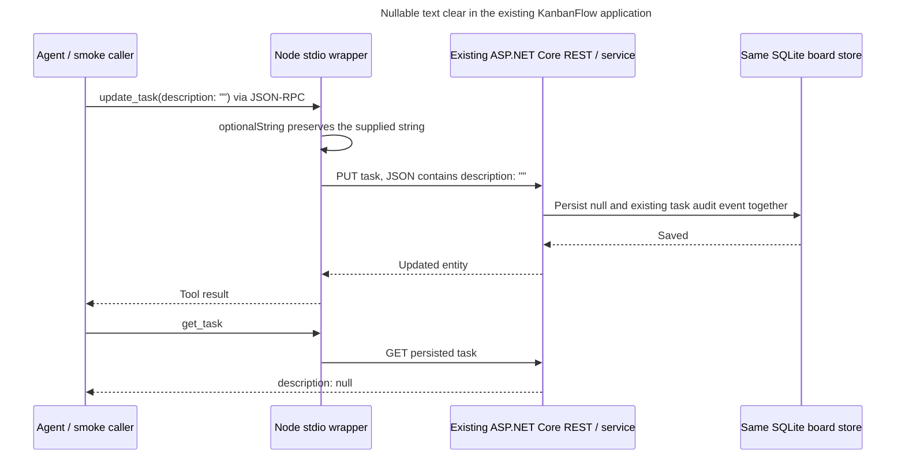

# TC-462: nullable text updates through stdio MCP

This case is for maintainers and agents changing the MCP wrapper. It proves that an explicit
empty string reaches the existing application's update boundary, so clearing obsolete board
documentation or an assignee actually changes the persisted record.

Owner: KanbanFlow maintainers. Reviewed: September 8, 2026. Source baseline:
`8073b3e5bccd227e503f0ecd888ccad8199e97d2`. Measured results belong in `runs/` at their tested commit.
Issue: [#462](https://github.com/joelfuller2016/KanbanFlow-v2/issues/462). Implementation: [#517](https://github.com/joelfuller2016/KanbanFlow-v2/pull/517).

## Contract and architecture

| Input | Nullable update field behavior |
|---|---|
| Omitted, or explicit JSON `null` | Preserve the stored value |
| Empty string, or whitespace-only string | Clear to persisted `null` |
| Non-empty text | Replace using the existing receiving service's normalization |

The affected fields are project `description`, `goals`, `readme`; feature `description`; task
`description`, `assignee`; and idea `body`, `plan`, `tags`. All nine update schemas allow string
or null and explain the contract. Names remain required on project, feature and task updates.
Blank task/idea status or priority values are validation errors, not clear operations.

Previously the wrapper converted `""` to `undefined`, which `JSON.stringify` omitted. REST
correctly preserved a field it never received. The fix changes only transport validation and
schema documentation; it retains the receiving REST/service boundary and existing data model.

The call-site audit deliberately keeps creation fields, idea query filters, actor defaults,
optional non-clearable title/checklist text and the Done override reason on
`optionalNonEmptyString`. That helper preserves their prior exact-empty-as-absent behavior;
whitespace normalization stays at the existing receiving boundary. Update enums are validated
before serialization. `requiredString`, including future full-content handling in #511, is
independent of this change.

## Executable checks

[The smoke entry point](../../../scripts/smoke-mcp.mjs) starts the real
[stdio wrapper](../../../scripts/mcp-server.mjs). It invokes
[the focused transport matrix](../../../scripts/mcp-clear-checks.mjs), which creates its own
project, feature, task and idea and deletes its own project/idea in `finally`.

| Requirement | Real check |
|---|---|
| All nine fields preserve/clear/replace | Eight states per field through REST and stdio: populated+omitted, populated+null, populated+empty, populated+whitespace, cleared+omitted, cleared+null, cleared+empty, non-empty replacement |
| Persisted data, not just successful calls | REST and stdio re-read after every update; omitted sibling fields remain unchanged |
| Native parity where available | The same eight states through native HTTP `update_idea` for body/plan/tags; native project/feature/task update tools do not exist at this baseline |
| Audit and timestamps | No-op leaves `UpdatedAt` and activity unchanged; real changes advance `UpdatedAt`; task/idea changes produce exactly one update event with correct before/after field values |
| REST/agent audit agreement | Compare update event types/counts against the equivalent REST operation for every state |
| Call-site compatibility | Empty create fields, default task enums, empty idea filters and empty release actor retain their previous behavior |
| Blank enum errors | Empty and whitespace status/priority fail with JSON-RPC `-32602` for task create/update and idea create/update where supported |
| No stranded fixtures | Own project and idea are deleted even when a scenario fails |

The matrix emits one JSON record per check, aggregates failures, and fails the smoke run.
It does not stop at the first lost clear, so a mutation run can show all nine regressions.

## Reproduce and recover

1. Start the app locally using a disposable SQLite path under this checkout's ignored
   `_sandbox/` directory and an unused loopback port. Verify `GET /api/projects` returns the
   disposable board. This avoids putting smoke activity into the user's live board. If startup
   fails, inspect that process's log and database path before trying again.
2. In a second PowerShell terminal, set `KANBANFLOW_API_URL` to that process (for example
   `http://127.0.0.1:5188`) and run `node scripts/smoke-mcp.mjs 1`, replacing `1` with a project id
   returned by the disposable board. Expect `190 passed, 0 failed` for this case and the normal
   final MCP smoke success line. A failed row names the transport, entity, field and input state.
3. Run `node scripts/framing-ab.mjs all` and `npm run test:scripts` to check wrapper framing and
   script regressions. Run `pwsh -NoProfile -File scripts/verify.ps1` for the repository rebuild
   and .NET tests, and `pwsh -NoProfile -File scripts/smoke-api.ps1` for the existing REST suite.
   Keep temporary API run files inside an ignored repository directory on this Windows setup.
4. Prove sensitivity in an isolated checkout: save the wrapper's bytes/hash, temporarily add
   `|| value === ""` back to the guard **inside `optionalString` only**, and rerun MCP smoke.
   Expect exactly nine `stdio.*.populated-empty` failures, with all populated-omitted checks
   still passing. Restore the original bytes in `finally` and verify the hash before any
   further validation, commit or publication. Repeat normal smoke after restoration.
5. Stop only the local processes created for this run. Preserve complete logs and the mutation
   matrix in ignored scratch; record the source commit, command outcomes and limitations in
   a run file here. A failed cleanup is a failed check, not a passing transport result.

## Boundaries

Project/feature REST updates do not emit update activity at the recorded baseline. This case
compares their stdio behavior with REST rather than institutionalizing missing events as the
permanent contract. #511 owns the wider audited save boundary; rerun this matrix after integration
and retain its single-event assertions for task/idea plus REST parity for project/feature.

There is no visual change. These transport checks are automated evidence and do not claim human
UI review, deployment, adoption or approval. Idea priority clearing and wrapper retirement are
separate concerns. No database migration, startup bootstrap, authentication or CI workflow changes
are part of this fix.
