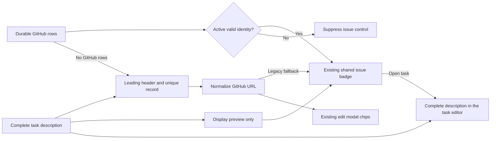

# TC-481: readable cards and accurate GitHub links

This case lets a maintainer verify [issue #481](https://github.com/joelfuller2016/KanbanFlow-v2/issues/481) and [PR #487](https://github.com/joelfuller2016/KanbanFlow-v2/pull/487) within the existing KanbanFlow application. It covers the card preview, outline title and linked task editors. It does not establish human usability approval or close the issue's broader board-density acceptance criteria.

## Architecture and behavior

[KanbanCard](../../../src/KanbanFlow/Components/Shared/KanbanCard.razor) retains the complete task model. Its title wraps to two lines at rest, expands on hover or keyboard focus, and stays expanded on devices without hover. A short display preview comes from [MirroredDescription](../../../src/KanbanFlow/Services/MirroredDescription.cs); storage and the task description editor retain the complete source. The outline also wraps task titles to two lines.

The existing shared issue badge resolves durable GitHub identity first. A quarantined or invalid GitHub row suppresses the editable fallback. When no durable GitHub row exists, the shared reader recognizes only a leading metadata header and one record per line. Duplicate records are rejected. Editable header text is an advisory link, not authenticated repository identity. A normalized `github.com` URL supplies both the destination and its displayed number. Only an exact owner/repository/issues/number route receives an issue label; the modal's PR chip similarly requires a pull-request route. Query strings and fragments, including parentheses and terminal punctuation, survive. The modal updates its PR link from the unsaved description without persisting that draft.

PR #487 does not change importer storage or resolve description ownership. Keep the complete-content import and recovery behavior from PR #511 when integrating these branches. A marker alone must never authorize overwriting human edits.

## Repeatable verification

1. Rebuild the selected source with `scripts/verify.ps1`, then run `npm run test:scripts`. Expect the hard build and test gates to pass. Preserve the failure log and investigate before retrying; the repository's format check is advisory at this source.
2. Publish the application into an ignored directory inside the owning worktree. Launch a local process with a new `KANBANFLOW_DB_PATH` in that directory and an unused port. Confirm the startup log names that database. This protects the normal board and avoids validating older build output. Stop only the process created for this run.
3. Open that address with a named Playwright CLI session. Run [card-reveal.browser.js](../../../scripts/card-reveal.browser.js) using `run-code --filename=<absolute script path>`. The script refuses the normal port 5123 and creates a labeled fixture project. Expect an explicit result with `completeDetails`, `exactLinkNavigation` and `realDragPersisted` equal to true. A CLI exit code of zero alone is insufficient: inspect `### Error` and the returned result.
4. Run the same script in Chromium, Firefox and WebKit. It creates its own no-hover context, checks the real keyboard/link gesture, measures the two-line title, and drives a real SortableJS drag. Keep the full result and browser logs in the ignored run directory. If prerender replacement detaches an element, reacquire it; do not weaken the expected behavior.
5. Review the long-title stress case with a human before declaring its density useful. The current hover rule exposes the whole title and can make a very long card taller than the viewport. Record any feedback and proposed bounded change on the same work item. Automated geometry checks do not establish that this tradeoff is desirable.

## Requirement and evidence map

| Requirement | Executable evidence |
|---|---|
| Href, issue/PR number and query/fragment agree after URL normalization | `GitHubChips_LabelTheNormalizedDestination_AndPreserveTheQueryAndFragment` |
| Partial-number and non-issue routes cannot impersonate issue chips | `GitHubChips_DoNotLabelOtherResourcesAsIssues` |
| A second marker inside a record value is ignored | `GitHubChips_DoNotSearchPastTheStartOfARecordValue` |
| Host pinning, duplicate records and label-value forgery protections remain | Existing `GitHubChips_AreOnlyEverRenderedForGitHubItself`, `SyncRecord_FailsClosedOnADuplicateRecord`, `EditItemModal_RefusesAPrLinkForgedInsideAGitHubLabel` |
| Resting title, hover/focus preview, WebKit keyboard link, no-hover state and drag suppression | `scripts/card-reveal.browser.js` |
| Complete 12,096-character description remains accessible in the same task | Browser detail-tail assertion, exact API readback and outline-editor check |
| The intended task moves to the intended column | Browser real mouse drag plus API status assertion |
| Human usability feedback and issue #481 density targets | Pending human review; no automated approval claim |

## Review findings on September 8, 2026

Reviewed head: `000337845b32c168c7ae70cd5b81c666ca8fba8d`. Five new URL regression cases failed against that compiled source: the modal selected a prefix such as `issues/12` from `issues/12suffix`, lost normalized destinations/query/fragment context, and accepted a repeated marker within a record value. The card also labeled a discussion number as an issue. The shared normalized reader fixes those cases. WebKit browser verification found that the new link was skipped by Tab; an explicit `tabindex="0"` corrects the actual keyboard interaction.

All 22 GitHub review threads were marked resolved when inspected. This is their disposition after source review; it is not a review approval:

| Thread IDs (`PRRT_kwDOSA8y6s6` prefix) | Finding | Disposition |
|---|---|---|
| `dktjK`, `dktjR`, `dk7kL`, `dk7kN`, `fl4z6`, `fw8NL` | Import refresh ownership, persisted locale, transport budget, Markdown fences and documentation | Importer is unchanged by this PR's current diff. Historical limit text must be superseded by #511 complete-content documentation during integration. |
| `dktjV`, `dk7kO`, `dk7kQ` | Link accessibility label and repeated parsing | Current card includes the descriptive new-tab label and caches parsing per description. |
| `dk7kR`, `dk7kd`, `dk7kg`, `dk7kj`, `fl40I`, `fl40K` | Outline line height, focus ring, duplicate/stale CSS, touch title and target size | Current CSS contains the corrected rules; browser assertions exercise their rendered behavior. |
| `dk7kU`, `dk7ka`, `dk7kn`, `fl4z_`, `fxJJb`, `fxJJt` | Parser boundaries, Markdown preservation, source/test documentation | Current tests and source preserve the earlier corrections. Header position is now explicitly described as shape, not authorship. |
| `fl4z8` | Missing repeatable Playwright reveal/link scenarios | Previously marked resolved while coverage was deferred. The committed browser script now provides the requested checks. |

The current PR description still contains obsolete importer promises and old verification counts. It must be rewritten around the final source and current run before publishing the review result. Review/merge gates remain GitHub's responsibility; a successful bot status is not approval.
