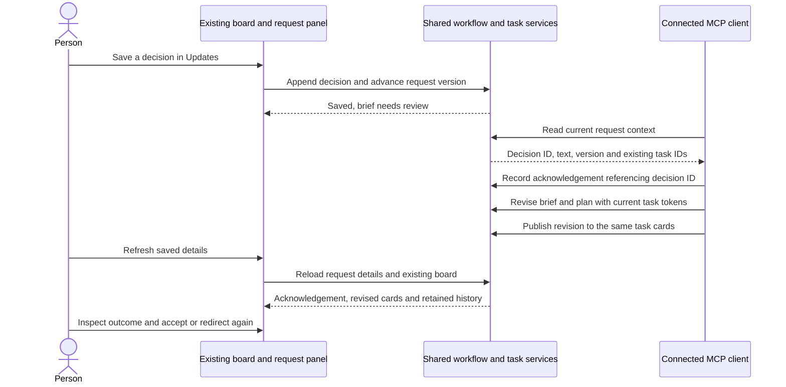

# TC-509: a human decision redirects work on the existing board

For the project owner, reviewers and connected AI clients. Owner: repository maintainer. Reviewed September 7, 2026 on Windows, PowerShell 7, .NET 10 and Playwright CLI. [Issue #509](https://github.com/joelfuller2016/KanbanFlow-v2/issues/509) owns the plan; [PR #511](https://github.com/joelfuller2016/KanbanFlow-v2/pull/511) owns this implementation. Measured results belong in this case's `runs/` directory.

The human should be able to locate the original request, understand the current work and evidence, make a decision, and see the connected client acknowledge and apply it to the same tasks. This case tests that loop without introducing another board or changing its layout. Actual human usability approval is a separate result.

## Processes and data

Use the existing ASP.NET Core app, SQLite database, native `/mcp` endpoint and optional Node stdio wrapper. For automated checks, publish the app into an ignored repository directory and use a disposable SQLite file on a separate loopback port. The [operating guide](../../request-workflow.md#verification-and-local-operation) explains startup and recovery. Automated fixtures must not write to the normal database.



Every client arrow is an explicit MCP call. The current PR does not launch Codex, automatically read decisions, interrupt running work, or provide authenticated reviewer identities. Caller attribution and a saved message do not prove agent delivery. The future runner must implement those controls on these same records.

## Automated acceptance checks

| ID | Observable check |
|---|---|
| A1 | A browser decision retains exact text, author and request identity in MCP context; the version advances and `needsBriefReview` becomes true. |
| A2 | An unpublished pre-decision plan cannot publish with either its old version or a refreshed version. A revised brief also prevents publishing the old brief's plan. |
| A3 | A connected MCP client acknowledges the decision ID, revises the brief and publishes a revised plan using the same draft/task IDs and original read tokens. |
| A4 | Refresh saved details shows the acknowledgement and reloads actual board cards; changed checks persist and prior evidence becomes historical. |
| A5 | Refresh and debounced filter URL updates preserve the selected request and unsaved brief. The revised card opens by keyboard and contains its request link. |
| A6 | The original and prior history remain intact. At 390px the request/decision view has no horizontal page overflow. |
| A7 | Native and stdio MCP discover matching schemas and share records; full solution and script checks pass at the recorded source revision. |
| A8 | Direct task entry and same-project task links open the right panel, including A → B, A → no task → A and canonical task-only links. Unknown and foreign-project task IDs do not open another project's card. |
| A9 | Closing a directly linked task removes its backdrop. Refreshing, filtering and clearing filters keep it closed while preserving task/request URL context. |
| A10 | A fresh task panel opens at half the desktop viewport width. Top-right Half page, Full page and Close icons remain beside the title; Full page fills the viewport. |
| A11 | Size changes retain task identity and unsent comment/type without writing task/workflow data. A comment saved from full page is visible through MCP on the same task. |
| A12 | Enter/Space operate size controls, Close/Escape return focus to the card, reopening starts at half page, and the board remains usable. At 390px both modes fit the available width with no overlap or horizontal overflow. |
| A13 | Selecting a board card, feature, task or nested subtask reveals one highlighted outline row, expanding its parents. Show in outline closes the card and focuses that same row, including a selected subtask and a full-page card. |
| A14 | Back/Forward highlight and reveal without opening an editor; empty/boundary states disable controls. Reselecting the current item or Show in outline does not add a visit. A new item after Back discards the forward branch. |
| A15 | The outline header stays fixed while its item area scrolls, without moving the board/page. Keyboard history controls and 390px reveal/focus remain usable. |
| A16 | Removed items are skipped, a removed current item loses its highlight, and another project cannot inherit old selection/history. Navigation leaves workflow versions, task tokens and ordinary task data unchanged. Real outline drag still preserves task membership/status and anchors around subtask siblings. |

Executables: [outline-navigation.browser.js](../../../scripts/outline-navigation.browser.js), [task-detail-display.browser.js](../../../scripts/task-detail-display.browser.js), [workflow-human-steering.browser.js](../../../scripts/workflow-human-steering.browser.js), [workflow-navigation.browser.js](../../../scripts/workflow-navigation.browser.js) and [smoke-workflow.mjs](../../../scripts/smoke-workflow.mjs). The latter creates a labeled single-task fixture. The browser cases refuse normal port 5123 and require the fixture's title and original-message provenance before writing.

1. **Rebuild the current PR.** From the repository root, run the quality gate and script suite. Record the source revision and actual exits. Rebuild after source changes; do not reuse stale test binaries.
2. **Start a disposable instance.** Use a fresh ignored database and published output, for example on port 5126. Confirm the database path in startup logs. On failure, retain the log and fix that instance; do not replace the normal board.
3. **Create the transport fixture.** Run `node scripts/smoke-workflow.mjs http://127.0.0.1:5126`. Expect `passed: true` and printed request/board/task IDs. This checks real native and stdio transports and leaves the fixture for the browser.
4. **Run the browser case.** Open the printed URL using a named Playwright CLI session. Run from an ignored working directory, so screenshots and CLI logs remain local. Expect exit 0; an assertion failure is a failed case even when earlier checks passed.

   ```powershell
   playwright-cli -s=human-511 open <the-board-URL-printed-in-step-3>
   playwright-cli -s=human-511 run-code --filename=C:/Users/Homepc/Projects/KanbanFlow-v2/scripts/task-detail-display.browser.js
   playwright-cli -s=human-511 run-code --filename=C:/Users/Homepc/Projects/KanbanFlow-v2/scripts/workflow-human-steering.browser.js
   playwright-cli -s=human-511 run-code --filename=C:/Users/Homepc/Projects/KanbanFlow-v2/scripts/workflow-navigation.browser.js
   ```

   Replace the marked URL and adjust the absolute script paths to your checkout. Start with a fresh transport fixture when repeating the cases: navigation adds a second ordinary task and link messages. The scripts save `steering-before.png`, `steering-acknowledged.png`, `steering-task-detail.png`, `steering-mobile.png` and `navigation-request-preserved.png` in their working directory. Inspect them after transitions settle; scroll within the request panel to see the acknowledgement on mobile. A CLI `### Error` is a failure even if the wrapper exits successfully. These are behavior-check evidence, not a pixel-diff or accessibility certification.
   For A13–A16, create another **fresh** transport fixture using step 3, open its printed board URL, then run `playwright-cli -s=human-511 run-code --filename=C:/Users/Homepc/Projects/KanbanFlow-v2/scripts/outline-navigation.browser.js`. This case creates a long nested hierarchy, checks real drag and removes only its two ordinary test tasks. It requires an untouched one-feature fixture and saves `outline-desktop.png` and `outline-mobile.png`. Never run it against the normal board.
5. **Record and clean up.** Add a run record with commit, environment, results, failures, limitations and human status. Close only the named browser and disposable app process you started; retain the normal app and its data.

The display case writes one labeled fixture comment and saves `card-half-page.png`, `card-full-page.png` and `card-mobile.png`. It disables screenshot animations so the active icon's color is settled. The half/full/close controls resize the same mounted card; existing editing behavior remains in place.

## Human walkthrough and decision contract

Use a labeled practice request for changes that should not affect real work. For real work, use its existing project/request and communicate with the connected agent in the same session.

1. **Orient yourself.** Open the project board and **Requests & plans**. Identify the request, read **Original**, inspect **Brief**, then compare **Plan & tasks** with the actual cards. You should be able to explain the outcome and current status without reading implementation files.
2. **Find what needs a decision.** Read **Updates** and **Results**. Find the latest progress, question or report, its checked source revision, observed checks and limitations. A Review card means review is needed; it does not mean you accepted the result.
3. **Redirect the work.** In **Updates**, select **decision**, enter a concrete change to scope, priority, acceptance or constraints, and choose **Add update**. Expect it in history and a brief-review notice. If absent, refresh and check the selected request before retrying.
4. **Verify acknowledgement.** Ask the connected agent to read the request. It should cite the decision ID or exact text, explain its response, and record that acknowledgement in Updates. Until then, the decision is saved but not acknowledged. Stopping a process currently requires the connected session's stop controls; a board message does not stop it.
5. **Inspect the revision.** After the agent updates the brief and plan, choose **Refresh saved details**. Check the revised scope on the same cards and acceptance checks. If it misses your intent, add another decision; do not accept merely because tests passed.

The future managed runner must give decision delivery, acknowledgement, pause/stop, application and continuation durable, visible records. These are later requirements, not implied capabilities.

## UI review checklist

Record a person's feedback for each UI area introduced by PR #511. Keep a row pending until someone actually tries it. A major change remains a bounded proposal or preview until its interactions are verified and user-tested.

| Area | Change from the existing UI | Actual human check |
|---|---|---|
| Ideas | Request & plan link and adoption of older notes | Pending: locate the original and distinguish a legacy snapshot. |
| Project | Collapsible request section above the existing board | Pending: select requests, locate status and collapse it for the board. |
| Original and Brief | Exact input and separately revisioned brief | Pending: distinguish ask from interpretation and preserve a draft. |
| Plan and repositories | Drafts, repository/files and explicit publication | Pending: distinguish draft from published work and inspect the same cards. |
| Updates | Attributed questions, decisions, progress and responses | Pending: distinguish saved, acknowledged and applied decisions. |
| Results | Reported checks, acceptance and historical conclusions | Pending: determine what is verified, what remains and whether to accept. |
| Task detail | Originating request, repository/result context and requested top-right half/full/close icons | Pending: open with the keyboard, resize with a draft, close and return to the board, and follow the request link. |
| Outline | One current highlight, scoped reveal, hidden history and fixed Back/Forward header | Pending: select distant/nested items, return with Show in outline, use both arrows, branch history and try a narrow screen. |
| Existing board | Existing filters, ordering, drag/drop and controls | Pending: verify familiar interactions remain usable. |

The September 7 corrections keep the existing layout and controls. **Refresh saved details** also reloads cards through the existing callback. Same-project task links open their requested panel; directly linked panels open after prerender so Bootstrap does not create an extra backdrop. Filter and Clear preserve the task/request URL context. Review by changing a task through MCP, refreshing, following its link, closing the panel, and filtering while retaining the selected request and an unsaved brief.

The subsequent user-requested card display change is bounded to the existing task panel: Half page is the desktop default, Full page expands that same panel, and Close returns to the board. Below 992px the panel uses the available width in either mode. Try the three icons with an unsent comment and record actual feedback in Updates; passing A10–A12 does not substitute for this human check.

The outline follow-up retains the existing feature/task/subtask editors. The added history arrows only highlight and reveal an item; Show in outline closes the card and focuses its current outline row. Test this on U-12 and record a person's feedback in Updates. Passing A13–A16 does not complete U-10.
