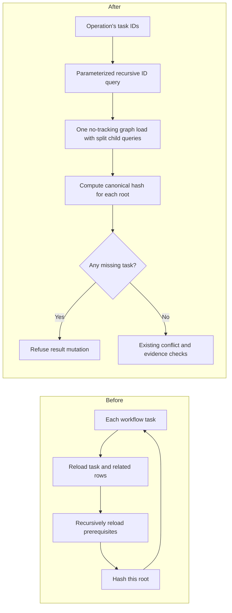

# TC-509: dependency reads and result integrity

This run records the September 8 review repairs in PR #511 for maintainers and people checking the existing board. It continues the [repeatable workflow case](../README.md) and [review cycle](../../../plans/pr-review-cycle-2026-09-08.md). Actual human usability approval remains pending.

Date: September 8, 2026, America/New_York; execution continued into September 9 UTC. Checked source: `3a07aa855551797263abac73fc91331097dbecf2`. It contains the operation-local graph repair `8cce41deeb7c9b266af83ed64faeb51be9d4dd52`, the missing-dependency refusal `367b2d1d6b0d58656c30cbf829af98ff505f95b3`, and master `8073b3e5bccd227e503f0ecd888ccad8199e97d2` with merged verification fix #516. Environment: Windows, PowerShell 7.6.5, .NET SDK 10.0.401, Node 24.20.0, repository xUnit and named Playwright CLI session `cycle511`.

## Problem and resulting behavior

Context reads and plan saves previously reloaded the same tasks, criteria, subtasks and prerequisite graphs for each root. A 12-task dependency chain made 648 context reads, 337 plan-save reads and 75 one-task publication reads. Each operation now loads its reachable graph once and computes each root's existing canonical hash from that operation's data. No cache survives the operation, and published evidence hashes retain their original property names, ordering and root-specific exclusions.

An independent counterexample also exposed an older integrity hole: the sentinel `missing-task` could itself be stored as result evidence and compared successfully during acceptance. Reporting, accepting and concluding now refuse an incomplete dependency graph. Old sentinel evidence appears historical rather than current. A refused operation leaves task status, criteria, evidence and request version unchanged.

The recursive SQL projects only IDs and uses `UNION`, so shared descendants and a legacy cycle terminate. A parameter carries the root-ID JSON; caller text is not interpolated into SQL. Missing targets remain observable. Plan writes retain their existing transaction boundaries. The full-content importer was also reconciled with master's strict dry-run argument handling: active flags still require values, and the removed comment-clipping option fails explicitly.

## Checks actually performed

| Check | Result |
|---|---|
| `pwsh -NoProfile -File scripts/verify.ps1` at the checked source | Exit 0; 1,311 .NET tests passed, 0 failed, 0 skipped; warnings-as-errors build had 0 warnings and 0 errors. Existing format drift remains advisory. |
| `npm run test:scripts` at the checked source | Exit 0; 244 passed, 0 failed, 0 skipped. This includes complete-content importer and strict argument cases plus the merged seven-case verification-script regression. |
| Focused Workspace cases during the repair | 112 passed after the missing-dependency repair. Both new public result-flow cases first failed against the old behavior. |
| Real SQLite command counter | Context/save/publish reads: 17/18/30 for one task, 17/18/31 for 12 tasks and 17/18/31 for 100 tasks. The old 12-task source measured 648/337/75 and failed the bound. |
| Persisted hash compatibility | All three pinned hashes captured from the pre-refactor source match exactly. Fresh reads observe persisted changes, ignore unrelated graph changes and unsaved tracked edits, and terminate a legacy cycle. |
| `dotnet publish src/KanbanFlow/KanbanFlow.csproj -c Release -o _sandbox/runtime-review-511/publish` | Exit 0; published the checked source for the disposable process on port 5137. |
| `node scripts/smoke-workflow.mjs http://127.0.0.1:5137` | Exit 0; 35 native and 54 wrapper tools, matching workflow schemas, shared card identity, stale-write rejection, audit paging/cascade retention and exact complete-content round trips. Description: 138,080 characters; comment: 126,040 characters. REST, native and stdio reads and saved audit values matched. |
| Existing `scripts/smoke-api.ps1` | Exit 0; complete API smoke passed against its own fresh database. The optional LLM attempt timeout was scoped to 1,000 ms for this disposable run; no live provider coverage is claimed. |
| `workflow-human-steering.browser.js` | Passed: browser decision visible through MCP, old plan refused, explicit acknowledgement visible, revised plan published to the same card, keyboard access and narrow viewport. |
| `task-detail-display.browser.js` | Passed: full/half geometry, top-right controls, draft preservation, saving from full view visible to MCP, keyboard/focus return, close/Escape and mobile fit. |
| `outline-navigation.browser.js` | Passed: selection/reveal for feature, task and nested subtask; history boundaries, branching, deletion and project reset; frozen header; real drag; no navigation data mutation. A fresh-fixture invocation with an outer result wrapper returned explicit `passed:true` after the whole existing script completed. |
| `change-logging.browser.js` | Completed without an assertion/tool error: real task, criterion, subtask, project and feature saves were checked through visible History and native MCP. |
| `workflow-navigation.browser.js` | Passed: initial deep link, same-project task links, query transitions, dismissed-panel behavior, draft/request preservation through filters, and unknown/foreign task rejection. |
| `full-content.browser.js` | Passed actual SignalR editor input, REST/native readback, full audit values, reopen and visible tail; description 128,098 characters, comment 69,062 characters, exact whitespace. |

The focused SQLite regressions are in `WorkspaceService.QueryTests.cs`: bounded reads through public context/save/publish paths; pinned legacy hashes; persisted-state and operation-lifetime checks; cycle/dangling-target handling; and two report/accept cases proving that missing-target evidence cannot advance state. The legacy-evidence case seeds the formerly accepted sentinel solely to prove refusal and historical rendering.

## Failed checks and recovery

1. The first query-bound experiment exposed a test helper using `Length` on an `IReadOnlyList`; correcting it to `Count` allowed the actual old-source query measurement. That compile error is not counted as a reproduced application defect.
2. The old 12-task query implementation exceeded the chosen independent database-read ceilings. After batching, the 12- and 100-task measurements agree and all canonical hashes remain unchanged.
3. Both missing-dependency result-flow cases initially succeeded when they should have refused. Explicit graph validation fixed them. The state hash is still captured after dependent-evidence invalidation, preserving the original operation order.
4. An attempted repeat of the outline script started from the navigation test's final URL and correctly refused it; retrying the previously used project then correctly refused its nonfresh fixture. A new transport-smoke project passed the complete script. Neither setup refusal was treated as an application failure or hidden by weakening its guards.
5. Playwright CLI can return process exit 0 with a tool-level error, so each command log was checked for `### Error` and its result. The outline and logging scripts use `console.log` instead of a return; the fresh outline wrapper additionally proved full completion with an explicit returned result.

The source-to-test pairing utility was unavailable in the earlier testing-skill attempt because `tree-sitter-language-pack` was missing. No static pairing/coverage percentage is claimed. The real database, transport and browser results above are separate evidence.

## Artifacts and limits

Complete transient files belong to the workflow worktree's ignored `_sandbox/`: `verify-after-gate-merge.log`, `scripts-after-gate-merge.log`, and `runtime-review-511/` with source, publish/app logs, process identity, scratch database, transport JSON, browser logs and screenshots. The normal app at port 5123 and the user's original dirty documentation were preserved. Process cleanup is recorded by the cycle after the last verification command.

This run verifies the source above. It does not substitute for testing the later combination with the health, durable-link, card, nullable-clear, draft-preservation or atomic-projection branches. In particular, rerun the nullable-clear matrix after #511 adds project/feature auditing and preserve both full-content importer behavior and durable identity handling during integration. Human checks in TC-509 remain pending; no new UI adoption is inferred from automated tests.
