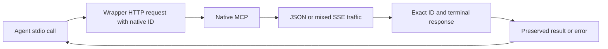

# PR-584: workflow and transport regression contract

This case is for maintainers reviewing or rerunning the regression expansion in
[PR #584](https://github.com/joelfuller2016/KanbanFlow-v2/pull/584). There is no separate GitHub
issue for this work. Request `9327981b-5625-4912-90ee-efdae8ad9928` in project 2 owns actual task
state and results. The [implementation plan](../../plans/2026-11-01-pr-review-and-regression-expansion.md)
owns scope and requirements R1–R7; root [JOURNAL.md](../../../JOURNAL.md) owns work history.
The initial source baseline was `789c6b4743f42663365cc04d1bb1e5429788a9d4`. This stable file
defines the reusable contract; the [run records](#runs) identify exactly what source was executed.

## Behavior and data flow

The stdio wrapper sends native `tools/call` requests to the ASP.NET Core `/mcp` endpoint. An HTTP
response can contain JSON or SSE traffic. SSE requests and notifications can precede the response.
The wrapper must identify the exact terminal response before returning a result or error to its caller.

The production change in [mcp-server.mjs](../../../scripts/mcp-server.mjs) validates JSON-RPC 2.0,
exact ID type/value, absence of a request method, mutually exclusive result/error, and a valid error
object. Unmatched frames are never a fallback result. Valid error code `0`, empty messages, falsey
data and absent optional data keep their meaning. Failed responses do not trigger an implicit HTTP
retry; a caller can retry explicitly with the same business key.

This follows the [JSON-RPC response/error contract](https://www.jsonrpc.org/specification) and the
[pinned MCP Streamable HTTP transport](https://modelcontextprotocol.io/specification/2025-06-18/basic/transports),
which permits request/notification traffic before the matching response. It introduces no
authentication, network access policy, domain field limit or workflow schema change.

Workflow service behavior is unchanged. New real-SQLite assertions protect complete report copies,
existing public field limits, atomic rejection and a coherent graph/edit-token snapshot during an
independent writer. The browser harness recognizes real creation audit activity rather than
suppressing it to satisfy an obsolete fixture assumption.

The updated [T4 decision](../../plans/2026-11-01-pr-review-and-regression-expansion.md#t4-correct-source-proven-browser-fixture-assumptions)
requires Settings to expose actual component readiness on its existing diagnostic-button container
with `data-interactive`, and to disable its four diagnostic buttons during prerender. The shared
browser scenario must wait for that signal, dispatch exactly one Run all click, and retain the
bounded completion wait plus complete-row, failed-row, green-summary and nonempty-result assertions.
A committed regression must force the pending-click/failed-first boundary through that same
scenario, and actual disabled controls must be checked while Blazor negotiation is held. An open
WebSocket or Blazor-global presence does not prove component readiness. This is a minor functional
readiness guard that preserves the visual layout. Verification of the new source remains pending;
the [same-source 485 counterexample](runs/2026-11-01-485d1c40f760.md#settings-pending-click-counterexample)
supersedes the earlier steady-state controls as proof of this boundary.

## Requirement-to-test matrix

| Contract | Exact test name or family | Distinguishing assertion |
|---|---|---|
| Complete report reaches both human surfaces | `RecordEvidence_MirrorsCompleteAuthoredReportIntoMessageAndTaskComment` | Entire independently constructed Markdown/Unicode report equals both request message and task comment; author/source/identity, Review and unaccepted evidence also checked |
| Existing report-field boundaries | `RecordEvidence_FieldLengthBoundary_PreservesOrRejectsAtomically` | Nine cases: Summary/Checks 20,000 and CodeReference 2,000, each at limit−1/limit/limit+1; exact accepted evidence and both complete mirrored reports, plus unchanged rejected version/rows/audit/receipt |
| Existing conclusion-field boundaries | `Conclude_FieldLengthBoundary_PreservesOrRejectsAtomically` | Six cases: Conclusion 50,000 and Limitations 10,000, before/at/after; exact accepted content and atomic rejection |
| Graph and token share one read snapshot | `ContextAsync_ConcurrentTaskEdit_DoesNotPairOldFieldsWithNewEditToken` | Actual independent SQLite writer at the graph/snapshot boundary; coherent old fields/token, then committed new description/different fresh token; no sleeps |
| Mixed SSE selects the real response | `wrapper selects the matching terminal SSE response after unrelated traffic` | Heartbeat/progress, foreign result and same-ID server request precede exact full Markdown/Unicode result |
| Invalid or unmatched envelopes cannot become receipts | `wrapper rejects native responses without a matching terminal ID (...)` | Sixteen partitions in both JSON/SSE; no successful result, explicit recovery, exactly one HTTP call per client call and unchanged business key |
| Correlated errors remain complete | `wrapper preserves correlated native errors in JSON (...)` and `wrapper preserves correlated native errors after unrelated SSE traffic (...)` | Exact code/message/nested data, code zero/empty message, and absence of optional data |
| New empty project has truthful recency | `A new empty project shows creation recency without work placeholders` | No progress/next-task/claim placeholder; displayed time equals actual API creation activity |
| Settings waits for component readiness and runs diagnostics exactly once | Shared `Settings 'Run all' reports an all-passed result` scenario plus `Settings Run all preserves a failed first suite across delayed rendering` | Four diagnostic buttons disabled during prerender; wait for component `data-interactive`; one dispatched click and one accepted run; a failed first result must remain a failure even if another run could pass; retain bounded completion, complete-row, failed-row, green-summary and nonempty-result assertions. New-source verification pending |

Sources: [workflow result tests](../../../tests/KanbanFlow.Tests/Services/WorkspaceService.ResultsTests.cs),
[query tests](../../../tests/KanbanFlow.Tests/Services/WorkspaceService.QueryTests.cs),
[workflow result service](../../../src/KanbanFlow/Services/Workflows/WorkspaceService.Results.cs),
[context service](../../../src/KanbanFlow/Services/Workflows/WorkspaceService.Context.cs),
[Settings component](../../../src/KanbanFlow/Components/Pages/Settings.razor),
[real wrapper tests](../../../scripts/workflow-tools.test.mjs), and
[existing browser suite](../../../scripts/ui-e2e.mjs).

## Rerun and recovery

1. **Use this repository checkout and pinned packages.** Record HEAD, clean/dirty state and runtime.
   Run `npm ci` for script/browser dependencies if absent. Expected: local project dependencies
   install successfully. Keep package versions; resolve an actual missing prerequisite before
   changing the toolchain. On Windows, set process-local `TEMP` and `TMP` to a short ignored
   directory such as `<checkout>/_sandbox/t`; put detailed logs in a separate evidence directory.
   Nested clone fixtures can exceed Windows path limits under a long evidence/temp prefix; retain
   stderr and compare the same operation with a short prefix before changing source or deadlines.
   The [485 run](runs/2026-11-01-485d1c40f760.md#windows-temp-path-failure-and-recovery) records the
   observed discriminator and recovery.
2. **Run the focused production-wrapper suite:** `node --test scripts/workflow-tools.test.mjs`.
   Expected: 53 passing cases. A failure reports the exact envelope partition; inspect that case
   and its forwarded request rather than adding retries or weakening ID checks. This single-file
   command omits optional concurrency/reporter flags that are unavailable in early releases within
   the declared [`node >=18` range](../../../package.json). Node documents
   [`--test-concurrency`](https://nodejs.org/api/cli.html#--test-concurrency) from 18.19.0/20.10.0/21.0.0
   and [`--test-reporter`](https://nodejs.org/api/cli.html#--test-reporter) from 18.15.0/19.6.0.
   These command-level facts do not establish a full supported-runtime test matrix.
3. **Run the canonical gate:** `./scripts/verify.ps1` from PowerShell 7. Expected: restore/build/tests
   exit 0 with no compiler warnings/errors. Existing formatter drift remains advisory. A
   `--no-build` unit run is evidence only after rebuilding that exact source.
4. **Run all script units with the recorded workload bound:**
   `node --test --test-concurrency=1 'scripts/*.test.mjs'`. The recorded run used Node v24.20.0;
   this exact command needs a runtime with that concurrency flag. It does not raise the package
   engine requirement. Expected: a complete clean summary, including real local Git/HTTP child
   fixtures. The suite can also perform an optional live GitHub issue/label read through authenticated
   `gh`; that case reports a skip reason when the read is unavailable. Record whether it ran or
   skipped rather than describe the whole gate as purely offline. Keep HEAD and relevant source
   frozen through the run; save actual exit/counts.
5. **Run the broad browser suite on a free alternate port:** set process-local `UI_E2E_PORT=5202`,
   then `npm run test:ui`. Expected: all currently declared scenarios pass and the owned app stops
   afterward. Include the shared single-click regression and the actual disabled-prerender check;
   preserve the failed-first result at the forced pending-click boundary.
   Its fresh temporary database must not be the normal board. If a port is occupied, choose a
   different free port; do not stop another process.
6. **Check real native/stdio compatibility** with the existing
   [fresh-manifest procedure](../../request-workflow.md#verification-and-local-operation),
   [workflow-smoke-instance.mjs](../../../scripts/workflow-smoke-instance.mjs) and
   [smoke-workflow.mjs](../../../scripts/smoke-workflow.mjs). Expected: a passed single-use manifest
   whose read-only health proof matches its exact disposable database. Never reuse a completed
   manifest or target port 5123. Stop only the fixture processes owned by this run and retain
   their evidence under ignored storage.

After the PR merges, fetch the actual merged primary, freshly build/run the unit suite and collect
the already-installed coverlet output where supported. Report its measured scope, not an inferred
coverage percentage. Static pairing, test counts and successful controlled mutations each provide
different evidence; none alone proves every branch is covered. The separate UI
human-usability/adoption gate remains pending. A successful run is not merge or human approval.

## Runs

- [2026-11-01: unmodified UI baseline and dirty-source focused controls, base `789c6b4743f4`](runs/2026-11-01-789c6b4743f4.md).
- [2026-11-01: broad failures at `a97b3c20b6e7` and explicitly dirty Settings harness controls](runs/2026-11-01-a97b3c20b6e7.md).
- [2026-11-01: recorded clean `485d1c40f760` gates and the later blocking Settings counterexample](runs/2026-11-01-485d1c40f760.md).
