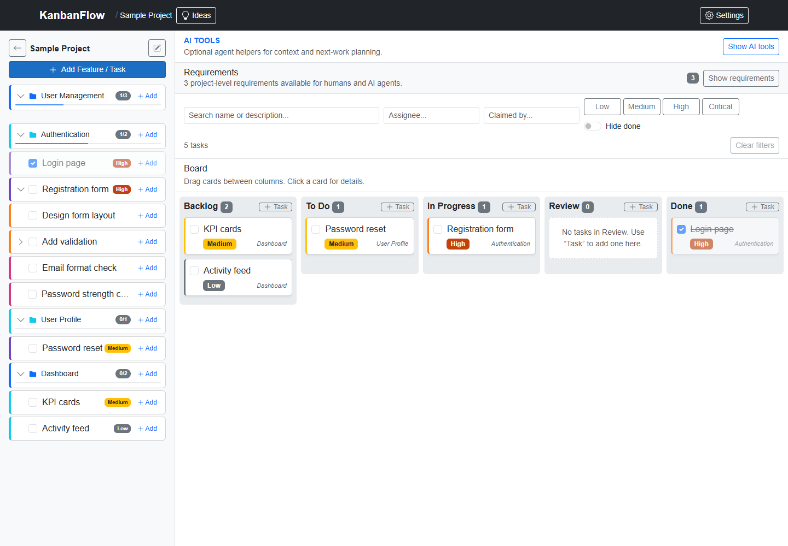
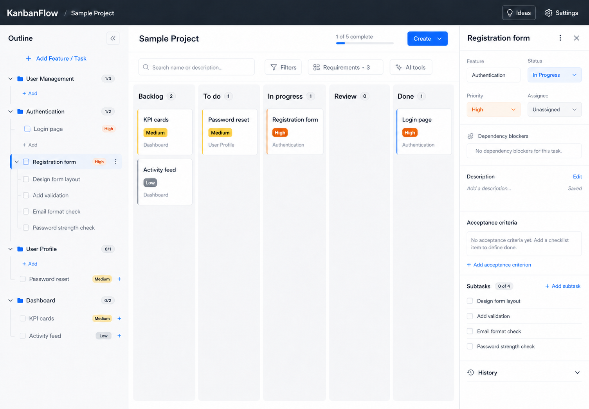
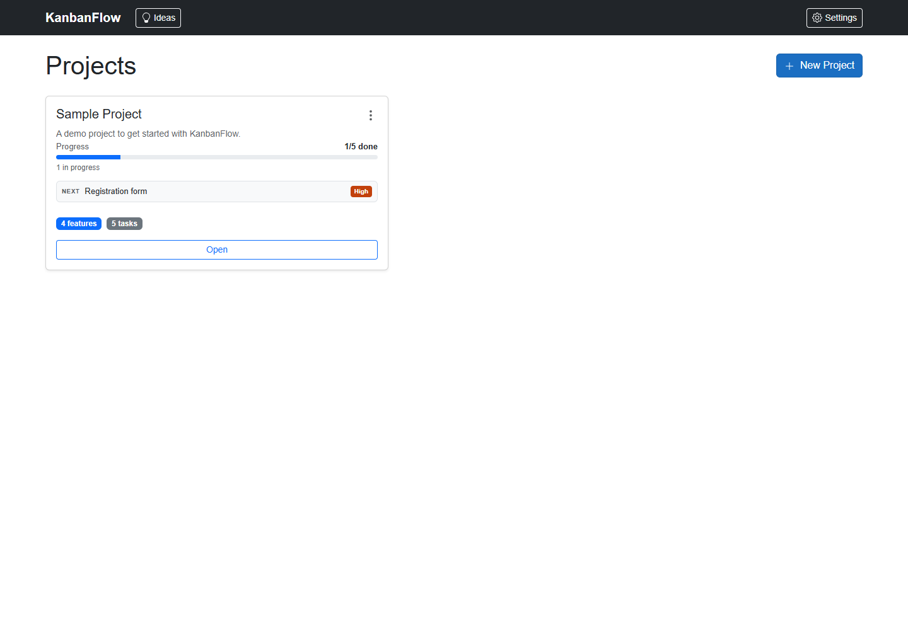
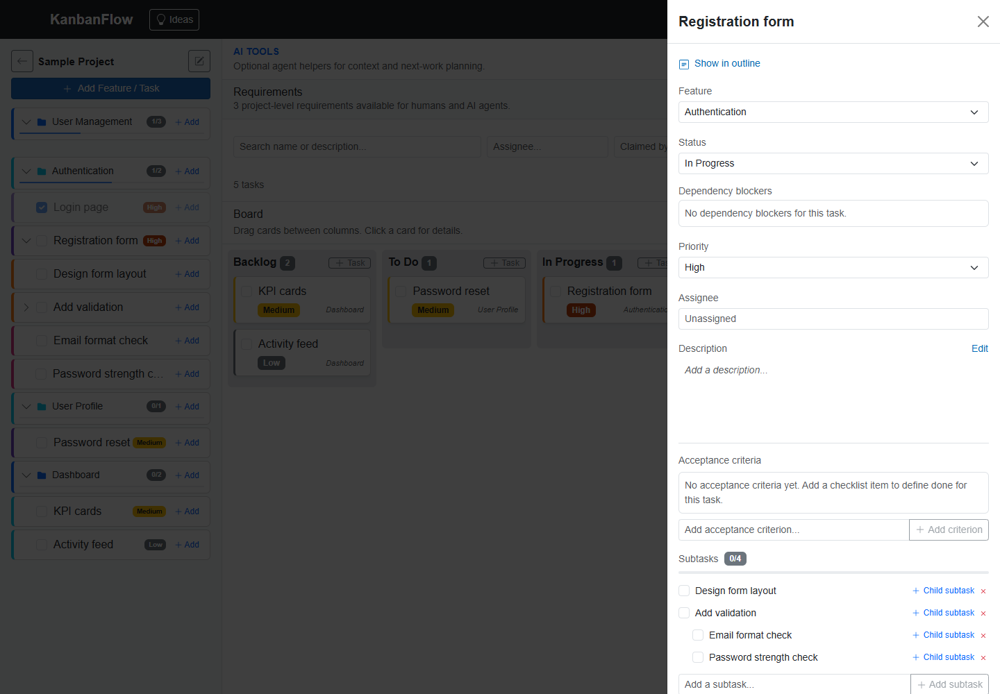

# KanbanFlow UI review

- **Date:** 2026-08-15
- **Status:** Design proposal; no application code has been changed
- **Original reviewed draft:** [issue #322 implementation-plan comment](https://github.com/joelfuller2016/KanbanFlow-v2/issues/322#issuecomment-5304724077)
- **Source:** `fix/414-atomic-dependency-cycle` at `652c60d`, running with the
  Development launch profile; the ad-hoc capture did not preserve a database manifest, so database
  isolation is not claimed
- **Authority:** [IMPLEMENTATION-PLAN.md](IMPLEMENTATION-PLAN.md) is the reviewed delivery
  contract. [PHASE-0-EVIDENCE.md](PHASE-0-EVIDENCE.md) records provenance, decisions, issue
  ownership, and compatibility boundaries for the evidence PR.
  [BROWSER-RUN-EVIDENCE.md](BROWSER-RUN-EVIDENCE.md) records the exact-head runtime smoke,
  environment, diagnostics, and screenshot hashes.

This folder keeps the review screenshots, redesign mock, and implementation
notes together inside the KanbanFlow-v2 repository.

The screenshots document the current UI and proposed direction. They are not geometry,
accessibility, performance, or pixel-diff baselines. Those baselines may be recorded only after the
minimum trustworthy UI harness described as Phase 0A in the implementation plan is merged.

**Current portfolio ownership (2026-08-16):** [#420](https://github.com/joelfuller2016/KanbanFlow-v2/issues/420)
is the peer portfolio command-center epic. [#421](https://github.com/joelfuller2016/KanbanFlow-v2/issues/421)
owns derived state/activity; [#422](https://github.com/joelfuller2016/KanbanFlow-v2/issues/422)
owns Home lenses, cards, Empty disclosure, and grid behavior;
[#423](https://github.com/joelfuller2016/KanbanFlow-v2/issues/423) owns Home discovery and views;
[#424](https://github.com/joelfuller2016/KanbanFlow-v2/issues/424) owns Ideas totals/paging while
coordinating changes to the shared board components; and
[#425](https://github.com/joelfuller2016/KanbanFlow-v2/issues/425) remains decision-gated portfolio
metadata. #322 owns the shared visual primitives, shell, task-board presentation, and accessibility
foundation; it must not duplicate those portfolio behaviors.

## Original review evidence

| View | File |
| --- | --- |
| Projects landing page | [`current-projects.png`](current-projects.png) |
| Project board | [`current-board.png`](current-board.png) |
| Board with task detail open | [`current-task-detail.png`](current-task-detail.png) |
| Conceptual proposed desktop composition | [`proposed-board-redesign.png`](proposed-board-redesign.png) |

These original images retain their pre-PR provenance. The three current-state captures came from
`652c60d` with UI files byte-identical to the planning base; their browser/runtime metadata was not
retained. The conceptual mock's authoring method, tool, prompt, and source-reference record were also
not retained, so none is inferred.

### Original current board

### Conceptual proposed direction—not implemented

The mock preserves the application's existing entities, workflow states, task
names, requirements, AI tools, outline, and task-detail fields. It intentionally
does not add dates, avatars, analytics, estimates, or new backend behavior.

## Exact-head browser smoke

The following screenshots were captured from PR #416 commit
`77aa135f435f62933c26d3fb099a580091baf3d4` in Microsoft Edge `151.0.4129.86`
at a `1440 × 1000` viewport against a fresh database in a GUID-named temporary run directory. See
[BROWSER-RUN-EVIDENCE.md](BROWSER-RUN-EVIDENCE.md) for the routes, fixture IDs, runtime and asset
checks, diagnostics, hashes, and limitations.

### Projects

### Board

### Task detail

This is manual browser-smoke and human-review evidence, not a deterministic geometry, pixel, Axe,
performance, or accessibility baseline. Phase 0A remains required. Because #416 changes no
application code, these screenshots show the current UI; the proposed composition above is not an
“after” screenshot.

## Primary findings

1. **The work surface starts too low.** AI tools, requirements, filters, counts,
   and guidance consume a large part of the viewport before the first board card.
2. **The outline is visually noisy.** Boxes, progress rails, colored edges,
   badges, and repeated `+ Add` actions compete with the hierarchy.
3. **Task editing is ambiguous.** The drawer mixes editable controls, static
   callouts, inline editing, and empty space without a clear persistence state.
4. **Cards underuse their space.** Titles and priority are visible, but feature,
   readiness, blocker, claim, and subtask information do not have a consistent
   hierarchy.
5. **Secondary controls have primary visual weight.** Filters, AI tools, and
   requirements visually compete with the board rather than supporting it.
6. **Completed-item fading can reduce contrast.** Completion should be expressed
   with a checkmark, quiet surface, and title treatment instead of lowering the
   opacity of every child control and label.
7. **The Projects page needs portfolio-level treatment.** The review capture appears to leave
   excessive empty space, but completed issue #281 already supplies the summary facts. Feed current
   layout evidence to #422; do not create a separate #322 grid implementation.

## Recommended direction

### Application shell

- Keep the compact dark global header and stabilize its navigation across pages.
- Put the project breadcrumb and view identity in one place instead of repeating
  the project name in multiple headers.
- Add a real `main` landmark, a page-level heading, and a skip link.

### Outline

- Use a 280–300 px collapsible sidebar with borderless rows.
- Communicate feature, task, and subtask levels through indentation, connector
  rails, typography, and icons rather than multiple unrelated colors.
- Keep one clear selected-row treatment.
- Move add-child and destructive actions into contextual overflow controls that
  remain reachable by keyboard and touch.

### Board toolbar

- Keep search visible.
- Place assignee, claim, priority, and hide-done options in one Filters control.
- Render active filters as removable chips.
- Replace the tall Requirements and AI sections with compact utility actions:
  `Requirements · 3` and `AI tools`.
- Show the task count beside the Board heading rather than in a separate row.

### Board and cards

- Let the board work surface fill the remaining viewport beneath sticky headers.
  Keep each lane's card stack content-height so the redesign does not restore
  the large gray one-card void removed by PR #335.
- Preserve a practical minimum lane width and use horizontal scrolling instead
  of compressing cards.
- Make titles the dominant card element; show feature as readable secondary text.
- Reserve color for semantic status, priority, selection, and warnings.
- Add only conditional readiness metadata already supported by the application,
  such as blockers, claim state, or subtask progress.
- Offer a keyboard/touch-visible `Move to…` path alongside drag-and-drop.

### Task detail

- On wide screens, use a modeless split pane so the board remains visible and
  interactive instead of being covered by a dark scrim.
- Use a sticky header and a compact metadata grid for Feature, Status, Priority,
  and Assignee.
- Present dependencies as relationship rows, not input-like empty boxes.
- Progressively disclose History and long subtask trees. Keep dependency state and acceptance-
  criteria guidance visible when empty; collapse only optional sections whose empty state carries
  no instruction or relationship meaning.
- Show explicit `Saving…`, `Saved`, and error feedback for inline edits.
- On smaller screens, convert the pane into an accessible modal drawer with
  contained focus, Escape handling, an inert background, and focus restoration.

### Projects page

- Preserve completed #281's progress, next-task, recency, claim, and count facts.
- Record current one/three/twenty-project evidence for #422, which owns Home lenses, card/list
  presentation, Empty disclosure, and any grid change.
- Let #423 own Home search/filter/sort/group and compact/card view state. #322 supplies reusable
  tokens, landmarks, target-size rules, and the shared accessibility harness only.

## Visual system

- Use an 8 px spacing grid with a restrained `4, 8, 12, 16, 24, 32` scale.
- Use one neutral border treatment, subtle shadows, and 8–12 px radii.
- Use slate text, off-white canvas, white surfaces, accessible primary blue, and
  semantic priority colors.
- Keep persistent labels at approximately 12–14 px or larger and avoid italic
  muted text for important metadata.
- Give frequent controls at least a 36 px target and preserve visible keyboard
  focus; target 44 px for primary touch controls.
- Do not reduce completed rows or cards with container-level opacity.

## Delivery sequence

The redesign follows the reviewable sequence defined in the detailed plan:

1. Publish this design evidence and the compatibility/issue-ownership inventory.
2. Make the UI harness trustworthy, deterministic, and Axe-gated.
3. Add design docs, tokens, landmarks, and shell improvements.
4. Compact project utilities and filter presentation without changing behavior.
5. Introduce the semantic outline while preserving drag identities.
6. Improve board lanes/cards and add the non-drag `Move to…` path.
7. Add responsive task detail and explicit save feedback.
8. Hand Home evidence and shared visual primitives to #420/#422/#423; do not open a separate #322
   Projects-grid PR.
9. Add performance/query guards, representative after-screenshots, documentation, and
   compatibility-CSS cleanup.

Functional, keyboard, accessibility, static-asset, and screenshot evidence accompanies the PR
that changes each surface; regression coverage is not deferred to the end.

## Scope guardrails

- Keep the existing workflow states and information architecture.
- Do not add new domain fields solely to make the mock look richer.
- Preserve current REST, MCP, and service behavior while changing presentation.
- Leave derived portfolio state to #421, Home presentation/retrieval to #422/#423, Ideas paging to
  #424, and decision-gated portfolio metadata to #425.
- Treat this mock as a visual target, not pixel-perfect generated production code.

## Detailed plan

See [IMPLEMENTATION-PLAN.md](IMPLEMENTATION-PLAN.md) for the phased
implementation, issue ownership, complete automated test matrix,
screenshot-verification protocol, and disposable-environment UI runbook.
